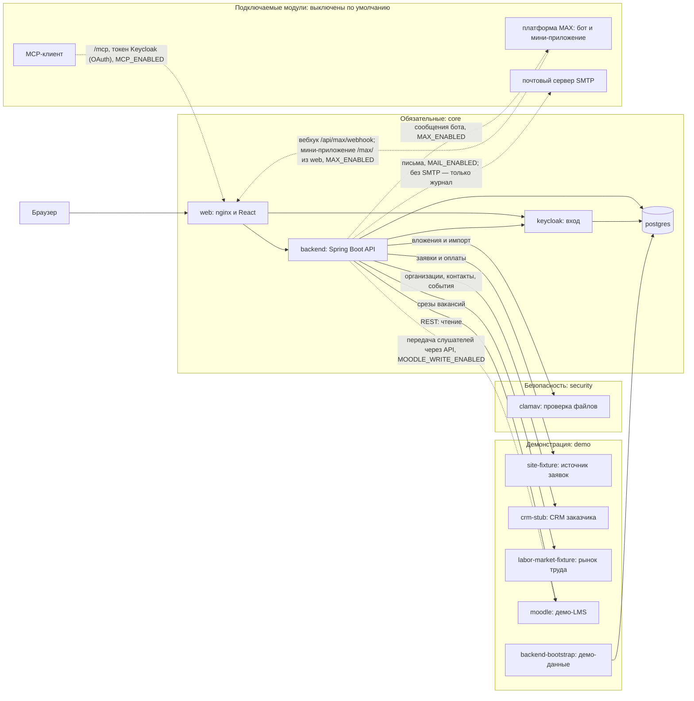

# CRM ИТ Школы РТК

[](../../actions/workflows/ci.yml)
[](../../actions/workflows/nightly.yml)

Система контроля работы менеджеров с вузами и школами по ИТ-программам и ИТ-продуктам. Для каждого вуза видно, кто из менеджеров его ведёт, по какой программе и продукту идёт работа, на каком этапе она находится и какой следующий шаг. За любой период можно построить отчёт по продуктам, вузам и менеджерам.

Стек: Java 21 и Spring Boot 3.5, React 19, PostgreSQL 16, Keycloak 26, ClamAV, nginx. Запуск через Docker Compose.

Версия — 2.5.3.

## Что умеет система

- «Контроль» — первый экран руководителя (у руководства первый экран — «Сводка команд», «Контроль» по всем командам — следующая вкладка): по каждому менеджеру видно, сколько у него вузов и взаимодействий, что просрочено, что без следующего шага, на каком этапе стоит каждое взаимодействие, какие вузы остались без работы. Два режима: «Сейчас» (менеджер вуза текущий) и «За период» (менеджер на конец периода); экран, детализация и выгрузка считают менеджера одинаково, итоги подписаны («по отбору» и «всего»). Плитки-фильтры, отметка «срок истёк» у договора. Переключатель «Вид»: по менеджерам, «Этапы» — матрица «программа × этап» (столбцы — этапы шаблона по порядку, по ячейке открывается список взаимодействий) и «Списком». Отборы те же, что в отчётах: тип организации, продукт, программа, направление, вид взаимодействия, вуз, менеджер, этап и период; выгрузка в XLSX и PDF, в том числе список вузов «Без работы».
- Карточка взаимодействия с вузом: контакты, этапы процесса, комментарии, проблемы и риски, вложения, договоры по продуктам, история изменений.
- «Путь вуза» — вкладка карточки вуза: весь цикл работы с вузом, по строке на каждое взаимодействие, включая завершённые.
- Виды взаимодействия со своими маршрутами: администратор ведёт справочник видов и правила выбора вида по типу организации, программе и продукту; у каждого вида свой шаблон этапов, руководитель может завести для вида шаблон своей команды. Вид подбирается автоматически при создании взаимодействия, отчёты и «Контроль» отбирают и группируют по виду.
- Процесс настраивается шаблонами этапов (базовый шаблон — 13 этапов, четырнадцатый пункт пути, контроль исполнения, сквозной). Каждое сохранение шаблона — новая версия маршрута: есть история, сравнение версий, перевод идущих взаимодействий на выбранную версию с сопоставлением этапов, откат и перенос шаблона файлом. У этапа есть свойства: «Требует действующего договора» (без договора этап не пройти), обязательные документы (система напоминает, что их нет) и роль этапа для LMS (связь с данными обучения не зависит от названия этапа). Шаблон с циклом без выхода к финалу сервер не сохранит. У этапа можно задать норматив в днях: отметка «долго на этапе» считается по нормативу этапа, а без него — по общему порогу из «Настроек».
- Договор школы и вуза: статусы согласования с историей, нормы согласования по сторонам и кругам с цветом, версии файла, допсоглашения, предмет и подписанты, связь с этапами взаимодействия (этап «Подписание» требует действующего договора с неистёкшим сроком), предупреждения об истекающих договорах, реестр договоров с выгрузкой и отчёт за период. Вуз видит свой договор в кабинете.
- Отчётность по соглашениям: у мероприятий плана — уровень образования, охват, единица, стоимость, исполнитель и подтверждающий документ; перечень мероприятий на период согласует координатор вуза в кабинете (если координатора нет, ответ вуза отмечает КАМ); сроки отчётного цикла с напоминаниями; «Отчёт по соглашениям» по шаблону выгрузки администратора с оценкой по ставкам. Справочники, ставки, сроки и пороги по умолчанию пусты и задаются администратором.
- Учёт людей и часов: преподавание сотрудниками в вузах, стажировки студентов и преподавателей с часами наставников, повышение квалификации преподавателей по людям с удостоверением и отметкой о передаче в ФРДО (срок передачи — настройка, напоминание в колокольчике), загрузка из XLSX; отчёт «Люди и часы».
- «Моя работа» менеджера: сроки и следующие шаги по группам («Просрочено», «Сегодня», «На этой неделе»), истекающие договоры, проблемы и риски, назначенные менеджеру, возвраты к работе после приостановки (дата возврата обязательна), сигналы LMS, фильтры.
- Отчёты за период: портфель взаимодействий, события, состояние на дату, длительность этапов, «Работа менеджеров за период», востребованность программ, реализация договоров, план подписаний и продлений, договоры за период, «Отчёт по соглашениям», «Люди и часы», динамика обучения. В «Востребованности программ» — место и индекс востребованности с вкладом каждой составляющей (веса задаёт администратор, при недостатке данных место не присваивается) и колонки спроса рынка труда. Отчёты о прошлом периоде берут состав по истории статусов на дату. В «Длительности» — медиана и P90. Сравнение периодов: «Состав активных взаимодействий» за 30 или 90 дней раскладывает изменение на оставшиеся, новые, завершённые, приостановленные и возобновлённые взаимодействия; полнота данных обучения показывает, по скольким идущим потокам данные есть. Выгрузка в XLSX, XLS, PDF, JSON, диаграммы в PNG и PDF.
- Данные из сайта (заявки и оплаты), из Moodle (обучающиеся, завершение курсов) и из рынка труда (месячные срезы вакансий по ИТ-направлениям, учитываются у направлений с отметкой). Доля завершивших показана с основанием («16 из 20 с известным статусом; данные по 20 из 100»), потоки без данных не превращаются в ноль. Сигналы LMS по входам не выдаются по устаревшим данным, а числовые сигналы (обучающиеся, доля завершивших) по ним помечаются «данные устарели».
- Обмен с CRM заказчика: организации и контакты приходят в CRM, события взаимодействия с вузом (этап, следующий шаг, менеджер, статус договора) уходят в CRM заказчика через очередь с повтором.
- Импорт из XLS, XLSX и CSV: каталоги вузов, направлений, программ, продуктов и вендоров, история взаимодействий с датами (в карточке помечена как импортированная), договоры с вузами и мероприятия плана; повторная загрузка не создаёт дублей. Импортированным карточкам ставится шаг по умолчанию, а руководитель задаёт шаг всем карточкам команды без шага одним действием. Для переноса из прежней CRM есть шаблон обмена.
- Передача слушателей в Moodle через API (выключена по умолчанию, отдельный токен записи): менеджер учебного процесса передаёт партию — поиск или создание пользователя, зачисление на курс, группа потока, сверка — и видит результат по каждой строке; файл для LMS остаётся запасным путём. Перенос слушателя между потоками сначала зачисляет его на новый курс и только после сверки снимает с прежнего; сбой на любом шаге виден в очереди и доводится повтором. Курс и группу Moodle можно уточнить у потока, строки из прежнего учёта сверяются с Moodle без изменений в нём. Правило логина в LMS (почта целиком или её часть до «@») задаёт `ENROLMENT_LMS_LOGIN`.
- Администрирование: «Настройки» — сроки хранения, пороги сигналов, срок ответа на обращения и учёт согласий, правка действует без перезапуска и пишется в журнал; «Обращения субъектов» — журнал обращений субъектов ПДн со сроком ответа, исполнителем, напоминанием и выгрузкой CSV; учёт согласий контактов и слушателей (включается настройкой); «Состояние модулей» — включён ли модуль, последняя операция и ошибки; «Версии маршрута» — какая команда на какой версии шаблона; на «Обзоре» — состояние резервных копий и проверки восстановления.
- Подключаемый модуль MCP (выключен по умолчанию): MCP-клиент читает данные и аналитику с правами сотрудника — те же расчёты, что на экранах: 15 инструментов чтения (КАМ — 8, руководителю команды — 15, «Руководству» — 14) и три промпта. Изменения — итог встречи и следующий шаг, переход этапа, проблему или риск, решение проблемы, паузу и возобновление — он только готовит планом (семь инструментов плана), а записывает их сотрудник, подтвердив план на экране CRM.
- Подключаемый модуль MAX (выключен по умолчанию): уведомления менеджеру и руководителю в мессенджере и мини-приложение с «Моей работой», карточкой взаимодействия и «Контролем».
- Подключаемый модуль почты (выключен по умолчанию): приглашения сотрудников и координаторов вузов, уведомления о сроках, договорах и запросах вузу; очередь писем и журнал отправки у администратора.
- Модуль «Слушатели» и раздел «Зачисление» для слушателей открытого набора: анкеты хранятся в зашифрованном виде, партии передаются с построчным результатом. Кабинет вуза: координатор вуза отвечает на запросы школы файлом, КАМ проверяет ответ; координатор скачивает свой файл ответа, получает письмо о приёмке и согласует перечни мероприятий своего вуза; видит только материалы своего вуза.
- Устойчивость: на неверный ввод API отвечает 400, 409 или 413 с кодом из перечня, а не 500; у разбора JSON есть пределы, частота запросов ограничена (429 `RATE_LIMITED`); фаззер прогоняет операции API неверными данными.

Модули «Слушатели» и кабинет вуза включены по умолчанию; по отдельности они выключаются переменными `MODULE_ENROLMENT_ENABLED=false` и `MODULE_PARTNER_ENABLED=false` в `.env.local`. Модули MCP, MAX, почта и передача в Moodle выключены по умолчанию и включаются переменными `MCP_ENABLED=true`, `MAX_ENABLED=true`, `MAIL_ENABLED=true` и `MOODLE_WRITE_ENABLED=true` (см. [описание запуска](docs/public/Запуск.md)). Включён ли модуль, его последнюю операцию и ошибки за 7 дней администратор видит в разделе «Состояние модулей».

## Состав системы



Пунктир — подключаемые модули, по умолчанию выключенные: адрес `/mcp` у backend, вебхук и мини-приложение MAX, почта и передача слушателей в Moodle. Включаются флагами в `.env.local`.

| Сервис | Профиль Compose | Назначение |
|---|---|---|
| `web` | `core` | единый адрес: интерфейс, `/api`, Swagger UI, вход Keycloak |
| `backend` | `core` | API, правила доступа, отчёты, синхронизация источников |
| `postgres` | `core` | база CRM и отдельная база Keycloak |
| `keycloak` | `core` | учётные записи и вход (OIDC) |
| `clamav` | `security` | антивирусная проверка вложений и загружаемых файлов |
| `site-fixture` | `demo` | демонстрационный источник заявок и оплат |
| `crm-stub` | `demo` | демонстрационная CRM заказчика: отдаёт организации и контакты, принимает события |
| `labor-market-fixture` | `demo` | демонстрационный источник спроса рынка труда: месячные срезы вакансий по ИТ-направлениям |
| `moodle` | `demo` (отдельный проект Compose) | демонстрационная LMS |
| `backend-bootstrap` | `demo` | одноразовое заполнение демо-данных |

Профиль `core` не имеет метки: его сервисы запускаются всегда. Без профиля `demo` система пустая и ждёт реальные источники: демонстрационные `site-fixture`, `crm-stub`, `labor-market-fixture`, демо-Moodle и демо-данные поднимаются только с ним. Без профиля `security` проверка файлов недоступна: вложения остаются в карантине, импорт файлов отклоняется. Подробности — в [описании запуска](docs/public/Запуск.md#что-запускается).

## Запуск

Нужны Docker Engine с Compose v2 не ниже 2.24 и `bash` 4+ (`openssl` нужен для резервных копий; запуск обходится без него — секреты создаются из `/dev/urandom`); 4 ГБ памяти (для нагрузочных прогонов от 6 ГБ).

```bash
git clone https://github.com/avrv1987/rtk-crm.git
cd rtk-crm
./scripts/bootstrap-demo.sh
```

В Windows без bash — `pwsh -NoProfile -File ./scripts/bootstrap-demo.ps1` (PowerShell 7+).

Скрипт создаёт `.env.local` со случайными паролями, собирает образы, поднимает все сервисы и заполняет демо-данные: команды, менеджеров, 26 организаций, карточки, договоры, источники. Первый запуск занимает от 5 до 15 минут: сборка, сигнатуры ClamAV, установка демо-Moodle. После запуска приложение открывается по адресу `http://rtk.localhost:8081`.

Другие варианты:

```bash
DEMO_LMS=false ./scripts/bootstrap-demo.sh    # без демо-Moodle
DEMO_DATA=false ./scripts/bootstrap-demo.sh   # пустая система с одним администратором
./scripts/reset-demo-data.sh                  # вернуть демо-данные к исходным
docker compose --env-file .env.local --profile '*' down    # остановить
```

Адреса, вход, публикация на сервере с TLS и резервные копии — в [описании запуска](docs/public/Запуск.md).

## Роли

Роль сотрудника задаётся в Keycloak: у учётной записи есть роль realm `crm-user`, `crm-leader`, `crm-admin`, `crm-management` или `crm-partner`. CRM читает её из подписанного ID-токена при входе. Команда сотрудника и флаг «Менеджер учебного процесса» хранятся в профиле CRM; профиль создаёт первый вход, а активирует администратор. Права проверяются на сервере в каждом запросе, чужие вузы недоступны.

| Роль | Роль в Keycloak | Что видит и делает |
|---|---|---|
| КАМ (`USER`) | `crm-user` | свои вузы: ведёт карточки, этапы, вложения, договоры |
| Руководитель (`LEADER`) | `crm-leader` | все вузы своей команды, «Контроль», назначает и передаёт вузы, ведёт шаблоны маршрута и переводит взаимодействия на новую версию, задаёт шаг карточкам команды без шага |
| Руководство (`MANAGEMENT`) | `crm-management` | все команды, «Контроль» с разбивкой по командам, «Сводка команд» с топ-5 программ по востребованности, только чтение |
| Администратор (`ADMIN`) | `crm-admin` | профили, команды, справочники, источники данных, настройки, обращения субъектов ПДн, состояние модулей и резервных копий, справочники и ставки отчётности по соглашениям; бизнес-данных не видит |
| Менеджер учебного процесса | `crm-user` или `crm-leader` и флаг в профиле | раздел «Зачисление» |
| Координатор вуза (`PARTNER`) | `crm-partner` | кабинет вуза: запросы школы с ответом файлом и квитанцией, согласование перечня мероприятий, материалы только своего вуза |

Работа по ролям — в [инструкциях пользователей](docs/public/Инструкции_пользователей.md).

## Требования ТЗ

| Требование ТЗ | Где реализовано | Где проверено |
|---|---|---|
| Вход через Keycloak, роли и область данных (ФТ10, ФТ11) | пакеты backend `security`, `access` | `ApiSecurityHttpTest`, `AccessManagementHttpTest`, `AdminCrmProfileServiceTest`; `scripts/release-smoke.mjs` |
| Каталоги и импорт вузов, программ, продуктов, вендоров (ТЗ §4 п. 1) | `catalog`, `catalogimport` | `CatalogImportServiceTest`, `CatalogImportWorkbookReaderTest`; `scripts/wave4-smoke.mjs` |
| Журнал взаимодействия, версии и конфликты (ФТ1, ФТ2) | `interaction` | `InteractionServiceTest`, `WorkListsHttpTest` |
| Контроль работы менеджеров (цель заказчика) | `work`, отчёт `MANAGER_WORK` | `ManagerWorkControlTest`, `WorkControlHttpTest`; `scripts/wave4-smoke.mjs` |
| Настройка процесса и версии маршрута (ФТ6, ФТ9) | `interaction`, шаблоны этапов | `WorkflowTemplateServiceTest`, `WorkflowRolloutTest`, `WorkflowTemplateVersionsHttpTest`, `InteractionServiceTemplateLockTest`; `scripts/release-smoke.mjs` |
| Договор школы и вуза | `agreement` | `AgreementServiceTest`, `AgreementHttpTest`, `AgreementLifecycleMigrationTest`; `scripts/fr05-smoke.mjs` |
| Вложения 10 форматов с антивирусной проверкой (ФТ3) | `attachment`, `infra/clamav` | `AttachmentContentValidatorTest`, `ClamAvAttachmentScannerTest`; `scripts/attachment-smoke.mjs` |
| Отчёты, статистика, диаграммы (ФТ1, ФТ4) | `report` | `ReportServiceTest`, `ReportWritersTest`, `ReportJobServiceTest`; `scripts/report-persistence-smoke.mjs` |
| Интеграции с сайтом и Moodle (ФТ5) | `source`, передача в Moodle — `enrolment` | `SourceSyncServiceTest`, `SourceSettingsServiceTest`, `EnrolmentServicesTest`; `scripts/wave2-smoke.mjs` |
| Виды взаимодействия, свойства этапа, «Путь вуза» и матрица «программа × этап» | `interaction`, `work` | `InteractionKindServiceTest`, `InteractionKindsHttpTest`, `StagePropertiesServiceTest`, `OrganizationPathServiceTest`, `AnalyticsFixesTest` |
| Ранжирование программ по востребованности (ТЗ §2) | `report`, индекс востребованности | `DemandIndexTest`, `DemandIndexParityTest`, `DemandIndexSettingsHttpTest` |
| Перенос данных: история взаимодействий и договоры | `catalogimport` | `MigrationImportTest` |
| Отчётность по соглашениям | `agreement` | `AgreementReportingHttpTest` |
| Учёт людей и часов | `people` | `PeopleServiceTest` |
| Настройки администратора, обращения субъектов ПДн, согласия, состояние модулей, версии маршрута | `settings`, `privacy`, `module`, `interaction` | `AdminSettingsHttpTest` |
| Резервная копия и проверка восстановления | `scripts/backup.sh`, `scripts/restore-check.sh`, карточка «Обзора» | `BackupStatusApiControllerTest`, `scripts/backup-test.sh` |
| Устойчивость API к неверному вводу | `ApiExceptionHandler`, `ApiRateLimitFilter` | `ApiFuzzHttpTest` |
| Рынок труда и CRM заказчика на демонстрационных источниках | `source` | `SourceSyncServiceTest`, `LaborMarketSettingsServiceTest`, `LaborMarketHttpTest`, `SourceCodeMigrationTest` |
| Подключаемые модули MCP, MAX и почта, выключены по умолчанию | пакеты backend `mcp`, `max`, `mail` | `McpHttpTest`, `AgentPlanServiceTest`, `McpDisabledHttpTest`, `MaxChannelHttpTest`, `MaxInitDataTest`, `MaxAppHttpTest`, `MaxModuleOffHttpTest`, `MailModuleOffHttpTest`; MAX проверен технически (бот, вебхук, мини-приложение отдаётся), пользовательская цепочка ждёт привязки учётной записи MAX; с реальным MCP-клиентом модуль не проверялся |
| Кэш действий пользователя (ФТ13) | `frontend/src/features/interactions/drafts.ts` | `frontend/tests/draftBase.test.ts` |
| Отклик до 1 с, 50 пользователей, 10 отчётов (НФТ1, НФТ6, НФТ7) | `scripts/load` | нагрузочный сценарий в `scripts/load` (`load-test.mjs`, `run-server-night.sh`); замер на целевом сервере 20.10.2026 (версия 2.5.3): 50 пользователей, 180 с, 0 ответов 5xx, ни одного ответа дольше 1 с, p95 перехода, комментария и предпросмотра 35, 33 и 67 мс, серия из 12 отчётов — готово 12 из 12; итог по порогам НФТ — успех |
| Swagger UI (§6 п. 2) | `backend/src/main/resources/static/openapi.yaml` | `OpenApiContractTest`; `scripts/release-smoke.mjs` |
| Docker, Linux, воспроизводимая сборка (§6 п. 4, 9) | `compose*.yaml`, `backend/Dockerfile`, `frontend/Dockerfile` | `scripts/release-gate.sh`; CI |
| Информационная безопасность, 152-ФЗ (§6 п. 10) | проверка прав на сервере, шифрование анкет, журнал, сроки хранения | тесты backend в пакетах `access`, `security`, `privacy`, `enrolment` |
| Документация и модель Archi (§6 п. 6–7) | [архитектура](docs/public/Архитектура.md), [модель Archi](docs/public/archi/README.md), [инструкции пользователей](docs/public/Инструкции_пользователей.md) | ссылки на документы проверяются перед публикацией |

## Интеграции: что настоящее, что демонстрационное

| Система | Что настоящее | Что демонстрационное | Как переключить на систему заказчика |
|---|---|---|---|
| Keycloak | вход OIDC, realm `rtk-crm` из `infra/keycloak`, роли сотрудников `crm-*` в ID-токене | демо-пользователи | `APP_OIDC_ISSUER_URI`, `APP_OIDC_PUBLIC_BASE_URL`, `APP_OIDC_INTERNAL_BASE_URL`, `APP_OIDC_CLIENT_SECRET`; в Keycloak заказчика нужен клиент `crm-bff` |
| Moodle | адаптер стандартного REST Moodle: чтение и передача слушателей через API (подключаемо: `MOODLE_WRITE_ENABLED`, отдельный токен записи, у роли сервиса — права на создание пользователя, зачисление и снятие с курса, группы и `moodle/site:viewuseridentity`), проверен на настоящем Moodle 4.5 | демо-Moodle с синтетическими курсами и обучающимися (`infra/moodle`, профиль `demo`) | `MOODLE_BASE_URL`, `MOODLE_TOKEN`, `MOODLE_COURSE_IDS` или экран «Источники данных»; подключение — в [описании запуска](docs/public/Запуск.md#подключение-настоящих-систем) |
| Сайт: заявки и оплаты | адаптер по предложенному контракту | `site-fixture`: 17 синтетических заявок и 6 оплат | `SITE_BASE_URL`, `SITE_TOKEN` или экран «Источники данных» |
| Рынок труда: спрос на ИТ-направления | адаптер по предложенному контракту: месячные срезы вакансий, сопоставление направлений, колонки отчёта | `labor-market-fixture`: 8 направлений за 12 месяцев, синтетика (`infra/labor-market-fixture`, профиль `demo`) | `LABOR_MARKET_BASE_URL`, `LABOR_MARKET_TOKEN` или блок «Рынок труда» на экране «Источники данных» |
| CRM заказчика | адаптер по предложенному контракту: организации и контакты приходят в CRM, события взаимодействия с вузом уходят в CRM заказчика | `crm-stub`: 5 синтетических организаций, 7 контактов, приём событий | `CRM_BASE_URL`, `CRM_TOKEN` или экран «Источники данных» |
| Импорт XLS, XLSX и CSV | разбор файлов каталогов, вендоров, истории взаимодействий, договоров с мероприятиями, повышения квалификации, анкет, оплат | образцы файлов и шаблон переноса из прежней CRM в `frontend/public` | не требуется |
| Антивирус | ClamAV, проверка каждого файла | — | не требуется |
| Почта | модуль почты: отправка по SMTP, очередь и журнал отправки | режим «Без отправки» по умолчанию: письма остаются в журнале и наружу не уходят | `MAIL_ENABLED=true` и SMTP-сервер в разделе «Почта» у администратора |
| MAX | бот и мини-приложение; на сервере проверены технически: бот отвечает, вебхук подписан, мини-приложение `/max/` отдаётся | пользовательская цепочка (привязка, уведомления, вход в мини-приложение) ждёт привязки учётной записи MAX | `MAX_ENABLED=true`, токен бота в карточке «Бот MAX» |
| MCP | адрес `/mcp`, вход MCP-клиента через Keycloak (OAuth, scope `crm-mcp`, запись — только планом со scope `crm-mcp.write`); проверен на стенде вживую: чтение по ролям, отказы, запись через план | реальный MCP-клиент выбирает эксплуатант | `MCP_ENABLED=true` и клиент в Keycloak (см. [описание запуска](docs/public/Запуск.md)) |
| Файл для LMS | формируется из анкет потока в формате шаблона организатора; запасной путь, если передача через API выключена | загрузка файла в LMS выполняется менеджером учебного процесса вручную | формат меняется перечнем заголовков в коде |

Переключение не требует правки кода. Значения задаются в `.env.local` или на экране «Источники данных» (администратор). Если `SITE_BASE_URL` указывает на настоящий адрес, `site-fixture` не запускается (так же `labor-market-fixture` — при настоящем `LABOR_MARKET_BASE_URL`, `crm-stub` — при настоящем `CRM_BASE_URL`); если задан `MOODLE_BASE_URL` другого Moodle, демо-Moodle не поднимается. Для боевой установки служит `DEMO_DATA=false`: bootstrap создаёт только администратора. Какие переменные задать для каждой системы — в [описании запуска](docs/public/Запуск.md#подключение-настоящих-систем).

## Проверки и CI

- `ci.yml`: на каждый push и pull request — тесты backend (JDK 21), сборка и тесты frontend (Node 24), сборка образов `web` и `backend`, проверка файлов Compose.
- `nightly.yml`: каждую ночь и вручную — подъём стенда с демо-данными, сквозные сценарии `release-smoke.mjs` и `wave4-smoke.mjs`, короткий нагрузочный прогон (10 пользователей, 10 отчётов); отчёт сохраняется артефактом. Это проверка того, что сценарий и стенд работают, а не замер требований к отклику.
- Локально: `bash scripts/release-gate.sh` (тесты backend и frontend, `docker compose config`).
- Зависимости frontend проверяются в CI шагом `npm audit --audit-level=high`.
- Два теста backend в CI пропускаются, потому что им нужны внешние системы: `MaxLiveApiTest` (токен настоящего бота MAX) и проверка живого Moodle в `SourceSyncServiceTest`. Вместо них работают тесты на имитации этих систем; вживую бот и передача в Moodle проверены на стенде.
- Поддерживается один экземпляр backend: ограничение частоты запросов, счётчики MCP и очередь отчётов живут в памяти процесса (см. [описание запуска](docs/public/Запуск.md#ограничения-установки)).
- Резервная копия согласованная ценой короткой остановки backend: на время копии API недоступен. Копии хранятся на том же сервере, пока не выбрано хранилище вне сервера; место для дополнительной копии задаётся настройкой и по умолчанию пусто. Скрипты копии и ежемесячной проверки восстановления проверены автотестом на имитации Docker, живой прогон на сервере предстоит (см. [описание запуска](docs/public/Запуск.md#ограничения-установки)).

## Документация

| Документ | Содержание |
|---|---|
| [Архитектура](docs/public/Архитектура.md) | назначение, контекст, компоненты, модули, хранение данных, ключевые потоки, развёртывание |
| [Инструкции пользователей](docs/public/Инструкции_пользователей.md) | работа по ролям: КАМ, руководитель, «Руководство», администратор, менеджер учебного процесса, координатор вуза |
| [Запуск](docs/public/Запуск.md) | требования, запуск стенда, переменные окружения, подключение настоящих систем, резервные копии, обновление |
| [Модель Archi](docs/public/archi/README.md) | функциональная и компонентная архитектура в формате Archi |
| Swagger UI | `/swagger-ui/index.html` на запущенном стенде; контракт — `backend/src/main/resources/static/openapi.yaml` |
