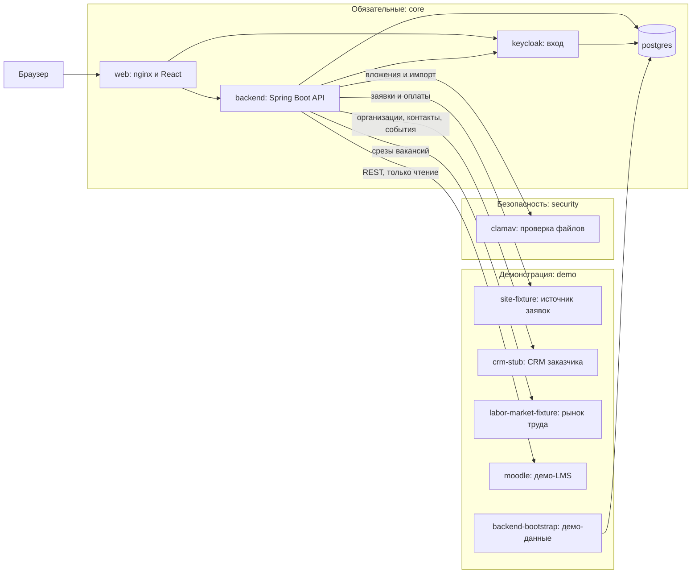

# CRM ИТ Школы РТК

[](../../actions/workflows/ci.yml)
[](../../actions/workflows/nightly.yml)

Система контроля работы менеджеров с вузами и школами по ИТ-программам и ИТ-продуктам. Для каждого вуза видно, кто из менеджеров его ведёт, по какой программе и продукту идёт работа, на каком этапе она находится и какой следующий шаг. За любой период можно построить отчёт по продуктам, вузам и менеджерам.

Стек: Java 21 и Spring Boot 3.5, React 19, PostgreSQL 16, Keycloak 26, ClamAV, nginx. Запуск через Docker Compose.

## Что умеет система

- «Контроль» — первый экран руководителя и руководства: по каждому менеджеру видно, сколько у него вузов и работ, что просрочено, что без следующего шага, на каком этапе стоит каждая работа. Отборы по продукту, программе, направлению, вузу, менеджеру, этапу и периоду, выгрузка в XLSX и PDF.
- Карточка работы с вузом: контакты, этапы процесса, комментарии, проблемы и риски, вложения, договоры по продуктам, история изменений.
- Процесс настраивается шаблонами этапов (базовый шаблон — 13 этапов, четырнадцатый пункт пути, контроль исполнения, сквозной). Каждое сохранение шаблона — новая версия маршрута: есть история, сравнение версий, перевод идущих работ на выбранную версию с сопоставлением этапов, откат и перенос шаблона файлом.
- Договор школы и вуза: статусы согласования с историей, версии файла, допсоглашения, предмет и подписанты, связь с этапами работы (этап «Подписание» требует действующего договора), реестр договоров с выгрузкой и отчёт за период.
- «Моя работа» менеджера: сроки, следующие шаги, фильтры.
- Отчёты за период: портфель взаимодействий, события, состояние на дату, длительность этапов, «Работа менеджеров за период», востребованность программ (с колонками спроса рынка труда), реализация соглашений, договоры за период. Выгрузка в XLSX, XLS, PDF, JSON, диаграммы в PNG и PDF.
- Данные из сайта (заявки и оплаты), из Moodle (обучающиеся, завершение курсов) и из рынка труда (месячные срезы вакансий по ИТ-направлениям, учитываются у направлений с отметкой).
- Обмен с CRM заказчика: организации и контакты приходят в CRM, события работы с вузом (этап, следующий шаг, менеджер, статус договора) уходят в CRM заказчика через очередь с повтором.
- Импорт каталогов вузов, направлений, программ, продуктов и вендоров из XLS и XLSX.
- Модуль «Слушатели» и раздел «Зачисление» для слушателей открытого набора: анкеты хранятся в зашифрованном виде. Кабинет вуза: представитель вуза видит только материалы, которые ему открыли.

Модули «Слушатели» и кабинет вуза включены по умолчанию; по отдельности они выключаются переменными `MODULE_ENROLMENT_ENABLED=false` и `MODULE_PARTNER_ENABLED=false` в `.env.local`.

## Состав системы



| Сервис | Профиль Compose | Назначение |
|---|---|---|
| `web` | `core` | единый адрес: интерфейс, `/api`, Swagger UI, вход Keycloak |
| `backend` | `core` | API, правила доступа, отчёты, синхронизация источников |
| `postgres` | `core` | база CRM и отдельная база Keycloak |
| `keycloak` | `core` | учётные записи и вход (OIDC) |
| `clamav` | `security` | антивирусная проверка вложений и загружаемых файлов |
| `site-fixture` | `demo` | демонстрационный источник заявок и оплат |
| `crm-stub` | `demo` | демонстрационная CRM заказчика: отдаёт организации и контакты, принимает события |
| `labor-market-fixture` | `demo` | демонстрационный источник спроса рынка труда: месячные срезы вакансий по ИТ-направлениям |
| `moodle` | `demo` (отдельный проект Compose) | демонстрационная LMS |
| `backend-bootstrap` | `demo` | одноразовое заполнение демо-данных |

Профиль `core` не имеет метки: его сервисы запускаются всегда. Без профиля `demo` система пустая и ждёт реальные источники: заглушки `site-fixture`, `crm-stub`, `labor-market-fixture`, демо-Moodle и демо-данные поднимаются только с ним. Без профиля `security` проверка файлов недоступна: вложения остаются в карантине, импорт файлов отклоняется.
Профиль `core` не имеет метки: его сервисы запускаются всегда. Без профиля `demo` система пустая и ждёт реальные источники. Без профиля `security` проверка файлов недоступна: вложения остаются в карантине, импорт файлов отклоняется. Подробности — в [описании запуска](docs/public/Запуск.md#что-запускается).

## Запуск

Нужны Docker Engine с Compose v2 не ниже 2.24 и `bash` 4+ (`openssl` не обязателен: без него секреты создаются из `/dev/urandom`); 4 ГБ памяти (для нагрузочных прогонов от 6 ГБ).

```bash
git clone https://github.com/avrv1987/rtk-crm.git
cd rtk-crm
./scripts/bootstrap-demo.sh
```

В Windows без bash — `pwsh -NoProfile -File ./scripts/bootstrap-demo.ps1` (PowerShell 7+).

Скрипт создаёт `.env.local` со случайными паролями, собирает образы, поднимает все сервисы и заполняет демо-данные: команды, менеджеров, 25 вузов, карточки, договоры, источники. Первый запуск занимает от 5 до 15 минут: сборка, сигнатуры ClamAV, установка демо-Moodle. После запуска приложение открывается по адресу `http://rtk.localhost:8081`.

Другие варианты:

```bash
DEMO_LMS=false ./scripts/bootstrap-demo.sh    # без демо-Moodle
DEMO_DATA=false ./scripts/bootstrap-demo.sh   # пустая система с одним администратором
./scripts/reset-demo-data.sh                  # вернуть демо-данные к исходным
docker compose --env-file .env.local --profile '*' down    # остановить
```


Адреса, вход, публикация на сервере с TLS и резервные копии — в [описании запуска](docs/public/Запуск.md).
## Роли

Роль сотрудника задаётся в Keycloak: у учётной записи есть роль realm `crm-user`, `crm-leader`, `crm-admin`, `crm-management` или `crm-partner`. CRM читает её из подписанного ID-токена при входе. Команда сотрудника и флаг «Оператор зачисления» хранятся в профиле CRM; профиль создаёт первый вход, а активирует администратор. Права проверяются на сервере в каждом запросе, чужие вузы недоступны.

| Роль | Роль в Keycloak | Что видит и делает |
|---|---|---|
| КАМ (`USER`) | `crm-user` | свои вузы: ведёт карточки, этапы, вложения, договоры |
| Руководитель (`LEADER`) | `crm-leader` | все вузы своей команды, «Контроль», назначает и передаёт вузы, ведёт шаблоны маршрута и переводит работы на новую версию |
| Руководство (`MANAGEMENT`) | `crm-management` | все команды, «Контроль» с разбивкой по командам, только чтение |
| Администратор (`ADMIN`) | `crm-admin` | профили, команды, справочники, источники данных; бизнес-данных не видит |
| Оператор зачисления | `crm-user` или `crm-leader` и флаг в профиле | раздел «Зачисление» |
| Представитель вуза (`PARTNER`) | `crm-partner` | кабинет вуза: только материалы своего вуза |

Работа по ролям — в [инструкциях пользователей](docs/public/Инструкции_пользователей.md).

## Требования ТЗ

| Требование ТЗ | Где реализовано | Где проверено |
|---|---|---|
| Вход через Keycloak, роли и область данных (ФТ10, ФТ11) | пакеты backend `security`, `access` | `ApiSecurityHttpTest`, `AccessManagementHttpTest`, `AdminCrmProfileServiceTest`; `scripts/release-smoke.mjs` |
| Каталоги и импорт вузов, программ, продуктов, вендоров (ТЗ §4 п. 1) | `catalog`, `catalogimport` | `CatalogImportServiceTest`, `CatalogImportWorkbookReaderTest`; `scripts/wave4-smoke.mjs` |
| Журнал взаимодействия, версии и конфликты (ФТ1, ФТ2) | `interaction` | `InteractionServiceTest`, `WorkListsHttpTest` |
| Контроль работы менеджеров (цель заказчика) | `work`, отчёт `MANAGER_WORK` | `ManagerWorkControlTest`, `WorkControlHttpTest`; `scripts/wave4-smoke.mjs` |
| Настройка процесса и версии маршрута (ФТ6, ФТ9) | `interaction`, шаблоны этапов | `WorkflowTemplateServiceTest`, `WorkflowRolloutTest`, `WorkflowTemplateVersionsHttpTest`, `InteractionServiceTemplateLockTest`; `scripts/release-smoke.mjs` |
| Договор школы и вуза | `agreement` | `AgreementServiceTest`, `AgreementHttpTest`, `AgreementLifecycleMigrationTest`; `scripts/fr05-smoke.mjs` |
| Вложения 10 форматов с антивирусной проверкой (ФТ3) | `attachment`, `infra/clamav` | `AttachmentContentValidatorTest`, `ClamAvAttachmentScannerTest`; `scripts/attachment-smoke.mjs` |
| Отчёты, статистика, диаграммы (ФТ1, ФТ4) | `report` | `ReportServiceTest`, `ReportWritersTest`, `ReportJobServiceTest`; `scripts/report-persistence-smoke.mjs` |
| Интеграции с сайтом и Moodle (ФТ5) | `source` | `SourceSyncServiceTest`, `SourceSettingsServiceTest`; `scripts/wave2-smoke.mjs` |
| Рынок труда и CRM заказчика на заглушках | `source` | `SourceSyncServiceTest`, `LaborMarketSettingsServiceTest`, `LaborMarketHttpTest`, `SourceCodeMigrationTest` |
| Кэш действий пользователя (ФТ13) | `frontend/src/features/interactions/drafts.ts` | `frontend/tests/draftBase.test.ts` |
| Отклик до 1 с, 50 пользователей, 10 отчётов (НФТ1, НФТ6, НФТ7) | `scripts/load` | нагрузочный сценарий в `scripts/load`; последний замер сделан на ранней версии 0.3, замер на версии 2.0 назначен отдельно |
| Swagger UI (§6 п. 2) | `backend/src/main/resources/static/openapi.yaml` | `OpenApiContractTest`; `scripts/release-smoke.mjs` |
| Docker, Linux, воспроизводимая сборка (§6 п. 4, 9) | `compose*.yaml`, `backend/Dockerfile`, `frontend/Dockerfile` | `scripts/release-gate.sh`; CI |
| Информационная безопасность, 152-ФЗ (§6 п. 10) | проверка прав на сервере, шифрование анкет, журнал, сроки хранения | тесты backend в пакетах `access`, `security`, `privacy`, `enrolment` |
| Документация и модель Archi (§6 п. 6–7) | [архитектура](docs/public/Архитектура.md), [модель Archi](docs/public/archi/README.md), [инструкции пользователей](docs/public/Инструкции_пользователей.md) | ссылки на документы проверяются перед публикацией |

## Интеграции: что настоящее, что демонстрационное

| Система | Что настоящее | Что демонстрационное | Как переключить на систему заказчика |
|---|---|---|---|
| Keycloak | вход OIDC, realm `rtk-crm` из `infra/keycloak`, роли сотрудников `crm-*` в ID-токене | демо-пользователи | `APP_OIDC_ISSUER_URI`, `APP_OIDC_PUBLIC_BASE_URL`, `APP_OIDC_INTERNAL_BASE_URL`, `APP_OIDC_CLIENT_SECRET`; в Keycloak заказчика нужен клиент `crm-bff` |
| Moodle | адаптер: стандартный REST Moodle только на чтение, проверен на настоящем Moodle 4.5 | демо-Moodle с синтетическими курсами и обучающимися (`infra/moodle`, профиль `demo`) | `MOODLE_BASE_URL`, `MOODLE_TOKEN`, `MOODLE_COURSE_IDS` или экран «Источники данных» |
| Сайт: заявки и оплаты | адаптер по предложенному контракту | `site-fixture`: 17 синтетических заявок и 6 оплат | `SITE_BASE_URL`, `SITE_TOKEN` или экран «Источники данных» |
| Рынок труда: спрос на ИТ-направления | адаптер по предложенному контракту: месячные срезы вакансий, сопоставление направлений, колонки отчёта | `labor-market-fixture`: 8 направлений за 12 месяцев, синтетика (`infra/labor-market-fixture`, профиль `demo`) | `LABOR_MARKET_BASE_URL`, `LABOR_MARKET_TOKEN` или блок «Рынок труда» на экране «Источники данных» |
| CRM заказчика | адаптер по предложенному контракту: организации и контакты приходят в CRM, события работы с вузом уходят в CRM заказчика | `crm-stub`: 5 синтетических организаций, 7 контактов, приём событий | `CRM_BASE_URL`, `CRM_TOKEN` или экран «Источники данных» |
| Импорт XLS и XLSX | разбор файлов каталогов, вендоров, анкет, оплат | образцы файлов в `frontend/public` | не требуется |
| Антивирус | ClamAV, проверка каждого файла | — | не требуется |
| Файл для LMS | формируется из анкет потока в формате шаблона организатора | загрузка в LMS выполняется оператором вручную | формат меняется перечнем заголовков в коде |

Переключение не требует правки кода. Значения задаются в `.env.local` или на экране «Источники данных» (администратор). Если `SITE_BASE_URL` указывает на настоящий адрес, `site-fixture` не запускается (так же `labor-market-fixture` — при настоящем `LABOR_MARKET_BASE_URL`, `crm-stub` — при настоящем `CRM_BASE_URL`); если задан `MOODLE_BASE_URL` другого Moodle, демо-Moodle не поднимается. Для боевой установки служит `DEMO_DATA=false`: bootstrap создаёт только администратора.
| Moodle | адаптер: стандартный REST Moodle только на чтение, проверен на настоящем Moodle 4.5 | демо-Moodle с синтетическими курсами и обучающимися (`infra/moodle`, профиль `demo`) | `MOODLE_BASE_URL`, `MOODLE_TOKEN`, `MOODLE_COURSE_IDS` или экран «Источники данных»; подключение — в [описании запуска](docs/public/Запуск.md#подключение-настоящих-систем) |
Переключение не требует правки кода. Значения задаются в `.env.local` или на экране «Источники данных» (администратор). Если `SITE_BASE_URL` указывает на настоящий адрес, `site-fixture` не запускается (так же `labor-market-fixture` — при настоящем `LABOR_MARKET_BASE_URL`, `crm-stub` — при настоящем `CRM_BASE_URL`); если задан `MOODLE_BASE_URL` другого Moodle, демо-Moodle не поднимается. Для боевой установки служит `DEMO_DATA=false`: bootstrap создаёт только администратора. Какие переменные задать для каждой системы — в [описании запуска](docs/public/Запуск.md#подключение-настоящих-систем).

## Проверки и CI

- `ci.yml`: на каждый push и pull request — тесты backend (JDK 21), сборка и тесты frontend (Node 24), сборка образов `web` и `backend`, проверка файлов Compose.
- `nightly.yml`: каждую ночь и вручную — подъём стенда с демо-данными, сквозные сценарии `release-smoke.mjs` и `wave4-smoke.mjs`, короткий нагрузочный прогон (10 пользователей, 10 отчётов); отчёт сохраняется артефактом. Это проверка того, что сценарий и стенд работают, а не замер требований к отклику.
- Локально: `bash scripts/release-gate.sh` (тесты backend и frontend, `docker compose config`).

## Документация

| Документ | Содержание |
|---|---|
| [Архитектура](docs/public/Архитектура.md) | назначение, контекст, компоненты, модули, хранение данных, ключевые потоки, развёртывание |
| [Инструкции пользователей](docs/public/Инструкции_пользователей.md) | работа по ролям: КАМ, руководитель, «Руководство», администратор, оператор зачисления, представитель вуза |
| [Запуск](docs/public/Запуск.md) | требования, запуск стенда, переменные окружения, подключение настоящих систем, резервные копии, обновление |
| [Модель Archi](docs/public/archi/README.md) | функциональная и компонентная архитектура в формате Archi |
| Swagger UI | `/swagger-ui/index.html` на запущенном стенде; контракт — `backend/src/main/resources/static/openapi.yaml` |
