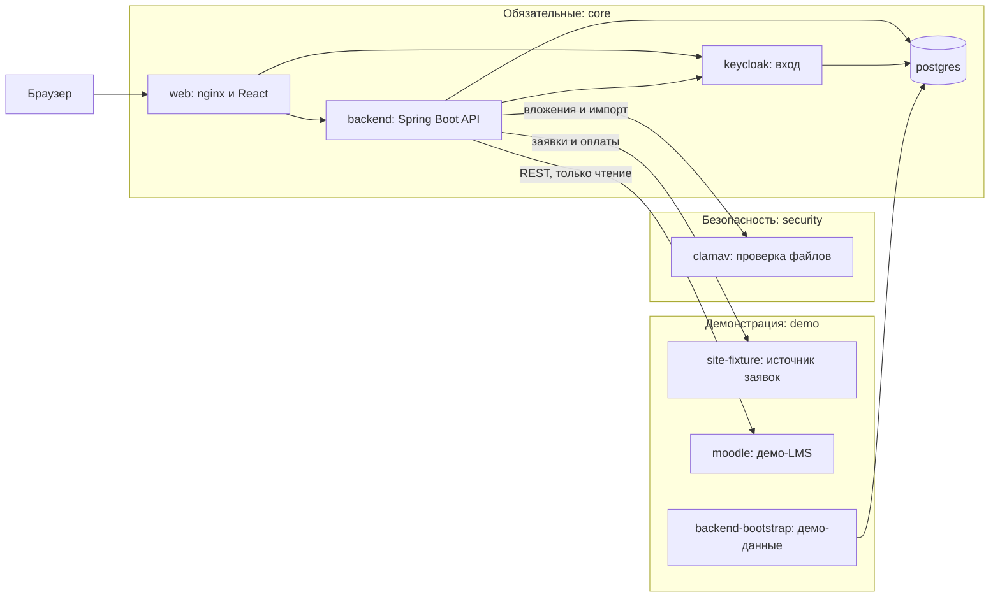

# CRM ИТ Школы РТК

[](../../actions/workflows/ci.yml)
[](../../actions/workflows/nightly.yml)

Система контроля работы менеджеров с вузами и школами по ИТ-программам и ИТ-продуктам. Для каждого вуза видно, кто из менеджеров его ведёт, по какой программе и продукту идёт работа, на каком этапе она находится и какой следующий шаг. За любой период можно построить отчёт по продуктам, вузам и менеджерам.

Стек: Java 21 и Spring Boot 3.5, React 19, PostgreSQL 16, Keycloak 26, ClamAV, nginx. Запуск через Docker Compose.

## Что умеет система

- Карточка работы с вузом: контакты, этапы процесса, комментарии, вложения, договоры по продуктам, история изменений.
- Процесс из 14 шагов настраивается шаблонами: этапы можно переименовать, добавить, убрать, поменять местами.
- «Моя работа» менеджера: сроки, следующие шаги, фильтры. Сводка руководителя команды и руководства по всем командам.
- Отчёты за период: портфель взаимодействий, события, состояние на дату, длительность этапов, востребованность программ, реализация соглашений. Выгрузка в XLSX, XLS, PDF, JSON, диаграммы в PNG и PDF.
- Данные из сайта (заявки и оплаты) и из Moodle (обучающиеся, завершение курсов).
- Импорт каталогов вузов, направлений, программ, продуктов и вендоров из XLS и XLSX.
- Раздел «Зачисление» для слушателей открытого набора: анкеты хранятся в зашифрованном виде.

## Состав системы



| Сервис | Профиль Compose | Назначение |
|---|---|---|
| `web` | `core` | единый адрес: интерфейс, `/api`, Swagger UI, вход Keycloak |
| `backend` | `core` | API, правила доступа, отчёты, синхронизация источников |
| `postgres` | `core` | база CRM и отдельная база Keycloak |
| `keycloak` | `core` | учётные записи и вход (OIDC) |
| `clamav` | `security` | антивирусная проверка вложений и загружаемых файлов |
| `site-fixture` | `demo` | демонстрационный источник заявок и оплат |
| `moodle` | `demo` (отдельный проект Compose) | демонстрационная LMS |
| `backend-bootstrap` | `demo` | одноразовое заполнение демо-данных |

Профиль `core` не имеет метки: его сервисы запускаются всегда. Без профиля `demo` система пустая и ждёт реальные источники. Без профиля `security` проверка файлов недоступна: вложения остаются в карантине, импорт файлов отклоняется. Подробности — в [docs/deploy.md](docs/deploy.md#профили-compose).

## Запуск

Нужны Docker Engine с Compose v2 не ниже 2.24, `bash` 4+ и `openssl`; 4 ГБ памяти (для нагрузочных прогонов от 6 ГБ).

```bash
git clone https://github.com/avrv1987/rtk-crm.git
cd rtk-crm
./scripts/bootstrap-demo.sh
```

В Windows без bash — `pwsh -NoProfile -File ./scripts/bootstrap-demo.ps1` (PowerShell 7+).

Скрипт создаёт `.env.local` со случайными паролями, собирает образы, поднимает все сервисы и заполняет демо-данные: команды, менеджеров, вузы, карточки, источники. Первый запуск занимает от 5 до 15 минут: сборка, сигнатуры ClamAV, установка демо-Moodle. После запуска приложение открывается по адресу `http://rtk.localhost:8081`, пароль демо-пользователей лежит в `.env.local` (`DEMO_USER_PASSWORD`).

Другие варианты:

```bash
DEMO_LMS=false ./scripts/bootstrap-demo.sh    # без демо-Moodle
DEMO_DATA=false ./scripts/bootstrap-demo.sh   # пустая система с одним администратором
./scripts/reset-demo-data.sh                  # вернуть демо-данные к исходным
docker compose --env-file .env.local --profile '*' down    # остановить
```

Адреса, учётные записи и сборка без Docker — в [docs/quickstart.md](docs/quickstart.md). Публикация на сервере с TLS — в [docs/deploy.md](docs/deploy.md).

## Роли

Роль сотрудника и его команда хранятся в профиле CRM; вход выполняет Keycloak. Права проверяются на сервере в каждом запросе, чужие вузы недоступны.

| Роль | Что видит и делает | Демо-логин |
|---|---|---|
| КАМ (`USER`) | свои вузы: ведёт карточки, этапы, вложения | `kam-a`, `kam-b`, `kam-c`, `kam-d` |
| Руководитель (`LEADER`) | все вузы своей команды, назначает и передаёт вузы | `leader`, `leader-b` |
| Руководство (`MANAGEMENT`) | все команды, только чтение | `management` |
| Администратор (`ADMIN`) | профили, команды, справочники, источники данных; бизнес-данных не видит | `admin` |
| Оператор зачисления | флаг у КАМ или руководителя: раздел «Зачисление» | `enrol` |
| Представитель вуза (`PARTNER`) | кабинет вуза: только материалы своего вуза, остальное недоступно | `partner` |

Подробно — [docs/roles.md](docs/roles.md).

## Требования ТЗ

| Требование ТЗ | Где реализовано | Где проверено |
|---|---|---|
| Вход через Keycloak, роли и область данных (ФТ10, ФТ11) | пакеты backend `security`, `access`; [roles.md](docs/roles.md) | `ApiSecurityHttpTest`, `AccessManagementHttpTest`; `scripts/release-smoke.mjs` |
| Каталоги и импорт вузов, программ, продуктов, вендоров (ТЗ §4 п. 1) | `catalog`, `catalogimport`; [import.md](docs/import.md) | `CatalogImportServiceTest`, `CatalogImportWorkbookReaderTest`; `scripts/wave4-smoke.mjs` |
| Журнал взаимодействия, версии и конфликты (ФТ1, ФТ2) | `interaction`; [workflow.md](docs/workflow.md) | `InteractionServiceTest`, `WorkListsHttpTest` |
| Настройка процесса (ФТ6, ФТ9) | `interaction`, шаблоны этапов | `WorkflowTemplateServiceTest`, `InteractionServiceTemplateLockTest`; `scripts/release-smoke.mjs` |
| Вложения 10 форматов с антивирусной проверкой (ФТ3) | `attachment`, `infra/clamav` | `AttachmentContentValidatorTest`, `ClamAvAttachmentScannerTest`; `scripts/attachment-smoke.mjs` |
| Отчёты, статистика, диаграммы (ФТ1, ФТ4) | `report`; [reports.md](docs/reports.md) | `ReportServiceTest`, `ReportWritersTest`, `ReportJobServiceTest`; `scripts/report-persistence-smoke.mjs` |
| Интеграции с сайтом и Moodle (ФТ5) | `source`; [integrations.md](docs/integrations.md) | `SourceSyncServiceTest`, `SourceSettingsServiceTest`; `scripts/wave2-smoke.mjs` |
| Кэш действий пользователя (ФТ13) | `frontend/src/features/interactions/drafts.ts` | `frontend/tests/draftBase.test.ts` |
| Отклик до 1 с, 50 пользователей, 10 отчётов (НФТ1, НФТ6, НФТ7) | `scripts/load` | [load-testing.md](docs/load-testing.md); ночной прогон в CI |
| Swagger UI и перечень библиотек (§6 п. 2) | `backend/src/main/resources/static/openapi.yaml`; [libraries.md](docs/libraries.md) | `OpenApiContractTest`; `scripts/release-smoke.mjs` |
| Docker, Linux, воспроизводимая сборка (§6 п. 4, 9) | `compose*.yaml`, `backend/Dockerfile`, `frontend/Dockerfile` | `scripts/release-gate.sh`; CI |
| Информационная безопасность, 152-ФЗ (§6 п. 10) | [пакет ИБ](docs/delivery/security/README.md) | [реестр мер](docs/delivery/security/6_Реестр_мер.md): каждая мера со ссылкой на тест |
| Документация и модель Archi (§6 п. 6–7) | [docs/delivery](docs/delivery/Сопроводительная_документация.md), [archi](docs/delivery/archi/README.md) | [соответствие ТЗ](docs/delivery/Соответствие_ТЗ.md) |

Полная матрица из 63 пунктов со статусами — [docs/delivery/Соответствие_ТЗ.md](docs/delivery/Соответствие_ТЗ.md).

## Интеграции: что настоящее, что демонстрационное

| Система | Что настоящее | Что демонстрационное | Как переключить на систему заказчика |
|---|---|---|---|
| Keycloak | вход OIDC, realm `rtk-crm` из `infra/keycloak`, роли и команды сотрудников | демо-пользователи | `APP_OIDC_ISSUER_URI`, `APP_OIDC_PUBLIC_BASE_URL`, `APP_OIDC_INTERNAL_BASE_URL`, `APP_OIDC_CLIENT_SECRET`; в Keycloak заказчика нужен клиент `crm-bff` |
| Moodle | адаптер: стандартный REST Moodle только на чтение, проверен на настоящем Moodle 4.5 | демо-Moodle с синтетическими курсами и обучающимися (`infra/moodle`, профиль `demo`) | `MOODLE_BASE_URL`, `MOODLE_TOKEN`, `MOODLE_COURSE_IDS` или экран «Источники данных»; настройка Moodle — [integrations.md](docs/integrations.md) |
| Сайт: заявки и оплаты | адаптер по контракту [site-api.yaml](docs/integrations/site-api.yaml) | `site-fixture`: 17 синтетических заявок и 6 оплат | `SITE_BASE_URL`, `SITE_TOKEN` или экран «Источники данных» |
| Импорт XLS и XLSX | разбор файлов каталогов, вендоров, анкет, оплат | образцы файлов в `frontend/public` | не требуется |
| Антивирус | ClamAV, проверка каждого файла | — | не требуется |
| Файл для LMS | формируется из анкет потока в формате шаблона организатора | загрузка в LMS выполняется оператором вручную | формат меняется перечнем заголовков, [Заглушки.md](docs/integrations/Заглушки.md) |

Переключение не требует правки кода. Значения задаются в `.env.local` или на экране «Источники данных» (администратор). Если `SITE_BASE_URL` указывает на настоящий адрес, `site-fixture` не запускается; если задан `MOODLE_BASE_URL` другого Moodle, демо-Moodle не поднимается. Для боевой установки служит `DEMO_DATA=false`: bootstrap создаёт только администратора. Устройство каждой интеграции и требования к стороне заказчика — [docs/integrations/Заглушки.md](docs/integrations/Заглушки.md).

## Проверки и CI

- `ci.yml`: на каждый push и pull request — тесты backend (JDK 21), сборка и тесты frontend (Node 24), сборка образов `web` и `backend`, проверка файлов Compose.
- `nightly.yml`: каждую ночь и вручную — подъём стенда с демо-данными, сквозные сценарии `release-smoke.mjs` и `wave4-smoke.mjs`, короткий нагрузочный прогон (10 пользователей, 10 отчётов); отчёт сохраняется артефактом.
- Локально: `bash scripts/release-gate.sh` (тесты backend и frontend, `docker compose config`).

## Документы

| Документ | Содержание |
|---|---|
| [docs/README.md](docs/README.md) | оглавление всех документов |
| [Сопроводительная документация](docs/delivery/Сопроводительная_документация.md) | назначение, архитектура, методы обработки данных, сборка, API, руководства пользователя и администратора |
| [Техническая документация](docs/delivery/Техническая_документация.md) | устройство системы, данные, права, процессы, 30 диаграмм |
| [Инструкции пользователей](docs/delivery/Инструкции_пользователей.md) | работа по ролям |
| [Архитектура](docs/architecture.md), [модель Archi](docs/delivery/archi/README.md) | вход, API, контур, версии |
| [Установка и публикация](docs/deploy.md) | профили Compose, TLS, резервные копии, проверки |
| [Роли и права](docs/roles.md), [процесс](docs/workflow.md), [отчёты](docs/reports.md) | правила работы |
| [Интеграции](docs/integrations.md), [заглушки](docs/integrations/Заглушки.md) | источники данных |
| [Нагрузочные проверки](docs/load-testing.md) | методика и результаты |
| [Информационная безопасность](docs/delivery/security/README.md) | персональные данные, угрозы, меры |
| [Библиотеки](docs/libraries.md), [лицензии](docs/licenses.md) | состав зависимостей |
| Swagger UI | `/swagger-ui/index.html` на запущенном стенде; контракт — `backend/src/main/resources/static/openapi.yaml` |
