# CRM ИТ Школы РТК. Техническая документация

Документ описывает устройство и работу системы: компоненты, модули сервера, данные, права, процессы, интеграции, безопасность, развёртывание и диагностику.

## Содержание

1. Назначение и состав системы
2. Архитектура
3. Модули сервера
4. Модель данных
5. Роли и права
6. Процессы
7. Интеграции и заглушки
8. Безопасность
9. Развёртывание и эксплуатация
10. Мониторинг и диагностика

## 1. Назначение и состав системы

CRM ведёт работу ИТ Школы РТК с вузами, колледжами и школами: карточки организаций и контактов, маршрут взаимодействия по этапам, документы, соглашения и план мероприятий, отчёты и статистику, данные из сайта и LMS. Модуль «Слушатели» ведёт зачисление физических лиц открытого набора: приём оплат, анкеты слушателей, файл для загрузки в LMS.

Пользователи:

| Роль | Код | Что делает |
|---|---|---|
| КАМ | `USER` | ведёт закреплённые за ним организации и их карточки взаимодействия |
| Руководитель | `LEADER` | ведёт все организации своей команды, назначает КАМ и заместителей, управляет шаблонами этапов команды |
| Руководство | `MANAGEMENT` | просматривает данные всех команд без права изменения |
| Администратор | `ADMIN` | управляет профилями, командами, справочниками, источниками данных, журналом, сроками хранения и функциями субъекта ПДн; бизнес-данных карточек не видит |
| Оператор зачисления | флаг `enrolment_operator` у `USER` или `LEADER` | работает в разделе «Зачисление» |

Состав поставки:

| Часть | Технологии | Где в репозитории |
|---|---|---|
| Клиент (SPA) | React 19.3, TypeScript 5.9, Vite 8.3; типы API генерируются из OpenAPI (`openapi-typescript`) | `frontend/` |
| Сервер | Java 21, Spring Boot 3.5.16 (Web, Security, OAuth2 Client, JDBC, Validation, Actuator), Spring Session JDBC, Flyway, Apache POI 5.5.1, PDFBox 3.0.5, springdoc 2.8.17 | `backend/` |
| Спецификация API | OpenAPI 3.1 | `backend/src/main/resources/static/openapi.yaml` |
| Конфигурация контура | Docker Compose, nginx, Keycloak realm, ClamAV, PostgreSQL | `compose*.yaml`, `infra/` |
| Скрипты эксплуатации | установка, резервное копирование, восстановление, сброс демо-данных | `scripts/` |

Разделы интерфейса зависят от роли: администратор видит «Администрирование» (меню из отдельных пунктов) и «Справка»; КАМ, руководитель и руководство — «Моя работа» (у руководства подписан «Сводка по всем командам»), «Вузы», «Отчёты и статистика», «Справка»; руководителю в «Администрировании» видны два пункта меню — «Шаблоны этапов» и «Заявки источников»; оператор зачисления дополнительно видит «Зачисление».

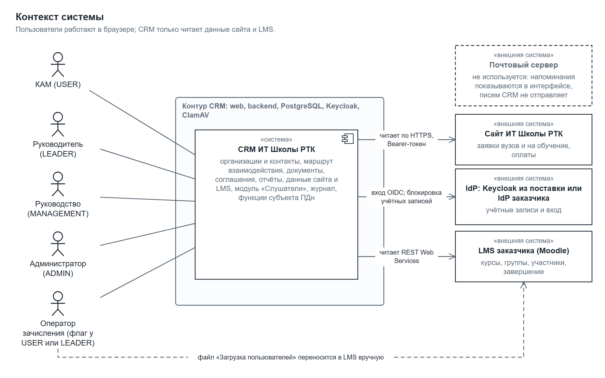

Рисунок 1 — Контекст системы: пользователи, внешние системы и граница контура

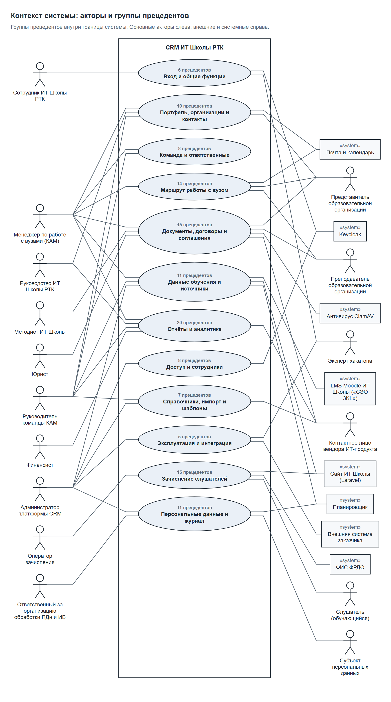

Рисунок 2 — Акторы и группы прецедентов


## 2. Архитектура

### 2.1. Компоненты и контейнеры

| Сервис Compose | Образ | Назначение | Порт наружу |
|---|---|---|---|
| `web` | сборка `frontend/Dockerfile`, nginx 1.29.2 | единая точка входа: отдаёт SPA, проксирует `/api/`, `/swagger-ui`, `/v3/api-docs`, `/openapi.yaml` в backend и `/idp/` в Keycloak, ставит заголовки безопасности | 8081 (HTTP); 80 и 443 с `compose.prod.yaml`; нет с `compose.edge.yaml` |
| `backend` | сборка `backend/Dockerfile`, Eclipse Temurin 21 JRE | REST API, вход через OIDC по схеме BFF, фоновые задания | нет |
| `backend-bootstrap` | тот же образ, профиль Spring `demo-bootstrap`, профиль Compose `demo` | одноразовое заполнение: демо-данные или первый администратор | нет |
| `postgres` | `postgres:16.11-bookworm` | две БД: CRM и Keycloak, у каждой своя роль | нет |
| `keycloak` | `quay.io/keycloak/keycloak:26.7.4` | realm `rtk-crm`, вход пользователей | нет |
| `clamav` | `clamav/clamav:1.4.6-debian13-slim`, профиль Compose `security` | антивирусная проверка вложений по TCP 3310 | нет |
| `site-fixture` | `nginx:1.29.2-alpine`, профиль Compose `demo` | тестовая копия API сайта: заявки и оплаты | нет |
| `moodle`, `moodle-db` | `bitnamilegacy/moodle:4.5.4-debian-12-r0`, `mariadb:11.4.5`, отдельный проект Compose `rtk-crm-moodle` (`infra/moodle/compose.yaml`) | демо-Moodle с синтетическими курсами | `127.0.0.1:8082` |

Все сервисы основного проекта работают в сети `rtk-crm`. Backend подключается к сети `rtk-crm-moodle`, когда к запуску добавлен `infra/moodle/compose.crm.yaml`.

### 2.2. Схема взаимодействия

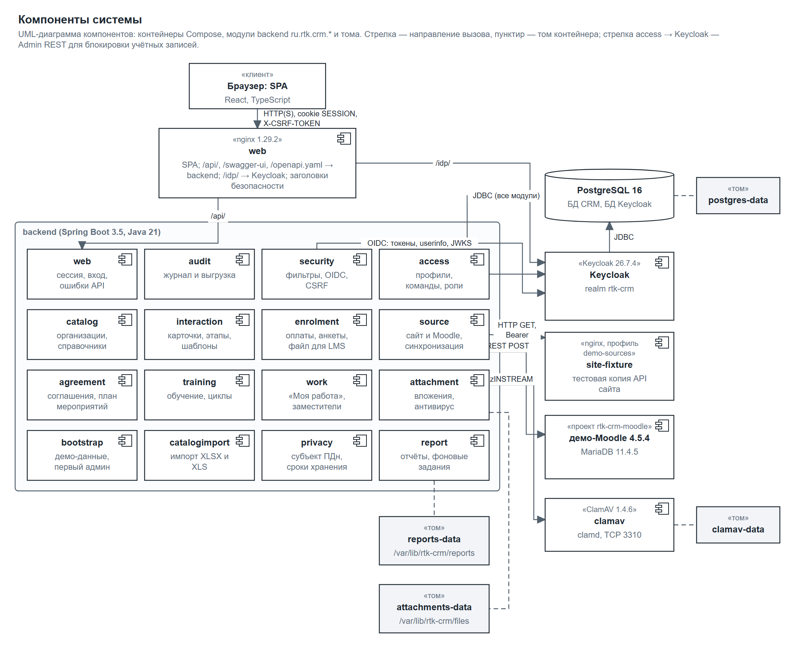

Рисунок 3 — UML-диаграмма компонентов: контейнеры, модули backend, тома

| Откуда | Куда | Протокол | Что передаётся |
|---|---|---|---|
| Браузер | `web` | HTTP или HTTPS | SPA, вызовы API с cookie `SESSION` и заголовком `X-CSRF-TOKEN`, страницы входа Keycloak |
| `web` | `backend` | HTTP | `/api/`, Swagger UI, OpenAPI; заголовки `X-Forwarded-*` |
| `web` | `keycloak` | HTTP | `/idp/*` без префикса |
| Браузер | Keycloak через `web` | HTTP(S) | авторизация по коду (`/idp/realms/rtk-crm/protocol/openid-connect/auth`) |
| `backend` | `keycloak` | HTTP во внутренней сети | обмен кода на токены, userinfo, ключи JWKS, Admin REST (`crm-account-sync`) |
| `backend` | `postgres` | JDBC | данные CRM, сессии Spring Session |
| `backend` | `clamav` | TCP, протокол clamd `zINSTREAM` | содержимое загружаемого файла |
| `backend` | сайт | HTTP GET, `Authorization: Bearer` | заявки и оплаты |
| `backend` | Moodle | HTTP POST, REST Web Services | курсы, группы, участники, завершение |

### 2.3. Порядок запуска

Порядок задают healthcheck-и: `web` ждёт `backend` и `keycloak`; `backend` ждёт `postgres`, `keycloak` и `clamav`. Долгоживущие сервисы объявлены с `restart: unless-stopped` и поднимаются после перезагрузки сервера сами; `backend-bootstrap` политики перезапуска не имеет.

## 3. Модули сервера

### 3.1. Пакеты `ru.rtk.crm.*`

| Пакет | Назначение | Ключевые классы и сущности |
|---|---|---|
| `access` | профили CRM, команды, роли, активация профиля, синхронизация учётной записи Keycloak | `UserRole`, `CrmProfile`, `CurrentProfileService`, `AdminAuthorization`, `AdminCrmProfileService`, `KeycloakAccountClient`; таблицы `crm_user_profiles`, `teams`, `crm_profile_events` |
| `security` | цепочка фильтров Spring Security, OIDC, CSRF, идентификатор запроса, JSON-ответы 401 и 403 | `ApiSecurityConfiguration`, `RequestIdFilter`, `CrmProfileRegistrationSuccessHandler`, `KeycloakLogoutSuccessHandler`, `ApiErrorLog` |
| `web` | сессия и вход, формат ошибок, обработчик исключений | `AuthApiController`, `SessionApiController`, `ApiError`, `ApiExceptionHandler`, `ApiErrorController` |
| `catalog` | организации, контакты, назначение КАМ, справочники (направления, программы, вендоры, продукты, контакты вендоров), история изменений справочников | `OrganizationRepository` (область видимости), `OrganizationCatalogService`, `OrganizationAssignmentService`, `ContactService`, `AdminCatalogService`, `VendorContactService` |
| `interaction` | карточки взаимодействия, этапы и переходы, события, комментарии, план, статус и отметки работы, шаблоны этапов, договоры по продуктам, защита от повтора команд | `InteractionService`, `WorkflowGraph`, `WorkflowTemplateService`, `ProductAgreementService`, `CommandIdempotencyRepository` |
| `attachment` | вложения к карточкам, проверка формата, антивирус, скачивание и просмотр | `AttachmentService`, `AttachmentContentValidator`, `ClamAvAttachmentScanner`, `AttachmentStorage` |
| `agreement` | соглашения с организациями, план мероприятий, подтверждения | `AgreementsApiController`; таблицы `agreements`, `agreement_activities`, `agreement_activity_kinds` |
| `training` | обучение преподавателей, циклы взаимодействия | `TrainingService`; таблицы `teacher_trainings`, `interaction_cycles` |
| `work` | «Моя работа», напоминания, заместители, показатели руководителя и руководства | `WorkService`, `OrganizationDeputyService`, `WorkProperties` |
| `report` | предпросмотр, статистика, фоновое построение файлов отчётов, сохранённые отчёты | `report_jobs`, `saved_reports` |
| `catalogimport` | импорт каталогов из XLSX и XLS с предпросмотром | `catalog_imports`, `catalog_import_rows`, `catalog_import_jobs` |
| `source` | источники данных: сайт и Moodle, запуски синхронизации, записи для разбора, сопоставления, снимки обучения | `SiteApiClient`, `MoodleClient`, `SourceSyncService`, `SiteRecordApplier` |
| `enrolment` | модуль «Слушатели»: оплаты, потоки, анкеты, шифрование, файл для LMS | `EnrolmentApiController`, `PaidOrderParser`, `LearnerDataCipher`, `LearnerRules`, `LmsRosterWorkbookWriter`, `LearnerWorkbookReader`, `LearnerRekeyJob` |
| `audit` | единый журнал администратора и безопасности, выгрузка журнала | `AuditJournalRepository`, `AuditAction`, `AuditApiController` |
| `privacy` | функции субъекта ПДн, сроки хранения | `PersonalDataApiController`, `PersonalDataService`, `RetentionService`, `RetentionProperties` |
| `bootstrap` | заполнение демо-данных или первого администратора, сброс демо-данных | `DemoBootstrapCommand`, `DemoBootstrapProperties`, `DemoResetConfiguration` |

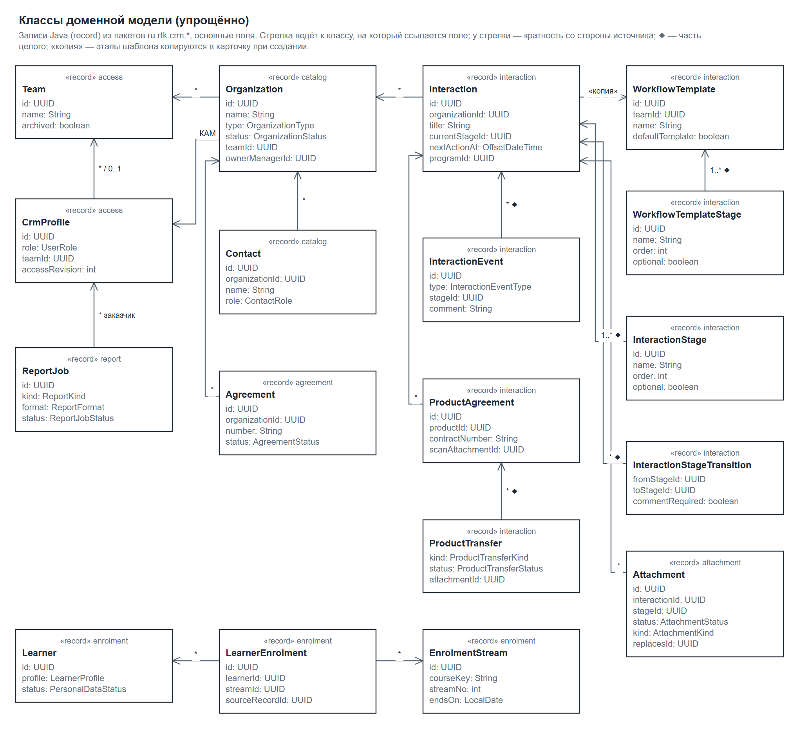

Рисунок 4 — Классы доменной модели (упрощённо)

### 3.2. Общие правила API

- Все операции — под `/api`, формат JSON, даты `YYYY-MM-DD`, моменты времени ISO 8601 со смещением, идентификаторы UUID.
- Изменяющие запросы передают заголовок `X-CSRF-TOKEN` со значением из `GET /api/csrf`.
- Команды принимают заголовок `Idempotency-Key`. Ключ и отпечаток тела хранятся в `command_idempotency_records`: повтор с тем же ключом и телом возвращает прежний результат, с другим телом — `409 IDEMPOTENCY_CONFLICT`.
- Изменение объекта с версией (карточка, организация, контакт, профиль, шаблон, анкета, поток и другие) передаёт ожидаемую `version`; при расхождении — `409 VERSION_CONFLICT` с полем `currentVersion`.
- Объект вне области данных пользователя отвечает `404`, как несуществующий.
- Ошибка всегда возвращается в формате `ApiError` (раздел 10.2); каждый ответ содержит заголовок `X-Request-Id`.

### 3.3. Эндпоинты по разделам

Полная спецификация — Swagger UI по адресу `<адрес CRM>/swagger-ui` (читает `<адрес CRM>/openapi.yaml`), в репозитории — `backend/src/main/resources/static/openapi.yaml`. В спецификации 155 операций в девяти группах.

| Группа OpenAPI | Операций | Основные пути |
|---|---|---|
| Session | 6 | `GET /api/auth/login`, `GET /api/auth/callback/{registrationId}`, `POST /api/auth/logout`, `GET /api/me`, `POST /api/me/activation-request`, `GET /api/csrf` |
| Catalog | 28 | `/api/organizations` (список, создание, дубликаты, карточка, статус), `/api/organizations/{id}/contacts`, `/api/organizations/{id}/assignment*`, `POST /api/organization-assignments`, `/api/organizations/{id}/deputies`, `GET /api/directions`, `/api/programs`, `/api/products`, `/api/source-records`, `GET /api/workflow-templates`, `/api/imports/*` |
| Work | 5 | `GET /api/work/team-indicators`, `GET /api/work/teams-summary`, `GET /api/work/learning-trend`, `GET /api/reminders`, `PUT /api/reminders/settings` |
| Interaction | 22 | `/api/interactions`, `/api/interactions/{id}` и подресурсы: `events`, `transitions`, `comments`, `step-completions`, `status`, `flags`, `stage-edits`, `stage-completions`, `product-agreements/{agreementId}`, `learning-snapshots`, `source-status`, `sources/refresh`, `teacher-trainings`, `cycle`, `cycles` |
| Attachment | 6 | `POST /api/interactions/{id}/attachments`, `POST /api/interactions/{id}/attachments/{attachmentId}/deletion`, `GET`/`PATCH /api/attachments/{id}`, `GET /api/attachments/{id}/preview`, `GET /api/attachments/{id}/download` |
| Agreements | 11 | `GET /api/agreement-activity-kinds`, `/api/organizations/{id}/agreements`, `/api/organizations/{id}/agreement-options`, `/api/agreements/{id}`, `/api/agreements/{id}/activities`, `/api/agreement-activities/{id}`, `/api/agreement-confirmations`, `/api/agreement-confirmations/archive` |
| Administration | 50 | `/api/admin/crm-profiles`, `/api/admin/teams`, `/api/admin/organizations`, `/api/admin/catalogs/{kind}`, `/api/admin/catalogs/vendors/{vendorId}/contacts`, `/api/admin/catalog-events`, `/api/admin/workflow-templates`, `/api/admin/agreement-activity-kinds`, `/api/admin/sources`, `/api/admin/source-records`, `/api/admin/source-mappings`, `/api/admin/audit-events`, `/api/admin/personal-data/*`, `/api/admin/retention` |
| Jobs и Reports | 1 + 15 | `GET /api/jobs/{id}`, `POST /api/reports/preview`, `POST /api/reports`, `POST /api/statistics`, `GET /api/reports/learning-dynamics` и `/file`, `/api/report-jobs`, `/api/report-jobs/{id}/result`, `/api/report-filters/*`, `/api/saved-reports` |
| Enrolment | 14 | `POST /api/enrolment/paid-orders`, `/api/enrolment/streams`, `/api/enrolment/streams/{id}/learners`, `/api/enrolment/streams/{id}/questionnaire-imports/preview` и `/apply`, `/api/enrolment/streams/{id}/lms-roster`, `/api/enrolment/roster-exports/{id}/transferred`, `/api/enrolment/learners/search`, `/api/enrolment/learners/{id}` и подресурсы `reveal`, `move-enrolments`, `history` |

## 4. Модель данных

### 4.1. База и миграции

Схема CRM создаётся и обновляется Flyway при старте backend (`spring.flyway.locations: classpath:db/migration`, файлы `backend/src/main/resources/db/migration/V*__*.sql`). Номер миграции V11 не используется. Очистка схемы у работающего backend запрещена (значение Spring Boot по умолчанию); она выполняется только при сбросе демо-данных в `backend-bootstrap` (раздел 9.9). Keycloak хранит свои данные в отдельной БД и управляет её схемой сам.

| Миграция | Таблицы и изменения |
|---|---|
| V1 | `teams`, `crm_user_profiles`, `organizations`, `spring_session`, `spring_session_attributes` |
| V2 | индексы области видимости организаций |
| V3 | `contacts`, `interactions`, `interaction_stages`, `interaction_contacts`, `interaction_events`, `command_idempotency_records` |
| V4 | `organization_assignment_events` |
| V5 | `crm_profile_active_events` |
| V6 | `directions`, `programs`, `vendors`, `products`, `product_agreements` |
| V7 | `attachments` |
| V8 | `workflow_templates`, `workflow_template_stages`, `workflow_template_transitions`, `interaction_stage_transitions`; базовый шаблон «Базовый процесс ИТ Школы РТК» из 13 этапов |
| V9 | `catalog_imports`, `catalog_import_rows`, `catalog_import_jobs` |
| V10 | `report_jobs`, индексы по периодам |
| V12 | план карточки, события правки этапов |
| V13 | `crm_profile_events` вместо `crm_profile_active_events`, `organization_team_events`, ожидание активации профиля |
| V14 | `sources`, `sync_runs`, `source_records`, `source_mappings`, `learning_snapshots` |
| V15 | даты потоков обучения в сопоставлениях |
| V16 | `contact_events`, `interaction_event_contacts`, статус работы и передача |
| V17 | `product_transfers`, виды и версии документов, поля договоров |
| V18 | `organization_deputies`, `reminder_settings`, роль `MANAGEMENT` |
| V19 | `saved_reports` |
| V20 | `catalog_change_events`, `catalog_name_locks`, программа карточки, умолчания команд |
| V21 | `audit_events`, статус ПДн, поля синхронизации учётных записей |
| V22 | `interaction_cycles`, `teacher_trainings`, поля запусков источников |
| V23 | тип организации «колледж» |
| V24 | `agreement_activity_kinds`, `agreements`, `agreement_activities`, `agreement_activity_interactions`, `agreement_activity_attachments` |
| V25 | `interaction_stage_completions` |
| V26 | `vendor_contacts` |
| V27 | оплаты `paid_order` в `source_records`, флаг `crm_user_profiles.enrolment_operator`, тип организации `OPEN_ENROLLMENT`, команда и организация «Открытый набор» |
| V28 | `enrolment_streams`, `learners`, `learner_enrolments` |
| V30 | `learning_observations` — история наблюдений обучения, перенос существующих снимков |

### 4.2. Основные таблицы и связи

| Область | Таблицы | Связи |
|---|---|---|
| Доступ | `teams`, `crm_user_profiles`, `crm_profile_events` | профиль принадлежит команде (`team_id`); профиль определяется парой `issuer` + `subject` из OIDC |
| Организации | `organizations`, `organization_assignment_events`, `organization_team_events`, `organization_deputies` | организация принадлежит команде и имеет ответственного КАМ (`owner_manager_id`); тип `UNIVERSITY`, `SCHOOL`, `COLLEGE`, `OPEN_ENROLLMENT`; статус `ACTIVE`, `PENDING`, `ARCHIVED` |
| Контакты | `contacts`, `contact_events`, `interaction_contacts`, `interaction_event_contacts` | контакт принадлежит организации, связан с карточками многие-ко-многим |
| Взаимодействия | `interactions`, `interaction_stages`, `interaction_stage_transitions`, `interaction_stage_completions`, `interaction_events`, `interaction_cycles` | карточка принадлежит организации; у неё свой снимок этапов и переходов; события образуют историю; циклы связывают карточку с предыдущей |
| Шаблоны | `workflow_templates`, `workflow_template_stages`, `workflow_template_transitions` | общий шаблон (`team_id IS NULL`) или шаблон команды; копируется в карточку при создании |
| Справочники | `directions` → `programs`; `vendors` → `vendor_contacts`, `products`; `catalog_change_events`, `catalog_name_locks` | программа принадлежит направлению, продукт — вендору |
| Договоры по продуктам | `product_agreements` → `product_transfers` | договор связывает карточку и продукт; передачи — материалы, лицензия, документация |
| Документы | `attachments` | вложение принадлежит карточке и этапу; цепочка версий через `replaces_id` |
| Соглашения | `agreements` → `agreement_activities` → `agreement_activity_interactions`, `agreement_activity_attachments`; `agreement_activity_kinds` | соглашение принадлежит организации; мероприятие плана связано с видом, карточками и подтверждающими файлами |
| Обучение | `teacher_trainings` | запись обучения связана с карточкой, событием комментария и вложением |
| Работа | `reminder_settings` | настройка напоминаний один к одному с профилем |
| Отчёты | `report_jobs`, `saved_reports` | задание отчёта принадлежит профилю и хранит путь к файлу результата |
| Импорт | `catalog_imports`, `catalog_import_rows`, `catalog_import_jobs` | импорт состоит из строк предпросмотра и задания применения |
| Источники | `sources`, `sync_runs`, `source_records`, `source_mappings`, `learning_snapshots`, `learning_observations` | запуск синхронизации создаёт или обновляет записи источника; сопоставление связывает курс или группу LMS с организацией и программой; снимок хранит последние агрегаты обучения, история — их изменения по времени |
| Слушатели | `enrolment_streams`, `learners`, `learner_enrolments` | зачисление связывает анкету, поток и запись оплаты `source_records` |
| Журнал | `audit_events` | записи журнала администратора и безопасности |
| Сессии | `spring_session`, `spring_session_attributes` | серверные сессии пользователей |

Почти все изменяющие таблицы ссылаются на `command_idempotency_records` через `command_id`.

ER-диаграммы построены разбором миграций Flyway: таблицы, ключевые колонки, первичные и внешние ключи. Каждая таблица подробно показана на одной диаграмме группы; таблица другой группы изображена пунктиром.

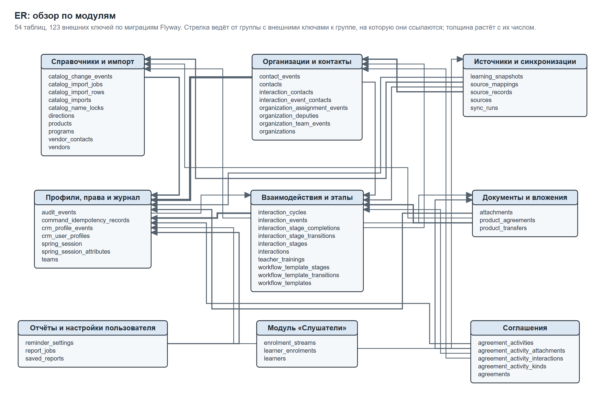

Рисунок 5 — ER-диаграмма: обзор по модулям

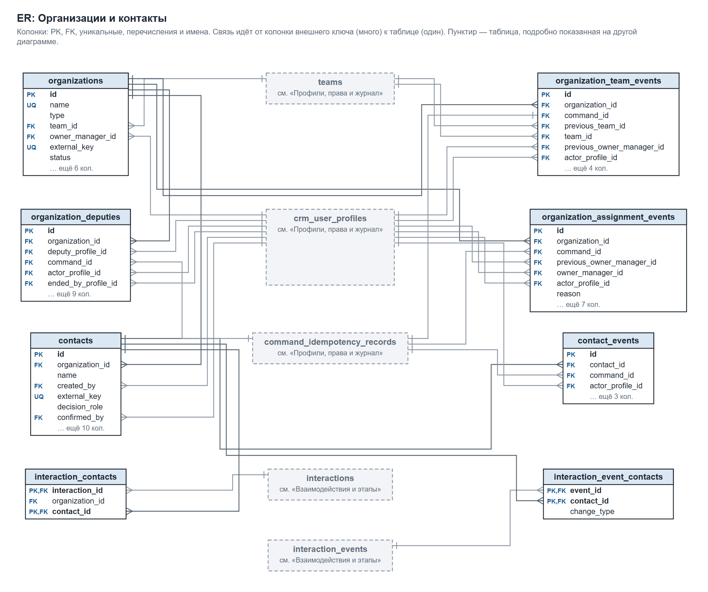

Рисунок 6 — ER-диаграмма: Организации и контакты

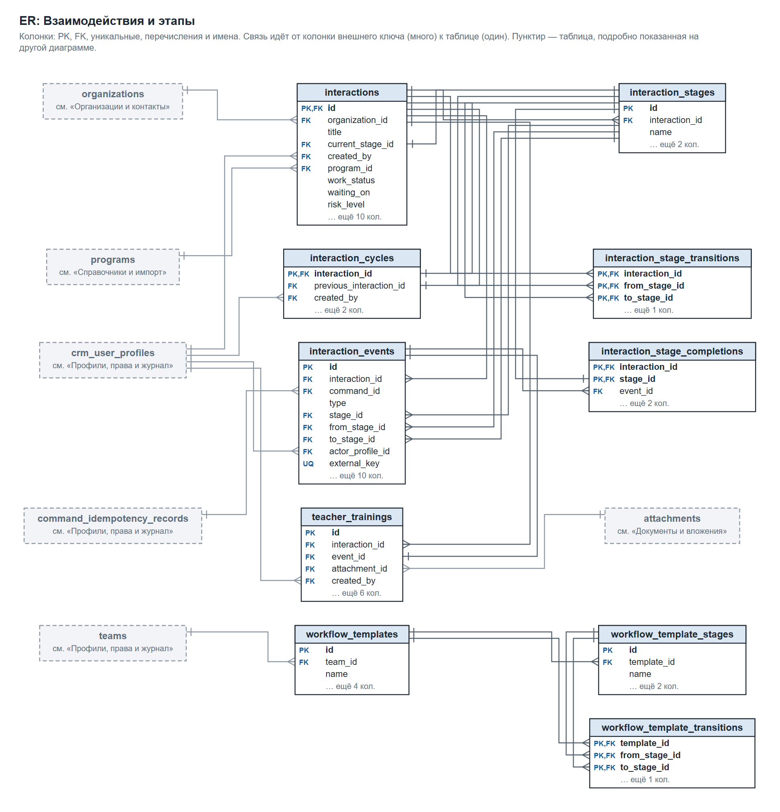

Рисунок 7 — ER-диаграмма: Взаимодействия и этапы

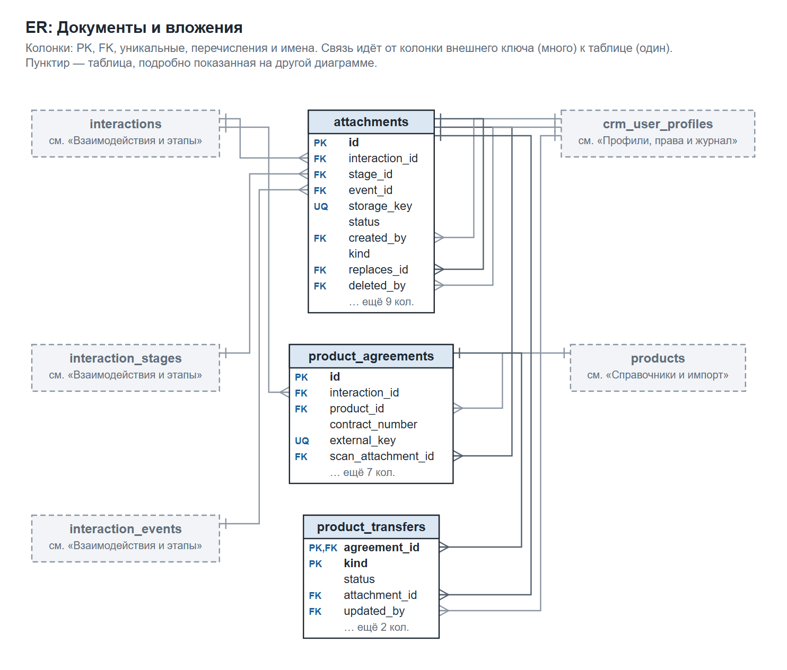

Рисунок 8 — ER-диаграмма: Документы и вложения

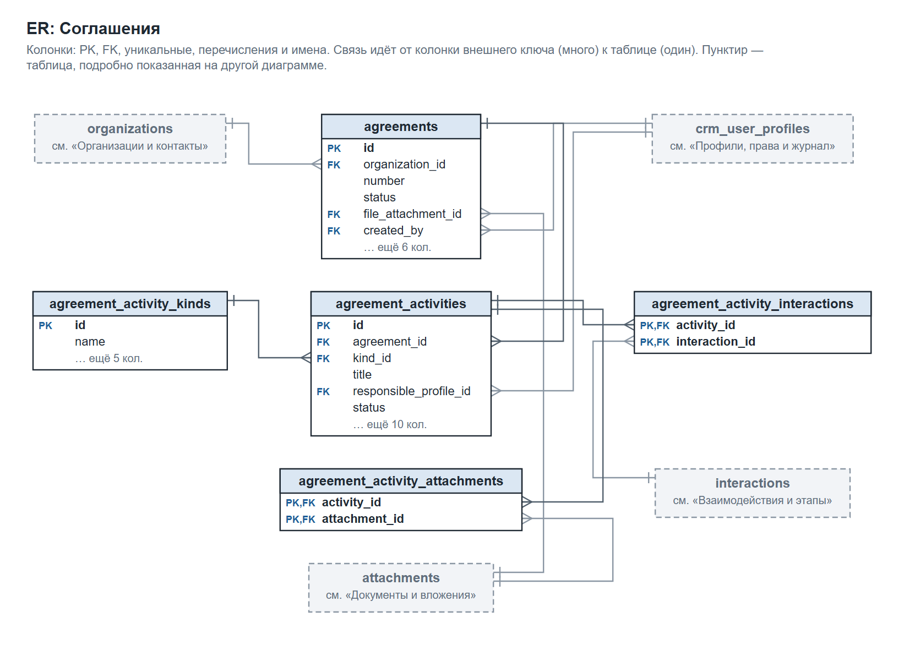

Рисунок 9 — ER-диаграмма: Соглашения

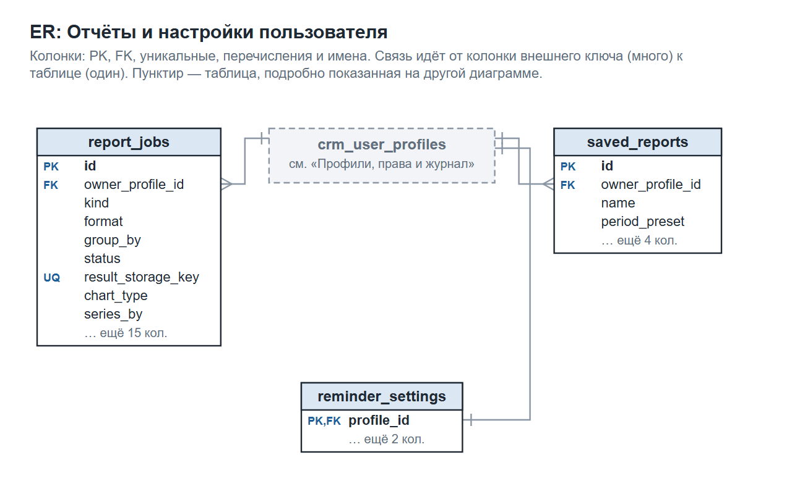

Рисунок 10 — ER-диаграмма: Отчёты и настройки пользователя

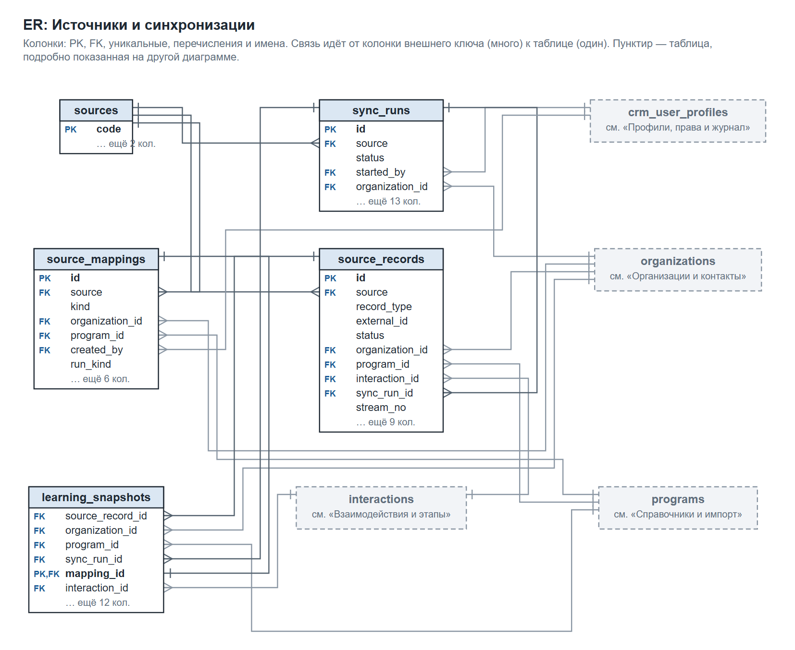

Рисунок 11 — ER-диаграмма: Источники и синхронизации

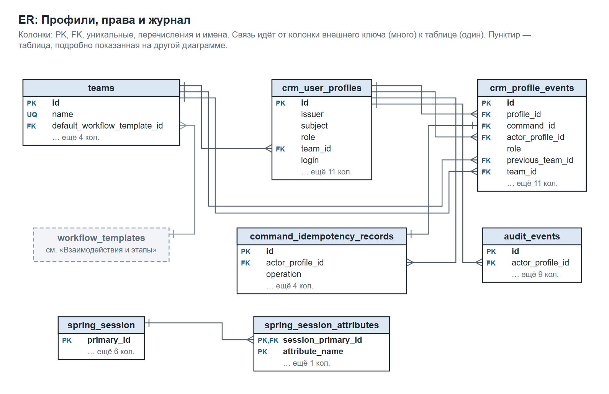

Рисунок 12 — ER-диаграмма: Профили, права и журнал

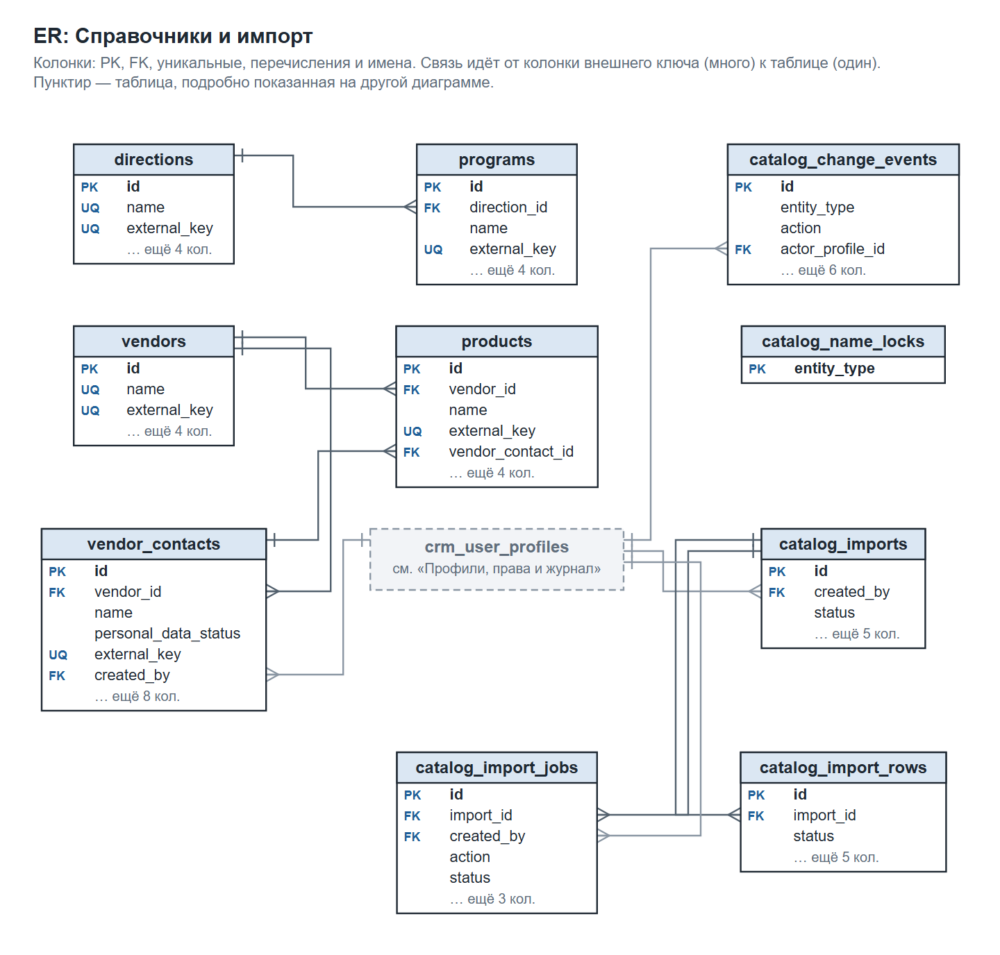

Рисунок 13 — ER-диаграмма: Справочники и импорт

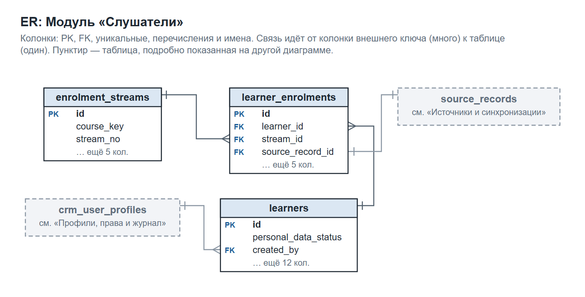

Рисунок 14 — ER-диаграмма: Модуль «Слушатели»

## 5. Роли и права

### 5.1. Проверка на сервере

- Каждый запрос к `/api/**`, кроме входа, требует аутентифицированной сессии; иначе `401 UNAUTHENTICATED`.
- `CurrentProfileService.requireActiveProfile` на каждом запросе заново читает профиль по `issuer` + `subject`. Нет профиля или он заблокирован — `403 CRM_PROFILE_REQUIRED`; профиль ждёт активации — `403 CRM_PROFILE_PENDING`.
- Права проверяются в сервисах, а не только в интерфейсе: `AdminAuthorization.requireAdmin` (только `ADMIN`), `ContactInteractionMutationAuthorization.requireCardEditor` (только `USER` и `LEADER`), `EnrolmentAccess.requireOperator` (флаг «Оператор зачисления» и включённый модуль), проверки руководителя в назначении КАМ, заместителях и шаблонах.
- Область данных накладывается условием SQL в `OrganizationRepository.visibilityScope` на списки и на выборку одного объекта. Объект вне области отвечает `404`.
- Изменение роли, команды, активности или флага оператора повышает `access_revision` профиля. Файлы отчётов, заказанные до изменения, больше не выдаются (`410 REPORT_ACCESS_CHANGED`).

### 5.2. Роли и области данных

| Роль | Область данных | Изменения |
|---|---|---|
| КАМ (`USER`) | организации своей команды, где он ответственный, и организации, где у него открыт период заместителя | карточки, контакты, вложения, соглашения своих организаций; создание организации (при `APP_ORGANIZATIONS_MANAGER_CREATION_REQUIRES_APPROVAL=true` новая организация получает статус `PENDING`, пока её не подтвердит руководитель команды или администратор) |
| Руководитель (`LEADER`) | все организации своей команды, включая требующие назначения | то же, что КАМ, плюс назначение и замена КАМ (в том числе себя), массовая передача, заместители, шаблоны этапов своей команды, показатели команды, удаление чужих вложений в своей области |
| Руководство (`MANAGEMENT`) | все организации всех команд | только чтение; сводка по командам `GET /api/work/teams-summary` и тренд обучения `GET /api/work/learning-trend`; к анкетам слушателей и «Зачислению» доступа нет |
| Администратор (`ADMIN`) | бизнес-данных карточек не видит | профили и команды, организации и их перенос между командами, справочники, общие шаблоны этапов, виды мероприятий, источники данных и сопоставления, журнал, функции субъекта ПДн, сроки хранения |

КАМ и руководитель без команды не могут быть активными. Администратор не может изменить свою роль, команду и активность; последнего активного администратора нельзя понизить или заблокировать (`409 LAST_ACTIVE_ADMIN`).

### 5.3. Флаг «Оператор зачисления»

- Хранится в `crm_user_profiles.enrolment_operator`; ограничение БД допускает флаг только у ролей `USER` и `LEADER`. При смене роли на `ADMIN` или `MANAGEMENT` флаг снимается.
- Даёт доступ ко всем операциям `/api/enrolment/*`. Проверка выполняется на каждом запросе до поиска объекта, поэтому запрос без флага к несуществующему объекту тоже получает `403`.
- При выключенном модуле (`MODULE_ENROLMENT_ENABLED=false`) все операции `/api/enrolment/*` отвечают `404`, а `GET /api/me` возвращает `enrolmentOperator: false`.
- Изменение флага записывается в `crm_profile_events` и в журнал как «Изменён флаг «Оператор зачисления»».

### 5.4. Профиль и активация

1. Первый вход через Keycloak создаёт профиль в состоянии ожидания: `active=false`, `pending_activation=true`, роль `USER`, без команды; имя и логин берутся из claims OIDC.
2. Пока профиль ждёт активации, любой запрос получает `403 CRM_PROFILE_PENDING`; кнопка «Сообщить администратору» вызывает `POST /api/me/activation-request` и один раз фиксирует время просьбы.
3. Администратор активирует профиль `PATCH /api/admin/crm-profiles/{id}`: роль, команда, активность, флаг оператора.
4. Блокировка профиля отключает учётную запись Keycloak через сервисный клиент `crm-account-sync` (роль `realm-management/manage-users`), разблокировка включает её. Если секрет клиента не задан или Keycloak недоступен, профиль блокируется в CRM и получает отметку «требует синхронизации»; повтор — `POST /api/admin/crm-profiles/{id}/account-sync`.
5. При блокировке, смене роли или команды КАМ его организации снимаются с него и требуют назначения.

## 6. Процессы

### 6.1. Маршрут взаимодействия и этапы

Карточка взаимодействия (`interactions`) принадлежит организации и ведётся по этапам. При создании карточки выбранный шаблон копируется в собственные этапы (`interaction_stages`) и переходы (`interaction_stage_transitions`) карточки; последующие правки шаблона на существующие карточки не влияют.

Правила графа этапов (`WorkflowGraph`) действуют и для шаблонов, и для правки этапов карточки:

- ровно один начальный этап (порядок 0);
- у каждого этапа, кроме последнего, есть исходящий переход; каждый этап достижим из начального;
- переход между соседними этапами разрешён без комментария; переход с пропуском этапов или возвратом больше чем на один шаг требует комментария (`comment_required`).

Операции карточки:

| Операция | Путь | Что происходит |
|---|---|---|
| Переход | `POST /api/interactions/{id}/transitions` | проверяется наличие перехода и комментарий, если он обязателен; меняется текущий этап; событие `TRANSITIONED` |
| Комментарий | `POST /api/interactions/{id}/comments` | событие `COMMENTED`, при необходимости следующий шаг и вложения |
| План | `PATCH /api/interactions/{id}` | следующий шаг и срок, контакты, программа, продукты; событие `PLAN_UPDATED` |
| Шаг выполнен | `POST /api/interactions/{id}/step-completions` | закрывает текущий следующий шаг |
| Статус работы | `POST /api/interactions/{id}/status` | `ACTIVE`, `PAUSED`, `COMPLETED`; событие `STATUS_CHANGED` |
| Отметки | `POST /api/interactions/{id}/flags` | ожидание вуза или РТК, проблема, риск (`MEDIUM`, `HIGH`) |
| Правка этапов | `POST /api/interactions/{id}/stage-edits` | переименование, добавление после, перенос, удаление; граф пересчитывается и проверяется; событие `STAGES_EDITED` |
| Отметка этапа вне текущего | `POST`/`DELETE /api/interactions/{id}/stage-completions` | этап отмечается выполненным без перехода; для текущего этапа отметка не ставится; события `STAGE_COMPLETED`, `STAGE_COMPLETION_CLEARED` |

Типы событий истории: `CREATED`, `TRANSITIONED`, `COMMENTED`, `STAGES_EDITED`, `PLAN_UPDATED`, `DETAILS_UPDATED`, `STATUS_CHANGED`, `AGREEMENT_UPDATED`, `ATTACHMENT_DELETED`, `STAGE_COMPLETED`, `STAGE_COMPLETION_CLEARED`. Изменять карточки могут только `USER` и `LEADER` в своей области данных.

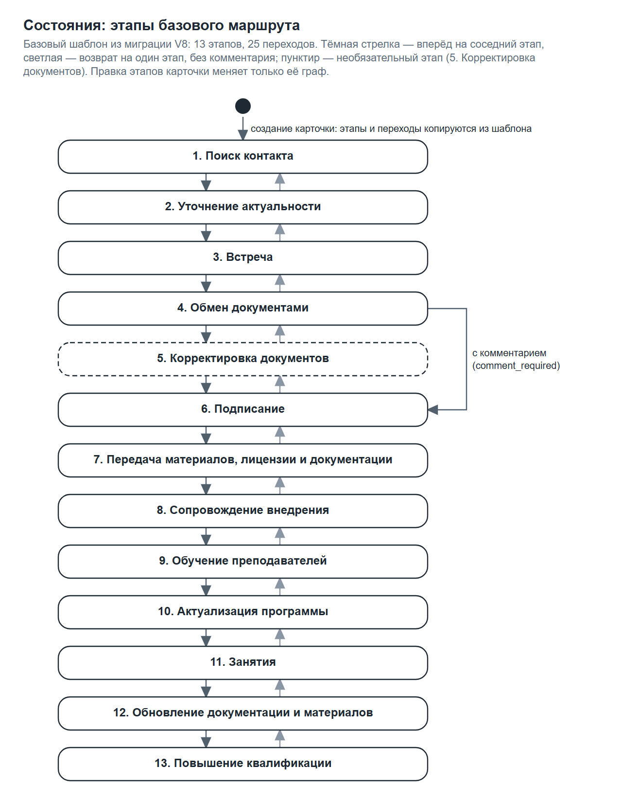

Рисунок 15 — UML-диаграмма состояний: этапы базового маршрута


Рисунок 16 — Диаграмма деятельности: маршрут вуза и контроль исполнения

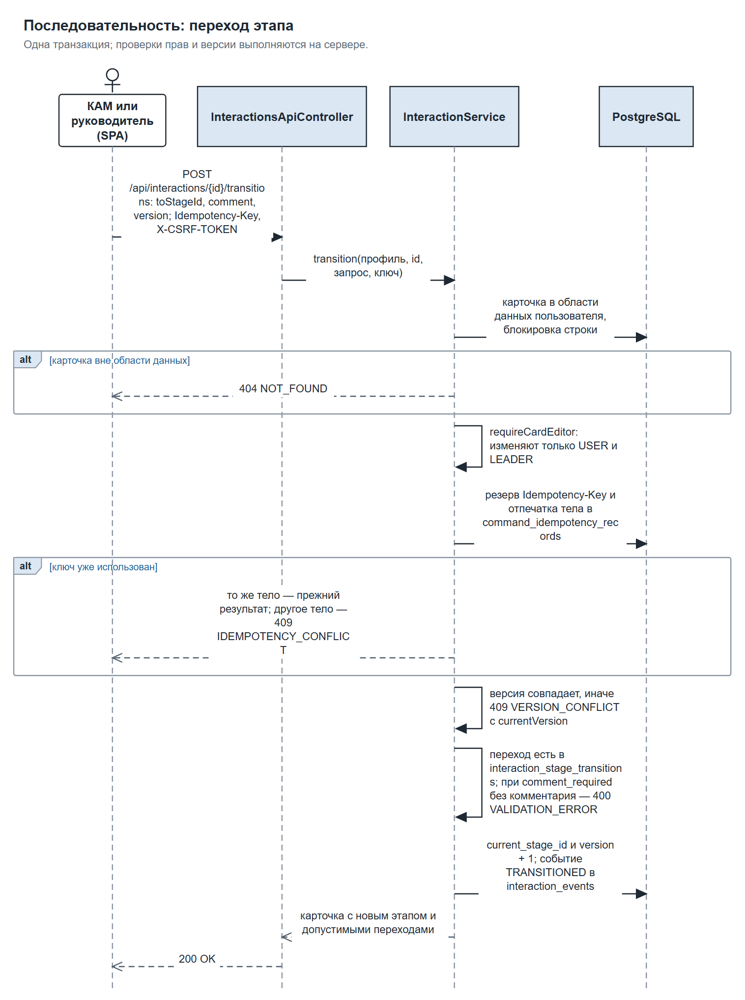

Рисунок 17 — UML-диаграмма последовательности: переход этапа

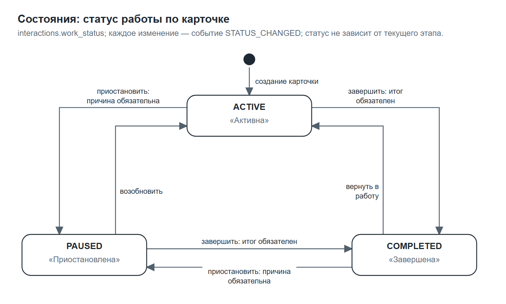

Рисунок 18 — UML-диаграмма состояний: статус работы по карточке

### 6.2. Шаблоны этапов

- Хранятся в `workflow_templates`, `workflow_template_stages`, `workflow_template_transitions`. Шаблон содержит от 1 до 100 этапов с порядком без пропусков, признаком «необязательный», и до 1000 переходов без повторов.
- Базовый общий шаблон «Базовый процесс ИТ Школы РТК» создаётся миграцией и есть в любой установке. Шаблон по умолчанию может быть общим и у команды.
- Администратор управляет общими шаблонами (`team_id IS NULL`), руководитель — шаблонами своей команды: `/api/admin/workflow-templates` (создание, чтение, изменение, удаление, назначение по умолчанию). Шаблон по умолчанию удалить нельзя; умолчание команды не может ссылаться на шаблон другой команды.
- Пользователи получают список доступных шаблонов через `GET /api/workflow-templates`.

### 6.3. Передача организации и заместители

- Назначить или заменить КАМ может только руководитель: `POST /api/organizations/{id}/assignment` (с необязательной запиской о передаче до 2000 символов) или массово `POST /api/organization-assignments` (до 100 организаций, блокировки берутся в упорядоченном порядке). Новый ответственный — активный КАМ той же команды или сам руководитель.
- Организацию типа «Открытый набор (физлица)» (`OPEN_ENROLLMENT`) за КАМ не закрепляют.
- Каждое назначение пишется в `organization_assignment_events`: прежний и новый ответственный, автор, причина (`PROFILE_BLOCKED`, `PROFILE_ROLE_CHANGED`, `PROFILE_TEAM_CHANGED`, `ORGANIZATION_TEAM_CHANGED`, `IMPORT` или пусто для ручного назначения), записка; история — `GET /api/organizations/{id}/assignment-events`.
- Перенос организации между командами выполняет администратор (`PATCH /api/admin/organizations/{id}/team`), событие пишется в `organization_team_events`.
- Заместитель: руководитель назначает активного КАМ своей команды, отличного от ответственного, на период до 366 дней (`/api/organizations/{id}/deputies`). У организации одновременно открыт не больше одного периода. Пока период открыт, заместитель видит организацию. Фоновая задача раз в `app.work.deputy-expiry-delay` (по умолчанию 5 минут) закрывает истёкшие периоды; смена ответственного закрывает открытый период.

### 6.4. Документы и вложения

- Загрузка: `POST /api/interactions/{id}/attachments` (multipart, этап обязателен, вид документа и замещаемая версия — по желанию). Размер файла — до 20 МБ (`app.attachments.max-file-size`, `spring.servlet.multipart.max-file-size`; запрос до 21 МБ, тот же предел в nginx).
- Допустимые форматы определяются по сигнатуре содержимого: PNG, JPEG, HEIC/HEIF, PDF, ZIP, GZIP, RAR, DOC, DOCX, XLS, XLSX. Имя файла очищается от разделителей путей и управляющих символов, до 255 символов.
- Виды документов: `CONTRACT`, `LICENSE_AGREEMENT`, `APPENDIX`, `ACT`, `SIGNED_SCAN`, `MATERIALS`, `DOCUMENTATION`, `CURRICULUM`, `QUALIFICATION`, `OTHER`. Новая загрузка может заменить прежнюю версию (`revision`, `replaces_id`).
- Хранение: файловая система, каталог `app.attachments.storage-root` (в контейнере `/var/lib/rtk-crm/files`, том `attachments-data`). Имя файла на диске — случайный UUID; после записи проверяется SHA-256.

Антивирусная проверка:

1. Файл сохраняется и передаётся в clamd по TCP (`app.attachments.scanner-host`, `scanner-port`, по умолчанию 3310) командой `zINSTREAM`; тайм-ауты — `scanner-connect-timeout` 2 с и `scanner-read-timeout` 20 с.
2. Ответ `OK` — статус `CLEAN`. Ответ `FOUND` — `REJECTED`, файл удаляется с диска. Зашифрованный архив или превышение пределов clamd — `UNVERIFIABLE`.
3. Недоступность ClamAV, тайм-аут или ошибка протокола — `UNVERIFIABLE`: файл сохраняется, но не выдаётся.
4. Скачивание `GET /api/attachments/{id}/download` и просмотр `GET /api/attachments/{id}/preview` работают только для `CLEAN`; для остальных статусов ответ — `404`. Просмотр доступен для PDF, PNG и JPEG и отдаётся со своей CSP, `X-Content-Type-Options: nosniff` и запретом кеширования. Каждое скачивание и просмотр пишутся в журнал.

Удалить вложение может загрузивший его пользователь или руководитель (`POST /api/interactions/{id}/attachments/{attachmentId}/deletion`); вложение, на которое ссылается договор по продукту как на скан или подтверждение передачи, удалить нельзя.

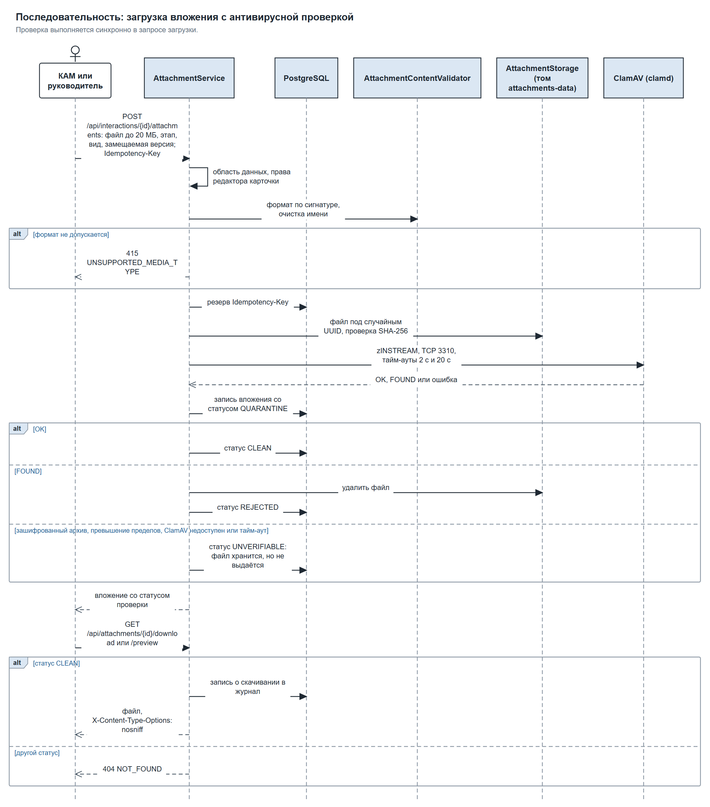

Рисунок 19 — UML-диаграмма последовательности: загрузка вложения с антивирусной проверкой

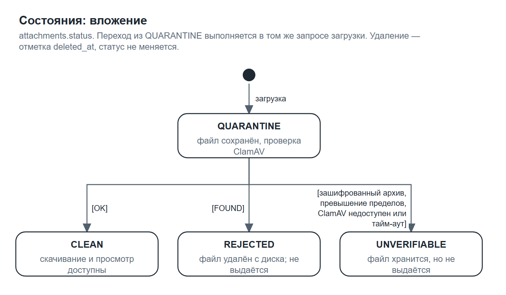

Рисунок 20 — UML-диаграмма состояний: вложение

### 6.5. Договоры по продуктам

Договор по продукту (`product_agreements`) связывает карточку и продукт: номер договора, признак подписанной лицензии, год окончания лицензии, скан. Передачи (`product_transfers`) фиксируют материалы, лицензию и документацию со статусом «передано» или «не передано», датой и подтверждающим вложением. Изменение — `PATCH /api/interactions/{id}/product-agreements/{agreementId}`.

### 6.6. Соглашения и план мероприятий

- Соглашение (`agreements`) принадлежит организации: номер (уникален в пределах организации), даты заключения и окончания, стороны, файл, статус `DRAFT`, `ACTIVE`, `COMPLETED`, `TERMINATED`.
- План мероприятий (`agreement_activities`): вид из справочника `agreement_activity_kinds`, название, единица, плановый и фактический объём, даты, ответственный, статус `PLANNED`, `IN_PROGRESS`, `DONE`, `CANCELLED`; связи с карточками и подтверждающими вложениями.
- Подтверждения — вложения, привязанные к мероприятиям: список `GET /api/agreement-confirmations`, архив ZIP `GET /api/agreement-confirmations/archive` (не больше 500 документов и общий размер до `app.agreements.archive-max-size`, 1 ГБ; иначе `422 CONFIRMATION_LIMIT`).
- Соглашения и мероприятия изменяют `USER` и `LEADER`; справочник видов мероприятий ведёт администратор.

### 6.7. Обучение преподавателей и циклы

- Запись обучения (`POST /api/interactions/{id}/teacher-trainings`) создаёт комментарий карточки и структурированную запись `teacher_trainings`: дата, курс, число записавшихся и завершивших, подтверждающее вложение, дата следующего цикла. С включённым напоминанием следующий шаг карточки ставится на 10:00 по Москве в дату следующего цикла.
- Новый цикл (`POST /api/interactions/{id}/cycles`) создаёт новую карточку с контактами, программой и продуктами предыдущей и связывает их в `interaction_cycles`; начало нового цикла позже предыдущего, у карточки не больше одного следующего цикла.

### 6.8. «Моя работа» и напоминания

- Напоминания вычисляются при запросе `GET /api/reminders` в области данных пользователя; рассылки по почте нет. В список попадают: просроченные и ближайшие шаги (`app.work.upcoming-days`, 7 дней), лицензии, истекающие в пределах `license-years-ahead` (1 год), циклы обучения, у которых подходит срок (`training-cycle-years` 3 года, предупреждение за `training-notice-days` 90 дней, этапы из `training-stage-names`). Длина списка — `reminder-list-limit`, 50.
- Карточка без движения дольше `stuck-days` (30 дней) считается застрявшей.
- Пользователь включает и выключает напоминания: `PUT /api/reminders/settings` (`reminder_settings`).
- Показатели руководителя по КАМ своей команды — `GET /api/work/team-indicators` (организации, карточки, просроченные, без следующего шага, застрявшие); сводка руководства по командам — `GET /api/work/teams-summary`.

### 6.9. Отчёты

Виды отчётов (`ReportKind`):

| Код | Название | Строка отчёта |
|---|---|---|
| `PORTFOLIO` | Портфель взаимодействий: текущее состояние | карточка взаимодействия; дополнительные колонки — вендоры, договор, лицензия, передачи |
| `EVENTS` | События взаимодействий за период | событие истории |
| `DEMAND` | Востребованность программ | программа: заявки сайта, оплаты и оплаченные потоки, участники и завершившие обучение по данным LMS, параллельные потоки |
| `SNAPSHOT` | Состояние портфеля на дату | карточка на выбранную дату |
| `DURATION` | Длительность этапов и цикла | группа «команда, программа, этап»: завершено, средняя и наибольшая длительность, текущие |
| `AGREEMENTS` | Реализация соглашений с вузами | мероприятие плана соглашения: объёмы, даты, статус, подтверждения |

Данные отчёта ограничены областью данных заказчика отчёта (раздел 5.2); у администратора отчёты пусты.

Режимы:

- предпросмотр `POST /api/reports/preview` — синхронно, постранично;
- статистика `POST /api/statistics` — агрегаты по этапам, вузам, ИТ-направлениям, программам, продуктам, ответственным или месяцам; диаграмма — столбцы или линия, до 100 столбцов и 5 рядов;
- файл `POST /api/reports` (заголовок `Idempotency-Key`) — фоновое задание; формат `XLSX`, `XLS`, `PDF`, `JSON` или `PNG` (PNG — только диаграмма, диаграмма — только PNG или PDF).

Фоновые задания:

1. Задание записывается в `report_jobs` со статусом `PENDING` и снимком профиля заказчика (роль, команда, `access_revision`) и выполняется пулом `ReportJobExecutor`: `app.reports.slots` потоков (10) и очередь `app.reports.queue-capacity` (40). Переполнение — `503 REPORT_CAPACITY_EXCEEDED`.
2. Статусы: `PENDING`, `RUNNING`, `SUCCEEDED`, `FAILED`. Клиент опрашивает `GET /api/report-jobs/{id}`; список последних заданий — `GET /api/report-jobs`.
3. Пределы: `app.reports.max-rows` 50 000 строк (`REPORT_ROW_LIMIT`), `app.reports.max-pdf-rows` 20 000 строк для PDF (`REPORT_PDF_ROW_LIMIT`), предел строк листа формата XLS (`REPORT_XLS_ROW_LIMIT`), предел диаграммы (`REPORT_CHART_LIMIT`). Код ошибки задания — в поле `errorCode`.
4. Файл строится во временный `<uuid>.part` и атомарно переименовывается в `<uuid>` в каталоге `app.reports.storage-root` (`/var/lib/rtk-crm/reports`, том `reports-data`). XLSX и XLS пишет Apache POI, PDF — PDFBox, PNG — `java.awt`, JSON — Jackson.
5. При старте backend незавершённые задания прошлого процесса получают `FAILED` с кодом `REPORT_INTERRUPTED`, временные файлы удаляются.
6. Скачивание `GET /api/report-jobs/{id}/result` доступно только заказчику и пишется в журнал. Если права заказчика изменились после заказа — `410 REPORT_ACCESS_CHANGED`; файл удалён по сроку или отсутствует — `410 REPORT_RESULT_UNAVAILABLE`; файл ещё не готов — `409 REPORT_NOT_READY`.
7. Файлы удаляются задачей сроков хранения через `APP_RETENTION_REPORT_FILES` (по умолчанию 7 дней).

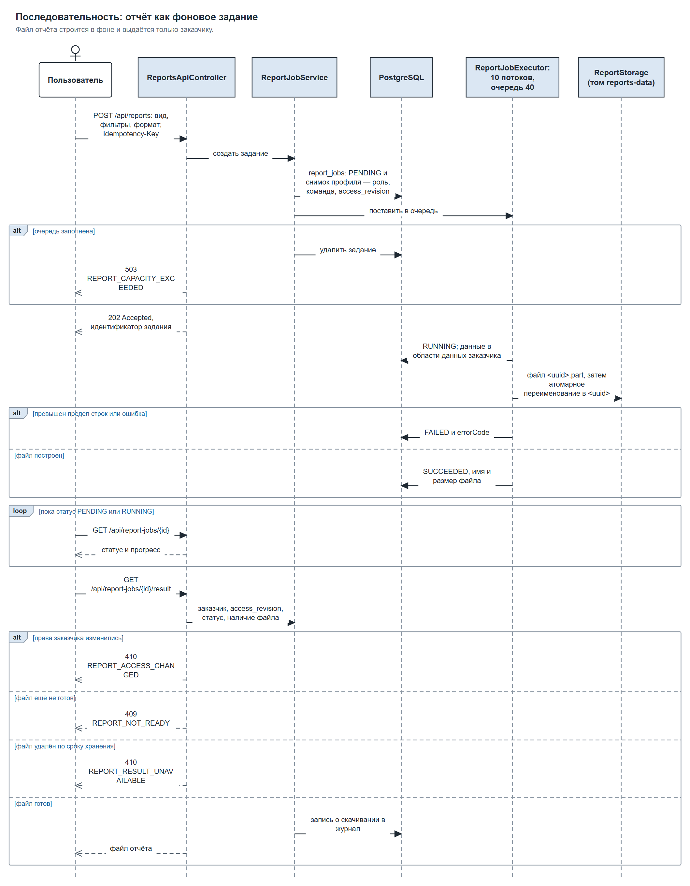

Рисунок 21 — UML-диаграмма последовательности: отчёт как фоновое задание

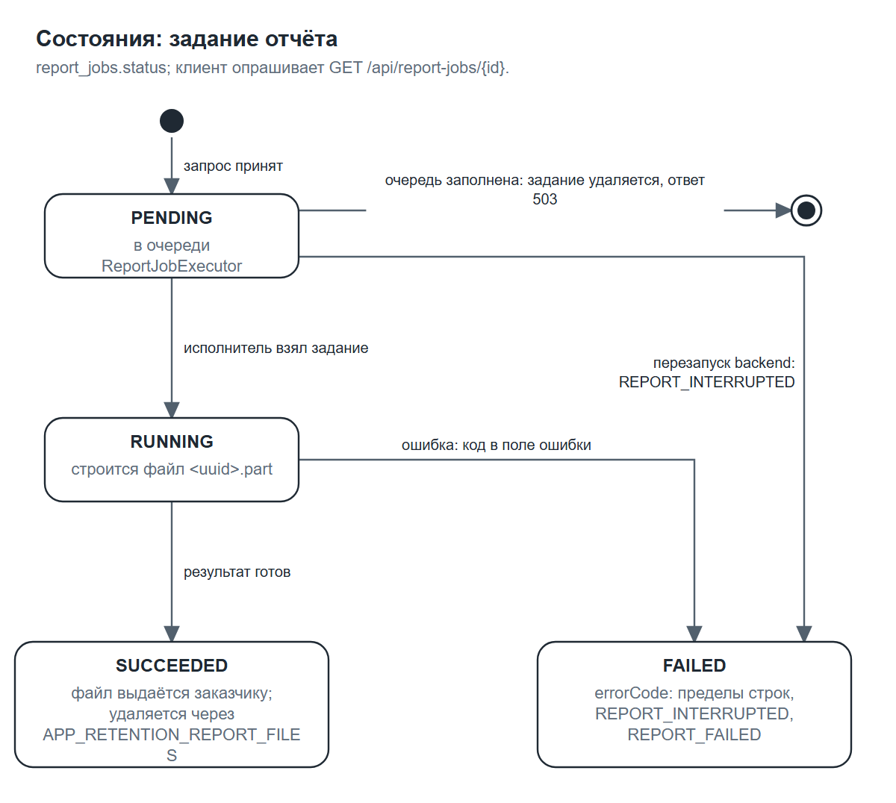

Рисунок 22 — UML-диаграмма состояний: задание отчёта

Сохранённые отчёты (`saved_reports`, `/api/saved-reports`) хранят набор параметров пользователя под уникальным для него именем и относительный период: текущий или прошлый месяц, текущий или прошлый квартал. Справочники фильтров — `/api/report-filters/managers`, `/vendors`, `/stages`.

### 6.10. Импорт каталогов

Импорт выполняет администратор. Формат — книга Excel XLSX или XLS (Apache POI): до 5 МБ, до 5000 строк, до 50 столбцов, до 4000 символов в ячейке, защита от zip-бомб (распакованный объём до 12 МБ).

Профили импорта (`CatalogImportProfile`): `AGREEMENT` (вуз, вендор, продукт, договор), `DIRECTION_PROGRAM` (направления и программы), `VENDOR_CONTACTS` (контакты вендоров).

1. `POST /api/imports/inspect` — листы и заголовки файла.
2. `POST /api/imports/preview` — сопоставление столбцов с полями профиля и план по строкам: `CREATE`, `UPDATE`, `UNCHANGED`, `CONFLICT`, `INVALID` с причинами; импорт сохраняется в `catalog_imports` и `catalog_import_rows` со статусом `PREVIEWED`.
3. `GET /api/imports/{id}` — состояние импорта.
4. `POST /api/imports/{id}/apply` (`Idempotency-Key`, версия импорта) — применение подтверждённых строк в одной транзакции, при необходимости — архивирование устаревших договоров; изменения пишутся в `catalog_change_events`; статус `APPLIED`.
5. `GET /api/jobs/{id}` — результат задания предпросмотра или применения (`catalog_import_jobs`).

Справочники направлений, программ, вендоров, продуктов и контактов вендоров вручную ведёт администратор (`/api/admin/catalogs/{kind}`); история изменений — `GET /api/admin/catalog-events`.

### 6.11. Источники данных: сайт и LMS

Источники — `WEBSITE` (сайт) и `MOODLE` (LMS), таблица `sources`.

**Запуск синхронизации.**

1. Администратор запускает синхронизацию `POST /api/admin/sources/{source}/sync` (ответ `202` с идентификатором запуска). Источник должен быть настроен (иначе `409 SOURCE_NOT_CONFIGURED`), активного запуска того же источника быть не должно (`409 SYNC_ALREADY_RUNNING`).
2. Запуск (`sync_runs`) выполняет отдельный исполнитель: `app.sources.slots` потоков (1) и очередь `app.sources.queue-capacity` (1); переполнение — `503 SYNC_CAPACITY_EXCEEDED`. Статусы: `PENDING`, `RUNNING`, `SUCCEEDED`, `FAILED`; способ запуска — `MANUAL`, `SCHEDULE`, `CARD`, `BOOTSTRAP`, `UPLOAD`.
3. Ошибка транспорта (HTTP не 200, неверный токен, тайм-аут, неверный JSON, превышение пределов) переводит весь запуск в `FAILED` с кодом `SOURCE_UNAVAILABLE`, `SOURCE_UNAUTHORIZED` или `SOURCE_INVALID_RESPONSE`; записи и метка `updated_since` не меняются, прежние данные сохраняются.
4. Каждая запись сайта применяется в своей транзакции; счётчики запуска: получено, создано, изменено, пропущено, требуют сопоставления, ошибки.
5. После успешного запуска сайта метка `updated_since` сдвигается на наибольший `updatedAt` полученных записей.
6. При старте backend незавершённые запуски получают `FAILED` с кодом `SYNC_INTERRUPTED`; непредвиденная ошибка — `SYNC_FAILED`.
7. Плановый запуск — по `APP_SOURCES_SYNC_CRON` (cron Spring, часовой пояс Europe/Moscow; пусто или `-` отключает) для каждого настроенного источника от имени активного администратора, который последним запускал этот источник. Источник, который ещё никто не запускал, по расписанию не синхронизируется.
8. Источник без успешной синхронизации дольше `APP_SOURCES_STALE_AFTER` (26 ч) помечается «данные устарели».

КАМ и руководитель обновляют данные источников своей карточки: `POST /api/interactions/{id}/sources/refresh` (сайт и LMS), `POST /api/interactions/{id}/learning-snapshots/sync` (только LMS); состояние — `GET /api/interactions/{id}/source-status`.

**Записи сайта.**

- Ключ записи — `source` + `record_type` + `external_id`, версия — `updatedAt`: та же версия пропускается, более новая заменяет прежнюю.
- Организация ищется по сопоставлению, затем по внешнему ключу `organizations.external_key`, затем по точному названию. Неизвестная организация или программа — статус `NEEDS_MAPPING` с причиной; организации по данным сайта автоматически не создаются.
- `partnership_request` (заявка вуза на сотрудничество) добавляется комментарием в подходящую карточку организации или создаёт новую карточку «Заявка с сайта: …» по базовому шаблону; контакт ищется по email или ФИО и при отсутствии создаётся. Этап карточки не меняется.
- `learning_application` (заявка на обучение) карточку не создаёт и учитывается в отчёте `DEMAND`; контакт заявки не сохраняется; отзыв (`withdrawn`) исключает заявку из спроса.
- `paid_order` (оплата) — раздел 6.12.

Разбор записей: администратор — «Источники данных» (`/api/admin/source-records`, `/api/admin/source-mapping-options`, `POST /api/admin/source-records/{id}/apply`, `POST /api/admin/source-records/{id}/organization`); руководитель в своей области — `/api/source-records` (сопоставление с организацией `resolve` и создание организации из заявки). Сопоставление применяется повторно ко всем ожидающим записям с тем же ключом (до 500 за раз).

**Данные LMS.**

- Администратор сопоставляет курс или группу Moodle с организацией, программой и датами потока (`/api/admin/source-mappings`); вид потока — обучающиеся или преподаватели. Курс может иметь несколько потоков.
- Синхронизация Moodle получает по каждому разрешённому курсу группы, участников с ролями и статус завершения и публикует снимок по потоку (`learning_snapshots`): число обучающихся, преподавателей, завершивших, не завершивших, со статусом «неизвестно», число групп. Если отслеживание завершения в курсе выключено, числа завершения пустые, а не нули.
- Снимок показывается в блоке «Обучение (LMS)» карточки и событием «Данные LMS» в истории, учитывается в отчёте `DEMAND`.
- Несопоставленный курс или группа не публикуется и попадает в записи для разбора со статусом `NEEDS_MAPPING`.
- Ошибка на любом курсе останавливает весь запуск без изменения прежних снимков.

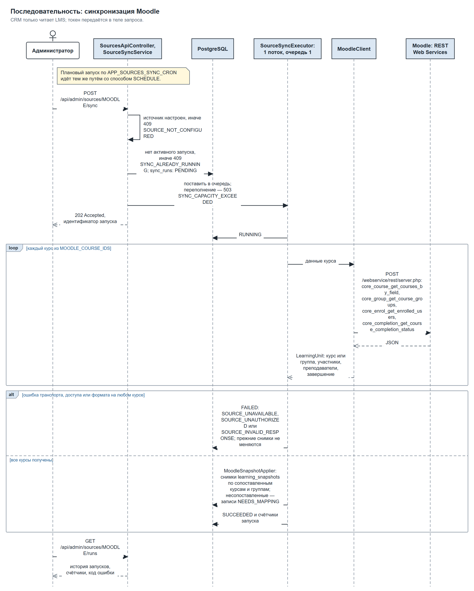

Рисунок 23 — UML-диаграмма последовательности: синхронизация Moodle

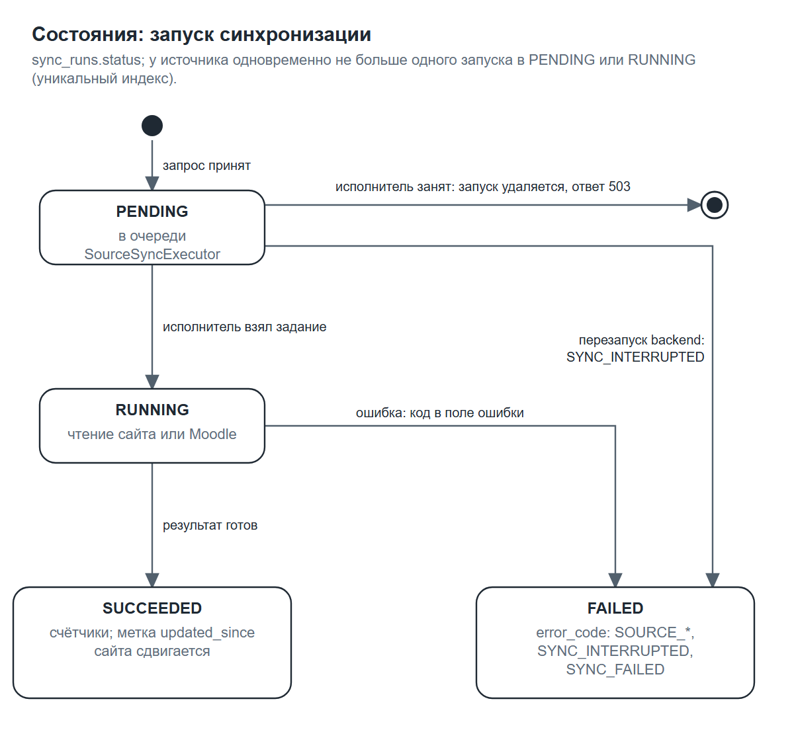

Рисунок 24 — UML-диаграмма состояний: запуск синхронизации

### 6.12. Модуль «Слушатели»

Модуль включается переменной `MODULE_ENROLMENT_ENABLED` (`app.modules.enrolment.enabled`); кабинет вуза — `MODULE_PARTNER_ENABLED` (`app.modules.partner.enabled`). Работает в нём только оператор зачисления.

**Данные.**

- Поток (`enrolment_streams`) — пара «курс» + «номер потока» (уникальна), дата окончания `ends_on`, версия.
- Анкета слушателя (`learners`) — 30 полей шаблона «Загрузка пользователей» (`LearnerField`): ФИО, телефон, email, СНИЛС, паспорт (серия, номер, кем выдан, дата выдачи, код подразделения), пол, дата рождения, адрес (регион, населённый пункт, улица, дом, квартира, индекс), ФИО в дательном падеже, образование, сведения о дипломе. Значения хранятся зашифрованными в поле `fields` (JSON «код поля → шифротекст»), пустые поля в JSON отсутствуют. Статус ПДн: `ACTIVE`, `RESTRICTED`, `ANONYMIZED`.
- Зачисление (`learner_enrolments`) связывает анкету, поток и запись оплаты; у слушателя одно зачисление на поток. Поля выгрузки в LMS: идентификатор выгрузки, время выгрузки, время отметки «передано».

**Приём оплат.**

1. Оплаты приходят файлом оператора (`POST /api/enrolment/paid-orders`, JSON-массив до 5 МиБ и до 10 000 элементов) или из API сайта (раздел 7.1). Оба пути разбирает один `PaidOrderParser`.
2. Запись без номера заявки, курса или номера потока не принимается. Неверные телефон или email отбрасываются с предупреждением, запись принимается. Пустые элементы и повторы номера учитываются в протоколе ответа.
3. В `source_records` с типом `paid_order` сохраняются только номер заявки, курс и номер потока; ФИО, телефон и email туда не попадают. Версия записи — SHA-256 от курса и номера потока (`payload_hash`).
4. В той же транзакции оплата принимается в модуль: если зачисление по этой оплате уже есть — берётся его слушатель; иначе ищется активная анкета с тем же отпечатком email или телефона и совпадающими фамилией и именем (отчество сравнивается, если есть в обоих); иначе создаётся новая анкета. Анкета с ограниченной обработкой не сопоставляется. Из оплаты заполняются только пустые поля; расхождение контактов фиксируется в протоколе без перезаписи. Ошибка откатывает и запись источника, и зачисление.
5. При выключенном модуле ФИО, телефон и email из оплат отбрасываются, в CRM остаются номер, курс и поток.

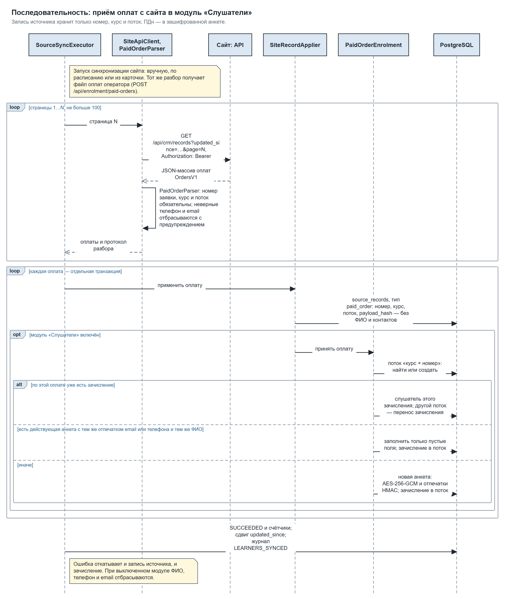

Рисунок 25 — UML-диаграмма последовательности: приём оплат с сайта в модуль «Слушатели»

**Анкета.**

- Заполняет оператор: правкой полей (`PATCH /api/enrolment/learners/{id}`) или загрузкой заполненного шаблона по потоку (`questionnaire-imports/preview`, затем `apply`). Самостоятельного заполнения слушателем нет.
- Проверки (`LearnerRules`): телефон нормализуется к `+7XXXXXXXXXX` (первая цифра после кода страны от 3 до 9); СНИЛС — 11 цифр с проверкой контрольного числа, формат вывода `XXX-XXX-XXX YY`; паспорт заполняется целиком: серия 4 цифры, номер 6 цифр, код подразделения `NNN-NNN`, дата выдачи не раньше 14-летия и не в будущем; дата рождения не раньше 1900-01-01, возраст не меньше 18 лет; образование — закрытый список из 7 значений; ограничения длины и допустимых символов для строковых полей, общий предел 500 символов.
- Полнота («Заполнено X из Y») считается по колонке `missing_fields` без расшифровки.
- Поиск (`POST /api/enrolment/learners/search`) — только точное совпадение по отпечаткам email, телефона, СНИЛС, фамилии или ФИО.
- Карточка (`GET /api/enrolment/learners/{id}`) возвращает маскированные значения: имя открыто, телефон `+7 9** ***-**-34`, email `i***@example.test`, СНИЛС `***-***-*** 12`, прочие документы, личные данные, адрес и образование — `***`, ФИО в дательном падеже открыто. Раскрытие группы полей — `POST /api/enrolment/learners/{id}/reveal`; ответы с раскрытыми данными отдаются с `Cache-Control: no-store`.
- Дубликат по СНИЛС объединяется переносом зачислений: `POST /api/enrolment/learners/{id}/move-enrolments`. История действий по анкете — `GET /api/enrolment/learners/{id}/history`.

**Шифрование полей.**

- Алгоритм — AES-256-GCM (`LearnerDataCipher`), тег 128 бит, случайный вектор инициализации 12 байт на каждое значение. Формат значения: `<версия ключа>:<IV в Base64>:<шифротекст с тегом в Base64>`.
- Дополнительные данные GCM: `<версия ключа>:learner:<id анкеты>:<код поля>`; значение, перенесённое в другое поле или анкету, не расшифруется.
- Ключи задаются только переменными окружения: `APP_ENROLMENT_ACTIVE_KEY_VERSION`, `APP_ENROLMENT_KEYS_V1`, `APP_ENROLMENT_KEYS_V2` (ровно 32 байта в Base64), `APP_ENROLMENT_FINGERPRINT_KEY` (не меньше 32 байт, не совпадает с ключами шифрования). При включённом модуле без ключей или с ключом неверной длины backend не запускается и называет переменную.
- Отпечатки для поиска — HMAC-SHA256 от `<вид>:<нормализованное значение>` на ключе отпечатков, хранятся в колонках `email_hmac`, `phone_hmac`, `snils_hmac`, `name_hmac`, `last_name_hmac`; по `snils_hmac` действует уникальный индекс.
- Ротация ключа: новая версия задаётся в `APP_ENROLMENT_KEYS_V2` и `APP_ENROLMENT_ACTIVE_KEY_VERSION=v2`. Задача `LearnerRekeyJob` запускается через минуту после старта и далее раз в час, перешифровывает анкеты со старой версией ключа пачками по 100 и пересчитывает отпечатки, не меняя `version` анкеты. Старый ключ удаляют, когда счётчик анкет со старой версией (блок «Сроки хранения» у администратора) равен нулю. Для третьей версии в `compose.yaml` добавляется переменная `APP_ENROLMENT_KEYS_V3`.

**Потоки и файл для LMS.**

- `GET /api/enrolment/streams` — потоки со счётчиками оплат, анкет, выгрузок и передач; `PATCH /api/enrolment/streams/{id}` — дата окончания потока; `GET /api/enrolment/streams/{id}/learners` — состав потока.
- `POST /api/enrolment/streams/{id}/lms-roster` формирует XLSX «Загрузка пользователей» (`LmsRosterWorkbookWriter`): все слушатели потока или только ещё не переданные; строки с незаполненными обязательными полями выгружаются пустыми или исключаются. Имя файла — `LMS_<курс>_поток<N>_<дата>.xlsx`. Формат файла — раздел 7.3.
- `POST /api/enrolment/roster-exports/{id}/transferred` отмечает, что выгрузка передана в LMS.

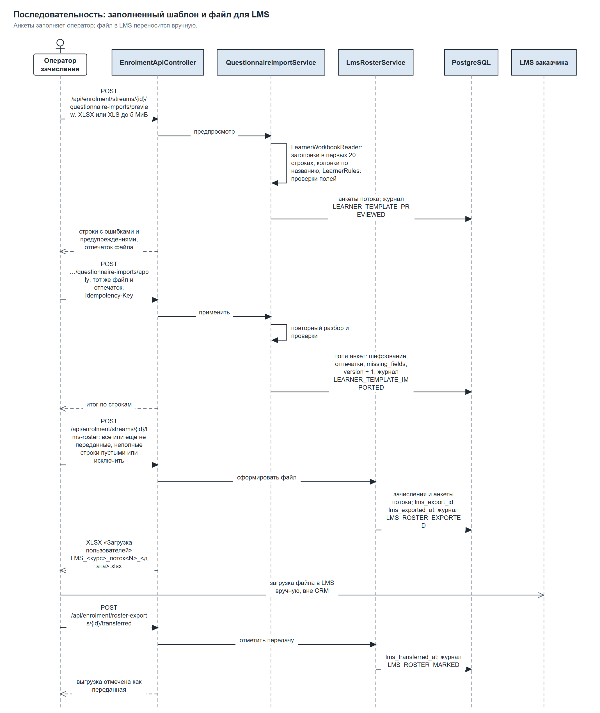

Рисунок 26 — UML-диаграмма последовательности: загрузка заполненного шаблона и файл для LMS

**Журнал.** События категории «Слушатели» (`LEARNER_VIEWED`, `LEARNER_FIELDS_REVEALED`, `LEARNER_CHANGED`, `LEARNER_SEARCHED`, `LEARNER_ENROLMENTS_MOVED`, `LEARNER_LIST_VIEWED`, `LEARNER_TEMPLATE_PREVIEWED`, `LEARNER_TEMPLATE_IMPORTED`, `LMS_ROSTER_EXPORTED`, `LMS_ROSTER_MARKED`, `STREAM_END_DATE_CHANGED`, `PAID_ORDERS_UPLOADED`, `LEARNERS_SYNCED`) хранят коды полей и групп и счётчики, но не значения. Вместо имени слушателя в журнале — «Слушатель» и первые 8 символов идентификатора.

**Срок хранения.** Анкета обезличивается, когда для всех её зачислений прошёл срок `APP_RETENTION_LEARNER_PROFILES` (по умолчанию `P3Y`) от даты окончания потока. Анкета с потоком без даты окончания автоматически не обезличивается. Зачисления, потоки и записи оплат после обезличивания сохраняются.

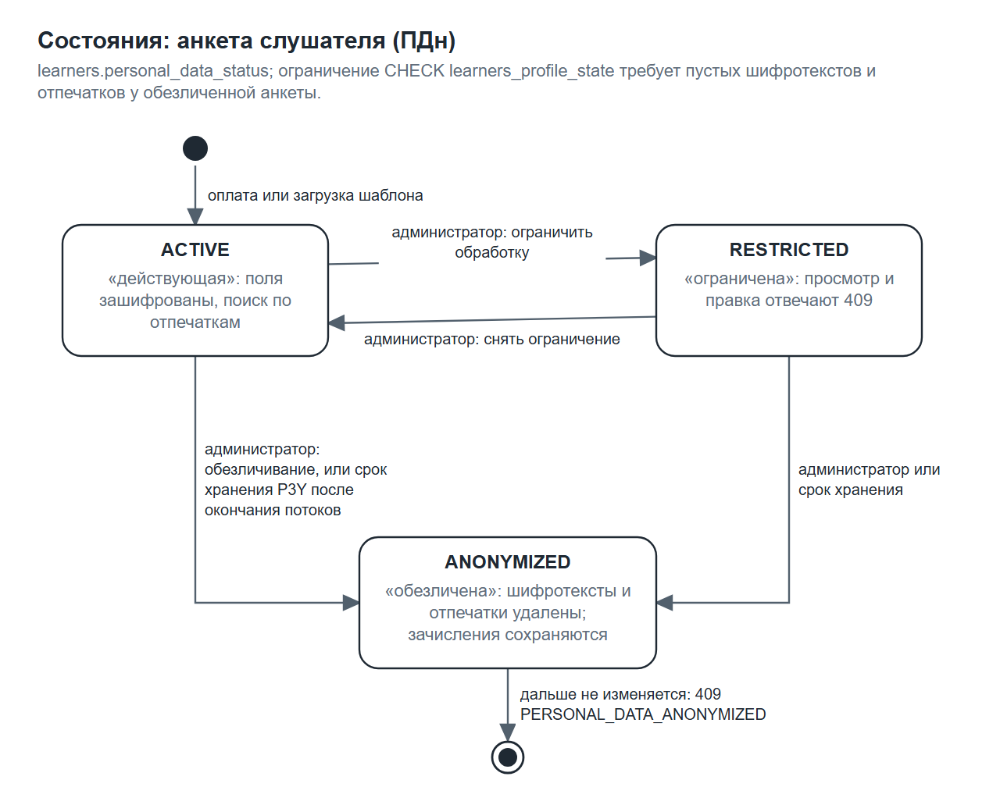

Рисунок 27 — UML-диаграмма состояний: анкета слушателя (ПДн)

### 6.13. Журнал

- Журнал администратора и безопасности (`AuditJournalRepository`) объединяет пять источников: `audit_events`, `crm_profile_events` (изменения профилей, отдельно — флаг оператора), `organization_assignment_events`, `organization_team_events`, `sync_runs`.
- Категории (`AuditCategory`): профили, назначения, организации, команды, синхронизация, скачивания, персональные данные, сроки хранения, учётные записи, слушатели. Действия (`AuditAction`) имеют русские подписи.
- Читает журнал только администратор: `GET /api/admin/audit-events` (фильтры: период, автор, объект, категория; страница по 50), выгрузка `GET /api/admin/audit-events/export?format=XLSX|CSV` не больше `app.reports.max-rows` строк (иначе `422 REPORT_ROW_LIMIT`); сама выгрузка пишется в журнал. Журнал изменений профиля — `GET /api/admin/crm-profiles/{id}/events`.
- В журнал не пишутся тела запросов, секреты и значения полей анкет; условия поиска субъекта ПДн не сохраняются, только факт и число найденного.
- Записи `audit_events` удаляются по сроку `APP_RETENTION_AUDIT_EVENTS` (по умолчанию 1095 дней); остальные источники журнала сроком хранения не ограничены.

### 6.14. Субъект персональных данных

Функции администратора (`/api/admin/personal-data`):

| Операция | Путь | Что делает |
|---|---|---|
| Поиск | `POST /api/admin/personal-data/search` | ищет субъекта по ФИО, почте, телефону в контактах, профилях, упоминаниях, вложениях, записях источников; анкеты слушателей — точным совпадением по отпечаткам |
| Выгрузка сведений | `POST /api/admin/personal-data/export?format=JSON\|PDF` | оператор, цели, источники, получатели, сроки хранения, найденные записи; для анкет — расшифрованные значения |
| Уточнение | `PATCH /api/admin/personal-data/contacts/{id}` | правка ФИО, должности, почты, телефона контакта |
| Ограничение обработки | `POST /api/admin/personal-data/contacts/{id}/restriction`, `POST /api/admin/personal-data/learners/{id}/restriction` | установка и снятие ограничения; при ограничении просмотр и правка отвечают `409 PERSONAL_DATA_RESTRICTED` |
| Обезличивание | `POST /api/admin/personal-data/anonymization` | замена ФИО, почты и телефона маркером во всех текстах целыми словами; у анкет удаляются шифротексты и отпечатки, статус `ANONYMIZED` |

Обезличенные записи дальше не изменяются (`409 PERSONAL_DATA_ANONYMIZED`).

### 6.15. Сроки хранения

Задача `RetentionService` запускается по расписанию `APP_RETENTION_CRON` (по умолчанию `0 30 3 * * *`, часовой пояс Europe/Moscow) и вручную (`POST /api/admin/retention/run`); одновременно выполняется один запуск, повторный ручной запуск получает `409 RETENTION_RUNNING`. Текущая политика — `GET /api/admin/retention`.

| Что | Переменная | По умолчанию | Действие |
|---|---|---|---|
| Файлы заказанных отчётов | `APP_RETENTION_REPORT_FILES` | `7d` | файл удаляется, скачивание отвечает `410 REPORT_RESULT_UNAVAILABLE` |
| Контакты организаций без изменений работ, истории и контактов | `APP_RETENTION_INACTIVE_CONTACTS` | `1095d` | обезличивание |
| Заблокированные профили сотрудников | `APP_RETENTION_DISMISSED_PROFILES` | `365d` после блокировки | обезличивание |
| Записи `audit_events` | `APP_RETENTION_AUDIT_EVENTS` | `1095d` | удаление |
| Анкеты слушателей | `APP_RETENTION_LEARNER_PROFILES` | `P3Y` после окончания последнего потока (период ISO-8601, календарно) | обезличивание |

Контакты и профили обрабатываются пачками по 200. Итог запуска пишется в журнал (`RETENTION_APPLIED`).

## 7. Интеграции и заглушки

Все интеграции подключаются к реальным системам заказчика изменением переменных окружения, без правки кода, кроме отдельно оговорённого случая шаблона файла для LMS.

| Система | Адаптер в коде | Что работает сейчас | Подключение реальной системы |
|---|---|---|---|
| Сайт: заявки и оплаты | `SiteApiClient`, `SiteRecord`, `SiteRecordApplier`, `PaidOrderParser` | тестовая копия сайта `site-fixture` | `SITE_BASE_URL`, `SITE_TOKEN` |
| LMS | `MoodleClient`, `MoodleSnapshotApplier` | демо-Moodle 4.5.4 | `MOODLE_BASE_URL`, `MOODLE_TOKEN`, `MOODLE_COURSE_IDS` |
| Файл «Загрузка пользователей» | `LearnerField`, `LmsRosterWorkbookWriter`, `LearnerWorkbookReader`, `LearnerRules` | шаблон из 30 колонок, файл переносится в LMS вручную | правка `LearnerField` при другом шаблоне |
| IdP | Spring Security OAuth2 Client (`ApiSecurityConfiguration`, `application-oidc.yml`), `KeycloakAccountClient`, `KeycloakLogoutSuccessHandler` | Keycloak из поставки, realm `rtk-crm` | `APP_OIDC_*`, `APP_KEYCLOAK_ACCOUNT_SYNC_CLIENT_SECRET` |

### 7.1. Сайт: заявки и оплаты

Заказчик не передал API сайта. CRM работает по собственному контракту `docs/integrations/site-api.yaml`.

**Контракт.** `GET {SITE_BASE_URL}/api/crm/records?updated_since=<ISO 8601>&page=<N>` с заголовком `Authorization: Bearer <SITE_TOKEN>`. Ответ — объект `{"items": [...], "nextPage": <номер или null>}`; запись содержит `externalId`, `type` (`partnership_request`, `learning_application`), `createdAt`, `updatedAt`, `status`, `organization`, `program`, `product`, `contact`, `applicationsCount`, `message`. Если ответ — JSON-массив, он разбирается как массив оплат `OrdersV1` (поля «Номер заявки», «Курс», «Фамилия», «Имя», «Отчество», «Телефон», «Email», «Номер потока»).

**Параметры клиента** (`app.sources.website`): HTTP-клиент JDK, проверка TLS по умолчанию, без переадресаций, тайм-ауты соединения 5 с и чтения 20 с, страница не больше 5 МБ, не больше 100 страниц за запуск. Адрес и токен есть только в конфигурации развёртывания, в БД, API и журнал не попадают.

**Как работает заглушка.** Сервис `site-fixture` (nginx, профиль Compose `demo`, без внешнего порта) отдаёт синтетические данные из `infra/site-fixture/data/`:

- `GET /api/crm/records?page=N` — `records-page-1.json` и `records-page-2.json` (17 записей заявок); без `Authorization: Bearer ${SITE_TOKEN}` — `401`, без номера страницы — `400`; параметр `updated_since` не учитывается, поэтому повторный запуск показывает пропуск уже полученных версий;
- `GET /orders/api/crm/records` — `orders-v1.json`, массив синтетических оплат (при `SITE_BASE_URL=http://site-fixture:8080/orders` источник получает оплаты).

Скрипт установки подставляет `SITE_BASE_URL=http://site-fixture:8080` и случайный `SITE_TOKEN` и поднимает `site-fixture`, если адрес сайта не задан или указывает на заглушку. Оплаты также загружает оператор файлом в разделе «Зачисление» (`POST /api/enrolment/paid-orders`) независимо от настройки сайта.

**Подключение реального сайта.**

1. Сайт реализует `GET /api/crm/records` по контракту `docs/integrations/site-api.yaml` (заявки — объектом `{items, nextPage}`, оплаты — массивом `OrdersV1`) с авторизацией Bearer-токеном только на чтение. Если формат сайта другой, меняются `SiteApiClient` и `SiteRecord`; код выше этой границы от формата не зависит.
2. В `.env.local` задать `SITE_BASE_URL` (адрес без `/api/...`) и `SITE_TOKEN`; при настоящем адресе `site-fixture` не запускается.
3. Задать расписание `SOURCES_SYNC_CRON`, перезапустить backend (`./scripts/bootstrap-demo.sh` или `docker compose --env-file .env.local up -d backend`).
4. Один раз запустить синхронизацию сайта вручную из «Источников данных»: после этого работает плановый запуск.
5. Разобрать записи `NEEDS_MAPPING`: сопоставить организации и программы.

### 7.2. LMS заказчика

**Как работает сейчас.** CRM читает Moodle через REST Web Services: `POST {MOODLE_BASE_URL}/webservice/rest/server.php` с параметрами `wstoken`, `wsfunction`, `moodlewsrestformat=json`; токен передаётся только в теле запроса. Вызываемые функции: `core_course_get_courses_by_field`, `core_group_get_course_groups`, `core_enrol_get_enrolled_users`, `core_completion_get_course_completion_status`. Читаются только курсы из списка `MOODLE_COURSE_IDS`. Роли участников: обучающиеся — `student`, преподаватели — `editingteacher`, `teacher` (`app.sources.moodle.student-roles`, `teacher-roles`). Тайм-ауты 5 с и 20 с, ответ не больше 5 МБ. Записи в LMS CRM не выполняет.

Ответ Moodle с полем `exception` или `errorcode` считается ошибкой; ошибки доступа (`invalidtoken`, `accessexception`, `nopermissions` и другие) дают `SOURCE_UNAUTHORIZED` с указанием проверить токен и роль сервиса. Пустой список участников при наличии групп считается ошибкой доступа (нет права `moodle/site:accessallgroups`).

**Как работает заглушка.** Демо-Moodle 4.5.4 в отдельном проекте Compose `rtk-crm-moodle` (`infra/moodle/compose.yaml`) поднимает и настраивает скрипт установки при `DEMO_LMS=true` (`scripts/moodle-demo.sh`, `infra/moodle/demo-setup.php`):

- включает веб-службы и REST, создаёт пользователя `crm-ws` с системной ролью `crmwsreader` (права `webservice/rest:use`, `moodle/course:view`, `moodle/course:enrolreview`, `moodle/course:managegroups`, `moodle/site:accessallgroups`, `moodle/user:viewdetails`, `report/completion:view`);
- создаёт ограниченный внешний сервис `crm_readonly` с четырьмя функциями выше и постоянный токен;
- создаёт два синтетических курса с группами, преподавателя и 10 синтетических учащихся, учётную запись просмотра `crm-jury`;
- записывает в `.env.local` `MOODLE_BASE_URL=http://moodle:8080`, `MOODLE_TOKEN`, `MOODLE_COURSE_IDS`; backend подключается к сети `rtk-crm-moodle` (`infra/moodle/compose.crm.yaml`).

Порт демо-Moodle `8082` опубликован только на `127.0.0.1`. Для внешнего показа демо-Moodle публикуется через `web` под отдельным именем (`MOODLE_PUBLIC_HOST` с `compose.prod.yaml` или `MOODLE_EDGE_HOST` с `compose.edge.yaml`). Отключение — `DEMO_LMS=false`: скрипт очищает демо-значения `MOODLE_*`, ранее полученные снимки остаются.

**Подключение LMS заказчика (Moodle).**

1. Администратор Moodle включает веб-службы и протокол REST.
2. Создаёт технического пользователя и роль с семью правами, перечисленными выше, и назначает её пользователю.
3. Создаёт ограниченный внешний сервис с четырьмя функциями, разрешает его техническому пользователю и выпускает токен.
4. В `.env.local` задаются `MOODLE_BASE_URL` (совпадает с `wwwroot` Moodle, переадресации не выполняются), `MOODLE_TOKEN`, `MOODLE_COURSE_IDS` (id курсов ИТ-программ через запятую), `DEMO_LMS=false`. Backend должен иметь сетевой доступ к адресу Moodle.
5. Backend перезапускается, администратор CRM запускает синхронизацию Moodle вручную и сопоставляет курсы и группы с организациями, программами и датами потоков.

Если LMS заказчика не Moodle, нужен свой клиент, возвращающий те же агрегаты `LearningUnit` (курс или группа, участники, преподаватели, завершение, число потоков); сопоставления, снимки, карточка и отчёт от вида LMS не зависят.

### 7.3. Файл «Загрузка пользователей»

Заказчик не подтвердил окончательный состав и обязательность полей шаблона. CRM формирует и читает файл по шаблону организатора из 30 колонок.

**Как работает сейчас.**

- Выгрузка (`LmsRosterWorkbookWriter`, `POST /api/enrolment/streams/{id}/lms-roster`) — XLSX. Первая строка листа 1 — 30 заголовков шаблона в порядке `LearnerField` (колонки A–AD), одна строка на зачисление. Телефон — число `7XXXXXXXXXX` с форматом `0`; даты — ячейки даты `dd.mm.yyyy`; СНИЛС, паспорт, индекс и поля диплома — текст (формат `@`), чтобы сохранить ведущие нули. На листе 2 — списки значений пола (`М`, `Ж`) и образования; колонки L и W имеют выпадающие списки.
- Обязательные для выгрузки поля (`LearnerRules.REQUIRED`): фамилия, имя, телефон, email. Строки, где они не заполнены, по выбору оператора выгружаются с пустыми значениями или исключаются.
- Загрузка заполненного файла (`LearnerWorkbookReader`, `questionnaire-imports/preview` и `apply`) принимает XLSX и XLS до 5 МиБ. Строка заголовков ищется в первых 20 строках: нужны колонки «Фамилия» и «Имя» и хотя бы одна из «Телефон», «Email». Колонки сопоставляются по названию заголовка без учёта регистра, «ё/е» и пробелов, поэтому перестановка колонок разбор не ломает; неизвестный заголовок — предупреждение. Числа, у которых Excel потерял ведущие нули, восстанавливаются с предупреждением. Проверки значений — `LearnerRules` (раздел 6.12).
- Файл в LMS переносит оператор вручную вне CRM и отмечает выгрузку как переданную (`POST /api/enrolment/roster-exports/{id}/transferred`).

**Что настроить при получении шаблона заказчика.** Состав, порядок и названия колонок задаются перечислением `LearnerField` (заголовок и метка поля), обязательные поля выгрузки — `LearnerRules.REQUIRED`, обязательные колонки для поиска строки заголовков — `REQUIRED_COLUMNS` и `CONTACT_COLUMNS` в `LearnerWorkbookReader`, списки значений — справочники пола и образования в `LearnerRules`. Это изменение кода с пересборкой backend; хранение анкеты (JSON «код поля → шифротекст») при этом не меняется, новые поля добавляются в перечисление.

### 7.4. IdP заказчика

Вход работает по стандартному OIDC через Spring Security OAuth2 Client; специфика Keycloak используется только для блокировки учётных записей (`KeycloakAccountClient`, Admin REST) и выхода (`end_session_endpoint`). Роли и команды хранятся в CRM, а не в IdP.

**Как работает сейчас.** CRM поставляется со своим Keycloak 26.7.4: realm `rtk-crm` импортируется из `infra/keycloak/rtk-crm-realm.json`, клиенты `crm-bff` и `crm-account-sync` и пользователи создаются скриптом установки (демо-пользователи или один администратор при `DEMO_DATA=false`).

**Подключение IdP заказчика.**

1. В IdP регистрируется конфиденциальный клиент для CRM с redirect URI `PUBLIC_ORIGIN/api/auth/callback/keycloak`, адресом возврата после выхода `PUBLIC_ORIGIN/` и scope `openid profile`. У IdP должен быть OIDC discovery и `end_session_endpoint`; имя пользователя берётся из claim `preferred_username` (`user-name-attribute` в `application-oidc.yml`).
2. В окружении backend задаются `APP_OIDC_ISSUER_URI` (издатель IdP), `APP_OIDC_CLIENT_SECRET`, `APP_OIDC_PUBLIC_BASE_URL` и `APP_OIDC_INTERNAL_BASE_URL`. Адреса эндпоинтов в `application-oidc.yml` строятся по схеме Keycloak (`/realms/rtk-crm/protocol/openid-connect/...`, для браузера — с префиксом `/idp`); для IdP с другой схемой адресов в `application-oidc.yml` задаются его `authorization-uri`, `token-uri`, `user-info-uri`, `jwk-set-uri` и `app.oidc.end-session-uri`.
3. Для синхронизации блокировок нужен Keycloak с сервисным клиентом `crm-account-sync` (роль `realm-management/manage-users`) и `APP_KEYCLOAK_ACCOUNT_SYNC_CLIENT_SECRET`. Для другого IdP переменная остаётся пустой: блокировка действует в CRM, профиль получает отметку «требует синхронизации», учётную запись в IdP отключают вручную.
4. Профили CRM связаны с парой «издатель + subject». При смене IdP пользователи входят заново, новые профили ждут активации администратором (раздел 5.4).

## 8. Безопасность

### 8.1. Вход: OIDC и BFF

- Backend — конфиденциальный клиент `crm-bff` realm `rtk-crm` (профиль Spring `oidc`, `application-oidc.yml`): поток Authorization Code, scope `openid profile`, имя пользователя из claim `preferred_username`.
- Вход: `GET /api/auth/login` перенаправляет на `/api/auth/authorization/keycloak`, затем в браузере — на `PUBLIC_ORIGIN/idp/realms/rtk-crm/protocol/openid-connect/auth`. Возврат — `/api/auth/callback/keycloak`. Обмен кода на токены, userinfo и ключи JWKS backend получает по внутреннему адресу Keycloak (`APP_OIDC_INTERNAL_BASE_URL`). Издатель ID-токена сверяется с `APP_OIDC_ISSUER_URI`.
- Токены в браузер не передаются: они хранятся в серверной сессии (Spring Session JDBC, таблицы `spring_session`, `spring_session_attributes`). Браузер получает только cookie `SESSION`.
- Выход: `POST /api/auth/logout` завершает сессию, удаляет cookie `SESSION` и `XSRF-TOKEN` и возвращает адрес завершения сессии Keycloak (`end_session_endpoint` с `post_logout_redirect_uri = PUBLIC_ORIGIN/`), который открывает браузер.
- Без аутентификации доступны только `/actuator/health`, `/actuator/info`, `/openapi.yaml`, `/swagger-ui/**`, `/v3/api-docs/swagger-config` и пути входа. Прочие пути вне `/api/**` backend отклоняет.
- Realm `rtk-crm` (`infra/keycloak/rtk-crm-realm.json`): самостоятельная регистрация и сброс пароля выключены, «запомнить меня» выключено, вход по email выключен, защита от подбора пароля включена, политика паролей `length(12) and maxLength(128) and notUsername and notEmail`, журналы событий входа и администрирования включены, язык интерфейса — русский. Клиенты `crm-bff` и `crm-account-sync` и пользователи создаются скриптом установки.

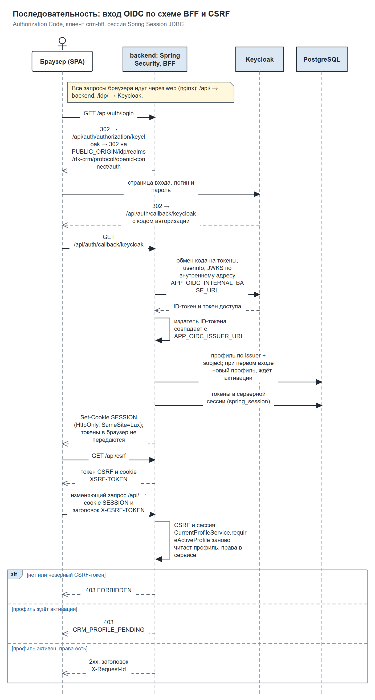

Рисунок 28 — UML-диаграмма последовательности: вход OIDC по схеме BFF и CSRF

### 8.2. Cookie и CSRF

- Cookie `SESSION`: `HttpOnly`, `SameSite=Lax`, `Secure` по переменной `SESSION_COOKIE_SECURE` (в `compose.prod.yaml` и `compose.edge.yaml` — `true`). Время жизни сессии явно не задано — действует значение Spring Boot по умолчанию.
- CSRF: `CookieCsrfTokenRepository` с cookie `XSRF-TOKEN`, доступной скрипту, и заголовком `X-CSRF-TOKEN`. Клиент получает токен из `GET /api/csrf` и передаёт его в каждом изменяющем запросе; без него — `403 FORBIDDEN`.

### 8.3. Заголовки и CSP

Заголовки ставит nginx (`infra/web/security-headers.conf`) на все ответы SPA, статики и ответ 413:

| Заголовок | Значение |
|---|---|
| `Content-Security-Policy` | `default-src 'self'; script-src 'self'; style-src 'self'; style-src-attr 'none'; img-src 'self' data: blob:; font-src 'self'; connect-src 'self'; frame-ancestors 'none'; base-uri 'self'; form-action 'self'; object-src 'none'` |
| `X-Content-Type-Options` | `nosniff` |
| `Referrer-Policy` | `strict-origin-when-cross-origin` |
| `X-Frame-Options` | `DENY` |
| `Permissions-Policy` | `geolocation=(), camera=(), microphone=(), payment=()` |
| `Strict-Transport-Security` | `max-age=31536000`, только когда запрос пришёл по HTTPS (напрямую или от доверенного прокси) |

`server_tokens off` скрывает версию nginx. Ответы `/api/` несут заголовки Spring Security по умолчанию, `/idp/` — заголовки Keycloak. Файлы выгрузок журнала и сведений о субъекте отдаются с `X-Content-Type-Options: nosniff`.

Заголовки `X-Forwarded-For` и `X-Forwarded-Proto` nginx принимает только от адресов `TRUSTED_PROXY_CIDR`; от остальных подставляет `$remote_addr` и `$scheme`. Заголовки `Forwarded`, `X-Forwarded-Port`, `X-Forwarded-Prefix` удаляются всегда, `X-Forwarded-Host` равен `Host`. В варианте с TLS снаружи закрыты `/idp/admin/` и `/idp/realms/master/` (ответ 404).

### 8.4. Шифрование анкет и ключи

Поля анкет слушателей шифруются AES-256-GCM, поиск идёт по HMAC-отпечаткам (раздел 6.12). Ключи хранятся только в переменных окружения (`.env.local` с правами 600) и не входят в резервную копию БД. Копию ключей оператор хранит отдельно от копии данных: без ключа анкеты не расшифровать, без ключа отпечатков не работает поиск.

Администратор значения анкет не видит, кроме выгрузки сведений о субъекте ПДн. Роль «Руководство» доступа к анкетам не имеет.

### 8.5. Журнал и журналы сервера

Действия с профилями, назначениями, командами, синхронизацией, скачиваниями, персональными данными, сроками хранения, учётными записями и анкетами пишутся в журнал администратора (раздел 6.13). Журналы входа и администрирования ведёт Keycloak. Журнал backend (раздел 10.1) содержит идентификатор запроса и строку по каждой ошибке 4xx без тела запроса.

### 8.6. Резервное копирование

Копия (раздел 9.6) содержит персональные данные CRM, БД Keycloak с хешами паролей и секретом клиента `crm-bff`, действующие сессии CRM. Её хранят вне сервера с ограниченным доступом. `.env.local` в копию не входит и хранится отдельно.

## 9. Развёртывание и эксплуатация

### 9.1. Требования

- Linux x86_64, Docker Engine и Docker Compose v2 не ниже 2.24 (используется тег `!override`), `bash` 4+, `openssl`, `sed`, `tr`; для копирования по расписанию — `flock`.
- Память: ClamAV ограничен 2 ГБ; при нехватке памяти ядро завершает самый крупный процесс, обычно clamd (раздел 9.10).
- Доступ в интернет при первой сборке: образы, Maven Central, npm registry, сигнатуры ClamAV.

### 9.2. Локальный запуск

```bash
git clone <репозиторий> rtk-crm && cd rtk-crm
./scripts/bootstrap-demo.sh
```

`scripts/bootstrap-demo.sh` (вариант для PowerShell — `scripts/bootstrap-demo.ps1`):

1. создаёт или дополняет `.env.local` (права 600): недостающие имена БД и пользователей получают значения по умолчанию, недостающие секреты — случайные значения; заданные значения сохраняются;
2. поднимает `postgres` и `keycloak`, применяет `infra/keycloak/rtk-crm-realm.json`, создаёт клиенты `crm-bff` и `crm-account-sync` и пользователей;
3. при `DEMO_LMS=true` поднимает и настраивает демо-Moodle, при `SITE_BASE_URL=http://site-fixture:8080` — тестовую копию сайта;
4. собирает и поднимает `backend`, `clamav`, `web` с ожиданием готовности и запускает `backend-bootstrap`.

Адрес по умолчанию — `http://rtk.localhost:8081` (`PUBLIC_ORIGIN`). Повторный запуск безопасен: секреты и данные сохраняются.

Режимы:

- `DEMO_DATA=true` (по умолчанию) — демо-пользователи, команды, организации, справочники, демо-карточка, сопоставления и первая синхронизация источников;
- `DEMO_DATA=false` — только один администратор CRM (`CRM_ADMIN_USERNAME`, временный пароль `CRM_ADMIN_PASSWORD` или случайный, записанный в `.env.local`), без демо-данных и демо-источников.

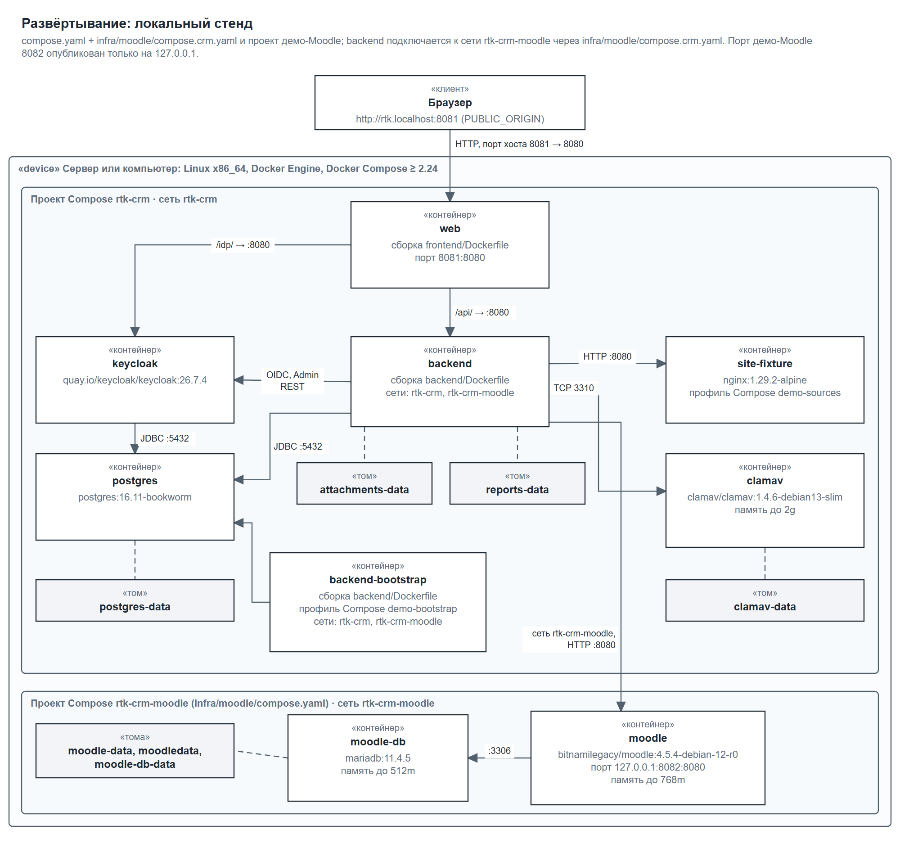

Рисунок 29 — UML-диаграмма развёртывания: локальный стенд

Разработка без Docker: backend собирается `backend/mvnw` (JDK 21), результат — `backend/target/rtk-crm-backend-0.1.0-SNAPSHOT.jar`; клиент — `npm ci && npm run build` в `frontend/` (Node.js 24.18+, npm 12). Сервер разработки Vite (`npm run dev`, порт 5173) проксирует `/api` и `/idp` на `http://localhost:8080`. Для jar нужны PostgreSQL, Keycloak и ClamAV и переменные `SPRING_DATASOURCE_*`, `APP_OIDC_*`, `APP_ATTACHMENTS_*`, профиль `oidc`. Без профиля `oidc` вход через OIDC не настраивается. Тесты backend без JDK на хосте: `docker build --target test backend`.

### 9.3. Публикация с TLS и за обратным прокси

**Свой TLS на nginx** — `compose.prod.yaml` поверх `compose.yaml` (`COMPOSE_FILE=compose.yaml:compose.prod.yaml` в `.env.local`):

- `web` публикует 80 и 443, берёт `infra/web/tls.conf`, монтирует сертификат `TLS_CERTIFICATE_FILE` и ключ `TLS_CERTIFICATE_KEY_FILE`; порт 80 отвечает 301 на HTTPS; TLS 1.2 и 1.3, HTTP/2;
- `backend` получает `SESSION_COOKIE_SECURE=true`;
- `keycloak` работает в режиме `start --import-realm` вместо `start-dev`.

**Общий обратный прокси** (например, Caddy в сети Docker `edge`) — `compose.edge.yaml` вместо `compose.prod.yaml`:

- `web` не публикует портов и подключается к внешней сети `edge` (`EDGE_NETWORK`) и к сети демо-Moodle `rtk-crm-moodle`;
- nginx доверяет `X-Forwarded-*` только от подсети прокси (`EDGE_PROXY_CIDR`, по умолчанию `172.18.0.0/16`);
- `SESSION_COOKIE_SECURE=true`, Keycloak в режиме `start`;
- демо-Moodle публикуется тем же nginx по имени `MOODLE_EDGE_HOST` (`infra/web/moodle-edge.conf`);
- ограничения памяти: `web` 128 МБ, `backend` 1280 МБ, `backend-bootstrap` 768 МБ, `keycloak` 1 ГБ, `postgres` 512 МБ, `clamav` 2 ГБ, `site-fixture` 64 МБ.

На общем прокси для домена CRM закрывают `/idp/admin` и `/idp/realms/master` и проксируют остальное на контейнер `web`, порт 8080.

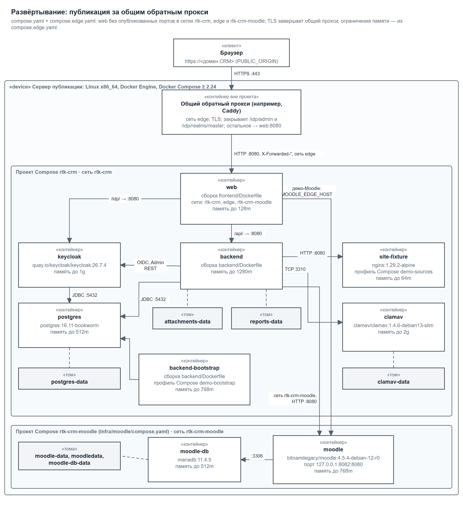

Рисунок 30 — UML-диаграмма развёртывания: публикация за общим обратным прокси с TLS

**Внешний TLS-прокси по HTTP** — только `compose.yaml` с `PUBLIC_ORIGIN=https://...`, `SESSION_COOKIE_SECURE=true` и `TRUSTED_PROXY_CIDR`, равным адресу прокси, каким его видит контейнер `web`.

`PUBLIC_ORIGIN` совпадает с адресом, который видит браузер; после его смены скрипт установки запускается повторно и обновляет redirect URI клиента `crm-bff`.

### 9.4. Переменные окружения

Файл `.env.local` создаёт скрипт установки, образец имён — `.env.example`. Значения секретов не публикуются и не коммитятся. В таблице — имена в `.env.local` и соответствующие настройки backend.

| Переменная `.env.local` | Настройка backend | Назначение | По умолчанию |
|---|---|---|---|
| `POSTGRES_SUPERUSER`, `POSTGRES_SUPERUSER_PASSWORD` | — | суперпользователь PostgreSQL, используется при инициализации тома | `postgres`, секрет |
| `CRM_DB_NAME`, `CRM_DB_USER`, `CRM_DB_PASSWORD` | `SPRING_DATASOURCE_*` | БД и роль CRM | `rtk_crm`, `crm`, секрет |
| `KEYCLOAK_DB_NAME`, `KEYCLOAK_DB_USER`, `KEYCLOAK_DB_PASSWORD` | — | БД и роль Keycloak | `keycloak`, `keycloak`, секрет |
| `KEYCLOAK_ADMIN_USERNAME`, `KEYCLOAK_ADMIN_PASSWORD` | — | bootstrap-администратор master realm | `bootstrap-admin`, секрет |
| `PUBLIC_ORIGIN` | `APP_OIDC_ISSUER_URI`, `APP_OIDC_PUBLIC_BASE_URL`, `KC_HOSTNAME` | внешний адрес без завершающего `/` | `http://rtk.localhost:8081` |
| — | `APP_OIDC_INTERNAL_BASE_URL` | внутренний адрес Keycloak | `http://keycloak:8080` |
| `CRM_OIDC_CLIENT_SECRET` | `APP_OIDC_CLIENT_SECRET` | секрет клиента `crm-bff` | секрет |
| `CRM_ACCOUNT_SYNC_CLIENT_SECRET` | `APP_KEYCLOAK_ACCOUNT_SYNC_CLIENT_SECRET` | секрет клиента `crm-account-sync`; пусто — синхронизация блокировок не настроена | секрет |
| `SESSION_COOKIE_SECURE` | `server.servlet.session.cookie.secure` | флаг `Secure` cookie сессии | `false`; `true` в `compose.prod.yaml`, `compose.edge.yaml` |
| `TRUSTED_PROXY_CIDR` | — (nginx) | адрес внешнего прокси, которому доверяются `X-Forwarded-*` | `127.0.0.1/32` |
| `EDGE_NETWORK`, `EDGE_PROXY_CIDR`, `MOODLE_EDGE_HOST` | — (`compose.edge.yaml`) | сеть и подсеть общего прокси, имя демо-Moodle | `edge`, `172.18.0.0/16`, нет |
| `TLS_CERTIFICATE_FILE`, `TLS_CERTIFICATE_KEY_FILE` | — (`compose.prod.yaml`) | пути к сертификату с цепочкой и ключу | нет |
| `COMPOSE_FILE` | — | набор файлов Compose, например `compose.yaml:compose.prod.yaml` | не задана |
| `SITE_BASE_URL`, `SITE_TOKEN` | `APP_SOURCES_WEBSITE_BASE_URL`, `APP_SOURCES_WEBSITE_TOKEN` | адрес API сайта и Bearer-токен; пустой адрес отключает источник | скрипт: `http://site-fixture:8080` и секрет |
| `MOODLE_BASE_URL`, `MOODLE_TOKEN`, `MOODLE_COURSE_IDS` | `APP_SOURCES_MOODLE_*` | адрес Moodle (совпадает с его `wwwroot`), токен внешнего сервиса, разрешённые курсы через запятую | скрипт с `DEMO_LMS=true`: демо-Moodle |
| `SOURCES_SYNC_CRON` | `APP_SOURCES_SYNC_CRON` | расписание синхронизации источников, cron Spring из шести полей по Москве; `-` отключает | скрипт: `0 0 * * * *`; без скрипта — `-` |
| `SOURCES_STALE_AFTER` | `APP_SOURCES_STALE_AFTER` | через сколько без успешной синхронизации данные источника считаются устаревшими | `26h` |
| `RETENTION_CRON` и `RETENTION_*` | `APP_RETENTION_*` | расписание и сроки хранения (раздел 6.15) | см. раздел 6.15 |
| `MODULE_ENROLMENT_ENABLED` | `MODULE_ENROLMENT_ENABLED` | модуль «Слушатели» | скрипт: `true` при демо-данных, иначе `false` |
| `MODULE_PARTNER_ENABLED` | `MODULE_PARTNER_ENABLED` | кабинет вуза | скрипт: `true` при демо-данных, иначе `false` |
| `ENROLMENT_ACTIVE_KEY_VERSION` | `APP_ENROLMENT_ACTIVE_KEY_VERSION` | версия ключа для новых и изменённых анкет | скрипт: `v1` |
| `ENROLMENT_KEYS_V1`, `ENROLMENT_KEYS_V2` | `APP_ENROLMENT_KEYS_V1`, `APP_ENROLMENT_KEYS_V2` | ключи шифрования анкет, 32 байта в Base64 | скрипт: `V1` — секрет, `V2` пусто |
| `ENROLMENT_FINGERPRINT_KEY` | `APP_ENROLMENT_FINGERPRINT_KEY` | ключ отпечатков для поиска анкет | секрет |
| `DEMO_DATA`, `DEMO_LMS`, `DEMO_USER_PASSWORD`, `DEMO_ACCOUNTS_SECURED` | — (скрипт) | режим демо-данных, демо-Moodle, общий пароль демо-пользователей, признак защищённых демо-учёток | `true`, `true`, секрет, пусто |
| `CRM_ADMIN_USERNAME`, `CRM_ADMIN_DISPLAY_NAME`, `CRM_ADMIN_PASSWORD`, `CRM_ADMIN_EMAIL` | — (скрипт) | первый администратор при `DEMO_DATA=false` | `admin`, «Администратор», секрет, `admin@rtk-crm.local` |
| `MOODLE_PUBLIC_HOST`, `MOODLE_DEMO_JAVA_COURSE`, `MOODLE_DEMO_DATA_GROUP` | — (скрипт) | публикация демо-Moodle с TLS, ключи демо-сопоставлений | пусто, заполняет скрипт |
| — | `APP_ORGANIZATIONS_MANAGER_CREATION_REQUIRES_APPROVAL` | организация, созданная КАМ, ждёт подтверждения | `true` |
| — | `APP_ATTACHMENTS_STORAGE_ROOT`, `APP_REPORTS_STORAGE_ROOT` | каталоги вложений и файлов отчётов | `/var/lib/rtk-crm/files`, `/var/lib/rtk-crm/reports` |
| — | `APP_ATTACHMENTS_SCANNER_HOST`, `APP_ATTACHMENTS_SCANNER_PORT`, `APP_ATTACHMENTS_SCANNER_CONNECT_TIMEOUT`, `APP_ATTACHMENTS_SCANNER_READ_TIMEOUT` | адрес clamd и тайм-ауты | `clamav`, `3310`, `2s`, `20s` |

Пароли БД применяются при первой инициализации тома `postgres-data`; позже смена пароля в `.env.local` требует смены пароля роли в PostgreSQL.

Постоянные параметры `application.yml`: пул соединений Hikari 20 (минимум 2), размер файла 20 МБ, запрос 21 МБ, архив подтверждений 1 ГБ, параметры отчётов, источников и «Моей работы» (разделы 6.8–6.11).

### 9.5. Тома

| Том | Путь в контейнере | Содержимое | В резервной копии |
|---|---|---|---|
| `postgres-data` | `/var/lib/postgresql/data` (`postgres`) | БД CRM и Keycloak | дампами `crm.dump`, `keycloak.dump` |
| `attachments-data` | `/var/lib/rtk-crm/files` (`backend`) | вложения, в том числе непроверенные | `attachments.tar` |
| `reports-data` | `/var/lib/rtk-crm/reports` (`backend`) | готовые файлы заказанных отчётов | `reports.tar` |
| `clamav-data` | `/var/lib/clamav` (`clamav`) | сигнатуры ClamAV | нет, скачиваются заново |

Демо-Moodle хранит данные в томах своего проекта `rtk-crm-moodle`; скрипты копирования его не затрагивают. `docker compose ... down` тома сохраняет, `down -v` удаляет.

### 9.6. Резервная копия и восстановление

```bash
./scripts/backup.sh /srv/backup/rtk-crm/<каталог>
./scripts/restore.sh /srv/backup/rtk-crm/<каталог>
```

Второй необязательный аргумент — env-файл, по умолчанию `.env.local`.

`backup.sh` работает на запущенном стенде без остановки сервисов и пишет в новый или пустой каталог (umask 077): `reports.tar.enc` (том отчётов), `crm.dump.enc` и `keycloak.dump.enc` (`pg_dump --format=custom`), `attachments.tar.enc` (том вложений), `SHA256SUMS` по зашифрованным файлам. Каждый файл шифруется на лету `openssl enc -aes-256-cbc -pbkdf2 -iter 600000` ключом `BACKUP_ENCRYPTION_KEY` из env-файла (если ключа нет, скрипт дописывает новый) или из файла `BACKUP_ENCRYPTION_KEY_FILE` с правами 600; открытые данные на диск не пишутся. Файлы отчётов архивируются первыми, затем БД, затем вложения; отчёт, достроенный во время копирования, после восстановления отвечает `410 REPORT_RESULT_UNAVAILABLE` и заказывается заново.

`restore.sh`:

1. проверяет `SHA256SUMS` и при расхождении завершается, ничего не меняя; зашифрованную копию расшифровывает потоком, а неверный ключ останавливает восстановление до изменений стенда; копия, сделанная до шифрования, восстанавливается без ключа; копия без `reports.tar` восстанавливается с предупреждением, файлы отчётов при этом очищаются;
2. поднимает `postgres` и останавливает `web`, `backend`, `keycloak`;
3. пересоздаёт обе БД и загружает дампы `pg_restore --no-owner --no-privileges --role=<роль БД>`;
4. очищает и распаковывает тома вложений и отчётов (владелец файлов отчётов — `crm`);
5. поднимает `keycloak`, `clamav`, `backend`, `web` с ожиданием готовности.

Для восстановления нужны тот же `.env.local` (секрет `crm-bff` записан и в нём, и в БД Keycloak, там же ключи анкет) и тот же `PUBLIC_ORIGIN` (профили CRM связаны с издателем `PUBLIC_ORIGIN/idp/realms/rtk-crm`). Текущие данные стенда при восстановлении удаляются.

Копирование по расписанию — `scripts/backup-scheduled.sh <каталог-копий> [число-копий] [env-file]` из cron или таймера systemd от пользователя группы `docker`: блокировка `flock`, копия во временный каталог `.partial-<время>`, проверка `SHA256SUMS` (заголовок `PGDMP` расшифрованных дампов проверяет `backup.sh`), переименование в `<время UTC>`, удаление копий сверх заданного числа (по умолчанию 7), время последней успешной копии — в файле `last-success`. Журнал запусков — `backup.log` (строки `START`, `OK`, `ROTATED`, `FAILED`); при сбое сообщение уходит в stderr и системный журнал (`logger -t rtk-crm-backup`), код выхода 1.

### 9.7. Обновление и миграции

1. Получить новую версию репозитория.
2. Выполнить `./scripts/bootstrap-demo.sh` (или `docker compose --env-file .env.local up -d --build`). Образы пересобираются, контейнеры пересоздаются с сохранением томов.
3. При старте backend Flyway применяет новые миграции по порядку номеров; применённые миграции не меняются. Если миграция не применилась, backend не запускается и не проходит healthcheck; причина — в журнале backend.

Файлы `infra/web/*.conf` читаются при старте контейнера `web`; скрипт установки пересоздаёт `web` сам, без него — `docker compose --env-file .env.local up -d --force-recreate --no-deps web`. Перед обновлением рекомендуется снять резервную копию.

### 9.8. Проверки здоровья

| Сервис | Проверка | Параметры |
|---|---|---|
| `backend` | `curl http://localhost:8080/actuator/health` внутри контейнера; наружу путь не проксируется | каждые 10 с, 30 попыток |
| `postgres` | `pg_isready` | каждые 5 с, 20 попыток |
| `keycloak` | `HEAD /health/ready` на порту управления 9000 | каждые 10 с, 30 попыток |
| `clamav` | `clamdcheck.sh` (`PING` → `PONG` по TCP 3310) | каждые 30 с, 3 попытки, `start_period` 15 минут |
| `web` | нет, состояние `running` | — |

Проверка после запуска:

```bash
docker compose --env-file .env.local ps
curl -s -o /dev/null -w '%{http_code}\n' http://localhost:8081/
curl -s -w '\n%{http_code}\n' http://localhost:8081/api/me
curl -s -o /dev/null -w '%{http_code}\n' http://localhost:8081/idp/realms/rtk-crm/.well-known/openid-configuration
curl -s -o /dev/null -w '%{http_code} %{redirect_url}\n' http://localhost:8081/api/auth/login
```

Ожидается: сервисы `healthy`, `200` для SPA, JSON с `401` для `/api/me` без сессии, `200` для discovery, перенаправление `/api/auth/login` в Keycloak с `redirect_uri=PUBLIC_ORIGIN/api/auth/callback/keycloak`.

### 9.9. Сброс демо-данных

`scripts/reset-demo-data.sh` запускает `backend-bootstrap` с `APP_DEMOBOOTSTRAP_RESET=true`: Flyway очищает схему CRM и применяет миграции заново, затем заполняются демо-данные и выполняется первая синхронизация источников; тома вложений и отчётов очищаются. Keycloak и Moodle не меняются. При `DEMO_DATA=false` скрипт не работает.

Перед открытием демо-стенда посторонним `scripts/secure-demo-accounts.sh <учётки>` выдаёт оставленным демо-учёткам индивидуальные пароли (файл `.demo-accounts.local`, права 600), отключает остальные, завершает их сеансы и записывает `DEMO_ACCOUNTS_SECURED=true`.

### 9.10. ClamAV и память

- Настройки clamd (`infra/clamav/clamd.conf`): TCP 3310, очередь 30 соединений, `StreamMaxLength`, `MaxScanSize`, `MaxFileSize` по 25 МБ, `MaxRecursion 16`, `MaxFiles 10000`, сигнал о зашифрованных архивах и превышении пределов, `ConcurrentDatabaseReload no` (при обновлении сигнатур в памяти одна копия базы, проверки на это время ждут).
- Память: база сигнатур занимает около 1 ГБ; `mem_limit: 2g`, `pids_limit: 256`.
- Первый запуск скачивает сигнатуры несколько минут; `backend` стартует после готовности ClamAV. Сигнатуры хранятся в томе `clamav-data`.
- Самовосстановление: entrypoint `infra/clamav/supervise.sh` при `init: true` запускает штатный `/init` образа, ждёт сокет clamd и раз в 10 секунд проверяет, что процесс `clamd` жив. Если clamd завершился (например, из-за нехватки памяти), контейнер завершается и Docker перезапускает его (`restart: unless-stopped`). Зависший, но живой clamd показывается как `unhealthy`; перезапуск вручную — `docker compose --env-file .env.local restart clamav`.
- Пока clamd недоступен, новые вложения получают статус `UNVERIFIABLE` и не выдаются.
- Число перезапусков и признак OOM: `docker inspect <контейнер clamav> --format '{{.RestartCount}} {{.State.OOMKilled}}'`.

### 9.11. Нагрузочные характеристики

Замер на целевом сервере через публичный адрес с TLS:

| Показатель | Результат |
|---|---|
| Пользователи и длительность | 30 одновременных пользователей, 180 с |
| Запросы | 5928, ответов 5xx — 0 |
| Переход по этапу | p95 27 мс, max 112 мс |
| Комментарий | p95 29 мс, max 245 мс |
| Предпросмотр отчёта | p95 52 мс, max 142 мс |
| Операции дольше 1 с | 0 из 1002 |
| Серия отчётов | 12 из 12 построены, одновременно до 10; операции во время серии — до 127 мс |

Параметры, определяющие пропускную способность: пул построения отчётов 10 слотов и очередь 40 (`app.reports.slots`, `queue-capacity`), пул соединений БД 20. Сценарий нагрузки и подготовка синтетических данных — `scripts/load/` (`load-test.mjs`, `seed-load-data.sh`, `remove-load-data.sh`, `run-server-night.sh`).

## 10. Мониторинг и диагностика

### 10.1. Журналы

| Источник | Как смотреть | Что содержит |
|---|---|---|
| backend | `docker compose --env-file .env.local logs backend` | журнал Spring Boot; в каждой строке `[requestId]` из MDC; для каждой ошибки 4xx — строка `API error status=… code=… requestId=… user=<subject> operation=<метод путь> reason=…`; ошибки 5xx — уровень ERROR со стеком |
| web | `docker compose --env-file .env.local logs web` | журнал доступа и ошибок nginx |
| keycloak | `docker compose --env-file .env.local logs keycloak`; события входа и администрирования — в консоли Keycloak | вход, ошибки входа, действия администратора Keycloak |
| clamav | `docker compose --env-file .env.local logs clamav` | загрузка сигнатур, результаты проверки, сообщение супервизора о падении clamd |
| Журнал администратора | раздел «Администрирование», `GET /api/admin/audit-events` | действия пользователей (раздел 6.13) |
| Источники данных | раздел «Администрирование», `GET /api/admin/sources`, `GET /api/admin/sources/{source}/runs` | запуски синхронизации, счётчики, код и текст ошибки |
| Резервные копии | `backup.log` и `last-success` в каталоге копий, `journalctl -t rtk-crm-backup` | запуски копирования по расписанию |

Каждый ответ backend содержит заголовок `X-Request-Id` (UUID). Тот же идентификатор возвращается в поле `requestId` ошибки и стоит в строках журнала backend, поэтому ошибку пользователя находят по нему: `docker compose --env-file .env.local logs backend | grep <requestId>`. Ответ 413 формирует nginx; его `requestId` построен из `$request_id` nginx.

Состояние backend: `/actuator/health` и `/actuator/info` внутри сети контура (`docker compose exec backend curl -s http://localhost:8080/actuator/health`); включены пробы liveness и readiness.

### 10.2. Коды ошибок API

Формат ошибки — `ApiError`: `{code, message, requestId}` и при необходимости `fieldErrors` (ошибки по полям) и `currentVersion` (текущая версия при конфликте). Трассировка стека и секреты в ответ не попадают. Для путей вне `/api/` тело ошибки не формируется.

Коды `ApiError.code` (перечисление в `openapi.yaml`; те же пояснения показывает раздел «Справка» интерфейса):

| Код | HTTP | Значение | Что делать |
|---|---|---|---|
| `VALIDATION_ERROR` | 400 | неверные или отсутствующие поля; подробности в `fieldErrors` | исправить значения и повторить |
| `BAD_REQUEST` | 400 | прочая ошибка запроса | обновить страницу и повторить; при повторении — сообщить код и `requestId` |
| `UNAUTHENTICATED` | 401 | сессии нет или она истекла | войти заново |
| `FORBIDDEN` | 403 | роли не хватает прав или неверен CSRF-токен | обновить страницу; действие не предусмотрено для роли или области данных |
| `CRM_PROFILE_REQUIRED` | 403 | учётная запись есть, профиля CRM нет или он заблокирован | администратор создаёт или разблокирует профиль |
| `CRM_PROFILE_PENDING` | 403 | профиль ждёт активации | администратор назначает роль и команду |
| `LAST_ACTIVE_ADMIN` | 409 | действие оставило бы систему без активного администратора | сначала назначить другого администратора |
| `NOT_FOUND` | 404 | объект не существует или вне области данных; также все операции `/api/enrolment/*` при выключенном модуле | проверить ссылку и назначение |
| `METHOD_NOT_ALLOWED` | 405 | метод не поддерживается для адреса | — |
| `CONFLICT` | 409 | прочий конфликт состояния | обновить данные и повторить |
| `VERSION_CONFLICT` | 409 | данные изменил другой пользователь; в ответе `currentVersion` | обновить карточку и повторить изменение |
| `IDEMPOTENCY_CONFLICT` | 409 | тот же `Idempotency-Key` пришёл с другим телом | выполнить действие заново |
| `PAYLOAD_TOO_LARGE` | 413 | файл больше 20 МБ или запрос больше 21 МБ (ответ формирует backend или nginx) | уменьшить файл |
| `UNSUPPORTED_MEDIA_TYPE` | 415 | неподдерживаемый тип содержимого или файла | сохранить файл в допустимом формате |
| `RATE_LIMITED` | 429 | код зарезервирован; ограничение частоты запросов не включено | — |
| `INTERNAL_ERROR` | 500 | непредвиденная ошибка; стек — в журнале backend по `requestId` | смотреть журнал backend |
| `DEPENDENCY_UNAVAILABLE` | 503 | недоступен зависимый сервис | повторить позже |
| `REPORT_NOT_READY` | 409 | файл отчёта ещё не построен | дождаться статуса `SUCCEEDED` |
| `REPORT_ACCESS_CHANGED` | 410 | права заказчика изменились после заказа отчёта | заказать отчёт заново |
| `REPORT_RESULT_UNAVAILABLE` | 410 | файл отчёта больше не хранится | заказать отчёт заново |
| `REPORT_CAPACITY_EXCEEDED` | 503 | заняты все построения и очередь | повторить примерно через 30 секунд |
| `REPORT_ROW_LIMIT` | 422 | строк больше `app.reports.max-rows` (отчёт или выгрузка журнала) | сузить период или фильтры |
| `SOURCE_NOT_CONFIGURED` | 409 | источник не настроен (нет адреса, токена или курсов) | задать переменные источника |
| `SYNC_ALREADY_RUNNING` | 409 | синхронизация источника уже идёт | дождаться завершения |
| `SYNC_CAPACITY_EXCEEDED` | 503 | исполнитель синхронизаций занят | повторить позже |
| `LMS_NOT_MAPPED` | 409 | для организации и программы карточки нет сопоставленных курсов LMS | администратор сопоставляет курсы |
| `LMS_SYNC_FAILED` | 502 | LMS не ответила или ответила ошибкой; прежние значения сохранены | смотреть историю запусков Moodle |
| `ACCOUNT_SYNC_FAILED` | 503 | не удалось синхронизировать учётную запись Keycloak с профилем | повторить `account-sync` |
| `PERSONAL_DATA_ANONYMIZED` | 409 | данные уже обезличены | ожидаемое поведение |
| `PROFILE_ACTIVE` | 409 | действие недоступно, пока профиль активен | заблокировать профиль и повторить |
| `RETENTION_RUNNING` | 409 | сроки хранения уже применяются | дождаться завершения |
| `CONFIRMATION_LIMIT` | 422 | в выборке подтверждений больше 500 документов или архив больше допустимого размера | сузить выборку |
| `PERSONAL_DATA_RESTRICTED` | 409 | обработка данных субъекта ограничена | снять ограничение в «Субъекте персональных данных» |

Коды ошибок фоновых заданий приходят не в `ApiError`, а в полях задания или запуска:

| Где | Код | Значение |
|---|---|---|
| задание отчёта, `errorCode` (`GET /api/report-jobs/{id}`) | `REPORT_ROW_LIMIT`, `REPORT_PDF_ROW_LIMIT`, `REPORT_XLS_ROW_LIMIT`, `REPORT_CHART_LIMIT` | превышен предел строк, строк PDF, строк листа XLS или размер диаграммы |
| | `REPORT_INTERRUPTED` | backend перезапустился во время построения |
| | `REPORT_FAILED` | непредвиденная ошибка построения, подробности в журнале backend |
| запуск синхронизации, `sync_runs.error_code` | `SOURCE_UNAVAILABLE` | источник недоступен или ответил не 200 |
| | `SOURCE_UNAUTHORIZED` | неверный токен или не хватает прав сервиса |
| | `SOURCE_INVALID_RESPONSE` | ответ не соответствует контракту или превышает пределы |
| | `SYNC_INTERRUPTED` | backend перезапустился во время запуска |
| | `SYNC_FAILED` | непредвиденная ошибка, подробности в журнале backend |

### 10.3. Типовые ситуации

| Признак | Где смотреть | Причина и действие |
|---|---|---|
| `backend` не становится `healthy` | `docker compose ... logs backend` | нет связи с PostgreSQL или Keycloak, ошибка миграции Flyway, модуль «Слушатели» включён без ключей (сообщение называет переменную) |
| `backend` ждёт `clamav` при первом запуске | `docker compose ... logs clamav` | загружаются сигнатуры; `start_period` 15 минут |
| вложения получают статус `UNVERIFIABLE` | `docker compose ... ps clamav`, `docker inspect` | clamd недоступен или перезапускался из-за нехватки памяти (раздел 9.10) |
| кнопка «Войти» ведёт на чужой адрес | `.env.local` | `PUBLIC_ORIGIN` не совпадает с адресом в браузере; исправить и повторить скрипт установки |
| пользователь видит экран ожидания | список профилей у администратора | профиль ждёт активации |
| скачивание отчёта отвечает 410 | задание отчёта | срок хранения файла истёк или права заказчика изменились; заказать заново |
| данные LMS или сайта не обновляются | «Источники данных», история запусков | источник не настроен, запуск `FAILED` с кодом, плановый запуск не включён или источник ни разу не запускали вручную |
