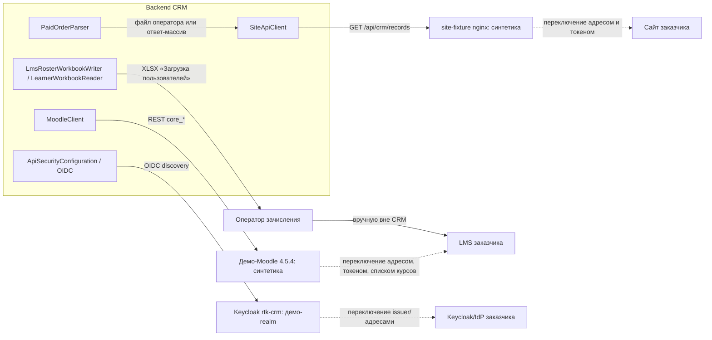

# Заглушки внешних интеграций

Доступа к API сайта заказчика и к его LMS/тестовым стендам у продукта нет, поэтому пять внешних систем подключены через заглушки: синтетический источник вместо сайта, демо-Moodle, шаблонный файл для LMS и собственный Keycloak. Ниже — как устроена каждая заглушка и как переключить её на настоящую систему заказчика.

## Общая схема

Ни один переход на реальную систему не требует правки Java-кода: меняются только переменные окружения (адреса, токены, список курсов, расписание) и, для сайта, регистрация клиента в чужом Keycloak или доверие CRM в организаторском API.

---

## 1. Сайт: заявки (`partnership_request`, `learning_application`)

**Как работает заглушка.** `infra/site-fixture` — тестовая копия сайта: nginx (сервис профиля Compose `demo`, без опубликованного порта), отдаёт `GET {SITE_BASE_URL}/api/crm/records?updated_since=&page=` по контракту `docs/integrations/site-api.yaml`. Отвечает 17 синтетическими записями («Демо:», контакты на `example.test`), требует `Authorization: Bearer ${SITE_TOKEN}` и игнорирует `updated_since`, поэтому каждый прогон демонстрирует пропуск повторов. Разбор изолирован в `ru.rtk.crm.source.SiteApiClient` → `SiteRecord` → `SiteRecordApplier` → `SourceSyncService`/`SourceSyncExecutor`. Запись без обязательных полей не роняет синхронизацию, а помечается `FAILED` с причиной; неизвестный вуз или программа — `NEEDS_MAPPING`; любая ошибка транспорта не изменяет уже сохранённые данные и метку `updated_since`; версия записи — `updatedAt` источника.

**Как подключить реальную систему.** Задать `SITE_BASE_URL` и `SITE_TOKEN` (`app.sources.website.*` в `application.yml`) на адрес и токен сайта заказчика; `scripts/bootstrap-demo.sh`/`.ps1` не поднимают `site-fixture`, если `SITE_BASE_URL` уже указывает на реальный адрес. Расписание синхронизации — `SOURCES_SYNC_CRON`. От заказчика нужны: адрес API, Bearer-токен на чтение (или другой согласованный способ авторизации), подтверждённый формат ответа, семантика статусов и отзыва заявки, желательно — фильтр по вузу в контракте.

---

## 2. Сайт: оплаты (`paid_order`, схема `OrdersV1`)

**Как работает заглушка.** `infra/site-fixture` отдаёт синтетический массив оплат по пути `/orders/api/crm/records` (6 записей: один человек на двух курсах, номер из 15 цифр, разные варианты написания). Тот же формат CRM принимает и файлом, который загружает оператор зачисления в разделе «Зачисление → Загрузка оплат». Разбор в обоих случаях — `ru.rtk.crm.enrolment.PaidOrderParser`; результат уходит в `source_records` (тип `paid_order`, без ФИО/телефона/email) и в зашифрованную анкету слушателя. Пустые элементы и повторы номера заявки не роняют загрузку целиком — считаются и отмечаются в протоколе; ошибки только в персональных полях не блокируют зачисление, такие записи принимаются с пометкой, что ПДн не сохранены; курс без сопоставления с программой получает статус «требует сопоставления».

**Как подключить реальную систему.** Как только сайт заказчика начнёт отвечать массивом `OrdersV1` вместо `{items}` по тем же `SITE_BASE_URL`/`SITE_TOKEN`, что и для заявок, `SiteApiClient` обработает это без изменений в коде. Файл оператора работает независимо от того, настроен сайт или нет. От заказчика нужны: подтверждение адреса/токена или файлового канала, дата оплаты (сейчас в контракте не передаётся, поэтому отчёты по оплатам не фильтруются по периоду), подтверждение, что номер заявки — устойчивый внешний идентификатор.

---

## 3. LMS Moodle: синхронизация курсов, групп и обучающихся

**Как работает заглушка.** `infra/moodle` — демо-Moodle (отдельный Compose-профиль, не входит в поставку CRM) с синтетическими курсами, группами, преподавателем и десятью учащимися, обращение только на чтение по стандартному REST Moodle (`core_course_get_courses_by_field`, `core_group_get_course_groups`, `core_enrol_get_enrolled_users`, `core_completion_get_course_completion_status`). Технический пользователь Moodle работает с ролью из семи прав, без права редактирования. Разбор изолирован в `ru.rtk.crm.source.MoodleClient`, который отдаёт наверх только агрегаты (`LearningUnit`: курс/группа, число участников, преподавателей, завершивших/не завершивших/неизвестно) — карточка, снимки и отчёты работают с этим результатом и от Moodle не зависят. Ошибка доступа или несовместимый ответ даёт код ошибки, а не тихую потерю данных; любая ошибка на курсе останавливает весь запуск без изменения прежних данных; курс без сопоставления вуза и программы — «требует сопоставления».

**Как подключить реальную систему.** Задать `MOODLE_BASE_URL`, `MOODLE_TOKEN`, `MOODLE_COURSE_IDS` (`app.sources.moodle.*`). На стороне Moodle заказчика администратор выполняет три шага, описанные в `docs/integrations.md` («Сервис и права в Moodle»): включить веб-службы REST, создать технического пользователя и роль с нужными правами, создать внешний сервис и выпустить токен. Код не меняется. От заказчика нужны: доступ к Moodle (адрес, версия, подтверждение веб-служб), выполнение шагов настройки его администратором, список ID курсов ИТ-программ.

---

## 4. Файл «Загрузка пользователей» для LMS

**Как работает заглушка.** Заглушки внешней системы здесь нет: загрузка в LMS выполняется оператором зачисления вручную вне CRM, поэтому «заглушкой» выступает сам шаблон файла — CRM формирует и читает XLSX в формате шаблона организатора без промежуточного стенда. `LmsRosterWorkbookWriter` формирует файл по потоку; `LearnerWorkbookReader` читает обратно заполненный оператором файл с предпросмотром и построчными замечаниями; состав полей, группировка и проверки формата (контрольная сумма СНИЛС, формат паспорта, даты, справочники пола и образования) — в `LearnerField`/`LearnerFieldGroup`/`LearnerRules`. Поля ищутся по названию заголовка, а не по номеру столбца, поэтому перестановка колонок не ломает разбор; для числовых полей, которые Excel лишает ведущих нулей (СНИЛС, индекс, серия/номер паспорта), они восстанавливаются с явным предупреждением. Обязательны сейчас только фамилия и имя, остальные несоответствия — предупреждение, а не отказ строки.

**Как подключить реальную систему.** Формат один и тот же для демонстрации и рабочего контура; если организатор пришлёт другой шаблон, состав и порядок колонок меняются правкой перечня заголовков (`LearnerField`) без изменения хранения анкеты. От заказчика нужны: подтверждение окончательного состава и обязательности полей шаблона, способ фактической загрузки заполненного файла в LMS (кто и как переносит его в Moodle или другую систему).

---

## 5. Keycloak / IdP заказчика

**Как работает заглушка.** Keycloak не является внешней системой с недоступным контрактом: он обязателен по ТЗ и полностью реализован — OIDC Authorization Code + PKCE, серверная сессия, роли и команды хранятся в CRM, а не в Keycloak. CRM ставится вместе со своим Keycloak (realm `rtk-crm`, импортируется из `infra/keycloak/rtk-crm-realm.json`) — это часть поставки продукта, а не имитация чужой системы. «Заглушкой» здесь можно назвать демонстрационный стенд: он поднимает и настраивает собственный Keycloak с демо-пользователями. Разбор изолирован в `ru.rtk.crm.security.ApiSecurityConfiguration` через стандартный Spring Security OAuth2 Client (issuer/authorization/token/userinfo/jwks), без специфики Keycloak; на Keycloak завязаны только `ru.rtk.crm.access.KeycloakAccountClient` (включение и отключение учётной записи при блокировке профиля) и выход через RP-Initiated Logout.

**Как подключить реальную систему.** Задать `APP_OIDC_ISSUER_URI`, `APP_OIDC_PUBLIC_BASE_URL`, `APP_OIDC_INTERNAL_BASE_URL`, `APP_OIDC_CLIENT_SECRET` (`application.yml`, раздел `app.oidc`) на issuer заказчика. Условия: у IdP заказчика должен быть OIDC discovery и зарегистрированный конфиденциальный клиент с redirect URI `PUBLIC_ORIGIN/api/auth/callback/keycloak` (имя пути `keycloak` не привязывает CRM к конкретному продукту). Если у IdP заказчика нет Admin REST API того же вида, что у Keycloak, синхронизация блокировки не настраивается (`APP_KEYCLOAK_ACCOUNT_SYNC_CLIENT_SECRET` пустой) — профиль получает пометку «требует синхронизации» вместо отказа входа, при этом блокировка в самой CRM всё равно действует. От заказчика нужно решение: остаётся ли вход через бандловый Keycloak CRM или подключается свой IdP; если свой — issuer, публичный и внутренний адрес, регистрация клиента `crm-bff` с нужным redirect URI, наличие Admin REST-подобного API для синхронизации блокировок.
