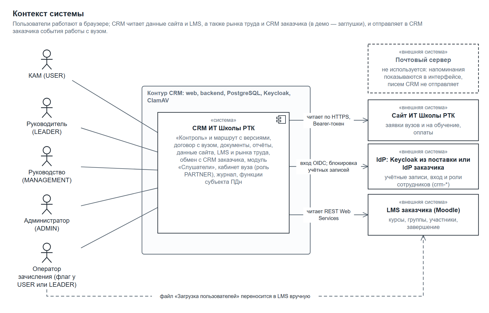
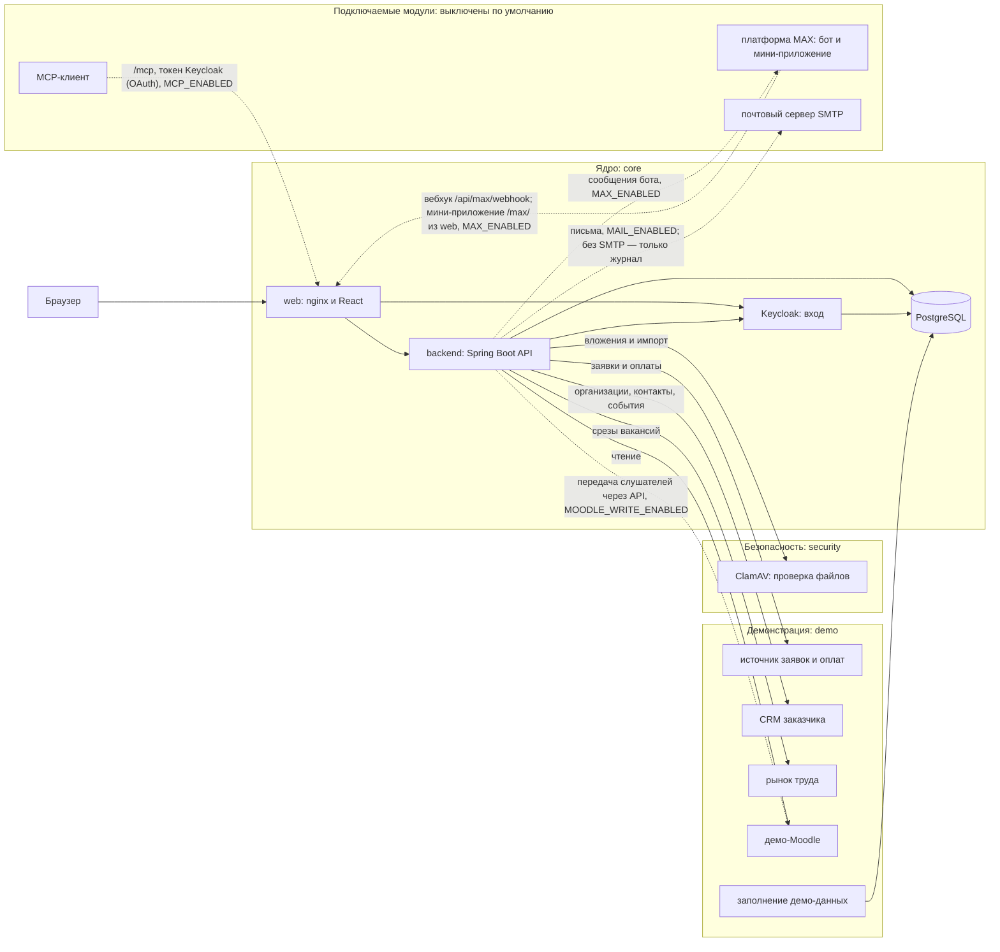
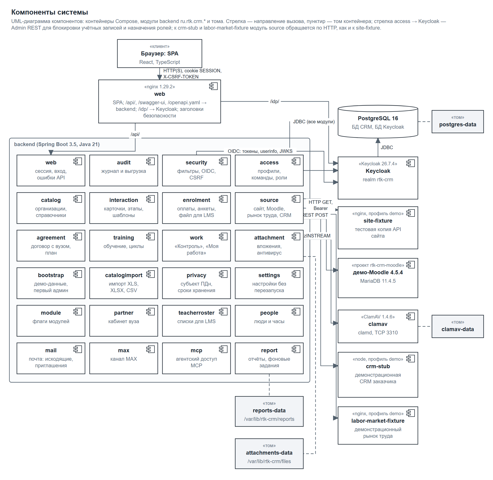
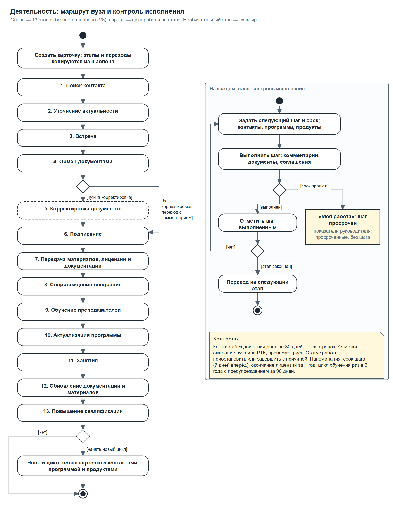

# Архитектура CRM ИТ Школы РТК

Документ описывает устройство системы в общих чертах: для чего она нужна, из чего состоит, как данные проходят через её части и как она разворачивается. Работа по ролям — в [инструкциях пользователей](Инструкции_пользователей.md), установка и запуск — в [описании запуска](Запуск.md).

## Назначение и цель

CRM контролирует работу менеджеров ИТ Школы РТК с вузами, колледжами и школами по ИТ-программам и ИТ-продуктам. Для каждой организации видно, кто из менеджеров её ведёт, по какой программе и продукту идёт работа, на каком этапе она находится и какой следующий шаг. За любой период строится отчёт по продуктам, организациям и менеджерам.

Цель системы — сделать работу с партнёрами прозрачной и воспроизводимой: единый маршрут из этапов, история каждого шага, договоры и соглашения, контроль сроков, данные о заявках и обучении из внешних источников.

Основные возможности:

- карточки организаций и контактов, справочники направлений, программ, продуктов и вендоров, импорт каталогов, истории взаимодействий и договоров из таблиц XLS, XLSX и CSV;
- маршрут работы с организацией по этапам: шаблоны этапов настраиваются, каждый переход фиксируется в истории;
- вложения и документы карточки, договоры и соглашения с вузами, план совместных мероприятий;
- рабочий стол менеджера «Моя работа» и экран «Контроль» для руководителя и руководства;
- отчёты и статистика за период с выгрузкой в таблицы, PDF и диаграммы;
- данные внешних источников: заявки и оплаты с сайта, обучение в LMS, спрос рынка труда, организации и контакты из CRM заказчика;
- модуль «Слушатели» для зачисления физических лиц открытого набора и кабинет координатора вуза (оба включаются и выключаются настройкой);
- отчётность по соглашениям: перечни мероприятий с согласованием вузом, ставки, сроки отчётного цикла, отчёт по шаблону выгрузки;
- учёт людей и часов: преподавание сотрудниками, стажировки, повышение квалификации преподавателей с передачей сведений в ФРДО;
- место и индекс востребованности программ с весами, которые задаёт администратор;
- настройки администратора, действующие без перезапуска, журнал обращений субъектов персональных данных и учёт согласий.

## Контекст системы

Пользователи работают в браузере. Система обращается к внешним источникам сама и в основном только читает из них данные.

*Рисунок 1 — контекст системы*

| Участник | Роль в системе |
|---|---|
| Менеджер по работе с вузами (КАМ) | ведёт закреплённые за ним организации и карточки работы, а также учёт преподавания, стажировок и повышения квалификации по своим вузам |
| Руководитель команды | видит все организации команды, назначает ответственных, ведёт шаблоны этапов команды |
| «Руководство» | смотрит данные всех команд, ничего не меняет |
| Администратор | управляет профилями, командами, справочниками, источниками данных, настройками системы, журналом и обращениями субъектов ПДн, следит за состоянием модулей и резервных копий; бизнес-данных карточек не видит |
| Менеджер учебного процесса | сотрудник с особым правом работает с анкетами слушателей |
| Координатор вуза | в кабинете отвечает на запросы школы файлом, согласует перечни мероприятий своего вуза и видит только материалы своего вуза |

Внешние системы:

| Система | Что даёт | На демонстрационном стенде |
|---|---|---|
| Keycloak | учётные записи и вход пользователей по стандарту OpenID Connect | Keycloak из поставки с демонстрационными пользователями |
| LMS Moodle | курсы, группы, обучающиеся, активность, завершение курсов; подключаемо — передача слушателей через API (поиск или создание пользователя, зачисление, группа, сверка), отдельный токен записи | демонстрационный Moodle с синтетическими курсами |
| Почтовый сервер (SMTP) | подключаемо: письма сотрудникам и координаторам вузов | режим «Без отправки»: письма остаются в журнале |
| Платформа MAX | подключаемо: бот с уведомлениями и мини-приложение | бот проверен технически, пользовательская цепочка ждёт привязки учётной записи |
| MCP-клиент | подключаемо: работа с данными CRM с правами сотрудника, изменения — только после его подтверждения | проверка инструментами MCP на стенде |
| Сайт ИТ Школы РТК | заявки вузов и на обучение, оплаты | демонстрационный источник с синтетическими заявками |
| Рынок труда | месячные срезы числа вакансий по ИТ-направлениям | демонстрационный источник с синтетическими данными |
| CRM заказчика | организации и контакты приходят в систему, события работы с вузом уходят в CRM заказчика | демонстрационный источник с синтетическими организациями |

На стенде все источники, кроме Keycloak, — демонстрационные: они воспроизводят предложенные форматы обмена и позволяют показать систему целиком. Подключение настоящих систем выполняется настройкой адресов и токенов без изменения кода, см. [описание запуска](Запуск.md).

## Компоненты и контейнеры

Система состоит из нескольких контейнеров Docker. Обязательные образуют ядро, остальные подключаются профилями Compose.

Пунктир — подключаемые модули, по умолчанию выключенные.

| Контейнер | Назначение |
|---|---|
| `web` | единая точка входа: отдаёт интерфейс, передаёт запросы `/api/` в backend, `/idp/` в Keycloak, отдаёт Swagger UI |
| `backend` | API, правила доступа, отчёты, фоновые задания, синхронизация источников |
| `postgres` | база данных CRM и отдельная база Keycloak |
| `keycloak` | учётные записи и вход |
| `clamav` | антивирусная проверка вложений и загружаемых файлов |
| контейнеры профиля `demo` | демонстрационные источники и заполнение демо-данных |

Наружу публикуется только `web`; база данных, Keycloak, антивирус и backend доступны лишь внутри сети контейнеров.

*Рисунок 2 — компоненты системы*

Клиентская часть — одностраничное приложение на React. Серверная — приложение на Java 21 и Spring Boot 3.5. Описание программного интерфейса — в формате OpenAPI 3.1 (`backend/src/main/resources/static/openapi.yaml`), его же показывает Swagger UI.

## Модули backend

Backend разбит на пакеты `ru.rtk.crm.*` по предметным областям. Каждый пакет отвечает за свою часть данных и интерфейса.

| Пакет | Что делает |
|---|---|
| `security`, `web` | вход, сессия, защита запросов, единый формат ошибок, состояние резервных копий для «Обзора» |
| `access` | профили сотрудников, команды, роли, активация профиля |
| `catalog` | организации, контакты, назначение менеджеров, справочники |
| `catalogimport` | импорт каталогов, истории взаимодействий и договоров из XLS, XLSX и CSV с предпросмотром; шаг по умолчанию для импортированных карточек |
| `interaction` | карточки работы, этапы и переходы, комментарии, приостановка с датой возврата, шаблоны этапов и версии маршрута, договоры по продуктам |
| `attachment` | вложения и документы, проверка формата и антивирусом |
| `agreement` | договоры и соглашения с организациями: статусы, версии файла, нормы согласования; план мероприятий; отчётность по соглашениям — справочники и ставки, перечни мероприятий с согласованием вузом, сроки цикла, отчёт по шаблону выгрузки |
| `people` | учёт людей и часов: преподавание сотрудниками в вузах, стажировки, повышение квалификации по людям, срок передачи сведений в ФРДО, отчёт «Люди и часы» |
| `training` | обучение преподавателей, циклы работы |
| `work` | «Моя работа» (лента сроков с итогами по группам), «Контроль», напоминания, заместители, показатели руководителя и руководства |
| `report` | отчёты, статистика, фоновое построение файлов, индекс востребованности программ |
| `source` | внешние источники: сайт, Moodle, рынок труда, CRM заказчика; запуски синхронизации |
| `enrolment` | модуль «Слушатели»: оплаты, потоки, анкеты, партии для LMS — файлом или передачей через API Moodle |
| `partner` | кабинет вуза: доступ координатора, запросы школы и ответы, перечни мероприятий на согласование |
| `teacherroster` | списки преподавателей вуза для загрузки в LMS |
| `audit` | единый журнал действий администратора и безопасности |
| `privacy` | запросы субъектов персональных данных: поиск, выгрузка сведений, обезличивание; журнал обращений со сроком ответа; учёт согласий (включается настройкой); сроки хранения |
| `settings` | настройки администратора: сроки хранения, пороги сигналов, учёт персональных данных; значение по умолчанию берётся из конфигурации, изменённое хранится в базе и действует без перезапуска, каждое изменение пишется в журнал |
| `module` | включение модулей и экран их состояния: последняя операция, ошибки за 7 дней |
| `bootstrap` | заполнение демо-данных или создание первого администратора |
| `mcp` | сервер MCP: чтение и аналитика с правами сотрудника, изменения через план, который подтверждает сотрудник; выключен по умолчанию |
| `max` | подключаемый модуль MAX: уведомления в боте и мини-приложение; по умолчанию выключен |
| `mail` | подключаемый модуль почты: уведомления, приглашения, журнал отправки; по умолчанию выключен |

*Рисунок 3 — маршрут работы с организацией*

## Модуль MAX

Модуль MAX присылает КАМ и руководителю команды уведомления в мессенджер MAX и открывает мини-приложение с «Моей работой», карточкой взаимодействия и, у руководителя, «Контролем» для просмотра. Он подключаемый и по умолчанию выключен (`MAX_ENABLED=false`): тогда у backend нет бинов модуля, его таблиц и заданий, пути `/api/max/**` и `/max/` отвечают 404, и система работает так же, как без модуля.

- **Свои таблицы.** Миграции модуля лежат отдельно (`backend/src/main/resources/db/max`) и применяются своим экземпляром Flyway с таблицей истории `flyway_schema_history_max` только при включённом модуле. Основная схема и её нумерация не меняются.
- **Канал.** Сервер MAX присылает события на вебхук `/api/max/webhook` с секретом в заголовке; событие сначала записывается в базу, потом обрабатывается. Исходящие сообщения идут через очередь: перед отправкой заново проверяется, что профиль активен, вуз ему виден и сообщение не устарело.
- **Привязка аккаунта** — одноразовой ссылкой из CRM и подтверждением в CRM тем же сотрудником.
- **Мини-приложение** — отдельная страница `/max/` в том же клиенте. Вход по подписанным данным запуска MAX, короткий сеанс с токеном в заголовке, отдельная цепочка защиты запросов. Права те же, что в CRM: запросы идут в те же сервисы.

Юридические вопросы канала (правила MAX, обработка персональных данных) решаются отдельно, до включения модуля.

## Модуль почты

Модуль почты присылает сотрудникам письма о событиях их работы, утренние и недельные сводки, администратору — сигналы о сбоях, а новым сотрудникам и представителям вузов — одноразовую ссылку на временный пароль вместо пароля на экране. По умолчанию выключен (`MAIL_ENABLED=false`): бинов, заданий и отправки нет, пути `/api/mail/**` отвечают 404.

- **Очередь и журнал.** Письмо ставится в очередь в момент события, повтор того же события второго письма не ставит. Перед отправкой заново проверяется, что получатель активен, его роль получает такие письма, тема не отключена и вуз ему виден. Ошибка отправки повторяется через 1, 5, 15 и 60 минут; после пяти попыток письмо ждёт решения администратора. Журнал хранится 30 дней.
- **Транспорт.** Письмо собирается одинаково (тема, текст, HTML, вложение); режим «Без отправки» сохраняет его в журнал, режим «SMTP» отправляет через почтовый сервис по STARTTLS или TLS. Режим переключается в админке без правки кода.
- **Минимизация данных.** В письмах — только названия вузов, номера договоров, сроки и ссылка в CRM; комментарии и тексты шагов не попадают. Адрес сотрудника берётся из Keycloak в момент отправки, в журнале — маска.

## Хранение данных

- **База данных PostgreSQL.** Все данные CRM лежат в одной базе, данные Keycloak — в отдельной базе со своей ролью. Схему CRM создаёт и обновляет Flyway при запуске backend; миграции хранятся в репозитории (`backend/src/main/resources/db/migration`).
- **Файлы.** Вложения и готовые файлы отчётов хранятся в отдельных томах Docker. Вложение сначала попадает в карантин и становится доступным только после антивирусной проверки.
- **Сессии.** Серверные сессии хранятся в базе данных; браузер получает только защищённую cookie, токены входа в браузер не попадают.
- **Настройки.** Значения по умолчанию задаёт конфигурация сервера. Изменённые администратором значения хранятся в базе и читаются при каждом обращении, поэтому действуют сразу и без перезапуска; каждое изменение пишется в журнал «было → стало».
- **Персональные данные.** Данные слушателей хранятся в защищённом виде и доступны только менеджеру учебного процесса. Действия с ними пишутся в журнал, сроки хранения настраиваются. Обращения субъектов персональных данных учитываются в отдельном журнале со сроком ответа и ссылкой на запись об исполнении; закрытые обращения удаляются по сроку хранения. Учёт согласий контактов и слушателей включается настройкой.
- **Журнал.** Изменения профилей и ролей, переносы организаций, скачивания файлов и запуски синхронизации записываются в единый журнал, который администратор просматривает и выгружает.

Данные внешних источников сначала попадают в промежуточные таблицы и только потом применяются к карточкам; записи, которые нельзя сопоставить однозначно, администратор разбирает вручную.

## Ключевые потоки

### Вход через Keycloak

1. Пользователь открывает адрес системы и нажимает «Войти».
2. Браузер переходит на страницу входа Keycloak (она открывается по тому же адресу, `/idp/`).
3. После ввода логина и пароля Keycloak возвращает браузер в backend с одноразовым кодом; backend обменивает его на токены.
4. Backend находит профиль CRM по идентификатору пользователя в Keycloak. Если профиля нет, он создаётся со статусом «ожидает активации»: доступ к данным открывает администратор.
5. Токены остаются на сервере в сессии, браузер получает защищённую cookie. Изменяющие запросы дополнительно защищены от подделки токеном формы.
6. Роль и область данных проверяются на сервере при каждом запросе: чужие организации недоступны.

### Работа по маршруту

1. КАМ создаёт карточку работы с организацией по программе: этапы и переходы копируются из шаблона команды.
2. На каждом этапе менеджер ведёт комментарии, прикладывает документы и фиксирует следующий шаг со сроком.
3. Переход на другой этап, пропуск этапа и смена статуса сохраняются в истории; параллельное изменение карточки двумя людьми обнаруживается и не теряет введённые данные.
4. «Моя работа» показывает сроки и просрочки менеджеру, «Контроль» — руководителю по команде.

### Отчёты

1. Пользователь задаёт период и фильтры; система сразу показывает предпросмотр и статистику в пределах доступной ему области данных.
2. Выгрузка файла (таблицы, PDF, диаграммы) строится фоновым заданием; число одновременных заданий ограничено.
3. Готовый файл доступен только заказчику отчёта; если его права изменились после заказа, файл не выдаётся и отчёт нужно заказать заново.

### Перечень мероприятий

1. КАМ формирует перечень мероприятий на период из плана договоров вуза и отправляет его вузу на согласование.
2. Координатор вуза в кабинете согласует перечень или возвращает его с комментарием; если координатора нет, ответ вуза отмечает КАМ.
3. Если в настройках задан срок ответа и вуз не ответил до его конца, перечень получает статус «согласован без ответа».
4. История перечня показывает, кто и через какой канал менял статус.

### Синхронизация источников

1. Администратор настраивает адреса и токены источников на экране «Источники данных» и задаёт расписание. По расписанию все настроенные источники запускаются по очереди, ручной первый запуск не нужен; запуск возможен и вручную.
2. Backend запрашивает данные у источника: сайт и рынок труда — HTTP-запросами с токеном на чтение, Moodle — стандартным REST Moodle (чтение; передача слушателей — отдельным токеном записи из раздела «Зачисление»), CRM заказчика — в обе стороны (организации и контакты приходят, события работы с вузом уходят).
3. Полученные записи сопоставляются с организациями, программами и потоками; неоднозначные попадают в «Записи для разбора».
4. Результат запуска, счётчики и ошибки видны на экране; сбой синхронизации не меняет ранее полученные данные.

### ИИ-агент через MCP

Модуль выключен по умолчанию и включается флагом `MCP_ENABLED`. Без флага адрес `/mcp` отвечает 404.

1. MCP-клиент (например, MCP Inspector или корпоративный агент) обращается к `/mcp` по протоколу Model Context Protocol, транспорт Streamable HTTP без состояния, ревизия 2025-11-25.
2. Без токена backend отвечает 401 и ссылкой на описание ресурса (`/.well-known/oauth-protected-resource`), где указан Keycloak.
3. Сотрудник входит в Keycloak в браузере (код авторизации с PKCE) и подтверждает доступ клиента. Клиент получает короткий токен доступа, выданный именно для MCP CRM.
4. Backend проверяет подпись, издателя, назначение и срок токена, находит профиль CRM и его роль. MCP доступен КАМ, руководителю и «Руководству»; администратору, менеджеру учебного процесса и координатору вуза — нет.
5. Инструменты вызывают те же сервисы, что экраны CRM, с правами вошедшего сотрудника. Чужая организация недоступна так же, как в интерфейсе.

Что заложено в ответы:
- телефоны и почты контактов замаскированы; анкет слушателей, поиска субъекта ПДн, выгрузок и файлов в MCP нет;
- тексты, написанные людьми, помечены как данные, а не инструкции;
- у списков есть признак полноты: сколько всего, сколько показано, полный ли список.

Каждый вызов записывается в журнал действий. Частота вызовов ограничена для каждого сотрудника. Инструментов, которые меняют данные сами или отправляют их наружу, нет: изменения идут только через план, подтверждённый сотрудником.

**Запись через план.** Клиент с дополнительным разрешением `crm-mcp.write` может подготовить изменение, но не записать его. Виды плана: итог встречи и следующий шаг, переход этапа (только разрешённый маршрутом, возврат — с причиной), проблема или риск, решение проблемы, пауза с датой возврата и возобновление:
1. Агент вызывает инструмент подготовки (`prepare_note_update`, `prepare_stage_transition` и другие). CRM проверяет право сотрудника изменять карточку, квоту (5 ожидающих и 30 планов в сутки) и сохраняет план с версией карточки, сроком жизни 20 минут.
2. Агент передаёт сотруднику ссылку на экран «План ИИ-агента» в CRM. Экран открывается в обычной сессии сотрудника и показывает «было / станет» по виду плана; свои планы сотрудник видит списком, о новом плане сообщают колокольчик, почта и MAX.
3. «Записать» выполняет ту же команду, что и карточка, от имени сотрудника; права и маршрут проверяются заново. Если карточку за это время изменили, план получает статус «устарел», данные не меняются. «Отклонить» закрывает план.
4. Агент узнаёт итог через `get_change_plan`.

План видит и подтверждает только тот сотрудник, для которого он создан. Подготовка, запись, отклонение и устаревание пишутся в журнал без текста плана.

## Развёртывание

Система запускается в Docker на Linux (на Windows — через Docker Desktop или WSL) командой Docker Compose.

- **Демонстрационный стенд:** одна машина, доступ по HTTP на локальном адресе, демонстрационные источники и данные. Поднимается одним скриптом.
- **Публикация:** тот же состав, но web завершает TLS (или за ним стоит общий обратный прокси), Keycloak работает в рабочем режиме, cookie сессии получает признак Secure, консоль администратора Keycloak закрыта снаружи.
- **Профили Compose:** `core` (всегда), `security` (антивирус), `demo` (демонстрационные источники и данные). Без `demo` система пустая и ждёт настоящих источников.
- **Тома:** база данных, вложения, готовые отчёты и база сигнатур антивируса сохраняются при пересоздании контейнеров.
- **Резервное копирование:** скрипт делает согласованную копию баз и файлов. На время копии backend останавливается, обычно около минуты; каждый файл шифруется; к копии прилагается манифест с числом записей и контрольными суммами; после записи копия проверяется расшифровкой. Восстановление выполняет отдельный скрипт, в том числе на новом сервере. Раз в месяц ещё один скрипт восстанавливает последнюю копию во временный проект Compose без открытых портов и сверяет её с манифестом. Состояние копий и проверки администратор видит на «Обзоре».

Пошаговое описание, переменные окружения и подключение настоящих систем — в [описании запуска](Запуск.md).

## Модель Archi

Функциональная и компонентная архитектура, развёртывание и дополнительные модули описаны в редактируемой модели формата Archi — [archi/rtk-crm.archimate](archi/rtk-crm.archimate). Как её открыть и что в ней показано — в [описании модели](archi/README.md).
