# CRM ИТ Школы РТК. Инструкции пользователей

Версия системы 2.5.3. Редакция от 21.10.2026.

Документ описывает, как работать в CRM ИТ Школы РТК: по ролям, внутри роли — по задачам, пошагово. Названия экранов, кнопок и полей приведены так, как они подписаны в интерфейсе версии 2.5.3. Тот же материал коротко изложен во встроенной «Справке» (меню под аватаром → «Справка»).

Если нужной возможности в документе нет — значит, в CRM её пока нет. Часть возможностей работает только при подключённых модулях: MAX, ИИ-агенты, почта, слушатели, запись в Moodle, кабинет вуза (раздел 1.7). Глава 8 собирает частые сообщения об ошибках и что с ними делать.

## Содержание

- [1. Начало работы](#1-начало-работы)
   - [1.1. Войти в CRM](#11-войти-в-crm)
   - [1.2. Роли и разделы](#12-роли-и-разделы)
   - [1.3. Шапка, меню под аватаром, колокольчик и справка](#13-шапка-меню-под-аватаром-колокольчик-и-справка)
   - [1.4. Первый вход: профиль ожидает активации](#14-первый-вход-профиль-ожидает-активации)
   - [1.5. Выйти](#15-выйти)
   - [1.6. Работа с телефона](#16-работа-с-телефона)
   - [1.7. Подключаемые модули](#17-подключаемые-модули)
- [2. Менеджер по работе с вузами (КАМ)](#2-менеджер-по-работе-с-вузами-кам)
   - [2.1. «Моя работа»: сроки и шаги](#21-моя-работа-сроки-и-шаги)
   - [2.2. Найти и открыть вуз](#22-найти-и-открыть-вуз)
   - [2.3. Добавить вуз](#23-добавить-вуз)
   - [2.4. Контакты вуза и согласия на обработку ПДн](#24-контакты-вуза-и-согласия-на-обработку-пдн)
   - [2.5. Начать взаимодействие по программе](#25-начать-взаимодействие-по-программе)
   - [2.6. Карточка взаимодействия: что на экране](#26-карточка-взаимодействия-что-на-экране)
   - [2.7. Вести взаимодействие: шаг, этапы, статус](#27-вести-взаимодействие-шаг-этапы-статус)
   - [2.8. Проблемы и риски](#28-проблемы-и-риски)
   - [2.9. Документы, лицензии и передача материалов](#29-документы-лицензии-и-передача-материалов)
   - [2.10. Обучение: данные LMS, сигналы, списки на курс](#210-обучение-данные-lms-сигналы-списки-на-курс)
   - [2.11. Договор с вузом и план мероприятий](#211-договор-с-вузом-и-план-мероприятий)
   - [2.12. Перечни мероприятий и отчёт по соглашениям](#212-перечни-мероприятий-и-отчёт-по-соглашениям)
   - [2.13. Люди и часы: преподавание, стажировки, повышение квалификации](#213-люди-и-часы-преподавание-стажировки-повышение-квалификации)
   - [2.14. Напоминания и просрочки](#214-напоминания-и-просрочки)
   - [2.15. Отчёты и статистика по своим вузам](#215-отчёты-и-статистика-по-своим-вузам)
   - [2.16. Принять вуз, переданный другим КАМ](#216-принять-вуз-переданный-другим-кам)
   - [2.17. Кабинет вуза: доступ координатору, что видит вуз, запросы](#217-кабинет-вуза-доступ-координатору-что-видит-вуз-запросы)
   - [2.18. MAX: уведомления и мини-приложение](#218-max-уведомления-и-мини-приложение)
   - [2.19. Запись от ИИ-агента: экран подтверждения](#219-запись-от-ии-агента-экран-подтверждения)
- [3. Руководитель команды](#3-руководитель-команды)
   - [3.1. «Контроль»: кто с каким вузом на каком этапе](#31-контроль-кто-с-каким-вузом-на-каком-этапе)
   - [3.2. Список, «Нет контакта», отчётность и строка «Ещё по команде»](#32-список-нет-контакта-отчётность-и-строка-ещё-по-команде)
   - [3.3. Подтвердить вуз, назначить или сменить ответственного](#33-подтвердить-вуз-назначить-или-сменить-ответственного)
   - [3.4. Массовая передача](#34-массовая-передача)
   - [3.5. Заместитель на период](#35-заместитель-на-период)
   - [3.6. Шаблоны этапов команды](#36-шаблоны-этапов-команды)
   - [3.7. Заявки с сайта](#37-заявки-с-сайта)
   - [3.8. Отчёты, выгрузки и диаграммы команды](#38-отчёты-выгрузки-и-диаграммы-команды)
- [4. «Руководство»](#4-руководство)
   - [4.1. «Сводка команд»](#41-сводка-команд)
   - [4.2. «Контроль» по всем командам](#42-контроль-по-всем-командам)
   - [4.3. Что ещё видит «Руководство»](#43-что-ещё-видит-руководство)
- [5. Администратор](#5-администратор)
   - [5.1. «Обзор»](#51-обзор)
   - [5.2. «Настройки»](#52-настройки)
   - [5.3. Сотрудники: активация, роль, команда, блокировка](#53-сотрудники-активация-роль-команда-блокировка)
   - [5.4. Команды и организации](#54-команды-и-организации)
   - [5.5. Справочники](#55-справочники)
   - [5.6. Общие шаблоны этапов и версии маршрута](#56-общие-шаблоны-этапов-и-версии-маршрута)
   - [5.7. Индекс востребованности](#57-индекс-востребованности)
   - [5.8. Отчётность по соглашениям](#58-отчётность-по-соглашениям)
   - [5.9. Учёт людей и часов](#59-учёт-людей-и-часов)
   - [5.10. Импорт из Excel и CSV](#510-импорт-из-excel-и-csv)
   - [5.11. Источники данных: Moodle, сайт, CRM заказчика и рынок труда](#511-источники-данных-moodle-сайт-crm-заказчика-и-рынок-труда)
   - [5.12. Почта](#512-почта)
   - [5.13. Бот MAX](#513-бот-max)
   - [5.14. Состояние модулей](#514-состояние-модулей)
   - [5.15. Журнал](#515-журнал)
   - [5.16. Персональные данные](#516-персональные-данные)
   - [5.17. Обращения субъектов ПДн](#517-обращения-субъектов-пдн)
   - [5.18. Сроки хранения](#518-сроки-хранения)
- [6. Менеджер учебного процесса](#6-менеджер-учебного-процесса)
   - [6.1. Раздел «Зачисление»](#61-раздел-зачисление)
   - [6.2. Загрузить файл оплат](#62-загрузить-файл-оплат)
   - [6.3. Поток: курс Moodle и дата окончания](#63-поток-курс-moodle-и-дата-окончания)
   - [6.4. Анкета слушателя: просмотр, правка, согласия, объединение](#64-анкета-слушателя-просмотр-правка-согласия-объединение)
   - [6.5. Загрузить заполненный шаблон «Загрузка пользователей»](#65-загрузить-заполненный-шаблон-загрузка-пользователей)
   - [6.6. Партия для LMS: файл, передача и результат по строкам](#66-партия-для-lms-файл-передача-и-результат-по-строкам)
   - [6.7. Передача и перенос через Moodle](#67-передача-и-перенос-через-moodle)
   - [6.8. Что нельзя и почему это видно в журнале](#68-что-нельзя-и-почему-это-видно-в-журнале)
- [7. Координатор вуза: кабинет «Сотрудничество с ИТ Школой РТК»](#7-координатор-вуза-кабинет-сотрудничество-с-ит-школой-ртк)
   - [7.1. Первый вход в кабинет](#71-первый-вход-в-кабинет)
   - [7.2. Ответить на запрос школы](#72-ответить-на-запрос-школы)
   - [7.3. Взаимодействия, документы и договоры](#73-взаимодействия-документы-и-договоры)
   - [7.4. Согласовать перечень мероприятий](#74-согласовать-перечень-мероприятий)
- [8. Если что-то пошло не так](#8-если-что-то-пошло-не-так)

## 1. Начало работы

### 1.1. Войти в CRM

1. Откройте адрес CRM в браузере. Откроется первая страница CRM.
2. Нажмите «Войти». Пока идёт переход, на кнопке написано «Переходим ко входу…».
3. Откроется страница входа «CRM ИТ Школы РТК». Введите логин и пароль корпоративной учётной записи и подтвердите вход.
4. Откроется CRM: в шапке название системы, разделы вашей роли, колокольчик напоминаний и аватар с меню.

Если сеанс истёк, первая страница пишет «Сеанс истёк. Войдите снова — вы вернётесь на тот же экран, несохранённый текст восстановится.». Нажмите «Войти снова».

Если появился экран «Не удалось проверить сессию», CRM сейчас не отвечает или вход устарел. Нажмите «Войти заново» или «Повторить» через несколько минут. Несохранённые черновики на этом устройстве останутся.

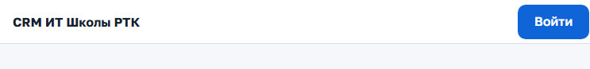

*Рисунок 1 — первая страница CRM*

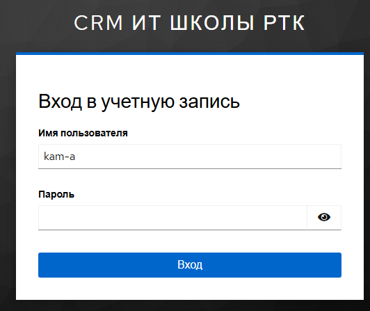

*Рисунок 2 — страница входа*

### 1.2. Роли и разделы

| Роль | Разделы в шапке | Первый экран |
|---|---|---|
| Менеджер по работе с вузами (КАМ), глава 2 | «Работа», «Вузы», «Договоры», «Отчёты» | «Работа» → «Моя работа» |
| Руководитель команды, глава 3 | те же четыре и «Настройки команды» | «Работа» → «Контроль» |
| «Руководство», глава 4 | «Работа», «Вузы», «Договоры», «Отчёты» | «Работа» → «Сводка команд» |
| Администратор, глава 5 | верхнего меню нет, боковое меню «Администрирование» | «Обзор» |
| Менеджер учебного процесса, глава 6 | «Зачисление»; у КАМ или руководителя с этим флагом — к своим разделам | «Зачисление» |
| Координатор вуза, глава 7 | верхнего меню нет, свой кабинет | «Сотрудничество с ИТ Школой РТК» |

В разделе «Работа» под шапкой — вкладки. У КАМ: «Моя работа» и «Проблемы и риски». У руководителя: «Контроль» и «Проблемы и риски». У «Руководства»: «Сводка команд», «Контроль» и «Проблемы и риски».

Менеджер учебного процесса из служебной команды «Открытый набор» видит только «Зачисление» и справку: вузов у него нет, завести вуз он не может.

### 1.3. Шапка, меню под аватаром, колокольчик и справка

**Меню под аватаром.** На кнопке — инициалы и имя. Нажмите её. Вверху меню — поля «Сотрудник», «Роль» и «Команда» (у «Руководства» — «Область»: «Все команды, только просмотр»; если команды нет — «Не назначена, вузы недоступны»). Пункты меню:

- «Подключить MAX» — у КАМ и руководителя, если подключён модуль MAX (раздел 2.18);
- «Уведомления на почту» — что присылать письмом, если в системе включена почта (у менеджера учебного процесса пункта нет);
- «Сменить пароль» — открывает страницу учётной записи в новой вкладке, пароль меняете сами;
- «Справка» — встроенное руководство по ролям и список кодов ошибок; в начале справки — строка «Версия системы: …»;
- «Выйти».

**Колокольчик.** У КАМ и руководителя — напоминания по срокам, договорам, лицензиям и отчётности (раздел 2.14). Красное число — просроченные шаги. У администратора колокольчик напоминает об обращениях субъектов персональных данных с близким или истёкшим сроком ответа (раздел 5.17). У «Руководства» колокольчика нет.

**Справка до входа.** Ссылка «Справка» есть на первой странице; вернуться к входу — кнопка «Ко входу».

### 1.4. Первый вход: профиль ожидает активации

При первом входе CRM создаёт профиль со статусом «Ожидает активации»: роль и команда ещё не назначены. Вы увидите экран «Профиль ожидает активации администратором».

1. Нажмите «Сообщить администратору». Пока сообщение отправляется, на кнопке написано «Отправляем…».
2. Появится сообщение: «Администратор увидит вашу просьбу в списке профилей CRM (дата и время). Войдите снова после того, как он откроет доступ».
3. Дождитесь, пока администратор назначит роль и команду, и войдите заново.

Если отправить сообщение не удалось, появится текст «Не удалось отправить сообщение. Повторите попытку позже или обратитесь к администратору напрямую» и номер Request ID. Сообщите его администратору. На этом же экране есть «Открыть справку» и «Выйти».

Экран «Профиль CRM недоступен» означает, что профиля нет или он заблокирован. Обратитесь к администратору CRM.

### 1.5. Выйти

1. Нажмите на аватар → «Выйти». Сеанс завершится. Черновики и выбранные фильтры, сохранённые в этой вкладке браузера, удалятся. Следующий вход снова запросит пароль.
2. Если сервер не ответил на «Выйти», CRM откроет страницу выхода учётной записи: подтвердите выход, и откроется первая страница.

Если в другой вкладке выполнен выход или вход другим пользователем, открытая вкладка сама вернётся на первую страницу.

### 1.6. Работа с телефона

CRM открывается в браузере телефона. Вверху — узкая полоса: «CRM РТК», колокольчик и аватар. Внизу — панель разделов: «Работа», «Вузы», «Договоры», «Отчёты»; у менеджера учебного процесса — пятая вкладка «Зачисление» (у сотрудника «Открытого набора» — только она). У руководителя в нижней панели есть «Ещё»: за ней «Настройки команды». Те же разделы есть в меню под аватаром.

Удобнее всего с телефона: «Моя работа», карточка вуза и карточка взаимодействия, переход этапа, комментарий, документы и (у руководителя) назначение ответственного. В карточке взаимодействия главная кнопка, «Добавить» и «⋯» закреплены внизу экрана. Импорт файлов, редактор шаблонов этапов и отчёты с диаграммами рассчитаны на экран компьютера. Для коротких действий на ходу есть мини-приложение MAX (раздел 2.18).

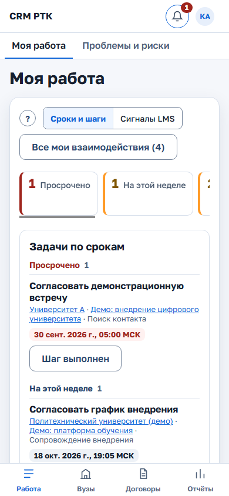

*Рисунок 3 — «Моя работа» на телефоне*

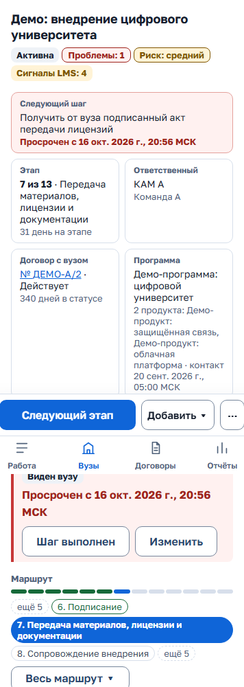

*Рисунок 4 — карточка взаимодействия на телефоне*

### 1.7. Подключаемые модули

Часть возможностей работает, только если модуль подключён на сервере. Какие модули включены, администратор видит на странице «Состояние модулей» (раздел 5.14). Без модуля соответствующих кнопок и разделов в интерфейсе нет.

| Модуль | Что даёт | Где описано |
|---|---|---|
| MAX | уведомления в мессенджере MAX и мини-приложение для КАМ и руководителя | разделы 2.18, 5.13 |
| ИИ-агенты (MCP) | помощник готовит планы записи, сотрудник их подтверждает | раздел 2.19 |
| Почта | письма-уведомления, приглашения со ссылкой вместо пароля на экране | разделы 5.12, 2.17 |
| Слушатели | раздел «Зачисление» для менеджера учебного процесса | глава 6 |
| Запись в Moodle | передача и перенос слушателей в Moodle из CRM | раздел 6.7 |
| Кабинет вуза | кабинет координатора вуза, запросы вузу | раздел 2.17, глава 7 |

## 2. Менеджер по работе с вузами (КАМ)

### 2.1. «Моя работа»: сроки и шаги

После входа открывается «Работа» → вкладка «Моя работа». Экран начинается со сроков.

**Плитки.** Сверху десять плиток: «Просрочено», «На этой неделе», «Без следующего шага», «Лицензии истекают до … года», «Договоры истекают за N дней» (по умолчанию 90), «Сигналы LMS», «Мои проблемы и риски», «Вернуться к работе», «Нет контакта больше N дней», «Новое по моим вузам».

1. Нажмите плитку — лента ниже покажет только её задачи. Нажмите ещё раз — отбор снимется.
2. Плитка «Сигналы LMS» не отбирает, а переключает экран на вид «Сигналы LMS» (раздел 2.10).
3. Плитка с нулём серая. Если данные недоступны, в плитке прочерк «—» и подпись «Сигналы LMS недоступны» или «Новое по вузам недоступно».

**Вид экрана.** Переключатель «Сроки и шаги» / «Сигналы LMS» показывает один из двух видов. Выбор запоминается на этом устройстве.

**Лента «Задачи по срокам».** В виде «Сроки и шаги» задачи собраны в группы «Просрочено», «Сегодня», «На этой неделе», «Позже», «Без следующего шага». В строке — шаг, вуз, взаимодействие, этап и срок. Время московское.

- В группе до 5 строк. Дальше — «Показать ещё N» и «Показать все в списке». Число у группы — все её задачи; если видна только часть, написано «Показано X из Y».
- Просроченный шаг стоит только в «Просрочено», в «На этой неделе» его нет — так же считает «Контроль».
- Если шагов со сроком нет: «Шагов со сроком нет. Задайте следующий шаг в карточке взаимодействия.». Если пусто в выбранной плитке: «По этой плитке задач нет.».

**Отметить шаг выполненным прямо в ленте**

1. Нажмите «Шаг выполнен» в строке. Откроется форма «Выполнение шага».
2. При желании заполните «Результат (необязательно)».
3. Заполните «Новый следующий шаг» и «Срок нового шага (МСК)». Если новый шаг не указать, форма предупредит: у взаимодействия не будет следующего шага и срока.
4. Если вы говорили с вузом, отметьте «Был контакт с вузом», выберите «Как прошёл контакт» («Встреча», «Звонок», «Письмо», «Мессенджер», «Мероприятие») и «Участники от вуза». Дата последнего контакта обновится сама; записи сайта и LMS контактом не считаются.
5. Нажмите «Отметить выполненным». Строка уйдёт в группу нового срока.

У взаимодействия без шага или срока в строке кнопка «Задать шаг»: она открывает карточку.

**Другие группы ленты** (их открывают плитки):

- «Лицензии истекают до … года» — отбирает список взаимодействий ниже.
- «Договоры истекают» — действующие договоры ваших вузов со сроком в ближайшие N дней и уже истёкшие. Номер договора открывает его в карточке вуза.
- «Мои проблемы и риски» — открытые записи, где ответственный вы, в том числе назначенные вам коллегой. Просроченные стоят сверху. Ссылка открывает карточку с окном «Проблемы и риски»; если вуз ведёт коллега и карточка вам недоступна — реестр. Внизу — «Все мои проблемы и риски в реестре».
- «Вернуться к работе» — приостановленные взаимодействия с наступившей датой возврата, у каждого кнопка «Возобновить» и строка «Приостановлено: <причина>». Приостановленные раньше без даты собраны в группу «Без даты возврата» с кнопкой «Открыть»: в карточке возобновите взаимодействие или приостановите его заново с датой.
- «Нет контакта с вузом» — идущие взаимодействия без делового контакта дольше порога. Порог выберите в списке «Дольше»: 14, 30, 45, 60 или 90 дней (по умолчанию 30, выбор хранится в этом браузере). В строке — «Последний контакт <дата>» или «Контакт не записан». Новое взаимодействие считается от даты создания. Если таких нет: «Со всеми вузами был контакт за N дней.».
- «Новое по моим вузам» — заявки с сайта и данные LMS по вашим вузам за 7 дней. Строка открывает взаимодействие. «Просмотрено» убирает строку из ленты и из счёта плитки; отметка видна только вам.

**Все мои взаимодействия.** Кнопка «Все мои взаимодействия (N)» над плитками прокручивает к полному списку «Все мои взаимодействия» (рядом — «Найдено: N»).

1. Введите текст в поле «Поиск по названию взаимодействия, вуза, программы или продукта».
2. Нажмите «Фильтры · N». Откроется боковая панель: «Срок следующего шага», «Этап», «Вид взаимодействия», «ИТ-программа» (по направлениям), «Продукт» (по вендорам), «Вуз», «Отметка», «Лицензия истекает», «Статус взаимодействия», «На текущем этапе», «Нет контакта с вузом».
3. Отметьте значения и нажмите «Готово». Выбранное видно чипами со «×». «Сбросить фильтры» убирает все.
4. Нажмите на название взаимодействия — откроется его карточка.

Приостановленные и завершённые взаимодействия в списке по умолчанию не показываются — выберите их в фильтре «Статус взаимодействия».

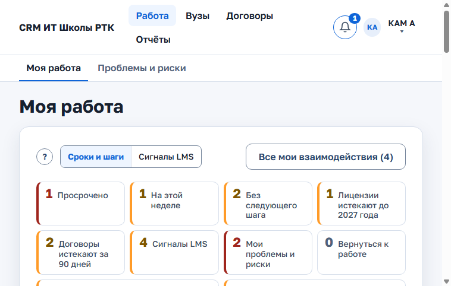

*Рисунок 5 — «Моя работа»*

### 2.2. Найти и открыть вуз

1. Откройте раздел «Вузы». В списке — вузы, где вы назначены ответственным или временно замещаете КАМ.
2. Введите часть названия в поле «Поиск по названию». Список «Состояние» («Действующие», «Ожидают подтверждения», «Архив») сужает выбор.
3. Нажмите на название вуза. Список скроется, карточка займёт всю ширину. Ссылка «← Все вузы» над карточкой вернёт в список с прежними фильтрами.

Если есть заявки с сайта по вашим вузам, ждущие разбора, над списком появится блок «Заявки с сайта ждут разбора: N». Раскройте его — увидите заявки и причину, по которой заявка не сопоставилась. Разбирает их руководитель команды (раздел 3.7).

**Карточка вуза**

- **Шапка.** Название, тип, состояние. Метки «Унаследован» и «Замещение: <КАМ> до <дата>», если применимо. Факты: «КАМ вуза», «Команда», «Обновлено … МСК», заполненные реквизиты (город, сайт, ИНН). Пустые поля скрыты.
- **Плашки.** «Вуз ждёт подтверждения руководителем команды. Работу с ним можно вести уже сейчас.» — пока руководитель не подтвердил новый вуз; «Вуз в архиве: …» — у архивного вуза.
- **Строка сводки.** Активные взаимодействия, просроченные шаги, ближайший срок, последний контакт, действующий договор с номером и сроком.
- **Вкладки.** «Взаимодействия (N)», «Путь вуза», «Контакты (N)», «Договоры и документы (N)», «Люди и часы», «История».
- **Меню «⋯».** У КАМ его нет: название, реквизиты, назначение и архив ведёт руководитель (раздел 3.3) и администратор.

**Вкладка «Взаимодействия»** показывает активные или все взаимодействия вуза (переключатель «Активные» / «Все»), статус — меткой рядом с названием. Здесь же кнопка «Новое взаимодействие» (раздел 2.5).

**Вкладка «Путь вуза»** показывает весь цикл работы с вузом: по строке на каждое взаимодействие, включая завершённые. Вверху сводка: «N взаимодействий: идут X, завершено Y · программ Z · просрочено шагов W». В строке:

- название, вид, программа и продукты; метка «Завершено» или «Приостановлено»;
- полоса по этапам маршрута самой карточки: пройденные зелёные, текущий синий, пропущенные пунктиром, необязательные бледнее; в подсказке сегмента — дата входа на этап; подпись «Этап N из M: название · на этапе K дн.» (у завершённых дней нет);
- срок следующего шага: просрочка красным, «Следующий шаг не задан» жёлтым;
- договор с вузом и его статус («Договор не привязан», если его нет), число проблем и рисков;
- обучение по данным LMS, если у взаимодействия есть потоки;
- «Предыдущий цикл» и «Следующий цикл» — ссылки на связанные циклы (новый цикл — раздел 2.7).

Переключатель порядка: «По программам» (группы «<программа> · N», идущие выше завершённых, новый цикл над прошлым; «Без программы» — последней), «По сроку шага», «По этапу». Нажатие на строку открывает взаимодействие. На телефоне строки идут карточками.

**Вкладка «История»** — общая лента вуза. Отбор по виду события: «Все события», «Новые взаимодействия», «Этапы», «Комментарии», «Планы и шаги», «Статус и данные взаимодействия», «Договоры и документы», «Назначения и передачи», «Контакты», а также по периоду; «Сбросить» снимает отбор. В записи — «Выполнил: …», время московское. Название взаимодействия открывает его карточку. Выше ленты — свёрнутый раздел «История назначений» (у руководителя — «История назначений и замещений»).

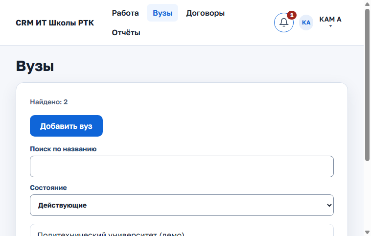

*Рисунок 6 — раздел «Вузы»*

### 2.3. Добавить вуз

Когда это нужно: вуза, с которым начинается работа, ещё нет в списке.

1. В разделе «Вузы» нажмите «Добавить вуз». Откроется форма «Новый вуз».
2. Заполните «Название *» и «Тип организации *» (Университет, Колледж (СПО) или Школа). При необходимости — «Город или регион», «Сайт», «ИНН».
3. Проверьте подсказки под формой:
   - «Похожие вузы — проверьте, нет ли среди них нужного:» — откройте найденный вуз, если это он;
   - «Вуз с таким названием уже есть: … Дубль не создаётся.» — точное совпадение блокирует создание;
   - «Вуз с таким ИНН уже есть. Если это не филиал, не создавайте дубль:» — у филиала ИНН может совпадать, поэтому создание не блокируется.
4. Нажмите «Создать и отправить на подтверждение».

Появится сообщение «… создана и отправлена руководителю на подтверждение. Работу можно начинать сразу.», и откроется карточка нового вуза. Вести взаимодействие можно, не дожидаясь подтверждения. Пока руководитель не подтвердил вуз (раздел 3.3), он виден с отбором «Ожидают подтверждения».

### 2.4. Контакты вуза и согласия на обработку ПДн

**Добавить контакт**

1. В карточке вуза откройте вкладку «Контакты» и нажмите «Добавить контакт». Откроется окно «Новый контакт».
2. Заполните «ФИО» (обязательно). При необходимости — «Должность», «Электронная почта», «Телефон», «Роль во взаимодействии».
3. Нажмите «Добавить контакт». Контакт появится в списке и станет доступен для привязки к взаимодействию.

**Изменить контакт**

1. У контакта нажмите «Изменить». Форма откроется прямо в карточке контакта.
2. Поправьте ФИО, должность, почту, телефон, роль во взаимодействии (Подписант (ЛПР), Исполнитель (внедрение), Преподаватель, Согласует документы, Другое).
3. При необходимости отметьте «Основной контакт» — прежний основной контакт потеряет эту отметку.
4. Нажмите «Сохранить контакт». «Отменить» закрывает форму без изменений.

У контакта с ограниченной обработкой данных вместо «Изменить» написано «Правка недоступна: обработка данных контакта ограничена.». «История изменений» под контактом показывает, кто и что менял.

**Отметить неактуальным.** В форме изменения отметьте «Не актуален (человек больше не отвечает за направление)» и сохраните. Неактуальный контакт скрывается из выбора для новых взаимодействий и не может быть основным. Из уже созданных взаимодействий его можно убрать, но не добавить снова, пока отметка не снята.

**Почта контакта** — латиницей, с доменом (name@example.ru): по ней координатор входит в кабинет вуза и получает письма. Если у контакта открыт доступ в кабинет, новая почта сразу становится и почтой входа (логин не меняется), а отметка «Не актуален» закроет доступ — форма предупреждает об этом до сохранения.

**Подтвердить контакт.** Когда вы сами связались с контактом, нажмите у него «Отметить «Контакт подтверждён»». Строка «Подтверждение» покажет «Подтверждён: <ФИО>, <дата>». Это снимает метку «Унаследован» с переданного вам вуза (раздел 2.16). У неактуального контакта и контакта с ограниченной обработкой кнопки нет.

**Записать согласие на обработку ПДн**

Учёт согласий нужен не всегда: решает оператор персональных данных, включает администратор в «Настройках» (раздел 5.2). Если учёт выключен, кнопки нет.

1. У контакта нажмите «Согласия». Под контактом раскроется список согласий: «<дата>: <основание>, документ …; записал <ФИО>».
2. Заполните «Дата согласия *» (не позже сегодня), «Основание *» (например, «согласие на обработку ПДн») и «Документ» (номер и дата).
3. Нажмите «Добавить согласие». Запись появится в списке.
4. Если человек отозвал согласие, нажмите «Отметить отзыв» у нужной записи. Она получит метку «Отозвано <дата>».
5. «Скрыть согласия» сворачивает список.

Записывают согласия КАМ и руководитель. У контакта с ограниченной обработкой или обезличенного согласия только видны; «Руководство» и администратор их только смотрят.

*Рисунок 7 — карточка вуза с контактами*

### 2.5. Начать взаимодействие по программе

1. В карточке вуза, во вкладке «Взаимодействия», нажмите «Новое взаимодействие». Откроется окно с формой.
2. Заполните «Название» (например, «Запуск программы по DevOps»).
3. Отметьте «Связанные контакты», выберите «Программа» и «Продукты». Программы в списке сгруппированы по ИТ-направлениям, продукты — по вендорам. Их можно не указывать.
4. Выберите «Вид взаимодействия», например «Повышение квалификации», или оставьте «По правилам: …» («Подобрать по правилам») — вид подберут правила администратора по типу организации, программе и продукту. Под полем показано описание вида. Поля нет, если администратор не завёл виды.
5. В поле «Шаблон процесса» оставьте первую строку («По виду: …», «Шаблон команды по умолчанию: …» или «Шаблон по умолчанию») или выберите другой шаблон. Строка под полем показывает, какой маршрут получит карточка. Если выбранный шаблон не совпадает с маршрутом вида, форма предупредит.
6. Заполните «Следующий шаг» и «Срок следующего шага (МСК)». «Дата последнего контакта (МСК)» — только если контакт уже был.
7. Нажмите «Создать взаимодействие».

Карточка появится в списке на первом этапе шаблона (в базовом шаблоне — «Поиск контакта»). Вид виден в шапке маршрута карточки и в строках списков.

**Сменить вид.** «⋯» → «Изменить данные взаимодействия…». В окне «Данные взаимодействия» выберите «Вид взаимодействия» и нажмите «Сохранить». Смена пишется в историю, этапы карточки не меняются, и шапка маршрута подписывает, что маршрут остался от прежнего вида. Чтобы работать по маршруту другого вида, начните новый цикл (раздел 2.7).

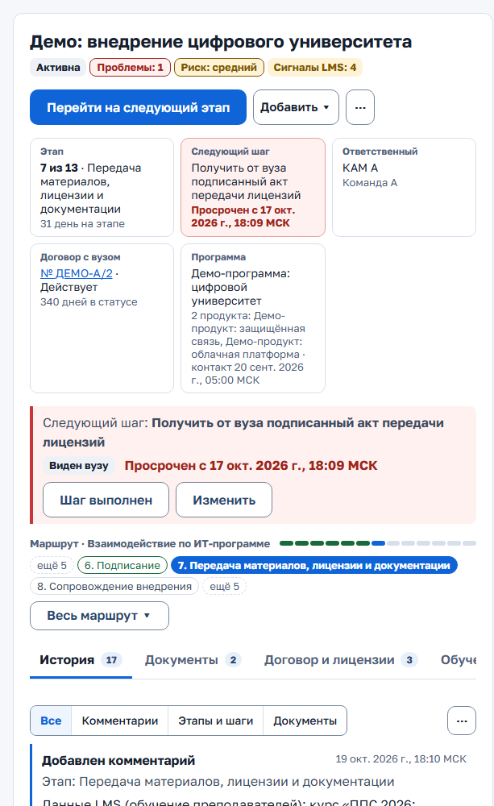

*Рисунок 8 — карточка взаимодействия*

### 2.6. Карточка взаимодействия: что на экране

Откройте взаимодействие во вкладке «Взаимодействия» карточки вуза, из «Моей работы» или из колокольчика. Карточка занимает всю ширину.

**Шапка.** Название и метки: «Активна» (или «Приостановлена», «Завершена»), «Ждём вуз» или «Ждём РТК», «Проблемы: N», «Риск: …», «Сигналы LMS: N» (открывает вкладку «Обучение»). Под ними — итог или причина статуса. У ролей без права правки — «Только просмотр» и знак «?».

**Пять фактов:**

1. Этап: «N из M» и дни на этапе.
2. Следующий шаг и срок. Просрочка выделена красным.
3. Ответственный: КАМ вуза, заместитель, команда.
4. Договор с вузом: номер (ссылка), статус, дни в статусе. На этапах документов без договора — «Создать договор», иначе «Нет». Второй строкой может стоять «Засчитан договор вуза № …, действует до …» или «Условие этапа выполнено: …» (раздел 2.11).
5. Программа, продукты, дата контакта.

**Главная кнопка.** Справа одна главная кнопка. Она зависит от ситуации:

| Ситуация | Кнопка |
|---|---|
| Взаимодействие приостановлено или завершено | «Возобновить взаимодействие» |
| Этап «Обмен документами», «Корректировка документов» или этап с отметкой «требует действующего договора», договора нет | «Создать договор», рядом — «Перейти на следующий этап…» |
| Дальше этапа с отметкой «требует действующего договора» не пройти без действующего договора | «Перейти к договору» (под шапкой подсказка, что сделать с договором) |
| Следующего шага нет | «Задать следующий шаг» |
| Во всех остальных случаях | «Перейти на следующий этап» |

Если переходов из этапа нет, кнопка неактивна, рядом подсказка.

**«Добавить ▾».** «Комментарий…», «Документ…», «Проблема или риск…». У завершённого взаимодействия «Комментарий…» нет.

**«⋯».** «Изменить шаг и срок…», «Перейти на следующий этап…» (если главная кнопка — не переход), «Вернуться на этап…», «Отметить этап выполненным (без перехода)…», «Чего ждём от вуза или РТК…», «Проблемы и риски…», «Изменить данные взаимодействия…», «Программа и продукты…», «Изменить этапы этого взаимодействия…», «Начать новый цикл…», «Приостановить или завершить…» (или «Возобновить…»). У «Руководства» в «⋯» только «Проблемы и риски…».

**Следующий шаг.** Строка под фактами: текст шага, срок, метка «Виден вузу», кнопки «Шаг выполнен» и «Изменить». «Шаг выполнен» есть, если задан шаг или срок; у завершённого взаимодействия обеих кнопок нет.

**Маршрут.** Свёрнут до текущего этапа и соседних. «ещё N» с краёв показывает, сколько этапов скрыто. «Весь маршрут ▾» раскрывает заголовок «Маршрут «<шаблон>» · вид «<вид>»», все этапы (необязательные помечены), версию шаблона («По шаблону «…», версия N»; если есть новее — «есть версия M; обновляет руководитель»), переходы из текущего этапа, «Все правила переходов (N)» и кнопки «Отметить этап выполненным» и «Изменить этапы». «Свернуть маршрут ▴» сворачивает его. У пройденного этапа в подписи — вход, выход, дни на этапе и число заходов, если были возвраты. У завершённого взаимодействия кнопок этапов нет, пока его не возобновят; документы, проблемы и новый цикл доступны.

**Вкладки.** «История (N)», «Документы (N)», «Договор и лицензии (N)», «Обучение», «Люди и часы», «Контакты (N)» (с кнопкой «Изменить состав»), «Запросы вузу» (если включён кабинет вуза, раздел 2.17).

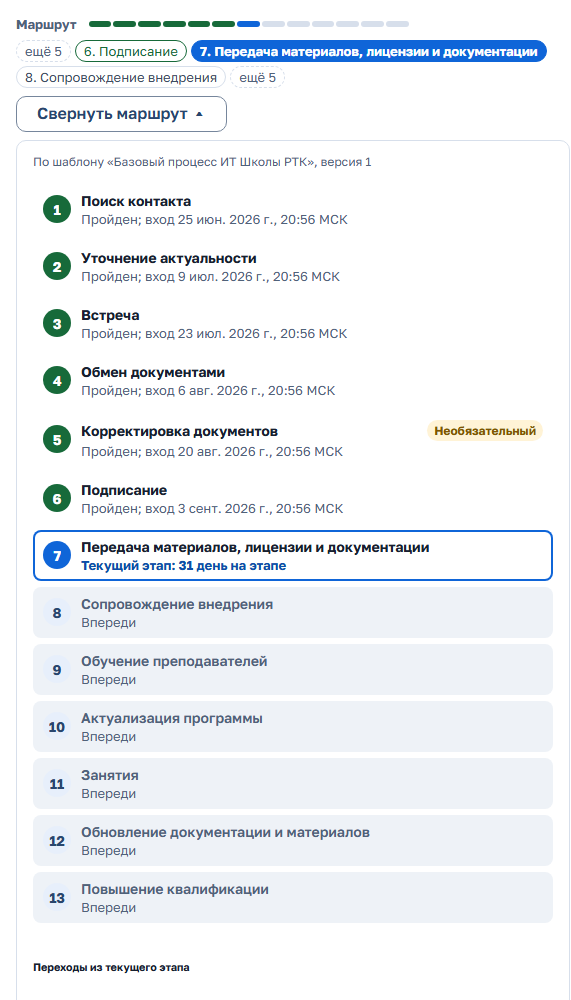

*Рисунок 9 — «Весь маршрут»*

**История.** Вкладка «История (N)» открыта по умолчанию. События идут от новых к старым, по 10; «Показать ещё» открывает следующие. Отбор: «Все», «Комментарии», «Этапы и шаги», «Документы». «⋯» вкладки → «Обновить» загружает историю заново. Кроме действий с карточкой, в истории видны загрузка документа без перехода и комментария, создание и смена статуса договора этой работы и запуск нового цикла (в обеих карточках) — с автором, временем и ссылкой на документ, договор или другую карточку цикла. Событие, загруженное импортом, подписано «Импортировано: файл и строка. Автор в файле: … Загрузил: …» (раздел 5.10).

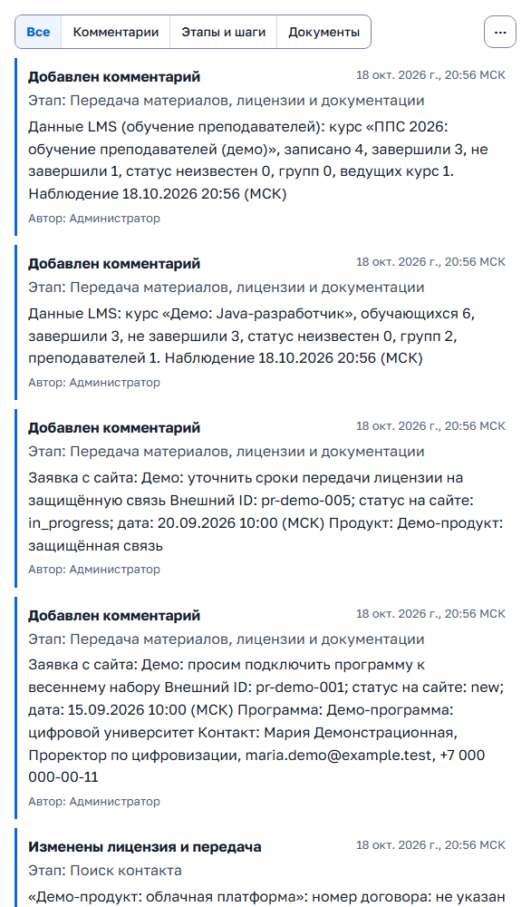

*Рисунок 10 — история взаимодействия*

**Если карточку изменил кто-то другой:** при сохранении появится сообщение о конфликте. Введённый текст не потеряется. Нажмите «Обновить карточку», проверьте новые данные и повторите действие.

### 2.7. Вести взаимодействие: шаг, этапы, статус

**Три похожих действия:**

- «Шаг выполнен» — сделана задача из «Следующего шага». Этап не меняется.
- «Отметить этап выполненным» — сделан другой этап, который идёт параллельно. Текущий этап остаётся.
- «Перейти на следующий этап» — работа на этапе закончена, взаимодействие идёт дальше по маршруту.

**Следующий шаг и срок.** Шаг и срок задаются при создании взаимодействия, при переходе этапа и комментарии (если там указан новый шаг) и при «Шаг выполнен». По сроку CRM считает просрочки и напоминания. Поля срока принимают и показывают московское время с пометкой «(МСК)».

**Изменить шаг и срок**

1. Нажмите «Изменить» в строке шага или «⋯» → «Изменить шаг и срок…».
2. Поправьте шаг и срок.
3. Нажмите «Сохранить».

Если включён кабинет вуза, в окне есть раздел «Кабинет вуза» с флажком «Показывать вузу» (раздел 2.17).

**Отметить шаг выполненным**

1. Нажмите «Шаг выполнен» в строке шага (или в ленте «Моей работы», раздел 2.1). Откроется форма «Выполнение шага».
2. Заполните «Результат (необязательно)», «Новый следующий шаг» и «Срок нового шага (МСК)». Если новый шаг не задать, форма предупредит, что у взаимодействия не будет следующего шага и срока.
3. Если был контакт с вузом, отметьте «Был контакт с вузом», выберите «Как прошёл контакт» (встреча, звонок, письмо, мессенджер, мероприятие) и «Участники от вуза». Канал и участники попадут в историю, дата последнего контакта обновится сама. Записи сайта и LMS контактом не считаются.
4. Нажмите «Отметить выполненным».

**Перейти на следующий этап**

1. Нажмите «Перейти на следующий этап». В окне поле «Следующий этап *» с этапами впереди по маршруту. Ближайший выбран заранее.
2. Пометка «(через этап, нужен комментарий)» означает пропуск этапа, «(нужен комментарий: не хватает документов)» — что у текущего этапа не хватает обязательных документов. Без «Комментарий к переходу» такой переход не сохранится. Если не хватает документов, окно подставит в комментарий «Не хватает документов: …»: допишите, почему без них. Один перечень документов объяснением не считается.
3. При необходимости отметьте «Проверенные документы к переходу».
4. Если переход упирается в правило договора, окно сразу скажет, что сделать с договором (раздел 2.11).
5. При желании раскройте «Заодно изменить следующий шаг»: пустое поле оставляет текущее значение.
6. Нажмите «Перейти на этап». Этап, комментарий и документы сохранятся вместе и появятся во вкладке «История». Внизу экрана появится короткое сообщение.

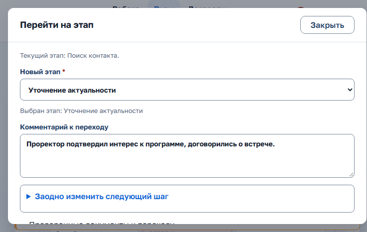

*Рисунок 11 — переход этапа*

**Пропустить необязательный этап.** В окне перехода выберите этап за ним (с пометкой «нужен комментарий») и напишите, почему этап пропущен.

**Вернуться на прежний этап**

1. Нажмите «⋯» → «Вернуться на этап…» (или кнопку в раскрытом маршруте). Откроется окно «Вернуться на этап».
2. Выберите «На какой этап вернуться *». В списке только прежние этапы, куда разрешён возврат по правилам переходов шаблона (в базовом шаблоне — предыдущий этап).
3. Заполните «Причина возврата *» — она обязательна в любом шаблоне и пишется в историю.
4. Нажмите «Вернуться на этап».

**Отметить этап выполненным без перехода.** Если работа по будущему или прошедшему этапу идёт параллельно с текущим (например, вы обучаете преподавателей во время сопровождения внедрения):

1. Нажмите «⋯» → «Отметить этап выполненным (без перехода)…» (или «Отметить этап выполненным» в «Весь маршрут»).
2. Укажите «Этап *», «Дата выполнения *» (не позже сегодняшней), при необходимости «Комментарий к отметке» и «Файлы этапа».
3. Нажмите «Отметить выполненным». Текущий этап не меняется — его завершает обычный переход.

Снять отметку можно в том же окне: в списке отмеченных этапов нажмите «Снять отметку» и подтвердите.

**Добавить комментарий без смены этапа**

1. Нажмите «Добавить ▾» → «Комментарий…».
2. Выберите «Этап комментария», введите «Текст комментария», при необходимости отметьте документы и «Был контакт с вузом».
3. Шаг в этом окне свёрнут — раскройте его, если нужно задать новый.
4. Нажмите «Добавить комментарий к этапу «…»».

**Изменить программу и продукты.** «⋯» → «Программа и продукты…». Продукт, по которому уже есть данные договора или лицензии, снять нельзя.

**Чего ждём.** «⋯» → «Чего ждём от вуза или РТК…». Выберите «Ждём вуз», «Ждём РТК» или «Ничего не ждём», при необходимости заполните «Чего именно ждём» и нажмите «Сохранить отметку». Отметка видна в шапке карточки, в «Моей работе» и в отчётах.

**Приостановить, завершить или возобновить**

1. Нажмите «⋯» → «Приостановить или завершить…» (у приостановленного или завершённого — «Возобновить…» или главная кнопка «Возобновить взаимодействие»).
2. Чтобы приостановить: заполните «Причина приостановки» и «Когда вернуться к работе *» (не раньше завтрашнего дня) и нажмите «Приостановить взаимодействие».
3. Чтобы завершить: заполните «Итог взаимодействия», нажмите «Завершить взаимодействие» и подтвердите в окне «Завершить взаимодействие?».
4. Чтобы возобновить: при желании заполните «Комментарий к возобновлению» и нажмите «Возобновить взаимодействие».

Дата возврата становится следующим шагом «Вернуться к работе после приостановки»; в этот день взаимодействие появится в «Моей работе» в группе «Вернуться к работе». При возобновлении этот служебный шаг снимается (вуз его тоже больше не видит) и возвращается шаг, который был до паузы, если он не был выполнен. Если возвращать нечего, шаг остаётся пустым — CRM напомнит его задать.

Приостановленное и завершённое взаимодействие уходит из «Моей работы» по умолчанию, но остаётся в карточке вуза и в отчётах. Завершённое взаимодействие не меняется: переходы этапов, комментарии, правка этапов и пауза недоступны, пока его не возобновят.

Даты проверяются на правдоподобие: срок шага и проблемы — в пределах пяти лет от сегодня, дата последнего контакта — не позже сегодня, дата подписания договора в статусах «Действует», «Завершён» и «Расторгнут» — не позже сегодня.

**Изменить этапы своей карточки**

1. Нажмите «⋯» → «Изменить этапы этого взаимодействия…» (или «Изменить этапы» в «Весь маршрут»).
2. В поле «Что изменить» выберите: «Переименовать этап», «Добавить этап после выбранного», «Переместить этап после выбранного», «Удалить этап» или «Изменить обязательность этапа».
3. Укажите «Этап *», при необходимости «После какого этапа *» и «Название этапа *».
4. Нажмите «Применить изменение». Для удаления — «Удалить этап…» и подтверждение «Удалить этап?».

Изменение касается только этой карточки. Удалить можно только будущий этап, по которому ещё нет событий истории и документов. Текущий этап не удаляется: такие этапы помечены «нельзя удалить: текущий этап» или «есть события или файлы». Обязательность меняется у будущего этапа без событий; необязательный этап можно пропустить с комментарием.

**Начать новый цикл.** Когда работа по программе пошла на следующий круг (например, новый учебный год) или нужен маршрут другого вида:

1. Нажмите «⋯» → «Начать новый цикл…». Откроется вкладка «Обучение», раздел «Циклы взаимодействия», с формой.
2. Проверьте «Название нового взаимодействия *» (по умолчанию «<название> — новый цикл») и «Начало цикла *».
3. «Вид взаимодействия» подставлен из прошлого цикла, «Шаблон этапов» — по виду. Их можно сменить; подсказка под полями покажет маршрут нового цикла.
4. Нажмите «Создать новый цикл». Откроется новая карточка с сообщением «Новый цикл начат. Это его карточка.».

Циклы связаны ссылками «Предыдущий цикл» и «Следующий цикл». Если следующий цикл уже есть, кнопки нет.

### 2.8. Проблемы и риски

У взаимодействия может быть несколько проблем и рисков.

**Записать проблему или риск**

1. Нажмите «Добавить ▾» → «Проблема или риск…» (или метку «Проблемы: N» / «Риск: …» в шапке, или «⋯» → «Проблемы и риски…»). Откроется окно со списком открытых записей.
2. Нажмите «Добавить проблему» или «Добавить риск».
3. Заполните описание (обязательно). Для риска выберите уровень «средний» или «высокий».
4. «Ответственный» по умолчанию — ответственный за вуз; можно выбрать другого сотрудника команды. «Срок решения» — по желанию.
5. Сохраните. Запись появится в списке с полями «Ответственный», «Срок», «Отметил».

«Изменить» поправляет описание, уровень, ответственного или срок. Чтобы закрыть запись, заполните «Как решили *» и нажмите «Решено». Флажок «Показать решённые (N)» возвращает закрытые записи в список. Каждое добавление, изменение и решение попадает в «Историю» взаимодействия и в «Историю» вуза.

**Реестр «Проблемы и риски».** Все записи по вашим взаимодействиям — на вкладке «Проблемы и риски» раздела «Работа», в том числе по вузам, где вы заместитель. Туда же попадают записи, где ответственным назначили вас коллеги: видны вид, описание, срок и вуз, а карточка вуза закрыта (пометка «вуз ведёт коллега, карточка вам недоступна»).

1. Нажмите «Фильтры»: вид, уровень риска, «Кто решает», вуз, статус, «Только с прошедшим сроком». Выбранное видно чипами.
2. Колонки: взаимодействие, вуз, «КАМ вуза», вид, описание, «Кто решает», срок, возраст.
3. Название взаимодействия или описание открывают карточку сразу с окном «Проблемы и риски», название вуза — карточку вуза.
4. Чтобы ответить по записи, нажмите «Комментарий» (окно «Комментарий ответственного», кнопка «Сохранить комментарий») или «Решено» («Отметить решённой»). Ответ попадёт в историю взаимодействия, КАМ вуза его увидит.
5. «⋯» → «Выгрузить XLSX» сохраняет строки по текущим фильтрам.

Руководитель видит записи команды, «Руководство» — все, только для просмотра.

### 2.9. Документы, лицензии и передача материалов

**Загрузить документ**

1. В карточке взаимодействия нажмите «Добавить ▾» → «Документ…». Или во вкладке «Документы» нажмите «Загрузить документ».
2. Выберите «Этап документа» (по умолчанию — текущий этап), «Вид документа» (из справочника «Виды документов»: договор, лицензионное соглашение, акт, скан подписанного документа и другие) и файл. Допустимо: PNG, JPEG, HEIC (фото с iPhone), PDF, ZIP, GZIP, RAR, DOC, DOCX, XLS или XLSX, до 20 МБ. Если выбран не текущий этап, появится предупреждение «Выбран не текущий этап: файл попадёт в этап «…», а текущий этап — «…»». Загрузку оно не блокирует.
3. Нажмите «Загрузить в этап «…»» (кнопка называет выбранный этап). Файл проверяется антивирусом. Статус в списке: «Проверен: доступен», «Отклонён: недоступен» или «Не удалось проверить: недоступен». «Обновить статус» перечитывает состояние.
4. Проверенный файл можно отметить при комментарии к его этапу или при переходе на его этап. Он свяжется с событием истории.

Во вкладке «Документы (N)» над списком — отбор по виду документа. В строке документа: имя, метка статуса, этап, вид, размер, время загрузки (МСК), версия.

- «Скачать» и «Просмотреть» — у проверенного файла, прямо в строке. PDF, PNG и JPEG «Просмотреть» открывает в новой вкладке. HEIC хранится как есть и только скачивается.
- «Обновить статус» — у файла, который ещё проверяется.
- «⋯» строки: «Вид документа…», «Сделать доступным вузу» или «Скрыть от вуза» (если включён кабинет вуза), «Загрузить новую версию…», «Удалить…».
- «Загрузить новую версию…» добавляет исправленный файл к прежнему. Прежняя версия остаётся в списке: «Версия 1», «Версия 2».
- «Удалить…» убирает ошибочно загруженный файл. Может автор файла или руководитель команды, можно указать причину. Файл перестаёт открываться и скачиваться, в истории появляется запись «Удалён документ».

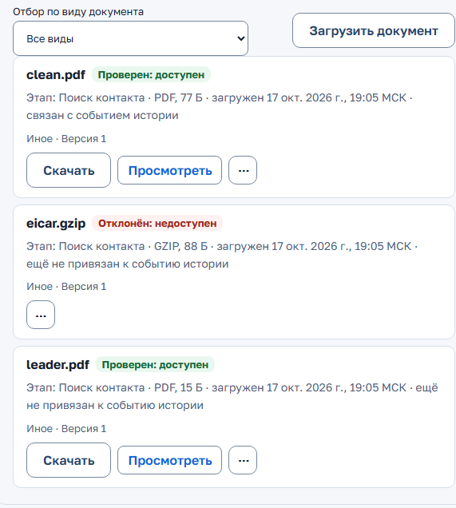

*Рисунок 12 — документы взаимодействия*

**Договор и лицензии.** Вкладка «Договор и лицензии» состоит из трёх разделов.

- «Договор с вузом»: связанный договор, кнопки смены статуса, «Создать договор», правило договора. Раздел виден на любом этапе. Подробнее — раздел 2.11.
- «Лицензии по продуктам»: у нужного продукта нажмите «Изменить лицензию». В форме «Лицензия: <продукт>» укажите номер договора, подписание лицензии, срок лицензии (год окончания) и «Скан договора или лицензии». Скан сначала загрузите во вкладке «Документы» и дождитесь статуса «Проверен: доступен». Нажмите «Сохранить договор и лицензию». Рядом показан вендор продукта и его контакт: телефон и почту можно скопировать одним нажатием. Если контакт не указан, справочник ведёт администратор (раздел 5.5). Изменение видно сразу на вкладке, в истории («Изменены договор и передача») и в отчётах.
- «Передача материалов»: у продукта нажмите «Изменить отметки передачи». Для материалов, лицензии и документации выберите «Передано» с датой и подтверждающим файлом или «Не передано». Нажмите «Сохранить отметки передачи». Статус передачи продукта пересчитывается: «Передано», «Передано частично» или «Не передано».

### 2.10. Обучение: данные LMS, сигналы, списки на курс

Вкладка «Обучение» карточки взаимодействия собирает всё, что CRM знает об обучении по данным Moodle. Разделы идут в порядке: «Предложение по данным LMS» (если есть), «Сигналы LMS», «Данные LMS», «Повышение квалификации», «Списки на курс LMS», «Циклы взаимодействия».

**Сигналы LMS.** Это подсказки по данным Moodle. Их показывают плитка «Сигналы LMS» и вид «Сигналы LMS» в «Моей работе» (видны 20 сигналов, дальше — «Показать все сигналы (N)») и вкладка «Обучение» в карточке.

- «В LMS появились обучающиеся» — занятия идут, а взаимодействие ещё до этапа с ролью «Идут занятия» (в базовом маршруте — «Занятия»).
- «Поток идёт, обучающихся нет».
- «Низкая доля завершивших» — доля среди обучающихся с известным статусом; сигнал приходит, только если статус известен хотя бы у 70 % потока (порог по умолчанию, задаёт администратор).
- «Данных о завершении недостаточно, нужна проверка» — статус известен у меньшей части потока: проверьте отслеживание завершения в курсе Moodle.
- Сигналы по входу в курс: «Обучающиеся не начали», «Поток идёт, активности нет», «Мало заходят в курс», «Обучающиеся перестали заходить», «Преподаватель не заходит в курс». Рядом с датой у них пометка «вход в курс — признак присутствия, а не учёбы». Если данные потока устарели (не обновлялись больше суток), сигналов по входу нет.
- Остальные сигналы по устаревшим данным приходят с пометкой «данные устарели» рядом с датой данных LMS. Прежде чем записать такой сигнал как риск, проверьте поток: в тексте риска CRM тоже отметит «данные устарели».

В карточке раздел «Сигналы LMS» вкладки «Обучение» раскрыт, если сигнал есть.

- «Перейти к этапу «…»» открывает обычное окно перехода. Этап меняется только после «Перейти на этап».
- «Скрыть до изменения данных» прячет сигнал, пока не изменятся числа LMS. У сигналов по входу в курс кнопка называется «Скрыть до конца недели». Скрытые сигналы собраны в свёрнутый список «Скрытые сигналы (N)».
- «Записать как риск» добавляет сигнал в «Проблемы и риски» взаимодействия (раздел 2.8); у записанного сигнала пометка «Записан в реестр проблем и рисков.».
- Если маршрут не разрешает прямой переход, вместо кнопки написано, что сделать.

Когда преподаватели вуза завершили курс ППС, во вкладке «Обучение» появляется предложение перейти к этапу «Актуализация программы». Кнопка «Перейти к этапу «Актуализация программы»…» открывает обычное окно перехода. Сам этап отметьте вручную, когда программа обновлена.

Блок «Предложение по данным LMS» с кнопкой «Отметить этап выполненным по данным LMS» появляется, когда курс завершил хотя бы один преподаватель. Рядом может быть кнопка «Запустить новый цикл». Если завершили не все, в нём написано «Часть преподавателей ещё не завершила курс». Если запись об обучении сохранилась, а этап не отметился, форма пишет «Запись об обучении сохранена, этап не отмечен». Нажмите «Повторить отметку этапа»: второй записи не будет.

У потока в «Данных LMS» пометка «данные устарели» значит, что курс давно не читался из Moodle, например падает при каждой синхронизации. Сообщите администратору.

**Преподаватели на повышение квалификации: файл для LMS.** Когда вуз направляет преподавателей на курс ПК в LMS, список собирает КАМ или руководитель, а пользователей импортирует LMS-команда. CRM в LMS не пишет.

1. Откройте вкладку «Обучение», раздел «Списки на курс LMS». Заполните «Новый список на курс LMS»: курс (подсказка — курсы обучения преподавателей из синхронизации) и группу. Нажмите «Создать список».
2. «Добавить преподавателя из контактов вуза» → «Добавить в список». Нет нужного человека — «Новый контакт-преподаватель…» открывает обычную форму контакта с ролью «Преподаватель».
3. У каждого преподавателя видно, как ФИО попадёт в колонки файла, и что мешает выгрузке: нет почты, инициалы вместо имени, одна почта у двоих. ФИО контакта пишется как «Фамилия Имя Отчество». Исправить почту или ФИО можно в блоке «Контакты преподавателей списка».
4. Выберите в блоке «Кого выгрузить в файл» «Только ещё не переданных LMS-команде» или «Всех готовых, включая переданных (повторная передача)» и нажмите «Скачать файл для LMS». Файл — шаблон «Загрузка пользователей» с заполненными только фамилией, именем, отчеством и почтой. Неготовые в него не входят. «Скачать CSV для загрузки в Moodle» даёт тот же состав в формате штатной загрузки пользователей Moodle (колонки `username`, `firstname`, `lastname`, `email`, `course1`, `group1`, `role1`). Администратор LMS загружает его в «Администрирование → Пользователи → Загрузка пользователей» и сразу записывает преподавателей на курс и в группу. Для этого в списке курс указывают по краткому имени, а группу — по названию, как они записаны в LMS. В форме загрузки Moodle включают «Создать пароль, если нужно, и отправить по почте», если пароль нужен новым пользователям.
5. Передав файл LMS-команде, нажмите у выгрузки «Отметить: передано LMS-команде» и подтвердите. После импорта и синхронизации Moodle рядом появится «В LMS записано: N».

Список без выгрузок можно удалить. Переданного преподавателя из списка не исключить. Выгрузка и отметка пишутся в журнал.

**Данные LMS** — обучающиеся и завершившие по потокам. У идущего потока показано «Учатся сейчас» (обучающиеся минус завершившие), у закончившегося — «Не завершили». Строка «Завершили» показывает основание, например «16 из 20 с известным статусом; данные по 20 из 100».

**Циклы взаимодействия.** Новый цикл начинает «⋯» → «Начать новый цикл…»: откроется вкладка «Обучение» сразу с формой нового цикла.

### 2.11. Договор с вузом и план мероприятий

Когда это нужно: с вузом готовится или уже заключён договор. Согласование, файл, допсоглашения и план совместных мероприятий (образовательные программы, стажировки, обучение преподавателей, доступ к продуктам и другое) ведутся в одном месте.

**Где договор.** В карточке вуза откройте вкладку «Договоры и документы». Слева — список «Договоры с вузом» с отбором по статусу, справа — карточка выбранного договора. На телефоне карточка открывается отдельно, назад ведёт «← Все договоры». Тот же договор открывает раздел «Договоры» (реестр, ниже) или кнопка «Создать договор» в карточке взаимодействия.

**Создать договор**

1. Нажмите «Добавить договор». Откроется окно.
2. Выберите «Проект — пойдёт на согласование с вузом» или «Уже подписан» (тогда укажите дату подписания).
3. Заполните номер (уникален в пределах вуза), дату подписания, «Действует до», дату отправки на согласование, стороны, подписанта вуза (по умолчанию контакт с ролью «Подписант (ЛПР)») и подписанта школы.
4. Отметьте «Связанные взаимодействия вуза» и предмет — направления, программы и продукты.
5. Чтобы запланировать подписание или продление, выберите в поле «План» «Подписание» или «Продление» и задайте «Плановая дата подписания» или «Плановая дата продления» (для продления подставляется дата «Действует до»). План попадает в отчёт «План подписаний и продлений договоров» (раздел 2.15).
6. Нажмите «Сохранить договор».

**Вести договор**

1. Статус меняют кнопки в шапке карточки договора: «Проект» → «На согласовании» (дата отправки по умолчанию — сегодня) → «На корректировке» → снова «На согласовании» или «На подписании» → «Действует» (нужна дата подписания) → «Завершён». Действующий договор можно расторгнуть. Возврат на шаг назад и расторжение — только с комментарием. В шапке видны статус и дни в статусе.
2. «⋯» договора: «Изменить реквизиты…» (откроется окно) и «Скачать подтверждения архивом (N)» — собирает документы мероприятий.
3. «Файл договора» → «Загрузить новую версию»: файл (форматы и размер те же, что у документов, до 20 МБ) и комментарий, например «редакция вуза» или «после корректировки». Каждая загрузка — новая версия с автором и датой, файл проверяется антивирусом. «Из документов взаимодействий» берёт уже загруженный документ.
4. «История версий (N)» свёрнута: раскройте её, чтобы скачать любую проверенную версию. Подписанная версия — последняя проверенная версия, загруженная до перехода в «Действует»: она отмечена «подписанная» и скачивается с этой пометкой в имени файла. Если скан загрузили позже, он станет текущей версией, а подписанная показана отдельной строкой.
5. «Дополнительные соглашения (N)» — свёрнутый раздел. «Добавить допсоглашение»: номер, дата, предмет и статус «Проект» или «Подписано». У допсоглашения свой файл с версиями.
6. «История статусов (N)» — свёрнутый раздел: кто, когда, с каким комментарием и из какого взаимодействия менял статус. Те же переходы видны во вкладке «История» карточки вуза.

**Сроки согласования.** Пока договор «На согласовании», «На корректировке» или «На подписании», под заголовком карточки договора видно, у кого он сейчас и сколько дней. «На согласовании» — сторона вуза, «На корректировке» — сторона школы. Круг — какой раз договор ушёл на согласование вузу. Норма у вуза — 6 недель в первом круге и 3 недели в следующих, у школы — 1 неделя. Общий срок считается от даты отправки на согласование. Цвет:

- «в норме»;
- «жёлтый» — дольше нормы на стороне или общий срок с 60-го дня;
- «красный» — общий срок с 90-го дня.

Июль и август в дни не входят. Нормы задаёт администратор сервера.

**Срок истёк.** Если дата «Действует до» прошла, рядом со статусом «Действует» появляется отметка «срок истёк». Статус сам не меняется: продлите срок в «Изменить реквизиты…» или переведите договор в «Завершён». Отметку видно в реестре, карточке договора и вуза, карточке взаимодействия, «Контроле» и кабинете вуза. Такой договор попадает в напоминания (раздел 2.14).

**План мероприятий**

1. В карточке договора, в разделе «План мероприятий», нажмите «Добавить мероприятие». Откроется окно «Новое мероприятие».
2. Заполните «Вид мероприятия» (справочник ведёт администратор), «Мероприятие» (название) и «Статус» (по умолчанию «Запланировано»).
3. Для отчётности заполните «Уровень образования», «Единица», «Охват, участников», «Количество по плану», «Стоимость или оценка, ₽», «Исполнитель» (организация группы компаний). Если у вида есть обязательные атрибуты, форма пишет «Для этого вида обязательны: …» и отмечает их звёздочкой.
4. Укажите «План: начало / окончание» и «Ответственный» (действующий сотрудник команды вуза). При необходимости отметьте «Связанные взаимодействия вуза» и «Подтверждающие документы».
5. Нажмите «Сохранить мероприятие».
6. По ходу работы откройте мероприятие кнопкой «Изменить» (окно «Изменить мероприятие») и заполните «Количество факт», «Факт: начало / окончание» и «Подтверждающий документ: реквизиты» (акт, письмо вуза: номер и дата). Когда мероприятие проведено, количество по факту и документ обязательны.

Статусы мероприятия: «Запланировано», «Выполняется», «Проведено», «Подтверждено вузом», «Отклонено», «Отменено». Удаление CRM подтверждает окном «Удалить мероприятие?»; документы остаются во взаимодействиях.

Подтверждающие документы мероприятий — это документы взаимодействия (раздел 2.9). Загрузите их во взаимодействие вуза и выберите в мероприятии после проверки антивирусом.

**Связь с этапами.** На этапах «Обмен документами», «Корректировка документов» и на этапе с отметкой «требует действующего договора» (в базовом маршруте — «Подписание») в карточке взаимодействия виден факт «Договор с вузом». Если договора нет, главная кнопка — «Создать договор», взаимодействие будет отмечено в нём заранее. Дальше отмеченного этапа можно пройти, только если у вуза есть любой действующий договор со школой: «Действует» с датой подписания и неистёкшим сроком, даже не привязанный к этому взаимодействию; «Завершён» не подходит. На этом этапе факт «Договор с вузом» и окно перехода называют договор, которым условие выполнено, с номером и сроком; если с работой договор не связан — подсказка «Засчитан договор вуза № …». Если срок договора истёк, CRM попросит продлить срок или оформить новый договор. Окно перехода и окно «Отметить этап выполненным» предупредят об этом до отправки. Маршруты без отмеченного этапа (например, повышение квалификации) правило не затрагивает.

**Привязать готовый договор.** Если договор с вузом заключили раньше взаимодействия, откройте в карточке взаимодействия вкладку «Договор и лицензии» и нажмите «Привязать договор вуза» (или «Привязать ещё договор вуза»). Выберите договор и нажмите «Привязать». Прежние связи договора с другими взаимодействиями сохранятся. Ту же кнопку показывает окно «Новый договор с вузом».

**Реестр «Договоры».** Раздел «Договоры» в шапке — все договоры ваших вузов.

- Плитки-фильтры: «На согласовании», «На корректировке», «На подписании», «Согласование затянулось» (жёлтые и красные), «Действует», «Истёк или истекает за 90 дней». Нажмите плитку — отберутся договоры. Нажмите ещё раз — отбор снимется. Число на плитке равно числу отобранных строк.
- Фильтры: статус, вуз, «истекает до», «на согласовании дольше N дней», «Согласование затянулось»; у руководителя — КАМ, у «Руководства» — ещё «Команда». «Сбросить фильтры» убирает все.
- Колонки: «Номер», «Вуз», «Статус», «В статусе», «Согласование» (сторона, круг, дни на стороне из нормы, общий срок и цвет), «Подписан», «Действует до», «Предмет», «КАМ» («Без ответственного КАМ», если КАМ не назначен). Над таблицей — «Договоров: N».
- «⋯» → «Выгрузить XLSX» сохраняет отобранные строки.
- Строка открывает договор в карточке вуза. Вводный текст — под знаком «?».

### 2.12. Перечни мероприятий и отчёт по соглашениям

Перечень мероприятий — список мероприятий договоров вуза на отчётный период, который вуз согласует. Период (календарный или учебный год), сроки ответа вуза и состав отчёта задаёт администратор (раздел 5.8).

**Сформировать перечень**

1. В карточке вуза откройте вкладку «Договоры и документы». Под договорами — блок «Перечни мероприятий». Строка под заголовком подскажет, кто отвечает за вуз: «У вуза есть координатор: перечень он согласует в кабинете вуза.» или «У вуза нет координатора с доступом к кабинету: ответ вуза отмечает КАМ.».
2. Нажмите «Сформировать перечень». Откроется окно «Сформировать перечень мероприятий».
3. Укажите «Год периода» (для учебного года — год начала) и, при желании, «Название (необязательно)».
4. Нажмите «Сформировать». В перечень попадут мероприятия договоров вуза на этот период, кроме отменённых, отклонённых и мероприятий расторгнутых договоров.
5. Нажмите строку перечня — раскроется его карточка: «Период», «Статус», таблица «Позиции (N)» и свёрнутая «История».
6. Чтобы убрать лишние позиции, нажмите «Изменить название и состав», снимите флажки в «Позиции перечня» и нажмите «Сохранить». «Собрать заново из плана» возвращает все мероприятия периода. Состав меняется только в статусах «Проект» и «Возвращён».

**Отправить перечень вузу**

1. Нажмите «Отправить вузу» и подтвердите в окне «Отправить перечень вузу?» кнопкой «Отправить».
2. Пустой перечень отправить нельзя: кнопка неактивна, рядом пояснение «Отправить пустой перечень нельзя: добавьте мероприятия плана договоров через «Изменить название и состав».».
3. Если у вуза есть координатор с доступом к кабинету, перечень появится у него в кабинете, решение примет он (глава 7).
4. Если координатора нет, вуз отвечает вам. Нажмите «Отметить ответ вуза: согласован» или «Отметить ответ вуза: возвращён», укажите «Дата ответа вуза» (не раньше отправки и не позже сегодня) и «Комментарий» (при возврате обязателен). Нажмите «Отметить».
5. Если вуз не ответил до конца срока, перечень получает статус «Согласован без ответа». Если срок не задан, перечень ждёт ответа. Срок виден в строке перечня: «ответ вуза до …».
6. Возвращённый перечень исправьте и отправьте снова: в карточке появится «круг N». История показывает, кто (КАМ, координатор вуза или система), когда и с каким комментарием менял статус.

Статусы перечня: «Проект», «На согласовании», «Согласован», «Согласован без ответа», «Возвращён». Сроки отчётного цикла и перечни, которые ждут ответа вуза или возвращены, появляются в колокольчике (раздел 2.14).

**Отчёт по соглашениям**

1. Откройте «Отчёты» → «Все отчёты» → группа «Договоры» → «Отчёт по соглашениям».
2. Задайте период (по умолчанию — текущий период по настройке) и «Вуз» (по умолчанию «Все доступные»). Отчёт пересчитывается сам.
3. Сверху плитки: вузы, мероприятия, участники (охват), стоимость, оценка по плану и по факту в рублях. Если у части мероприятий нет подходящей ставки, появится плитка «мероприятий без подходящей ставки».
4. Ниже — таблица «Мероприятия (N)» с колонками по шаблону администратора и своды: «Свод по вузам», «Свод по видам мероприятий», «Свод по исполнителям», «Свод по уровням образования». Если администратор включил порог, есть «Свод по исполнителям против порога N %» с колонками «База», «Требуется», «План достигает», «Факт достигает».
5. «Выгрузить ▾» → «XLSX (Excel)», «PDF» или «JSON» — те же строки, что на экране.

Оценка мероприятия — количество × ставка на дату проведения; ставки задаёт администратор.

### 2.13. Люди и часы: преподавание, стажировки, повышение квалификации

Вкладка «Люди и часы» есть в карточке вуза (все записи вуза) и в карточке взаимодействия (записи этого взаимодействия: «Показаны записи этого взаимодействия; все записи вуза — в карточке вуза.»). Её видят КАМ, руководитель и «Руководство»; «Руководство» только смотрит.

Во вкладке три раздела: «Преподавание сотрудниками», «Стажировки», «Повышение квалификации преподавателей».

**Добавить запись**

1. В нужном разделе нажмите «Добавить запись». Откроется окно «<раздел>: новая запись». Во взаимодействии оно подставится само.
2. Заполните поля раздела (обязательные отмечены звёздочкой):
   - «Преподавание сотрудниками»: «Взаимодействие», «Договор», «Мероприятие плана договора» (часы засчитываются в мероприятие договора вуза), «Дисциплина или программа», «Сотрудник» или «Не из справочника — исполнитель группы компаний» с полями «ФИО исполнителя группы компаний» и «Компания исполнителя», «Начало», «Окончание», «Часы», «Единица часа», «Группа или поток», «Подтверждение вузом» (не запрашивалось, запрошено у вуза, подтверждено вузом, вуз не подтвердил), «Документ подтверждения», «Дата подтверждения».
   - «Стажировки»: «ФИО стажёра», «Стажёр» (студент или преподаватель), «Место стажировки: подразделение или исполнитель», «Наставник» или «ФИО наставника», период, «Часы стажёра», «Часы наставника», «Итог» (запланирована, идёт, завершена, не завершена), «Трудоустроен после стажировки», «Документ». Можно выбрать договор и мероприятие плана.
   - «Повышение квалификации преподавателей»: «Поток Moodle (список на курс LMS)», «Преподаватель из контактов вуза» или «ФИО преподавателя» и «Электронная почта», «Программа», даты, часы, «Итог» (обучается, аттестован, не аттестован), «Номер удостоверения», «Дата удостоверения», «Передано в ФРДО (дата)» — только для аттестованных.
3. Нажмите «Сохранить». Запись появится в таблице раздела.

«Изменить» в строке открывает ту же форму, «Удалить» спрашивает подтверждение «Удалить запись?»: запись исчезнет из учёта и отчётов, удаление пишется в журнал. Единица часа подставляется из настроек администратора («академический час (45 минут)» или «астрономический час (60 минут)»), в записи её можно сменить.

**Загрузить список повышения квалификации из XLSX**

1. В разделе «Повышение квалификации преподавателей» откройте блок «Загрузить список из XLSX».
2. Нажмите «Скачать шаблон» и заполните файл.
3. Выберите файл и, при необходимости, «Поток Moodle для всех строк» (по умолчанию «Без потока Moodle»).
4. Нажмите «Проверить». Если ошибок нет — «Ошибок нет, строк: N. Можно загружать.». Если есть — «Найдены ошибки (N); ничего не загружено.» и список «Строка N: …» со всеми ошибками каждой строки сразу. Исправьте файл и проверьте снова.
5. Нажмите «Загрузить». Появится «Загружено записей: X из N.». При ошибке в любой строке ничего не загружается.

Если почта в строке совпала с почтой контакта вуза, запись связывается с контактом, а ФИО и почта берутся из контакта — как при выборе контакта в форме.

**ФРДО.** Колонка «ФРДО» в таблице повышения квалификации показывает «передано ДД.ММ», «не передано», «передать до …» или «просрочено: срок …» (строка выделена). Если администратор задал срок передачи сведений в ФРДО, колокольчик напоминает о нём (раздел 2.14). Когда сведения переданы, укажите дату в поле «Передано в ФРДО (дата)».

**Отчёт «Люди и часы»** — «Отчёты» → «Все отчёты» → группа «Договоры». Задайте период. Своды: по преподаванию — «По вузам», «По исполнителям», «По месяцам начала»; по стажировкам — «Стажировки по вузам», «Стажировки по местам»; по повышению квалификации — «Повышение квалификации по вузам», «По программам». Часы приводятся к единице из настроек администратора. Выгрузки файлом у этого отчёта нет.

Руководитель ведёт записи вузов команды.

### 2.14. Напоминания и просрочки

Колокольчик в шапке — напоминания. Красное число на нём — просроченные шаги.

1. Нажмите на колокольчик. Под ним откроется панель «Напоминания на <дата>» со строкой итогов «Просрочено: X, срок сегодня: Y, в ближайшие 7 дней: Z.». Страница вокруг не затемняется.
2. Нажмите запись — откроется нужная карточка. Панель закроется.
3. Закрыть панель можно и кнопкой «Закрыть», клавишей Esc или щелчком вне панели.

Разделы панели (показываются те, где есть записи и которые доступны вашей роли):

- «Ответы вузов ждут проверки» — если включён кабинет вуза: запросы, на которые координатор ответил или задал вопрос (раздел 2.17);
- «Планы ИИ-агента ждут подтверждения» — если подключён модуль ИИ-агентов: план, «Действует до …», ссылка «Все планы» (раздел 2.19);
- «Работы на прежних версиях маршрута» и «Вузы без КАМ после блокировки» — только у руководителя (глава 3);
- «Отчётность по соглашениям» — ближайшие сроки отчётного цикла («<дата> — <что сдать>») и перечни мероприятий ваших вузов на согласовании или возвращённые, со сроком ответа вуза (раздел 2.12);
- «Просроченные шаги» — срок шага прошёл; ссылка «Все просроченные (N)» открывает список;
- «Наступающие сроки» — в ближайшие 7 дней;
- «Договоры истекают» — действующие договоры с вузами со сроком в ближайшие N дней (по умолчанию 90) и уже истёкшие; ссылка открывает договор в карточке вуза;
- «Лицензии истекают» — по продукту и вузу, если год окончания лицензии близок или уже прошёл;
- «Следующий цикл повышения квалификации» — если со дня обучения преподавателей прошло почти три года;
- «Пора планировать повышение квалификации» — если после записи «Обучение преподавателей» прошло 12 месяцев, а этап «Повышение квалификации» ещё не отмечен;
- «Передать сведения в ФРДО» — удостоверения о повышении квалификации, сведения о которых пора передать: вуз, программа, номер удостоверения, срок. Просроченный срок выделен красным. Ссылка ведёт в карточку вуза, вкладка «Люди и часы» (раздел 2.13).

Записи ведут в карточку взаимодействия; договоры — в договор в карточке вуза; ФРДО — в карточку вуза; планы ИИ-агента — на экран плана.

**Отметка новой сводки.** При первом входе за день, если в сводке есть пункты, колокольчик обводится синим. Если просрочек нет, на нём синяя точка — например, когда ждут проверки ответы вузов или планы ИИ-агента. Отметка гаснет при первом открытии панели. Флажок «Отмечать новую сводку на кнопке при первом входе за день» внизу панели включает и выключает её. Красное число просрочек видно всегда.

Те же числа продублированы плитками «Моей работы» (раздел 2.1).

### 2.15. Отчёты и статистика по своим вузам

Раздел «Отчёты» состоит из четырёх вкладок:

- «Задачи» — открывается первой. Четыре задачи: «Что требует внимания», «Что сделано за период», «Что происходит с обучением», «Исполнение договоров». У каждой написано, какой отчёт она открывает и как он считает. «Открыть отчёт» строит преднастроенный отчёт сразу, методика видна над ним. Под каждой задачей — «Ещё:» и ссылки на связанные отчёты, доступные вашей роли.
- «Все отчёты» — полный список в группах «Контроль», «Договоры», «Обучение», «Служебные». У каждого отчёта одна строка о том, для чего он.
- «Сохранённые (N)» — ваши сохранённые отчёты.
- «Выгрузки (N)» — файлы, которые вы заказали. Десять последних, остальные по кнопке «Показать ещё (N)».

Отчёты по группам:

- «Контроль»: «Работа менеджеров за период», «Портфель взаимодействий», «События за период», «Состояние портфеля на дату», «Длительность этапов и время до входа в последний этап» (у руководителя и «Руководства» ещё «Разбор КАМ», раздел 3.8);
- «Договоры»: «Реализация договоров», «План подписаний и продлений договоров», «Договоры за период», «Отчёт по соглашениям» (раздел 2.12), «Подтверждения по договорам», «Люди и часы» (раздел 2.13);
- «Обучение»: «Востребованность программ», «Динамика обучения»;
- «Служебные»: «Статистика и диаграммы».

**Построить отчёт:**

1. На вкладке «Все отчёты» нажмите нужный отчёт. Над заголовком — крошки «Отчёты / группа»: они возвращают в список. Какие данные в отчёте — написано под знаком «?».
2. Задайте период кнопками «Эта неделя», «Этот месяц», «Этот квартал», «Этот год», «Прошлый месяц» или «Свой диапазон» (даты «с» и «по»). Даты включительно, по московскому времени (МСК). Для отчёта «Состояние портфеля на дату» вместо периода — «Состояние на дату»: «Сегодня», «Конец прошлого месяца» или своя дата. «Портфель взаимодействий» открывается без периода — это все взаимодействия сейчас. Остальные отчёты открываются с текущим месяцем. Выбранный период сохраняется при смене отчёта. Вузы в архиве в отчёты не входят.
3. Нажмите «Фильтры» (если отборы заданы — «Фильтры · N»). Панель откроется сбоку, на телефоне — на весь экран. Каждый отбор — строка с выбранным значением. Нажмите строку, найдите значение поиском и отметьте одно или несколько. «Не указано» — отдельная строка вверху списка. В панели: «Тип организации», «Вузы», «ИТ-направления», «ИТ-программы», «ИТ-продукты», «Виды взаимодействия» (кроме договоров; у востребованности вид отбирает только «Спрос вузов»), «Ответственный», «Этап»;
 у портфеля — «Статус взаимодействия», «Отметки взаимодействия», «Отбор по периоду» и «На этапе дольше»; у событий — «Вид события»; «Договор и лицензия» (подписание и срок лицензии, что не передано, вендор); у востребованности — «Сортировка». Закройте панель кнопкой «Готово». «Сбросить фильтры» убирает все отборы.
4. Выбранные значения остаются под строкой периода чипами. Крестик убирает значение.
5. Нажмите «Показать». Таблица появится сразу под строкой периода, экран прокрутится к строке «Строк в отчёте: N». Шапка таблицы закреплена, широкая таблица прокручивается внутри себя. По 50 строк на странице: «Назад» и «Вперёд».
6. Меню «⋯» у заголовка:
   - «Сохранить отчёт…»;
   - «Колонки и порядок…» — одно окно: флажки включают колонки, порядок меняется перетаскиванием или кнопками «Выше» и «Ниже». У портфеля доступны и договорные колонки: «Вендор», «Номер договора», «Статус передачи» и другие;
   - «Группировка диаграммы…»;
   - «Сбросить выбор».
7. «Выгрузить ▾» заказывает файл по тем же фильтрам и колонкам: «XLSX (Excel)», «PDF», «XLS (старый Excel)», «JSON (для обработки программами)».
8. Файл строится в фоне. Внизу экрана появляется сообщение со ссылкой «Открыть выгрузки». На вкладке «Выгрузки (N)» статус меняется: «Ждёт очереди» → «Отбираем строки» → «Собираем файл: N строк» с полосой готовности → «Готово: N строк». Нажмите «Скачать». Если «Не получилось», рядом написано, что сделать. Код для поддержки — в «Подробнее для поддержки». Время «Заказан» и «завершён» — по Москве, с пометкой «МСК». Одновременно строится не больше пяти ваших файлов: шестой CRM примет, когда готов один из прежних.

**Длительность и поля в отчётах о прошлом.** В отчёте «Длительность этапов…» есть колонки «Медиана длительности, дн.» и «90-й процентиль длительности, дн.»; сколько прохождений учтено, показывает колонка «Завершённых прохождений», без них в колонке «нет данных». В отчётах за закончившийся период колонки «ИТ-программа (текущая)», «ИТ-продукты (текущие)», «ИТ-направление (текущее)» и «Команда (текущая)» взяты на сегодня, об этом говорит примечание «Время полей». В диаграмме «Портфеля» и «Состояния на дату» есть группировка «по вехам (роль этапа для LMS)»: сколько взаимодействий дошло до этапов обучения преподавателей, занятий и повышения квалификации.

**Место программы в «Востребованности программ».** Отчёт по умолчанию ставит программы по месту. Колонки «Место» и «Индекс востребованности (0–100)» считаются из прироста записанных, доли завершивших, активности за 7 дней, спроса вузов и оплат открытого набора: каждый показатель сравнивается с другими программами выборки и умножается на вес. Над таблицей — блок «Как считается индекс». «Почему такое место» в колонке «Вклад компонентов (почему такое место)» раскрывает вклад каждого показателя. «Покрытие индекса» показывает, какая доля веса посчитана по данным, и пометки «малая база» и «данные Moodle устарели». «Данных недостаточно» — у программы нет данных Moodle за период или их мало; это не последнее место. «Тренд к прошлому периоду» сравнивает с предыдущим периодом той же длины. Подробнее — справка, раздел «Место и индекс востребованности программы».

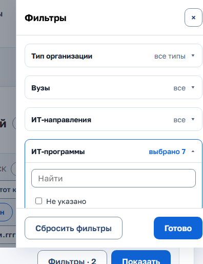

*Рисунок 13 — конструктор отчёта*

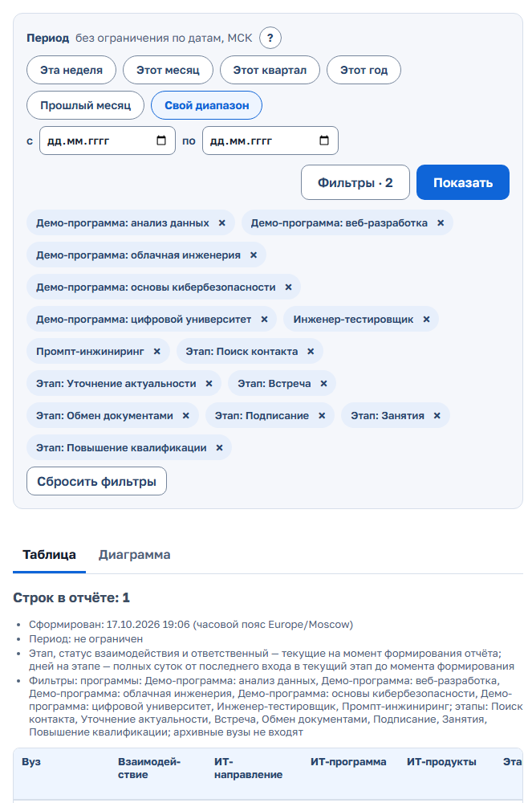

*Рисунок 14 — таблица отчёта*

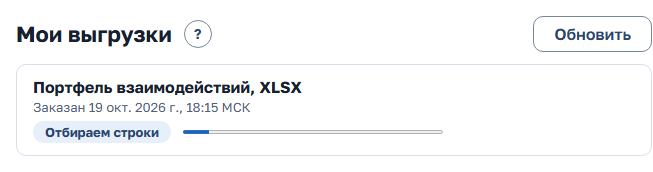

*Рисунок 15 — выгрузки*

**Как читать числа.** «Последнее действие сотрудника» в портфеле и в состоянии на дату — последнее событие взаимодействия без автоматических записей Moodle и сайта; если таких нет — «не зафиксировано». «Время до входа в последний этап» в отчёте длительностей — от создания взаимодействия до первого входа в последний этап, это не подтверждённое завершение. В «Востребованности программ» колонки — отдельные шкалы: заявки — по дате подачи, оплаты — без ограничения периода, обучающиеся и завершившие — участия, а не уникальные люди; делить одну колонку на другую нельзя. «Доля завершивших среди известных, %» считается так же, как в «Динамике обучения», а «Основание доли» рядом показывает, на сколько участий она опирается и сколько потоков периода без данных. Полные определения показателей — в документе «Паспорта показателей» комплекта документации.

**Сохранённые отчёты.** В конструкторе нажмите «⋯» → «Сохранить отчёт…». Введите «Название нового отчёта». При необходимости выберите «Период при открытии» (например, «Прошлый месяц» — пересчитывается при каждом открытии). Нажмите «Сохранить». Если открыт сохранённый отчёт, в том же окне есть «Обновить «название»» — записать в него текущий выбор, и «Сохранить как новый». На вкладке «Сохранённые (N)»: «Открыть» открывает отчёт и сразу строит таблицу. «⋯» строки: «Переименовать» и «Удалить» (с подтверждением). Отчёты хранятся под вашей учётной записью и открываются с любого устройства. Если отбор сохранённого отчёта больше недоступен (КАМ ушёл, вуз передан, программа удалена), при открытии CRM назовёт такие отборы: отчёт и выгрузка строятся без них, сохраните отчёт заново.

**Статистика и диаграммы:**

1. В отчётах «Портфель взаимодействий», «События за период», «Состояние портфеля на дату» и «Востребованность программ» откройте вкладку «Диаграмма». Диаграмма строится по тем же периоду и фильтрам. Отчёт «Статистика и диаграммы» открывает то же сразу на вкладке «Диаграмма».
2. «Изменить группировку» (или «⋯» → «Группировка диаграммы…») открывает окно. Группировка: «по этапам», «по вузам», «по ИТ-направлениям», «по ИТ-программам», «по ИТ-продуктам», «по видам взаимодействия», «по вехам (роль этапа для LMS)» (у портфеля и состояния на дату), «по ответственным», «по месяцам». У «Востребованности программ» — только по вузам, направлениям, программам, ответственным и месяцам. Этапы идут в порядке маршрута самих взаимодействий; если в выборке разные шаблоны, столбцы подписаны «шаблон: этап».
 Для месяцев — «Вид отображения» («Столбцы» или «График (линия)») и «Линии» («Одна линия: всего» или «Отдельно по …»). После смены нажмите «Показать».
3. Меню «Скачать ▾» заказывает файл диаграммы: «PNG (картинка)» или «PDF». Когда он готов, скачивание начинается автоматически, файл остаётся в «Выгрузках». Если столбцов больше, чем помещается в файл, CRM назовёт предел — сузьте период или фильтры.

Шкала диаграммы начинается с нуля, у каждого столбца подписано число. «Не указано» заштриховано и стоит последним: это строки без значения, а не ноль. Под диаграммой — «Таблица основания диаграммы» с теми же числами. Этапы идут в порядке маршрута, этапы без взаимодействий показаны нулём. На графике по месяцам при числе линий больше пяти показаны пять крупнейших и «Остальные».

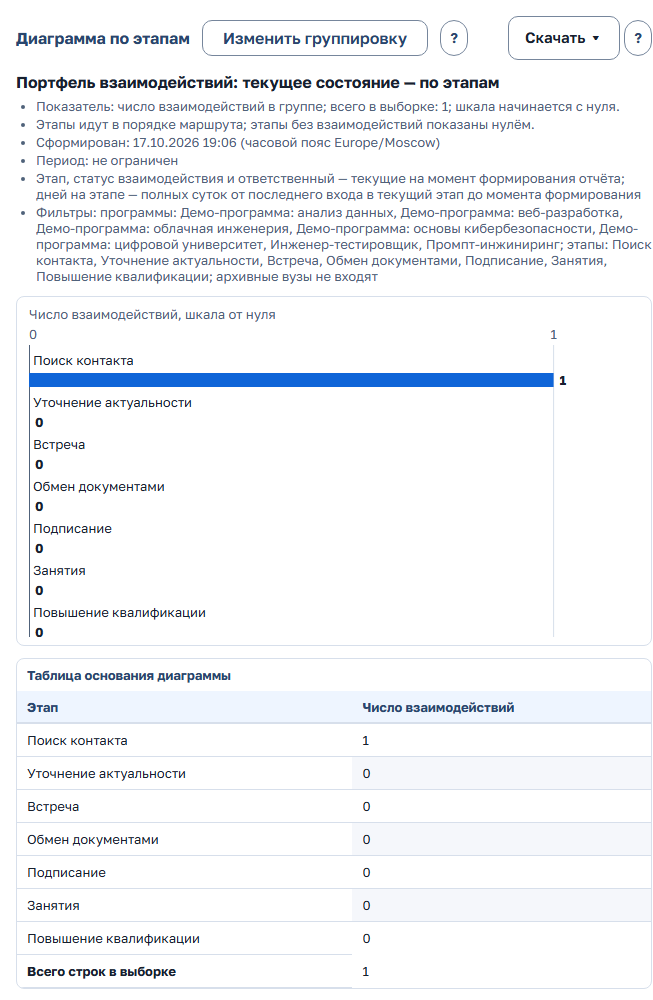

*Рисунок 16 — вкладка «Диаграмма»*

**Динамика обучения.** Показывает обучающихся и завершивших по месяцам по истории наблюдений Moodle. Задайте период (пустой период — последние 12 месяцев; у «Этот месяц», «Этот квартал», «Этот год» и «Эта неделя» отчёт строится по сегодняшний день), выберите «Линии» — по вузам или по ИТ-программам — и показатель. Нажмите «Показать». Под графиком — таблица основания и раскрывающиеся «Строки по вузам и ИТ-программам». «Выгрузить ▾» сохраняет те же строки в XLSX или PDF. Число месяца — наблюдение, действовавшее на конец его последнего дня. «Нет данных» у завершивших означает, что Moodle не отслеживает завершение курса. «Доля завершивших среди известных, %» — завершившие к обучающимся с известным статусом, округлена до целого. Рядом «Основание доли», например «16 из 20 с известным статусом; данные по 20 из 100»: доля 80 % опирается на 20 человек из 100. Без отслеживания завершения показано «нет данных», а не 0 %. Поток, который шёл в месяце без наблюдения, — «нет данных» и колонка «Потоков без данных», а не ноль. Месяцы раньше первого потока в данных — «данных недостаточно», а не ноль: реестра плановых потоков нет. Тот же вид «16 из 20 с известным статусом; данные по 20 из 100» — у строки «Завершили» в карточке взаимодействия. В карточке взаимодействия, в разделе «Данные LMS», у идущего потока показано «Учатся сейчас» (обучающиеся минус завершившие), у закончившегося — «Не завершили».

**Спрос рынка труда в «Востребованности программ».** Для программ, чьё ИТ-направление отмечено в справочнике флажком «Учитывать спрос рынка труда», в таблице и в файлах (XLSX, XLS, PDF, JSON) есть колонки «Спрос рынка: вакансии» — число открытых вакансий в последнем месячном срезе периода — и «Тренд спроса, %» — изменение этого числа за период. У остальных программ в этих колонках «не применяется». «Нет данных» значит, что источник не передал срезы за период. Это не ноль. Спрос рынка стоит рядом с показателями школы и в общий показатель не входит. Колонки можно убрать в «⋯» → «Колонки и порядок…». Источник данных и дата последнего среза указаны в примечании к отчёту.

**План подписаний и продлений договоров.** Выберите «Год» и в «Период» — «I кв.», «II кв.», «III кв.», «IV кв.» (по умолчанию текущий) или «Год». Над таблицей — число подписаний, продлений, выполненных, просроченных и предстоящих. Затем «Итоги по КАМ», «Итоги по командам» и строки плана с колонками «Вуз» (ссылка на карточку), «КАМ», «Договор», «Вид», «Плановая дата» и «Статус»: «Выполнено», «Просрочено» или «Впереди». Действующий договор без плановой даты попадает в план продлением на дату «Действует до». «Выгрузить ▾» сохраняет строки и итоги в XLSX или PDF. Плановые даты задаются в карточке вуза (раздел 2.11).

**Договоры за период.** Задайте период (по умолчанию с 1 января по сегодня). Плитки: переходы статусов, подписано, расторгнуто, среднее время согласования (от отправки на согласование до подписания) и «согласование затянулось» — жёлтые и красные договоры по нормам из раздела «Сроки согласования». Ниже — таблицы «Переходы статусов», «Подписанные», «Расторгнутые», «Согласование затянулось». «Выгрузить ▾» сохраняет итоги и таблицы в «XLSX (Excel)» или «PDF».

**Подтверждения по договорам.** Выберите «Вуз», «Вид мероприятия» и период, нажмите «Показать». Скачайте документ по имени или все сразу — «Скачать архивом».

### 2.16. Принять вуз, переданный другим КАМ

Когда руководитель передаёт вам вуз, он попадает в ваш список «Вузы» сразу. После смены ответственного прежний КАМ теряет доступ к вузу и его файлам. Вуз помечен «Унаследован» с подсказкой «Контакты ещё не подтверждены новым ответственным», пока вы не подтвердите хотя бы один контакт (раздел 2.4).

1. Откройте карточку переданного вуза. Вверху — предупреждение «Унаследованный вуз: вы ещё не подтвердили ни одного контакта. Свяжитесь с контактом и отметьте у него «Контакт подтверждён»».
2. Откройте вкладку «История» и раздел «История назначений». Там видно, кто и когда передал вуз и какая записка (комментарий к передаче) оставлена: что обещано вузу, чего от РТК ждут, к кому обращаться.
3. Свяжитесь с контактом и нажмите у него «Отметить «Контакт подтверждён»». Метка «Унаследован» снимется.

### 2.17. Кабинет вуза: доступ координатору, что видит вуз, запросы

Раздел действует, если подключён модуль «Кабинет вуза». Кабинет — отдельный экран для координатора сотрудничества со стороны вуза (глава 7). Вы решаете, кому открыть доступ, что показать и какие запросы отправить.

**Открыть координатору доступ в кабинет**

Открыть доступ может ответственный КАМ вуза, руководитель его команды или администратор. «Руководство» видит, у кого есть доступ, но не меняет его.

1. Откройте карточку вуза → вкладка «Контакты (N)». У контакта видна отметка «Есть доступ в кабинет вуза», «Доступ в кабинет закрыт» или «Нет доступа в кабинет вуза» с кнопкой «Открыть доступ в кабинет».
2. Нажмите «Открыть доступ в кабинет» и подтвердите в окне «Открыть доступ в кабинет вуза?» кнопкой «Открыть доступ». Логин — рабочая почта контакта; если почты нет, логин создаётся автоматически.
3. Если почта в CRM выключена или у контакта нет почты, на экране один раз появятся адрес входа, логин и временный пароль. Передайте их координатору по защищённому каналу и нажмите «Я передал пароль, скрыть». Пароль больше нигде не хранится и в журнал не попадает. Если почта включена, на экране будет «Ссылка на временный пароль отправлена на …»: координатор получит одноразовую ссылку и сам увидит пароль один раз.
4. «Закрыть доступ» у того же контакта (с подтверждением «Закрыть доступ в кабинет вуза?») блокирует вход и отключает учётную запись. Отметка контакта «Не актуален» и архив вуза закрывают доступ автоматически. Открытые запросы вузу этому контакту при закрытии доступа отменяются с причиной «доступ закрыт»; ответы, которые ждут проверки, остаются.
5. Если координатор забыл пароль, закройте доступ и нажмите «Открыть доступ снова» — будет выдан новый временный пароль.

Открыть доступ можно только действующему вузу и актуальному контакту без ограничения обработки данных.

**Что увидит вуз: флаги в карточке взаимодействия**

По умолчанию вуз не видит ни следующего шага, ни документов.

- **«Показывать вузу»** — карточка взаимодействия → «Изменить» в строке шага (или «⋯» → «Изменить шаг и срок…») → раздел «Кабинет вуза» → флажок «Показывать вузу». Флажок сохраняется сразу при нажатии, отдельно от формы. Без шага он недоступен: «Сначала задайте следующий шаг.». Шаг и срок появятся в кабинете как «Ближайший шаг». При смене шага или срока отметка снимается, её нужно поставить снова. У такого шага в карточке метка «Виден вузу».
- **«Доступен вузу»** — карточка взаимодействия → вкладка «Документы» → «⋯» у документа → «Сделать доступным вузу» (обратно — «Скрыть от вуза»). Скачать файл в кабинете можно только после проверки антивирусом. Новая версия документа отметку не наследует.

Комментарии, история, отметки «Ждём вуз», проблемы и риски, другие контакты, отчёты и напоминания в кабинет не попадают.

**Запрос вузу и проверка ответа**

Запросы ведёт ответственный КАМ вуза и руководитель его команды. «Руководство» видит их только для чтения.

1. Карточка взаимодействия → вкладка «Запросы вузу» → «Запросить у вуза».
2. Заполните «Координатор вуза» (контакт с открытым доступом в кабинет), «Что нужно сделать вузу», «Ожидаемый результат», «Срок ответа» (не в прошлом) и отметьте «Материалы (открытые вузу документы)». Если координаторов нет, форма пишет «У контактов вуза нет доступа в кабинет. Откройте доступ на вкладке «Контакты».».
3. Нажмите «Отправить запрос».
4. Когда вуз ответит, в колокольчике появится раздел «Ответы вузов ждут проверки», а у кнопки колокольчика — синяя точка (если нет просрочек).
5. В карточке запроса виден ответ, номер квитанции и файл. Файл ответа лежит и во вкладке «Документы» (вузу он не открыт). Скачать и принять ответ с файлом можно только после проверки антивирусом.
6. «Принять ответ» закрывает запрос. «Вернуть на доработку» требует «Причина возврата (для «Вернуть»)» — вуз увидит её в кабинете и пришлёт новую версию. Если вуз задал вопрос, заполните «Уточнение для вуза» и нажмите «Отправить уточнение». «Отменить запрос» закрывает его без ответа.

Решение по ответу не меняет этап взаимодействия: этап КАМ двигает отдельно, как обычно. У материалов запроса видно, подтвердил ли вуз получение именно этой версии: «получено …» или «получение не подтверждено». Если почта включена, координатор получает письмо о новом запросе, о возврате ответа на доработку и о приёмке ответа (это письмо он может отключить), а КАМ — об ответе вуза. Уведомлений MAX координатору пока нет.

### 2.18. MAX: уведомления и мини-приложение

Раздел действует, когда в CRM подключён модуль MAX. MAX доступен КАМ и руководителю команды. «Руководству», администратору, менеджеру учебного процесса и координатору вуза он недоступен. Если в меню под аватаром нет пункта «Подключить MAX», модуль выключен или ваша роль его не получает. Бот присылает уведомления по вашей работе, мини-приложение открывает «Мою работу» и карточку взаимодействия на телефоне. Права те же, что в CRM.

**Подключить свой аккаунт MAX**

1. Нажмите на аватар → «Подключить MAX». Откроется окно «Уведомления в MAX».
2. Нажмите «Получить ссылку». Ссылка одноразовая и действует 10 минут, время окончания написано под ней. Не пересылайте её. Ссылка показывается один раз: если её нет под рукой, нажмите «Новая ссылка».
3. Откройте ссылку на телефоне, где установлен MAX, и нажмите «Начать» в боте.
4. Вернитесь в CRM. Окно само покажет вопрос «Подключить MAX-аккаунт …?».
5. Нажмите «Подключить», если аккаунт ваш. «Это не я» отменяет ссылку. Пока вы не подтвердили подключение в CRM, уведомления не приходят. Один аккаунт MAX подключается только к одному профилю.
6. После подключения в том же окне появится блок «Что присылать». Отметьте нужное: «Утренняя сводка в 9:00 по рабочим дням», «Мне назначили или передали вуз», «Договор вернули на доработку, срок договора истекает», «Новая заявка с сайта (для руководителя команды)».

**Что приходит и когда**

- Утренняя сводка в 9:00 по рабочим дням — та же лента, что «Моя работа» (раздел 2.1): просрочено, сегодня, на неделе, без шага, ближайшие шаги с названиями вузов. Пустая сводка не отправляется, неотправленная сводка теряет смысл в конце дня.
- Вам назначили или передали вуз.
- Договор вашего вуза вернули на доработку; срок договора истекает через 30 и 7 дней.
- Руководителю команды — новая заявка с сайта по вузу команды.
- Агент подготовил для вас план записи (раздел 2.19) — сообщение с кнопкой «Открыть план». Это уведомление не отключается и перестаёт действовать вместе с планом.
- С 20:00 до 9:00 по Москве (тихие часы) сообщения приходят без звука. Сообщение не отправляется, если вуз уже передали другому КАМ, профиль заблокирован или сообщению больше суток.
- В сообщениях только названия вузов: тексты комментариев и шагов в них не попадают. Бот не принимает текст — всё записывается в CRM или в мини-приложении.

Если вы остановили бота в MAX, окно «Уведомления в MAX» пишет «Бот остановлен в MAX: уведомления не приходят». Чтобы включить их снова, откройте бота и нажмите «Начать».

**Отключить MAX.** Нажмите на аватар → «Подключить MAX» → «Отключить MAX». Вместе с подключением закрываются сеансы мини-приложения. Подключение сотрудника может снять и администратор (раздел 5.13).

**Мини-приложение: «Моя работа»**

1. Нажмите «Открыть» в сообщении бота. Пароль не нужен: вход идёт по вашему аккаунту MAX. Если аккаунт не подключён в CRM, приложение покажет «MAX не подключён к CRM» и кнопку «Открыть CRM».
2. Вверху пять плиток с числами: «Просрочено», «Сегодня», «На неделе» (до конца недели, без сегодняшнего дня), «Без шага», «Позже». Приложение само открывает первую непустую плитку в этом порядке. Выбранная плитка залита цветом, плитка «Просрочено» выделена.
3. Нажмите другую плитку, чтобы увидеть её список. Если в выбранной плитке пусто, под ней кнопка «Показать «…» · N» ведёт к первой непустой. Если везде ноль — «Всё сделано». Если срочного нет, а в «Позже» есть шаги, вверху зелёная плашка «Срочного нет.».
4. В строке списка — шаг, вуз, срок («Просрочено на 2 дн.», «Завтра, 10:00») и отметки. Кнопка «✓» справа сразу открывает «Шаг выполнен», «＋» — «Задать шаг». Длинный список продолжает «Показать ещё N».
5. Если есть приостановленные взаимодействия с наступившей датой возврата, сверху плашка «Пора возобновить…». Вернуть их в работу можно в CRM.
6. Ссылка «Открыть CRM ↗» открывает основную CRM в браузере.

**Мини-приложение: карточка взаимодействия**

1. Нажмите строку списка. Откроется карточка: блок «Следующий шаг», отметки, контакты, договоры вуза и последние события.
2. У контакта — значки телефона и письма: нажмите, чтобы позвонить или написать. Если контактов нет, написано «Контактов в карточке нет. Добавить можно в CRM.».
3. Внизу экрана всегда кнопки «Шаг выполнен» и «Комментарий». Если шага нет — «Задать шаг».
4. «Шаг выполнен»: заполните «Что получилось (необязательно)» и «Новый следующий шаг», выберите срок и нажмите «Сохранить». Появится сообщение «Шаг отмечен выполненным. Новый шаг записан.».
5. «Комментарий»: достаточно написать текст — шаг и срок останутся прежними (так и написано под полем). Чтобы задать другой шаг, нажмите «Изменить». Если срок шага уже прошёл, приложение попросит указать новый. После сохранения — «Комментарий записан в историю.».
6. Срок задаётся кнопками «Завтра», «Через 3 дня», «Через неделю» или «Другая дата». Быстрые сроки ставят 10:00 по Москве; если день выпал на выходной, срок переносится на понедельник, и приложение пишет об этом.
7. Ссылка «Открыть карточку в CRM ↗» открывает ту же карточку в основной CRM.

Этап взаимодействия в мини-приложении не меняется. Выгрузок, договоров, назначения КАМ, анкет и вложений в нём нет. Завершённое взаимодействие только просматривается: «Работа завершена. Вернуть её в работу можно в CRM.».

Черновик живёт, пока приложение открыто, и на сервере не хранится. Если карточку тем временем изменили в CRM, приложение напишет «Карточку только что изменили в CRM. Обновите данные — ваш текст останется.». Нажмите «Обновить данные».

При тёмной теме телефона приложение тоже тёмное.

**Мини-приложение руководителя: «Команда».** У руководителя вверху переключатель «Моя работа» | «Команда». «Команда» — только просмотр, с подписью «Только просмотр · данные на ЧЧ:ММ»:

- плашка «N вузов без КАМ. Назначить ответственного можно в CRM.»;
- плитки итогов команды: «Просрочено», «В риске», «Застряли» (на одном этапе дольше норматива), «Без шага», «Вузов»;
- список КАМ «Сначала — у кого горит» с отметками «просрочено N», «в риске N», «застряли N», «без шага N» или «всё в порядке»;
- ссылка «Открыть «Контроль» в CRM ↗».

**Сеанс мини-приложения** закрывается после 30 минут без действий, через 4 часа от входа, при смене вашей роли или команды, блокировке и отключении MAX. Приложение входит заново само. Если не вышло, оно покажет «Сеанс закончился»: закройте его и откройте снова из сообщения бота. Если сеанс закончился посреди формы, текст остаётся на экране — скопируйте его перед перезапуском.

Если приложение пишет «Нет доступа» — оно доступно только КАМ и руководителю команды, работайте в основной CRM. «Недоступно» означает, что мини-приложение в этой установке CRM не включено. При «Нет связи с CRM» нажмите «Повторить». Коды ошибок MAX — в разделе 8.

### 2.19. Запись от ИИ-агента: экран подтверждения

Раздел действует, когда в CRM подключён модуль ИИ-агентов (MCP). Агент сам ничего не записывает в CRM. Он готовит план записи, а записываете вы. Так же работает руководитель команды.

Виды планов: «Итог и следующий шаг», «Переход этапа», «Проблема или риск», «Решение проблемы», «Пауза или возобновление».

**Проверить и записать план**

1. Откройте ссылку, которую дал агент, сообщение MAX с кнопкой «Открыть план» или список «Планы ИИ-агента» из колокольчика.
2. Откроется экран «План ИИ-агента: …» с видом плана в заголовке. На нём вуз, взаимодействие, этап («… (этап N из M)»), поле «Подготовил» (агент, клиент, дата) и текст агента: итог встречи, обоснование перехода, описание, решение или причина — в зависимости от вида.
3. Проверьте таблицу «…: было и станет»: колонки «Было» и «Станет» для этапа, статуса, шага, срока и других полей плана. Время — по Москве.
4. Прочитайте блок «Факты из истории карточки»: даты, авторы и тексты в нём взяты из CRM, а не со слов агента. Текст агента — только данные: команды внутри него ничего не выполняют.
5. Обратите внимание на предупреждения: возврат на прежний этап, переход через этап, «Срок в плане уже прошёл.».
6. Нажмите «Записать». Запись выполнится одним действием от вашего имени. «Отклонить» закрывает план без изменений: «План отклонён, взаимодействие не изменилось.».

План открывает только тот, для кого он подготовлен. Он действует 20 минут, время окончания написано на экране: «План действует до … (Москва).». Если карточку за это время изменили, кнопка «Записать» недоступна и экран пишет «Карточку изменили после подготовки плана: записать его не получится. Отклоните план и попросите агента подготовить новый.». После окончания срока — «Срок плана истёк, взаимодействие не изменилось. Попросите агента подготовить план заново.».

**Список «Планы ИИ-агента».** Ссылка «Все мои планы» на экране плана и пункт в колокольчике открывают список ваших планов. Отбор «Вид» сужает список, флажок «Показать и решённые» добавляет закрытые планы. Статусы: «Ждёт подтверждения», «Записан», «Отклонён», «Истёк», «Карточку изменили», «Не записан».

**Вопросы к помощнику.** Руководителю и «Руководству» помощник отвечает по режиму «Сейчас» или «За период», периоду и тем же отборам, что на «Контроле» (менеджер, вуз, направление, программа, продукт, этап, тип организации, у «Руководства» — команда): числа совпадут с экраном и отчётом «Работа менеджеров за период». С отбором по типу организации «Без работы» не считается. Помощник также отвечает по динамике и тренду обучения, сигналам LMS, востребованности программ и плану подписаний — теми же числами, что отчёты. «Руководство» только спрашивает: планов записи для этой роли нет.

## 3. Руководитель команды

Руководитель ведёт карточки вузов своей команды наравне с КАМ: те же формы, что в главе 2. В мини-приложении MAX у руководителя есть экран «Команда» (раздел 2.18), планы ИИ-агента подтверждаются так же, как у КАМ (раздел 2.19). В истории автором события указывается руководитель, а не КАМ вуза. В шапке у руководителя ещё один раздел — «Настройки команды».

### 3.1. «Контроль»: кто с каким вузом на каком этапе

После входа у руководителя открывается «Работа» → вкладка «Контроль». Это главный экран для отчёта о работе менеджеров.

**Строка управления.**

- «?» — пояснение к экрану.
- Режим: «Сейчас» — текущий КАМ вуза; «За период» — КАМ на конец выбранного периода, как в отчёте «Работа менеджеров за период». Без периода «За период» включает прошлый месяц. Отбор по менеджеру, выгрузка и отчёт идут по тому же правилу; режим хранится в адресе. Видны только вузы, доступные вам сейчас. Рядом с итогами подписано «КАМ текущий» или «КАМ на» дату. В режиме «За период» с прошедшим концом в строки входят взаимодействия, активные на конец периода по истории смены статуса, и те, у которых в периоде были события: работа, завершённая позже, остаётся в прошлом месяце.
- Период: «Без ограничения», «Неделя», «Месяц», «Квартал», «Год», «Даты…» (поля «с» и «по»).
- «Фильтры · N» — боковая панель: тип организации (тот же отбор, что в отчётах; сужает и строки, и вузы «Без работы» с их выгрузкой), продукт, вид взаимодействия, ИТ-программа, ИТ-направление, вуз, менеджер («Не указано» — вузы без действующего менеджера), этап, «На этапе дольше (если у этапа нет норматива)» (7, 14, 30, 60 или 90 дней; значение из настроек помечено «(по настройке)»), при периоде — «Показать за период».
- «⋯» — меню действий.

Выбранные фильтры видны чипами со «×». «Сбросить фильтры» убирает все. Они хранятся в адресе страницы: ссылку можно отправить коллеге. Под ними строка «N вузов · M взаимодействий · КАМ текущий · данные на …» и «Обновить». В режиме «За период» с прошедшим концом вместо «КАМ текущий» написано «КАМ на <дата>; команда, программа и продукт — текущие». При выбранной плитке строка начинается с «всего:» и добавляет «· по отбору: …». Без периода и без отборов по продукту, программе, направлению и этапу число вузов совпадает с разделом «Вузы»: в него входят и вузы без идущего взаимодействия. Служебная организация «Открытый набор (физлица)» для оплат физлиц не считается ни здесь, ни в «Вузах».

**Плитки-фильтры.** Нажмите плитку — отберутся нужные взаимодействия. Нажмите ещё раз — отбор снимется. Нули серые.

- «Просрочено»;
- «Срок на этой неделе»;
- «Без шага или срока»;
- «Проблемы и риски»;
- «Договор на согласовании» — договоры вузов на согласовании, корректировке и подписании, как в реестре договоров, в том числе не привязанные к взаимодействию. Плитка показывает список этих договоров с цветом согласования и взаимодействия их вузов;
- «Вузов без КАМ»;
- «На этапе дольше N дн.» — дольше норматива этапа, если он задан в шаблоне, а без норматива — дольше общего порога из «Настроек» администратора; выбор «На этапе дольше» меняет общий порог только на вашем экране. Без этапов договора, пока договор на согласовании, корректировке или подписании: там действуют нормы согласования;
- «С сигналами LMS» — взаимодействия с сигналами LMS (число самих сигналов — в строке «Ещё по команде»);
- «Без работы» — вузы, за которыми закреплён КАМ, но идущего взаимодействия нет. Плитка видна без периода и без отборов по продукту, программе, направлению и этапу.

Если выбран период, плитки делятся на две строки. Первая — «Изменения за период» (в режиме «За период» — «За период, КАМ на конец периода»): «Перешли на другой этап», «Новые взаимодействия», «Завершённые»; в режиме «За период» здесь же «Вузов без КАМ на» конец периода — по строкам периода. Вторая — «Сейчас» (в режиме «За период» — «Сейчас — состояние взаимодействий периода»): состояние тех же строк на сегодня. Сегодняшние списки «Вузы без КАМ» и «Без работы» при периоде не показываются. «Завершённые» — взаимодействия, переведённые в статус «Завершено» в периоде; вход в последний этап маршрута не считается завершением, а завершение, отменённое возобновлением в том же периоде, не засчитывается. Сроки («Просрочено», «Без шага или срока», «Срок на этой неделе») считаются только у идущих взаимодействий: завершённому шаг не нужен, у приостановленного срок — дата возврата.

**Задать шаг карточкам без шага.** Если в текущем отборе есть карточки «Без шага или срока», над группами видна кнопка «Задать шаг карточкам без шага (N)». Нажмите её и подтвердите в окне «Задать шаг карточкам без шага?» кнопкой «Задать шаг». Карточки вашей команды получат шаг по умолчанию из настройки импорта (по умолчанию «Связаться с вузом», 7 дней); уже введённый текст шага сохраняется, карточки, где шаг успел появиться, пропускаются. Каждая карточка получает запись в истории, вся операция — запись в журнале.

**Группы по менеджерам.** Под плитками — группы. В заголовке группы итоги: вузов (вместе с вузами без работы), взаимодействий, просрочено, на этой неделе, без шага или срока, на этапе дольше N дней, проблемы и риски, с сигналами LMS, без работы. Число в итогах — кнопка: она отбирает взаимодействия этого менеджера. Группы с просрочкой или проблемами раскрыты, остальные свёрнуты. На телефоне плитки стоят сеткой в две-три колонки, все группы свёрнуты, «горящие» менеджеры идут первыми. «⋯» → «Развернуть всех» или «Свернуть всех».

Колонки таблицы:

- «Вуз и взаимодействие» — вторая строка: направление, программа, продукты;
- «Этап» — название, полоса и подпись «Положение в маршруте: этап 5 из 13» (номер этапа, а не готовность), дни на этапе;
- «Следующий шаг» — со сроком;
- «Договор» — номер и статус договора с вузом; отметка «срок истёк», если срок прошёл, или «до …», если он истекает в ближайшие 90 дней; «согласование: жёлтый» или «красный», если согласование затянулось;
- «Обучение (LMS)» — обучающиеся идущих потоков, сколько заходили в курс за неделю, сигналы, пометка «Этап не подтверждён LMS» (например, взаимодействие на этапе «Занятия», а в курс никто не заходит);
- «Проблемы и отметки».

Те же данные — в колонках «Обучение (LMS) сейчас» и «Сверка этапа с LMS» отчёта «Работа менеджеров за период».

**Вузы без КАМ.** Первой стоит группа «Вузы без КАМ». В ней до 10 вузов с причиной. При отборе по вузу в группе остаются выбранные вузы; при отборе по программе, продукту, направлению, виду или этапу — только вузы без КАМ, у которых есть подходящие взаимодействия (вуз без взаимодействий к программе не привязан). Плитка «Вузов без КАМ» считает так же. «Назначить КАМ» у вуза открывает окно назначения прямо в «Контроле»; такие же кнопки есть в группе «Требует назначения». «Все N и массовая передача» ведёт к массовой передаче (раздел 3.4). У «Руководства» «Все N» раскрывает полный список здесь же.

**Без работы.** Следом — группа «Без работы» (до 10 вузов, остальные — «Показать все N»): вузы, за которыми закреплён КАМ, но идущего взаимодействия нет, с именем КАМ (у «Руководства» — и с командой) и датой последнего действия сотрудника по вузу («не зафиксировано», если записей нет; автоматические данные источников не считаются). Число в заголовке менеджера «без работы N» отбирает его вузы.

**«⋯» у «Контроля»:**

- «Выгрузить XLSX» и «Выгрузить PDF» — по текущим фильтрам, режиму и выбранной плитке, с колонками «Статус договора» и «Договор»; с плиткой «Без работы» — список вузов: КАМ, команда, вуз, последнее действие сотрудника; без периода файл называется «Работа менеджеров: текущее состояние», переходы и комментарии в нём — за всё время, с периодом — «Работа менеджеров за период»;
- «Все форматы — в отчёте» — отчёт «Работа менеджеров за период»;
- «Показать списком» — те же строки одной таблицей (раздел 3.2); в виде «Списком» на этом месте «Показать по менеджерам»;
- «Развернуть всех», «Свернуть всех».

Если у «Руководства» выбрана команда, вместо выгрузок в «⋯» пункт «Выгрузка — без отбора команды»: он снимает отбор команды.

«Показать списком» переносит все отборы: период и режим, фильтры, плитку, порог «На этапе дольше» и команду у «Руководства». «Все форматы — в отчёте» переносит период и фильтры; плитку отчёт не знает, она названа в предупреждении сверху.

**Вид: по менеджерам, этапы, списком.** Переключатель «Вид» над строками. Все три вида строятся из одних данных, фильтры, плитки, режим, период и команда действуют на все.

- «По менеджерам» — группы, как описано выше.
- «Этапы» — матрица «программа × этап». Строки — ИТ-программы («Без программы» — отдельной строкой) или продукты (переключатель «Строки матрицы»: «По программам» / «По продуктам»), столбцы — этапы маршрута по порядку, включая пустые, последний столбец и строка — «Всего». Этап, добавленный КАМ в маршрут своей карточки, стоит на своём месте с пометкой «(этап карточки)»; «(прежний этап)» — только этапы прежних версий шаблона, они в конце. В ячейке — число взаимодействий и вузов на этапе. Красная ячейка — есть просрочки, жёлтая — без шага или срока или на этапе дольше порога «На этапе дольше». Нажатие на число открывает вид «Списком» с отбором этой программы (продукта) и этапа. Если у взаимодействий разные маршруты (разные виды), матрица строится по каждому маршруту отдельно с подписью видов, а отбор из ячейки добавляет виды маршрута. Взаимодействие с несколькими продуктами входит в строку каждого продукта, «Всего» считает его один раз. В режиме «За период» с прошедшим концом этап — на конец периода. Для идущих взаимодействий числа совпадают с отчётом «Портфель» → «Диаграмма по этапам» при том же отборе. На телефоне каждая программа — свёрнутая карточка со списком непустых этапов.
- «Списком» — одна таблица с колонками «КАМ» (у «Руководства» — и команда), «Вуз и взаимодействие», «Этап», «Следующий шаг», «Договор», «Обучение (LMS)», «Проблемы и отметки»: сначала просроченные, затем без шага, затем по сроку. При выбранной плитке у менеджера, у команды и в строке над плитками видны два числа: «по отбору» — показанные строки и «всего» — все взаимодействия по фильтрам. Итоги команд у «Руководства» считаются без фильтров, поэтому при любом отборе подписаны «всего, без фильтров».

В отчёте «Работа менеджеров за период» по умолчанию видна колонка «Взаимодействие» — рядом с вузом, как в выгрузке «Контроля». Менеджер указан на конец периода (если период не закончился — текущий); в «Фильтрах» → «Менеджер» можно выбрать «Текущий («Сейчас»)», а переход из «Контроля» переносит его режим. Комментарии — только людей. Ниже — «Итоги по продуктам» и «Итоги по вузам» (отдельные таблицы, листы XLSX и разделы PDF). Одно взаимодействие может относиться к нескольким продуктам, поэтому сумма строк по продуктам бывает больше строки «Всего (уникальные взаимодействия)»: она считается по уникальным взаимодействиям. Итоги по менеджерам вынесены в отдельную таблицу, лист XLSX и раздел PDF и в число строк не входят: строки по менеджерам внутри команды («Требует назначения» — своя строка у каждой команды), «Итого по команде» и «Всего». Числа — в своих колонках («Вузов», «Взаимодействий», «Просрочено», «На этой неделе», «Без шага или срока», «Переходов за период»), их можно сложить и взять в сводную таблицу. Без периода, плитки и отборов по направлению, программе, продукту и этапу «Вузов» считает и вузы без идущего взаимодействия, как экран «Контроля»: вуз без работы входит в строку своего КАМ, вуз без КАМ — в «Требует назначения».

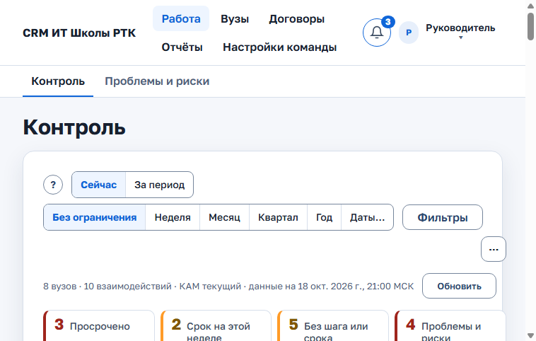

*Рисунок 17 — «Контроль»*

**Показатели по КАМ** — итоги в заголовках групп по менеджерам: взаимодействия, просрочки, взаимодействия без шага или срока, время на этапе, проблемы и риски, сигналы LMS.

### 3.2. Список, «Нет контакта», отчётность и строка «Ещё по команде»

**Список.** «⋯» → «Показать списком» (или «Вид» → «Списком») показывает те же строки, что «Контроль», одной таблицей со всеми отборами (раздел 3.1). Старый адрес `#/work` тоже открывает этот вид — список «Все взаимодействия». В нём:

- поле «Поиск по названию взаимодействия, вуза, программы или продукта»;
- «Фильтры · N» с боковой панелью: «Срок следующего шага», «Этап», «Вид взаимодействия», «ИТ-программа», «Продукт», «Вуз», «Отметка», «Лицензия истекает», «КАМ» (в том числе «Требует назначения»), «Статус взаимодействия», «На текущем этапе», «Нет контакта с вузом»;
- чипы выбранных фильтров и «Найдено: N»;
- колонки «Взаимодействие и вуз» (отметки, «Нет документов этапа», «Последнее событие: …», вид, программа), «Этап» («на этапе N дней»), «Следующий шаг», «Срок», «КАМ» (с заместителем: «КАМ (заместитель … до …)»).

«⋯» → «Показать по менеджерам» возвращает к группам.

**«Нет контакта больше N дней».** Свёрнутый блок под группами, со счётчиком «взаимодействий N». В нём идущие взаимодействия, где последний деловой контакт (отметка «Был контакт с вузом» или дата в данных взаимодействия) старше порога; новое взаимодействие считается от даты создания, записи сайта и LMS контактом не считаются.

1. Раскройте блок.
2. Выберите «Порог»: 14, 30, 45, 60 или 90 дней (по умолчанию 30; выбор хранится в браузере и общий с «Моей работой»).
3. В строках (до 10) — вуз, КАМ и «последний контакт <дата>» или «контакт не записан».
4. «Все N в списке работы» открывает список с фильтром «Нет контакта с вузом».

**«Отчётность по соглашениям».** Блок появляется, когда есть что показать; счётчик «сроков N · перечней M». В нём ближайшие сроки отчётного цикла (их задаёт администратор) и перечни мероприятий вузов команды на согласовании у вуза или возвращённые (раздел 2.12).

**Строка «Ещё по команде».** Внизу «Контроля». Подпись над строкой: «По всей команде, фильтры, плитки и период выше не применяются. Сигналы LMS — действующие сейчас; обучающиеся и активные взаимодействия — сегодня против 90 дней назад; данные обучения — по идущим потокам».

- «Все сигналы LMS: N» — список сигналов с КАМ (что означает каждый сигнал — раздел 2.10). Скрыть сигнал, записать его как риск или перейти к этапу можно в карточке взаимодействия;
- «Заместители: N» (или «Заместители: нет») — пары «ответственный → заместитель, до <дата>» со списком вузов и форма «Заместитель на все вузы КАМ» (раздел 3.5);
- «Вузы ждут подтверждения: N» — ссылка на список вузов с отбором «Ожидают подтверждения»;
- «Обучающиеся за 90 дней, сопоставимые потоки: A → B, ±C; новые потоки без базы сравнения: D» (может продолжаться «начались потоки (N): +X», «закончились потоки (N): −Y») — потоки без данных на начало периода показаны отдельно и в изменение не входят. Строка раскрывает тренд по ИТ-программам и вузам команды: период, таблицы, списки «Растёт число обучающихся» и «Падает число обучающихся» (до пяти вузов в каждом). Ссылка «Динамика обучения» ведёт в отчёт;
- «Активные взаимодействия за 90 дней: 40 → 45: остались …» — из чего сложилось изменение: сколько осталось, завершено, приостановлено, новых и возобновлённых;
- «Данные обучения доступны для N из M идущих потоков; K требуют проверки» — по скольким потокам Moodle есть свежие данные. Без подключённого Moodle свежесть не оценивается, это сказано в строке.

В разделе «Вузы» руководитель видит все вузы команды, включая созданные, но не подтверждённые («Ожидают подтверждения»). Вуз без ответственного помечен «Требует назначения»; отбор «Только требующие назначения» показывает только такие.

### 3.3. Подтвердить вуз, назначить или сменить ответственного

**Меню «⋯» карточки вуза у руководителя** («Ещё действия с вузом»): «Назначить или сменить ответственного…», «Заместитель на время отсутствия…» (раздел 3.5), «Изменить название и реквизиты…», «Архивировать вуз…». Архивный вуз возвращает кнопка «Восстановить вуз» в плашке карточки.

**Подтвердить новый вуз.** Вуз, который завёл КАМ, ждёт подтверждения. Откройте его карточку: в плашке кнопки «Подтвердить вуз» и «Отклонить заявку». Руководитель сам создаёт вуз кнопкой «Добавить вуз» → «Создать»: вуз появится в команде без КАМ, назначьте его через «⋯».

**Назначить или сменить ответственного**

1. Откройте карточку вуза и выберите «⋯» → «Назначить или сменить ответственного…». Откроется окно «Назначить или сменить ответственного» с текущим КАМ («Сейчас: …»).
2. В поле «Новый ответственный» выберите сотрудника команды (себя — строка с пометкой «(вы)»).
3. При необходимости заполните «Комментарий к передаче»: что обещано, что ждут от РТК, к кому обращаться. Новый ответственный увидит его в истории назначений.
4. Нажмите «Назначить ответственного».

Чтобы снять КАМ, нажмите в том же окне «Снять назначение» и подтвердите. Вуз получит отметку «Требует назначения»; снятие завершает и действующее замещение.

Кто, кому и когда передал вуз и текст записки — во вкладке «История», раздел «История назначений и замещений». После смены ответственного прежний КАМ сразу теряет доступ к вузу и его файлам, новый — получает.

Назначить КАМ можно и прямо в «Контроле»: кнопка «Назначить КАМ» в группах «Вузы без КАМ» и «Требует назначения».

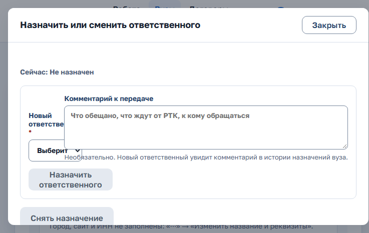

*Рисунок 18 — назначение ответственного*

### 3.4. Массовая передача

Когда это нужно: нужно передать сразу несколько вузов одному КАМ, например при уходе сотрудника.

1. В списке «Вузы» отметьте флажки у нужных строк или нажмите «Выбрать все вузы на странице для передачи». Из «Контроля» сюда ведёт «Все N и массовая передача».
2. Откроется панель «Передача выбранных вузов: N» («Снять выбор» очищает выбор). Выберите общего нового ответственного в поле «Передать всем выбранным» или задайте его отдельно для каждого вуза.
3. При необходимости напишите «Передаточную записку»: этапы, договор, контакты, открытые проблемы, обещания вузу. Одна записка попадёт в историю назначений каждого вуза.
4. Нажмите «Передать выбранные».
5. В окне «Передать вузы: N?» проверьте строки «вуз: было → станет» и нажмите «Передать».

За один раз можно передать от 1 до 100 вузов. Если хотя бы один вуз изменился, пока вы заполняли форму, CRM не передаст ни одного: обновите список и повторите.

### 3.5. Заместитель на период

Когда это нужно: КАМ уходит в отпуск или временно недоступен, а вуз должен вестись без задержки.

1. В карточке вуза выберите «⋯» → «Заместитель на время отсутствия…». Откроется окно.
2. Выберите активного КАМ своей команды, укажите даты «С» и «По». Запланированное замещение подписано «— начнётся в первый день периода».
3. Нажмите «Назначить заместителя».
4. Чтобы завершить замещение раньше срока, нажмите «Завершить замещение» и подтвердите (для запланированного — «Отменить замещение»). Для запланированного, ещё не начавшегося замещения окно называется «Отменить запланированное замещение?»: доступа у заместителя ещё нет.

Дата начала — не позже чем через год. У вуза одно замещение: если оно запланировано и ещё не началось, CRM так и скажет — чтобы назначить срочное, сначала отмените запланированное кнопкой «Завершить замещение». Руководителя в списке заместителей нет: заместителем назначают КАМ команды. Снятие ответственного завершает и действующее замещение — окно подтверждения об этом пишет.

**Заместитель сразу на все вузы КАМ** (отпуск, больничный):

1. Откройте «Контроль» → «Ещё по команде» → «Заместители: N» → «Заместитель на все вузы КАМ».
2. Выберите «Отсутствует КАМ» и «Заместитель», даты «С» и «По» (по умолчанию — две недели с сегодняшнего дня).
3. Нажмите «Назначить на все вузы КАМ». Замещение создаётся по каждому действующему вузу КАМ; появится «Заместитель назначен по вузам: N.». Вуз, где замещение уже есть, пропускается — причина показана под формой. Назначать может только руководитель своей команды.

Заместитель ведёт карточки вуза от своего имени весь указанный период. Ответственный КАМ не меняется и сохраняет доступ. В списке вузов и в карточке видно «Замещение: <КАМ> до <дата>». Замещение заканчивается само по истечении срока, а также при смене ответственного вуза.

### 3.6. Шаблоны этапов команды

В шапке у руководителя — раздел «Настройки команды». На телефоне он под кнопкой «Ещё» в нижней панели и в меню под аватаром. В нём две вкладки: «Шаблоны этапов» и «Заявки с сайта» (со счётчиком заявок, раздел 3.7). Остальные разделы администрирования (раздел 5) видит только администратор.

1. Откройте «Настройки команды» → «Шаблоны этапов».
2. Нажмите «Новый шаблон» или «Создать на основе базового» у базового шаблона; у своего шаблона — «Редактировать». Откроется редактор.
3. Задайте «Название шаблона».
4. В разделе «Этапы» добавьте этапы («Добавить этап»), задайте названия (без повторов), порядок кнопками «Выше» и «Ниже» (переходы при этом перестраиваются по новому порядку сами, как при правке этапов карточки), отметьте «Необязательный». У этапа можно задать «Требует действующего договора», «Роль для LMS» (обучение преподавателей, идут занятия, повышение квалификации) и «Обязательные документы».
5. В разделе «Явные переходы» задайте пары «Из этапа» → «В этап» («Добавить переход»). Для пропуска этапа отметьте «Нужен комментарий».
6. При желании заполните «Что изменилось» — это увидят в истории версий.
7. Нажмите «Создать шаблон» или «Сохранить шаблон». Каждое сохранение — новая версия шаблона. Пока в шаблоне есть ошибки, они перечислены под формой все сразу, а кнопка недоступна. Если сеанс истёк, изменённый черновик шаблона после повторного входа откроется снова.

**Норматив этапа.** В поле «Норматив, дней» у этапа задайте, сколько дней (от 1 до 3650) работа может стоять на этом этапе. «Долго на этапе» в «Контроле», отчётах и сводке берёт норматив этапа, а без него — общий порог из «Настроек». Новый норматив сразу действует на идущие работы, переводить их на новую версию не нужно. Пусто — общий порог.

**Напоминание о версиях.** Пока у команды есть работы на прежних версиях шаблона, в колокольчике раздел «Работы на прежних версиях маршрута»: «Работ на прежних версиях: N; последняя версия — M. Обновите работы до неё в «Истории версий»». Как обновить — ниже.

**Вузы без КАМ после блокировки.** Если администратор заблокировал КАМ и не передал его вузы, в колокольчике руководителя раздел «Вузы без КАМ после блокировки»: назначьте КАМ (раздел 3.3).

**Меню «⋯» строки шаблона:** «История версий», «Сделать шаблоном команды по умолчанию» (или «Вернуть общий шаблон по умолчанию»), «Удалить». Вместо «Удалить» может стоять пометка «Базовый шаблон меняет администратор.» или «Шаблон по умолчанию удалять нельзя.».

Сигналы и подсказки LMS ищут этапы по роли для LMS, поэтому этап с ролью можно переименовать. По названию ищется только «Актуализация программы»: при её переименовании редактор предупредит. Из каждого этапа должен быть путь до финального. Закрыть изменённый черновик можно только после подтверждения. Шаблон, по которому идут незавершённые взаимодействия или который выбран маршрутом вида, удалить нельзя. Перевести карточку на другой шаблон нельзя: завершите такие взаимодействия или начните «Новый цикл» по другому маршруту.

Шаблон команды доступен КАМ при создании взаимодействия (пункт «Шаблон команды по умолчанию: …»). Новые взаимодействия идут по последней версии, начатые остаются на своей, пока руководитель их не обновит. Базовый шаблон не редактируется и не удаляется напрямую — его только копируют в шаблон команды.

**История версий.** «⋯» строки шаблона → «История версий» открывает окно «История версий: «…»» со всеми версиями: «Версия N» (у действующей — «— текущая»), дата (МСК), автор, комментарий, этапы и сколько идущих взаимодействий команды на каждой. В блоке «Сравнить версии» выберите «Было» и «Стало»: появится список добавленных, удалённых, переименованных и перемещённых этапов, изменений обязательности и свойств этапов (в том числе норматива), новых и убранных переходов. Если разницы нет — «Этапы и переходы в этих версиях одинаковые.». В «⋯» версии: «Скачать файл» сохраняет версию файлом, «Взять за основу» (у прежних версий) загружает её в редактор; после сохранения она станет новой версией.

**Обновить взаимодействия до новой версии.**

1. В окне истории версий на строке нужной версии нажмите «Обновить взаимодействия до версии N» (для старой версии — «Вернуть взаимодействия к версии N»).
2. Проверьте таблицы «Взаимодействия на версии …» с колонками «Этап версии N», «Что с ним» («без изменений», «переименован», «найден по названию», «выбрано вручную», «этапа нет в новой версии»), «Куда перейдут взаимодействия», «Взаимодействий на этапе». Если этапа нет в новой версии, взаимодействие перейдёт в следующий этап. Чтобы выбрать другой, измените значение в столбце «Куда перейдут взаимодействия»; «Вернуть предложенное сопоставление» отменяет ручной выбор.
3. В списке «Взаимодействия» отметьте, какие взаимодействия обновить («Отметить все», «Снять отметки»). Отметка «текущий этап исчезает» показывает, что взаимодействие сменит этап. Взаимодействия с отметкой «этапы меняли в карточке» не отмечены: чтобы обновить и их, отметьте флажок «Заменить этапы, изменённые в карточке, этапами версии N» — их собственные правки этапов будут заменены.
4. Нажмите «Обновить выбранные взаимодействия (N)». В истории каждого взаимодействия появится запись «Маршрут обновлён до версии N…». Если кто-то изменил взаимодействие за это время, появится сообщение — нажмите «Построить заново».

**Шаблоны команды для видов взаимодействия.** Под списком шаблонов — таблица «Шаблоны команды для видов взаимодействия» с колонками «Вид», «Шаблон вида», «Шаблон команды». В столбце «Шаблон команды» выберите шаблон своей команды или общий; «Как у вида» возвращает шаблон вида из справочника. Новые карточки этого вида в вузах команды пойдут по выбранному шаблону, идущие не меняются.

**Перенос шаблона между стендами или командами.** Скачайте версию кнопкой «Скачать файл». На другом стенде в редакторе нажмите «Загрузить этапы из файла». Без открытого шаблона получится новый шаблон, при открытом — его новая версия. Проверьте этапы и сохраните.

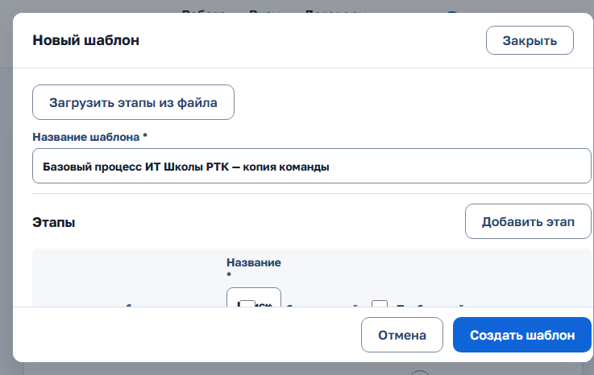

*Рисунок 19 — редактор шаблона*

### 3.7. Заявки с сайта

В «Настройках команды» откройте вкладку «Заявки с сайта» (экран «Заявки с сайта, ожидающие разбора»). Здесь заявки с сайта по вузам вашей команды и по вузам, которых ещё нет в CRM, которые не удалось сопоставить автоматически. В строке — «Вуз на сайте», «Подана», «Состояние» («Требует разбора»). КАМ видит эти заявки в «Вузах» только для чтения; у руководителя строка «Заявки с сайта ждут разбора: N» в «Вузах» ведёт сюда.

1. В строке заявки нажмите «Разобрать». Раскроется форма («Свернуть» закрывает её).
2. Если вуз в CRM уже есть, выберите его в поле «Вуз CRM» и нажмите «Сопоставить и применить».
3. Если вуза ещё нет, раскройте «Вуза нет в CRM — создать вуз», заполните «Название» и «Тип» и нажмите «Создать вуз». Он появится в вашей команде со статусом «Требует назначения».

Заявка исчезает из списка, как только применена. Новое взаимодействие из заявки получает шаг «Ответить на заявку» со сроком через 2 рабочих дня. Если заявка дополняет существующее взаимодействие, его шаг не меняется.

Синхронизацию источников и «Сопоставления» (курс или группа → вуз, программа, вид потока и даты) настраивает и запускает администратор — раздел 5.11.

### 3.8. Отчёты, выгрузки и диаграммы команды

Те же экраны, что в разделе 2.15, но с областью данных всей команды. Перечни мероприятий и «Отчёт по соглашениям» (раздел 2.12) руководитель ведёт и смотрит по всем вузам команды; блок «Отчётность по соглашениям» со сроками цикла и перечнями на согласовании есть и в «Контроле». Фильтр «Ответственный» содержит всех КАМ команды и «Не указано» (вузы без ответственного). В «Событиях за период» есть вид события «Назначение, смена и снятие КАМ». **Разбор КАМ** (группа «Контроль», только у руководителя и «Руководства»): выберите КАМ команды и период, нажмите «Показать». Появятся плитки «событий за период», «активных взаимодействий», «с отметками ожидания, проблемы или риска» и вкладки «События за период», «Открытые шаги», «Риски, проблемы и ожидания».

В «Работе менеджеров за период» под таблицей — «Итоги по менеджерам и командам», «Итоги по продуктам» и «Итоги по вузам»; в «Фильтрах» → «Менеджер» — «На конец периода («За период»)» или «Текущий («Сейчас»)». Сохранённые отчёты работают так же: набор фильтров и колонок хранится под вашей учётной записью и открывается на любом устройстве.

## 4. «Руководство»

Роль «Руководство» — только чтение по всем командам. Менять что-либо она не может: любое изменяющее действие вернёт «Доступ запрещён». В шапке — «Работа», «Вузы», «Договоры», «Отчёты».

Вкладки «Работы»: «Сводка команд», «Контроль», «Проблемы и риски».

### 4.1. «Сводка команд»

Первый экран — «Работа» → «Сводка команд». Сверху — строка «данные на …» и «Данные обучения доступны для N из M идущих потоков». Переключатель «Окно сравнения» («30 дней» / «90 дней») задаёт окно для таблиц изменений; кнопка «Контроль по всем командам» открывает «Контроль». Таблицы:

- «Команды сейчас» — активные взаимодействия, просрочено (из взаимодействий со сроком), без шага или срока, «На этапе дольше N дн.» (порог из «Настроек» и нормативы этапов), проблемы и риски (из активных), вузы без КАМ и без работы (из вузов команды). У каждого числа — знаменатель и доля, например «8 из 80 активных (10 %)». Общего балла команды нет;
- «Договоры по командам» — на согласовании, корректировке и подписании (с числом жёлтых и красных) и истёкшие или истекающие за 90 дней;
- «Изменение к прошлому периоду» — новые, завершённые, перешедшие на другой этап взаимодействия и подписанные договоры за последние 30 или 90 дней против стольких же дней перед ними (даты подписаны «… – … против … – …», в ячейке «было X · изменение»). Если раньше было 0, пишется «новое наблюдение»;
- «Топ-5 программ по востребованности» — пять программ с наибольшим индексом востребованности за последние 90 дней: «Место», «Программа», «Индекс (0–100)», «Покрытие». Если данных не хватает ни у одной программы — «Ни у одной программы не хватает данных для индекса.». Расчёт тот же, что в отчёте «Востребованность программ»; программы с «данных недостаточно» в топ не входят. Ссылка «Полный отчёт» открывает отчёт за тот же период без отборов;
- «Состав активных взаимодействий» — за то же окно 30 или 90 дней по командам и итог: было = остались + завершены + приостановлены, стало = остались + новые + возобновлены. Если база меньше 10, процент не показывается — ни в доле, ни в изменении.

Число открывает те же строки: «Контроль» с отбором команды и плиткой или реестр договоров с отбором команды. Чип «Команда: …» снимает отбор; выгрузка из «Контроля» доступна без отбора команды.

### 4.2. «Контроль» по всем командам

Вкладка «Контроль» — как у руководителя (разделы 3.1 и 3.2), но по всем командам и только для чтения.

- Каждая команда — раскрывающаяся строка. В ней итоги: вузов, без КАМ, взаимодействий, просрочено, без шага или срока, на этапе дольше N дней, проблемы и риски, вузов с обучением, обучающихся во всех потоках, учатся сейчас, преподавателей. Сразу раскрыта команда с наибольшей просрочкой. Внизу — строка «Все команды». Раскрытая команда показывает своих менеджеров.
- Плитки «Контроля» работают как у руководителя.
- Блоки «Нет контакта больше N дней» и «Отчётность по соглашениям» — как у руководителя, по всем командам.
- Строка «Ещё по всем командам»: сигналы LMS, заместители, вузы на подтверждении и тренд обучения. Тренд раскрывается по командам и ИТ-программам. Добавлены подписания текущего квартала: подписаний, продлений, просрочено, впереди, выполнено. Ссылка ведёт в отчёт «План подписаний и продлений договоров».
- «Вид» → «Этапы» — матрица «программа × этап» по всем командам или по команде, выбранной в «Сводке команд»; «Вид» → «Списком» и «⋯» → «Показать списком» — те же строки одной таблицей, с выбранной командой.
- Если выбрана команда, выгрузка в «⋯» называется «Выгрузка — без отбора команды»: она снимает отбор и выгружает все команды.

### 4.3. Что ещё видит «Руководство»

- вкладку «Проблемы и риски» — записи всех команд, только для просмотра;
- «Вузы», карточки вузов и взаимодействий с историей и маршрутом, контакты, документы. Историю назначений вуза — только для чтения, без кнопок действий;
- списки преподавателей на повышение квалификации и их выгрузки для LMS — без скачивания файла и отметок;
- «Договоры» и договоры в карточках вузов, только для просмотра. В реестре договоров есть колонка и отбор «Команда»;
- вкладку «Люди и часы» в карточках вузов и взаимодействий, перечни мероприятий и «Отчёт по соглашениям» — только просмотр;
- отчёты, статистику и выгрузки по всем командам, в режиме просмотра, включая «Разбор КАМ». «Руководство» ведёт и свои «Сохранённые отчёты» — личные настройки, которые видит только их владелец;
- справочники.

Колокольчика с напоминаниями, раздела «Настройки команды» и MAX у роли «Руководство» нет. Помощнику ИИ-агента можно задавать вопросы (раздел 2.19), но планов записи у этой роли нет.

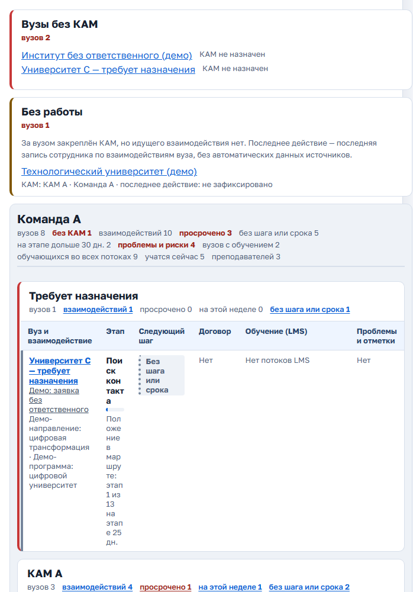

*Рисунок 20 — «Контроль» у «Руководства»*

## 5. Администратор

Вход — как у любого пользователя (раздел 1). У роли «Администратор» верхнего меню нет: открывается «Администрирование» с боковым меню. У каждого пункта свой адрес. Меню собрано в группы:

- «Начало»: «Обзор», «Настройки»;
- «Люди и доступ»: «Сотрудники», «Команды», «Организации»;
- «Данные»: «Справочники», «Импорт из Excel», «Шаблоны этапов», «Версии маршрута», «Индекс востребованности», «Учёт людей и часов», «Отчётность по соглашениям»;
- «Интеграции»: «Источники данных», «Почта», «Состояние модулей»;
- «Безопасность»: «Журнал», «Персональные данные», «Обращения субъектов», «Сроки хранения».

Счётчики в меню показывают, сколько сотрудников ждут активации и сколько записей источников ждут разбора. На телефоне меню открывается кнопкой «☰ Разделы: <открытый раздел>». «Выйти», «Сменить пароль» и «Справка» — в меню под аватаром. Колокольчик администратора напоминает об обращениях субъектов ПДн (раздел 5.17).

У администратора нет данных вузов: карточки вузов и отчёты ему не показываются. После входа об этом напоминает пояснение с кнопкой «Понятно». Потом тот же текст открывает знак «?» рядом с заголовком. Чтобы посмотреть работу с вузами, войдите руководителем команды или менеджером.

### 5.1. «Обзор»

Страница «Обзор» открывается первой. На ней:

- «Ожидают активации: N» — ссылка «Показать ожидающих» ведёт в «Сотрудники» с отбором «Ожидают»;
- «Записи для разбора: N» — ссылка «Разобрать» ведёт на вкладку «Записи для разбора» источников;
- «Источники данных» — состояние каждого источника: норма, устарели, ошибка, не настроен; «Подробнее» открывает источник;
- «Резервная копия» (ниже);
- «События для CRM заказчика» — «В очереди N · отправлено N · с ошибкой N» и ссылка «Очередь событий»;
- «Полнота данных обучения» — «Данные обучения доступны для N из M идущих потоков; K требуют проверки» (без подключённого Moodle — «Moodle не подключён, свежесть не проверяется»), число записей Moodle, ждущих сопоставления, и до 50 потоков на проверку; ссылка «Сопоставления и записи Moodle». Курсы, которые в CRM ещё не приходили, сюда не попадают.

Если часть сводки не загрузилась, «Обзор» так и пишет: нажмите «Повторить». Если источник дал сбой, на всех страницах администрирования над содержимым — строка со ссылкой на вкладку этого источника.

**Резервная копия.** Копии делает и проверяет администратор сервера по расписанию; на «Обзоре» видно, что они идут:

- «Последняя копия: <дата МСК>, <размер>» — с пометкой «— больше суток назад», если свежей копии нет;
- «Проверка восстановления: <дата>, восстановление <время>» — с пометкой «— больше 35 дней назад», если проверки давно не было;
- «Последняя копия <дата> не удалась: <причина>.» или «Последняя проверка восстановления … не удалась: …» — если последний запуск сорвался;
- «Отметки о копии нет: копий ещё не было или стенд восстановлен из копии.» — если отметки нет.

Любое предупреждение передайте администратору сервера. Ссылка «Как восстановить» открывает раздел справки о резервном копировании и восстановлении. На время копии сервер CRM останавливается примерно на минуту.

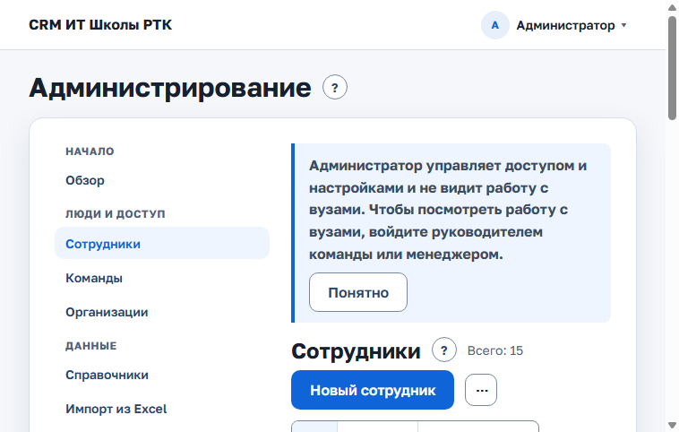

*Рисунок 21 — «Администрирование»*

### 5.2. «Настройки»

«Начало» → «Настройки» — значения, которые администратор меняет без перезапуска сервера. Три группы:

- «Сроки хранения»: «Файлы заказанных отчётов», «Контакты вузов без изменений», «Профили сотрудников с закрытым доступом», «Журнал администратора и безопасности», «Планы записи ИИ-агента», «Анкеты слушателей после окончания потока», «Журнал отправленных писем», «Входящие сообщения MAX», «Исходящие сообщения MAX», «Закрытые обращения субъектов ПДн»;
- «Пороги сигналов»: «Долго на этапе» (если у этапа нет норматива, по умолчанию 30 дней), «Данные LMS и источников устарели через», «Покрытие статусов завершения для доли завершивших» (по умолчанию 70 %);
- «Персональные данные»: «Срок ответа на обращение субъекта ПДн», «Срок ответа считать в рабочих днях (пн–пт, без праздников)», «Напоминать о сроке ответа за», «Учёт согласий контактов вузов», «Учёт согласий слушателей».

Колонки таблицы: «Настройка», «Значение», «По конфигурации» (значение конфигурации сервера), «Изменено» (дата и автор или «нет»).

**Изменить значение**

1. Введите новое число в колонке «Значение». Если число вне допустимого диапазона, под полем подсказка, например «Целое число от X до Y дн.».
2. Нажмите «Сохранить». Появится «Изменение записано в журнал и уже действует.».
3. Флажки («Включено» / «Выключено») сохраняются сразу при нажатии.
4. Чтобы вернуть значение сервера, нажмите «По конфигурации» и подтвердите в окне «Вернуть значение конфигурации?» кнопкой «Вернуть».

Каждое изменение записывается в «Журнал» как «было → стало».

Учёт согласий по умолчанию выключен: нужен ли он, решает оператор персональных данных. Когда учёт включён, согласия записывают КАМ у контакта (раздел 2.4) и менеджер учебного процесса в анкете слушателя (раздел 6.4); администратор их только смотрит (раздел 5.16).

Порог покрытия и малая база индекса — в «Индексе востребованности» (раздел 5.7), нормативы этапов — в «Шаблонах этапов» (раздел 5.6), сроки ответа вуза на перечни — в «Отчётности по соглашениям» (раздел 5.8).

### 5.3. Сотрудники: активация, роль, команда, блокировка

Страница «Сотрудники» — таблица. Колонки: «Сотрудник», «Роль», «Команда или вуз», «Логин», «Доступ», «Последний вход (МСК)». Рядом с названием — «Всего: N». Метка «Текущий сеанс» стоит у вашей строки.

**Найти сотрудника**

- Сегменты «Все», «Ожидают · N», «Заблокированы».
- Поиск по имени или логину.
- «Фильтры · N»: «Состояние» («Все», «Активные», «Ожидают активации», «Заблокированные», «Требуют синхронизации»), «Роль» (в том числе «Координатор вуза (кабинет)»), «Команда».
- «⋯» заголовка → «Выгрузить в Excel» сохраняет список по тем же фильтрам.

**Завести сотрудника**

1. Нажмите «Новый сотрудник» над таблицей.
2. Заполните «ФИО *», «Логин *» (латиница, цифры, точка, дефис; потом не меняется), «Почта *», «Роль *» и «Команда» (обязательна для КАМ и руководителя).
3. Нажмите «Завести сотрудника».
4. Дальше зависит от режима почты (раздел 5.12):
   - почта отправляет письма (режим «SMTP-сервер») — сотрудник получит письмо с одноразовой ссылкой на временный пароль, ссылка действует 72 часа; окно пишет «Ссылка на временный пароль отправлена на …», нажмите «Готово»;
   - почта выключена или в режиме «Без отправки» — окно один раз покажет «Адрес входа», «Логин» и «Временный пароль». «Скопировать пароль» копирует его. Передайте данные сотруднику лично или по защищённому каналу и нажмите «Я передал пароль, закрыть».
5. При первом входе система попросит задать свой пароль.

Флаг «Менеджер учебного процесса» ставится после создания, в «Изменить».

**Действия со строкой.** «⋯» в строке сотрудника:

- «Изменить» — окно с ролью, командой и доступом;
- «Журнал изменений» — личная история профиля;
- «Сбросить пароль» — «Выдать новый пароль»: по тем же правилам, что у нового сотрудника, — письмо со ссылкой или пароль на экране один раз;
- «Завершить сеансы» — сотрудник выйдет из CRM на всех устройствах;
- «Сбросить второй фактор» — если сотрудник потерял телефон с приложением для кодов; при следующем входе система попросит подключить новое;
- «Сменить почту» — почта учётной записи Keycloak, логин прежний.

Для своего профиля и для другого администратора сбросов и завершения сеансов нет. Администратор меняет пароль и второй фактор сам в личном кабинете Keycloak. Если доступ утерян, это делает администратор Keycloak в консоли.

**Вход с кодом.** Если это включено на сервере, администратор и менеджер учебного процесса после пароля вводят шестизначный код из приложения-аутентификатора (Яндекс Ключ, Google Authenticator, FreeOTP и другие). При первом входе система покажет QR-код: отсканируйте его приложением и введите код. Код меняется каждые 30 секунд. На демо-стенде код не нужен.

**Активировать сотрудника**

1. Сотрудник, которого завели в Keycloak вручную, после первого входа появляется на вкладке «Ожидают» (счётчик в сегменте и в меню).
2. В его строке нажмите «Активировать».
3. Откроется окно «Активация профиля: …». Проверьте «Отображаемое имя *», выберите роль (Менеджер (КАМ), Руководитель команды, Администратор, Руководство (только чтение)) и команду (обязательна для активных КАМ и руководителей).
4. Для КАМ и руководителя при необходимости отметьте «Менеджер учебного процесса: загрузка оплат и данные слушателей». Флаг откроет сотруднику раздел «Зачисление» (глава 6), пока включён модуль «Слушатели».
5. Нажмите «Сохранить» и подтвердите в окне «Подтвердите изменение доступа».

Так же меняют роль и команду у действующего сотрудника: «⋯» → «Изменить» (окно «Изменение профиля: …»). У координатора вуза вместо флажка доступа — «Доступ в кабинет вуза открыт»: администратор может только закрыть доступ, открывает его КАМ (раздел 2.17).

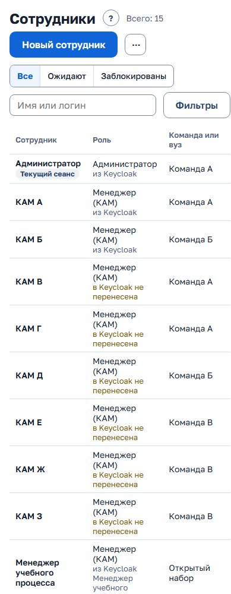

*Рисунок 22 — «Сотрудники»*

**Роль хранится в Keycloak.** У роли написано «из Keycloak». Роль, выбранная в «Изменить», сразу назначается и в Keycloak. Если роль поменяли в консоли Keycloak, она начнёт действовать при следующем входе сотрудника, но не позже чем через 12 часов (самая долгая сессия CRM; после 30 минут без действий сессия тоже заканчивается). Чтобы сразу — «⋯» → «Завершить сеансы». Команду и флаг «Менеджер учебного процесса» ведёт CRM.

- Если у роли написано «в Keycloak не перенесена», нажмите «⋯» заголовка → «Перенести роли в Keycloak». Повторное нажатие безопасно.
- Если смена роли не завершилась, под именем написано «Роль в Keycloak может отличаться». Нажмите «Сверить роль с Keycloak»: CRM запишет в Keycloak роль, сохранённую в CRM. До сверки сотрудник работает с ролью из CRM.
- Если синхронизация не удалась, под именем написано «требует синхронизации». Когда Keycloak снова заработает, нажмите кнопку в раскрытой строке.

**Своя роль в Keycloak.** В Keycloak можно завести свою роль, например «Отдел развития», и включить в неё одну из ролей CRM. Сотрудники с ней получат права этой роли.

1. Консоль Keycloak → realm «CRM ИТ Школы РТК» → Realm roles → Create role. Название — например, «Отдел развития». Save.
2. В новой роли: Action → Add associated roles → «Filter by realm roles» → выберите одну роль CRM: `crm-user` (КАМ), `crm-leader` (руководитель), `crm-management` («Руководство») или `crm-admin` (администратор) → Assign.
3. Назначьте новую роль сотрудникам (Users → сотрудник → Role mapping) или группе (Groups → группа → Role mapping).
4. Сотрудник входит в CRM с правами включённой роли. Команду назначьте в «Сотрудниках», как обычно.

Роль без роли CRM в составе прав не даёт: сотрудник увидит «Профиль CRM недоступен». Включайте в роль одну роль CRM. Если их несколько, действует старшая.

**Заблокировать сотрудника и вернуть доступ.** Отдельной кнопки «Заблокировать» нет — доступ открывает и закрывает флажок «Доступ к CRM открыт» в окне «Изменить».

1. Нажмите «⋯» → «Изменить» и снимите флажок «Доступ к CRM открыт».
2. Нажмите «Сохранить». Окно «Подтвердите изменение доступа» покажет вузы сотрудника. В «Передать вузы» выберите КАМ той же команды (или «Не передавать — вузы останутся без КАМ») и подтвердите.
3. Доступ закрывается со следующего запроса сотрудника. Выбранный КАМ получает вузы, в их истории — причина «блокировка КАМ». Если вузы не передали, они остаются без КАМ: руководитель команды видит их в колокольчике («Вузы без КАМ после блокировки»), в истории вуза та же причина. Так же при смене роли или команды КАМ.
4. Чтобы вернуть доступ, отметьте флажок заново и сохраните. Вузы автоматически не возвращаются.

Изменить собственный профиль нельзя. Систему нельзя оставить без единого активного администратора: последнего активного понизить или заблокировать нельзя.

**«Не могу войти».** В окне «Изменить» блок «Вход в систему» показывает неудачные попытки входа и временную блокировку Keycloak после подбора пароля: в списке сотрудник при этом «Активен». «Снять блокировку входа» обнуляет счётчик, пароль не меняется; действие попадает в журнал.

### 5.4. Команды и организации

**Команды.** Страница «Команды» — таблица с колонками «Команда», «Руководитель», «КАМ», «Организаций» и счётчиком «Всего: N».

- «Создать команду» — уникальное название без учёта регистра.
- Сегменты «Действующие», «Архив», «Все» и поиск по названию.
- Раскрытие строки показывает состав команды.
- «⋯» строки: «Переименовать», «Архивировать» (только команду без организаций и сотрудников, включая заблокированных) или «Восстановить».

**Организации.** Страница «Организации» — таблица всех вузов с колонками «Организация», «Тип», «Команда», «Ответственный КАМ», «Состояние».

- «Добавить организацию».
- Список «Состояние» («Действующие», «Ожидают подтверждения», «Архив», «Все») и поиск. Раскрытие строки показывает реквизиты.
- «⋯» строки: «Изменить название и реквизиты», «Подтвердить вуз», «Отклонить заявку», «Архивировать вуз» или «Восстановить вуз», «Перенести в команду…».

**Перенести вуз в другую команду:** «⋯» → «Перенести в команду…», выберите команду и нажмите «Подтвердить перенос». Текущий КАМ будет снят, организация получит статус «Требует назначения» — назначит КАМ руководитель новой команды.

### 5.5. Справочники

Страница «Справочники» — вкладки: «ИТ-направления», «ИТ-программы», «Вендоры», «ИТ-продукты», «Виды документов», «Виды взаимодействия», «Правила выбора вида», «Виды мероприятий», «Журнал изменений».

1. Откройте нужную вкладку и нажмите её главную кнопку: «Добавить направление», «Добавить программу» (в направлении), «Добавить вендора», «Добавить продукт» (у вендора), «Добавить вид документа», «Добавить вид взаимодействия», «Добавить правило» или «Добавить вид мероприятия». Откроется окно. Дубль по названию среди действующих и архивных записей отклоняется с предложением «восстановите запись», если найден архивный.
2. Сегменты «Действующие», «Архив», «Все» и поиск помогают найти запись.
3. «⋯» строки → «Переименовать» правит название.
4. «⋯» строки → «Архивировать» скрывает запись из «Нового взаимодействия» и фильтров. Направление или вендор с действующими программами или продуктами архивировать нельзя. «Восстановить» возвращает запись.
5. У вендора в «⋯» есть «Контакты»: «Добавить контакт» («ФИО *», «Телефон», «Почта», «Способ связи» — «Почта» или «Чат в Telegram», «Продукты контакта»), архивирование контакта.
6. На вкладке «ИТ-направления» у направления есть флажок «Учитывать спрос рынка труда». По умолчанию он выключен.
7. «Виды мероприятий» — виды для плана мероприятий договоров (раздел 2.11). Архив — с подтверждением. «⋯» → «Обязательные атрибуты…» задаёт, какие атрибуты мероприятия этого вида обязательны для отчётности (по умолчанию — ни одного). КАМ увидит их со звёздочкой в форме мероприятия.
8. «Виды документов» — виды, которые выбирают при загрузке документа и задают обязательными у этапов шаблона. Вид в архиве для новых документов не предлагается.
9. «Журнал изменений» показывает, кто, когда и что изменил в справочниках.

Справочник вендоров, продуктов и контактов файлом организатора загружается в разделе «Импорт из Excel» (раздел 5.10): профиль импорта «Вендоры, продукты и контакты».

**Виды взаимодействия.** Вкладка «Виды взаимодействия» → «Добавить вид взаимодействия» или «⋯» строки → «Изменить»: название, описание, «Шаблон маршрута по умолчанию» (общий шаблон; пусто — общий шаблон по умолчанию), порядок в списках, отметка «Действует». Недействующий вид остаётся у карточек и в фильтрах «Моей работы», «Контроля» и отчётов с пометкой «не действует», но не предлагается для новых. Перед отключением окно называет число незавершённых карточек вида. Последний действующий вид отключить нельзя. Вид определяет маршрут только новых карточек.

**Вид по умолчанию.** Его получает новая карточка, если КАМ не выбрал вид и ни одно правило не подошло. Такой вид один, он отмечен «По умолчанию» и назначается явно отметкой «Вид по умолчанию для новых карточек»; порядок в списке на выбор не влияет. Снять отметку или отключить вид по умолчанию можно, только назначив другой.

**Правила выбора вида.** Вкладка «Правила выбора вида» → «Добавить правило»: «Тип организации», «ИТ-программа» (только действующая), «ИТ-продукт» (хотя бы одно условие), «Вид взаимодействия» и приоритет (1 — самый высокий). Правило подставляет вид, если КАМ не выбрал его сам, а также при импорте из Excel и для заявок сайта и данных Moodle. Заявка и данные Moodle попадают только в карточку вуза с той же программой и того вида, что дают правила (заявка — только в незавершённую); если таких карточек несколько, запись уходит на разбор. При равном приоритете побеждает правило с большим числом условий. Правило с теми же условиями и приоритетом, что у другого, не сохраняется; о пересечении с правилом любого приоритета форма предупреждает и называет, какое правило выиграет или никогда не сработает. Правило отключённого вида помечено «Вид отключён — правило не действует». «⋯» → «Отключить» временно выключает правило, «Включить» возвращает; отключённое правило и правило отключённого вида не мешают новым. «⋯» → «Удалить» удаляет правило; созданные по нему карточки не меняются. Изменения справочника и правил видны в разделе «Журнал».

### 5.6. Общие шаблоны этапов и версии маршрута

**Шаблоны этапов.** Порядок работы — как в разделе 3.6: редактор, этапы с полем «Норматив, дней», явные переходы, история версий, сравнение и файлы. Администратор дополнительно ведёт базовый шаблон по умолчанию (его нельзя удалить: «Шаблон по умолчанию удалять нельзя.») и кнопкой «Сделать шаблоном по умолчанию» переносит признак общего шаблона по умолчанию на другой шаблон. Список — таблица; редактор и история версий открываются окнами по кнопкам в строке и в «⋯».

Изменение общего шаблона не меняет идущие взаимодействия сразу: взаимодействия каждой команды обновляет до новой версии её руководитель. Новый норматив этапа действует на идущие работы сразу.

**Версии маршрута** («Данные» → «Версии маршрута»). Таблица: «Команда», «Шаблон», «Последняя версия», «Работы по версиям» (например, «v1: 3, v2 (последняя): 5»), «На прежних версиях» («нет» или число). Если незавершённых работ по шаблонам нет — «Незавершённых работ, связанных с шаблонами, нет.». Переводят работы руководители команд: «Шаблоны этапов» → «История версий» → «Обновить взаимодействия до версии N»; пока у команды есть работы на прежних версиях, руководитель видит напоминание в колокольчике.

### 5.7. Индекс востребованности

«Данные» → «Индекс востребованности» задаёт, как отчёт «Востребованность программ» ставит программам место (раздел 2.15).

1. Задайте веса показателей: «Прирост записанных», «Доля завершивших», «Активность за 7 дней», «Спрос вузов», «Оплаты открытого набора». У каждого поля в подписи — значение по умолчанию. Сумма весов — ровно 100.
2. При необходимости измените «Порог покрытия, % веса с данными» (по умолчанию 50) и «Малая база, участий меньше» (по умолчанию 10).
3. Нажмите «Сохранить». Веса сразу применятся ко всем отчётам и к «Топ-5 программ» в «Сводке команд».

«Вернуть по умолчанию» восстанавливает веса 30, 25, 25, 10, 10. Каждое изменение записывается в журнал.

### 5.8. Отчётность по соглашениям

«Данные» → «Отчётность по соглашениям». Здесь задаётся всё, что зависит от требований к отчётности по соглашениям с вузами; по умолчанию ничего не включено. Какие нормативы применять, решает эксплуатант: уточните у ответственного за соглашения. Каждое изменение пишется в журнал.

Вкладки: «Настройки», «Сроки отчётного цикла», «Справочники», «Ставки», «Шаблон выгрузки».

**Настройки**

1. Выберите «Отчётный период»: «Календарный год» или «Учебный год» и «Месяц начала учебного года». Под полем — «Текущий период по настройке: …».
2. Задайте «Срок ответа вуза на перечень, дней» и «Срок ответа на повторную отправку, дней». Пусто — без согласования «молчанием»: перечень ждёт ответа сколько угодно.
3. Задайте «Напоминать о сроках цикла за, дней».
4. В блоке «Свод по исполнителям против порога» при необходимости отметьте «Показывать свод в отчёте» и задайте «Порог, % от базы», «Общая база, ₽» (пусто — сумма баз исполнителей) и «Название базы».
5. Нажмите «Сохранить».

**Сроки отчётного цикла.** «Добавить срок» → «Название», «Дата», «Что сдаётся», флажок «Ежегодно»; «Убрать» удаляет строку. Нажмите «Сохранить сроки». Сроки появляются в колокольчике КАМ и руководителя и в «Контроле». Пример в подсказке взят из приказа Минцифры № 270 и требует проверки.

**Справочники.** Переключатель «Исполнители» / «Уровни образования» / «Единицы», кнопка «Добавить». У исполнителя (организации группы компаний) можно задать «База, ₽» для порога. «⋯» строки: «Изменить название и базу» (или «Переименовать»), «В архив» / «Восстановить».

**Ставки.** «Добавить ставку» → окно «Новая ставка»: «Вид мероприятия», «Единица», «Уровень» (по умолчанию «любой»), «Действует с», «Ставка, ₽ за единицу». «⋯» строки: «Изменить», «Удалить». Оценка мероприятия — количество × ставка на дату проведения.

**Шаблон выгрузки.** Какие колонки и в каком порядке выводит «Отчёт по соглашениям», с какими подписями. Колонку можно включить или выключить, переименовать, сдвинуть стрелками ↑/↓ и добавить через «Добавить колонку». Нажмите «Сохранить шаблон». Шаблон действует на экран и на файлы XLSX, PDF и JSON. «Вернуть по умолчанию» (с подтверждением «Вернуть колонки по умолчанию?») восстанавливает все колонки.

Обязательные атрибуты мероприятия задаются у вида: «Справочники» → «Виды мероприятий» → «⋯» → «Обязательные атрибуты…» (раздел 5.5).

### 5.9. Учёт людей и часов

«Данные» → «Учёт людей и часов» — настройки для вкладки «Люди и часы» (раздел 2.13).

1. Выберите единицу часа по умолчанию для «Часы преподавания сотрудниками в вузах», «Часы стажировок (стажёра и наставника)» и «Часы повышения квалификации преподавателей»: «академический час (45 минут)» или «астрономический час (60 минут)». По умолчанию преподавание и повышение квалификации — в академических часах, стажировки — в астрономических.
2. При необходимости задайте «Срок передачи сведений в ФРДО, дней от даты удостоверения (пусто — не задан)» (1–365) и «Напоминать о передаче в ФРДО за, дней» (0–90). Без срока просрочка не считается.
3. Нажмите «Сохранить». «Вернуть по умолчанию» восстанавливает исходные значения.

Уже внесённые записи сохраняют свою единицу; отчёт приводит часы к единице из настройки. Каждое изменение — в журнале. Записи самих вузов администратор не видит.

Стажёры, преподаватели на повышении квалификации, исполнители и наставники не из справочника находятся в «Персональных данных» в группе «Учёт людей и часов»: их можно выгрузить субъекту и отметить для обезличивания (раздел 5.16).

### 5.10. Импорт из Excel и CSV

«Данные» → «Импорт из Excel» загружает вузы, справочники, историю работы и договоры из файла XLS, XLSX или CSV. Страница ведёт по четырём шагам: 1 «Файл» → 2 «Столбцы» → 3 «Проверка» → 4 «Применение».

**Загрузить файл**

1. Выберите «Профиль импорта»: «Каталог по ТЗ (10 полей)», «Направления и программы», «Вендоры, продукты и контакты», «История взаимодействий» или «Договоры с вузами».
2. При необходимости скачайте образец: «Скачать шаблон файла (10 полей ТЗ, 3 примера)», «Скачать шаблон «Вендоры, продукты и контакты»», «Скачать шаблон «История взаимодействий»», «Скачать шаблон «Договоры с вузами»». ФИО менеджера в примерах шаблона каталога вымышленное (кнопка «О шаблоне»): замените его на реального КАМ своей команды, иначе строка не сопоставится.
3. Выберите «Файл XLS, XLSX или CSV» и нажмите «Проверить файл». Сервер проверит формат и антивирусом, покажет листы. Файл CSV (UTF-8 или Windows-1251, разделитель «;» или «,» определяется сам) читается как один лист «CSV». Скрытый лист Excel помечен «(скрытый лист)».
4. Выберите «Лист». Заголовки столбцов сопоставляются автоматически. Проверьте выбор: поля со звёздочкой обязательны. Необязательные столбцы — в раскрывающемся блоке «Дополнительно» («Дополнительно: ключи, контакты и словарь статусов» у каталога, «Дополнительно: ключи и необязательные поля» у остальных профилей).
5. Нажмите «Создать предпросмотр». В «Протоколе предпросмотра» колонки «Применить», «Строка», «Результат» («Создать», «Обновить», «Без изменений», «Конфликт», «Ошибка»), «Сообщения» и «Было и станет» (кнопка раскрывает значения «Было» и «Станет»). Чтобы поправить сопоставление столбцов, нажмите «Изменить сопоставление».
6. Отметьте строки и нажмите «Подтвердить применение», затем «Применить» в окне «Применить выбранные строки?». Применяются только строки без ошибок и конфликтов. Если данные изменились после предпросмотра, применение отклоняется — создайте предпросмотр заново.

Отдельного списка прошлых загрузок нет: каждое применение импорта записывается в «Журнал» (раздел «Настройки и справочники») с профилем и числом строк. Повторная загрузка того же файла показывает уже применённые строки как «Без изменений».

**Каталог по ТЗ.** Строки одного вуза и одной ИТ-программы дают одно новое взаимодействие, ПО строк попадают в него списком продуктов. ИТ-программу задаёт необязательный столбец «ИТ-программа» в «Дополнительно» — название из справочника; неизвестное название — ошибка строки. Без программы новое взаимодействие называется «Лицензии и передача ПО (из реестра)». Без столбца «Тип организации» тип нового вуза берётся из названия: «колледж», «техникум», «СПО» — колледж; «школа», «лицей», «гимназия» — школа; иначе вуз. Должность ответственного читается только из столбца «Должность ответственного» в «Дополнительно», а не из ячейки с ФИО. Только в этом профиле есть:

- «Команда для новых организаций без КАМ (необязательно)» — по умолчанию «Не создавать такие вузы»; созданный вуз получает статус «Требует назначения»;
- выбор «Выберите КАМ для строки N», если ФИО совпало у нескольких КАМ;
- блок «Записи вузов, которых нет в загруженном реестре» с флажками «Архивировать: …»;
- раскрывающийся блок «Дополнительно: явные UUID для строк» для конфликтных строк («UUID вуза», «UUID КАМ», «UUID взаимодействия», «UUID договора»), после правки — «Перестроить предпросмотр».

**История взаимодействий.** Шаблон — «Скачать шаблон «История взаимодействий»». Обязательные столбцы: «Вуз», «Дата события» (`ДД.ММ.ГГГГ` или `ГГГГ-ММ-ДД`, можно со временем `ЧЧ:ММ`), «Тип события»: «комментарий», «переход этапа», «контакт» (или сразу канал: «звонок», «встреча», «письмо», «мессенджер», «мероприятие»), «шаг». Необязательные: «Взаимодействие» (название), «Этап» (для перехода обязателен), «Текст», «Автор» (логин сотрудника или «импорт»), «Канал», «Срок шага», «Ключ строки»; в «Дополнительно» — ключ вуза, ключ и UUID взаимодействия. Вуз должен уже быть в CRM. Если у вуза одно взаимодействие, столбец «Взаимодействие» можно не заполнять; если взаимодействия с таким названием или ключом нет, оно создаётся. Дата события не может быть в будущем. В истории карточки событие стоит на своей дате и подписано «Импортировано: файл и строка. Автор в файле: … Загрузил: …» — за действие сотрудника оно не выдаётся. Флажок «Поставить этап карточки по последнему переходу из файла (если после него в CRM переходов не было)» переводит карточку на этап самого позднего перехода, если после него в CRM переходов не было. Повторная загрузка того же файла даёт «Без изменений».

**Договоры с вузами.** Шаблон — «Скачать шаблон «Договоры с вузами»». Обязательные столбцы: «Вуз» и «Номер договора». Необязательные: «Статус» (по умолчанию «Проект»), «Дата подписания», «Действует до», «Программы» и «Продукты» (названия из справочников через «;»), «Вид мероприятия», «Мероприятие», «Плановый объём», «Статус мероприятия»; в «Дополнительно» — дата отправки на согласование, стороны, направления, единица, плановые даты мероприятия. Строка — договор и одно мероприятие его плана; для второго мероприятия повторите строку договора. Для «Действует», «Завершён» и «Расторгнут» нужна дата подписания не позже сегодняшней, «Действует до» — не раньше подписания: те же правила, что при ручном создании. Существующий договор импорт не меняет: совпадающая строка — «Без изменений», расхождение — «Конфликт» с подсказкой исправить договор в карточке. Если строки одного договора в файле противоречат друг другу (например, «Действует» и «Завершён»), все его строки получают «Конфликт» и договор не создаётся; остальные договоры файла создаются.

**Шаг по умолчанию при импорте.** Блок на той же странице: «Текст шага» и «Срок, дней» (по умолчанию «Связаться с вузом», 7 дней), кнопка «Сохранить шаг». Его получают карточки, созданные импортом, чтобы не попасть в «Без шага»; тот же шаг руководитель задаёт в «Контроле» карточкам без шага. Изменение пишется в журнал.

**Перенос из другой CRM (например, Flow).** Готовой интеграции нет; перенос идёт через файл. Нажмите «Скачать формат переноса из другой CRM (листы «Вузы», «История», «Договоры»)» (пояснение — «О переносе из другой CRM»):

1. Выгрузите из прежней системы в Excel или CSV: организации с ответственными КАМ и контактами, историю активностей (дата, тип, текст, автор, этап сделки, идентификатор активности), договоры.
2. Перенесите столбцы в листы формата. Лист «Вузы» — десять полей ТЗ, ФИО КАМ должны совпадать с сотрудниками CRM; в столбце «Автор» листа «История» — логины сотрудников CRM или «импорт». Идентификатор сделки прежней системы — в «Ключ взаимодействия», идентификатор активности — в «Ключ строки»: тогда повторная загрузка ничего не задвоит.
3. Загрузите лист «Вузы» профилем «Каталог по ТЗ», затем «История» профилем «История взаимодействий», затем «Договоры» профилем «Договоры с вузами». На каждом шаге проверьте протокол и примените строки без ошибок.
4. Исправьте ошибочные строки в файле и загрузите его ещё раз: применённые строки покажутся «Без изменений».

Импорт не создаёт учётные записи и роли: менеджер из файла должен уже быть активным КАМ. Если что-то пошло не так, в протоколе «Подробнее для поддержки» показывает «Идентификатор задания для поддержки» — сообщите его поддержке.

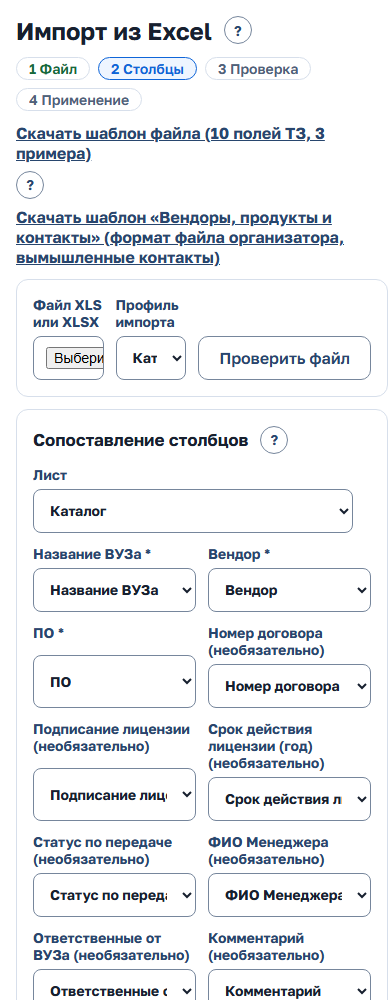

*Рисунок 23 — импорт из Excel*

### 5.11. Источники данных: Moodle, сайт, CRM заказчика и рынок труда

Страница «Источники данных» — шесть вкладок: «Сайт ИТ Школы», «LMS Moodle», «CRM заказчика», «Рынок труда», «Записи для разбора (N)», «Сопоставления». Открывается на первом источнике с проблемой. «?» у заголовка поясняет страницу, «Обновить» перечитывает состояние.

**Вкладка источника.**

- Состояние словом: «Норма», «Устарели», «Ошибка», «Выполняется», «Не настроен», «Выключен». Если синхронизация заблокирована, написана причина.
- Последний запуск (МСК) со счётчиками.
- Главная кнопка «Запустить синхронизацию» — для каждого источника отдельно.
- «Настройки подключения» раскрываются по нажатию.
- «История запусков» свёрнута.
- Ссылки на записи для разбора и сопоставления этого источника.
- Сбой синхронизации показывает строка со ссылкой на вкладку. Он не пропадает молча.

**Настройки подключения.**

- Moodle: адрес, токен, номера разрешённых курсов, роли обучающихся и преподавателей.
- Сайт: адрес и токен. Расписание плановой синхронизации — на вкладке «Сайт»; оно одно для всех источников (cron по МСК, пусто — выключено). По расписанию по очереди запускаются все настроенные источники, ручной запуск перед этим не нужен. В истории запусков и в «Журнале» плановый запуск подписан «Система»; в «Журнал» он попадает, только если что-то изменил, впервые отправил запись на разбор или завершился ошибкой. Записи, которые уже ждут разбора, плановый запуск находит снова, но новой строки в «Журнале» это не даёт; в истории запусков источника он остаётся.
- CRM заказчика: адрес и токен.
- Рынок труда: «Адрес источника» и «Токен источника», кнопки «Сохранить», «Проверить связь» и «Вернуть значения конфигурации».
- Адрес — только `https://`, курсы — числа через запятую. Токен привязан к адресу: при смене адреса введите токен заново.
- Пока на экране ничего не сохранено, действуют значения из конфигурации развёртывания. Сохранённое на экране действует сразу, без перезапуска сервера.
- «Проверить связь с …» делает пробный запрос по значениям формы и ничего не сохраняет.
- Токен после сохранения не показывается: экран пишет только «задан на экране, изменён <дата>», «задан в конфигурации развёртывания» или «не задан». Чтобы не менять токен, оставьте поле пустым. Если сменился ключ шифрования на сервере, экран попросит задать токен заново.
- «Вернуть значения конфигурации» удаляет сохранённое на экране.
- Сохранение пишется в журнал без значений токенов.

**Записи для разбора.** Вкладка «Записи для разбора (N)» — записи, которые не сопоставились автоматически: «Заявка вуза на партнёрство», «Заявка на обучение», «Оплаченная заявка (сайт)» (если включён модуль «Слушатели»), «Курс Moodle», «Группа курса Moodle», организации и контакты CRM заказчика. Найти запись помогают поле «Вуз, курс, программа или внешний ID» и фильтр по источнику.

1. В строке нажмите «Разобрать». Раскроется форма.
2. Выберите «Вуз CRM» (группы «Подходящие по данным CRM заказчика» и «Все организации»). Для контакта — «Контакт организации»; для курса Moodle — ещё «Программа CRM», «Вид потока», «Начало потока», «Последний день потока».
3. Нажмите «Сопоставить и применить» (для записи с ошибкой — «Применить повторно»).
4. Если вуза в CRM нет, раскройте «Вуза нет в CRM — создать вуз» и создайте его.

Руководитель разбирает заявки с сайта по своей команде в «Настройках команды» (раздел 3.7).

**Группа Moodle для открытого набора.** Группу потока открытого набора можно сопоставить, только если курс не сопоставлен целиком: если у курса уже есть сопоставление на весь курс, группа не примет отдельного сопоставления и придёт в «Записи для разбора». Сначала снимите сопоставление курса во вкладке «Сопоставления», затем разберите запись с группой.

**Сопоставления.** Вкладка «Сопоставления» — список «курс или группа → вуз, программа, вид потока и даты». Есть поиск и фильтр по источнику. «⋯» строки: «Изменить», «Добавить поток» и «Удалить данные участия» (у сопоставлений потоков обучения), «Снять». Удаление данных участия и снятие CRM подтверждает отдельным окном.

**Ограничения LMS.**

- Данные потока привязаны к паре «вуз + программа». Если у вуза несколько взаимодействий по одной программе, сигналы видны в каждом, а событие «Данные LMS» уходит в одно из них.
- Событие «Данные LMS» считается в «Последнем событии» взаимодействия, как действие человека.
- Если новый цикл не заведён, данные нового потока попадут в закрытое взаимодействие, и сигналов по нему не будет.
- Статус завершения запрашивается по каждому человеку, поэтому большие курсы читаются долго.
- Ночная проверка не обращается к живому Moodle. Связь проверяйте кнопкой «Проверить связь» и синхронизацией.

**Рынок труда.** Источник присылает по месяцам число открытых вакансий по ИТ-направлениям. CRM показывает их в отчёте «Востребованность программ» рядом с показателями школы. Учитывается спрос у направлений с флажком «Учитывать спрос рынка труда» (раздел 5.5). Кнопка «Показать направления» открывает таблицу «Направления с признаком «Учитывать спрос рынка труда»» с колонками «Направление», «Направление источника», «Действие»: видно, с каким направлением источника сопоставлено каждое («Подобрано по названию.», «Задано администратором.» или «Не сопоставлено…»), и «Вакансий в последнем срезе (месяц): N». Если названия не совпали, выберите направление источника в списке и нажмите «Сохранить»: отчёт учтёт выбор сразу. Персональных данных источник не передаёт.

**CRM заказчика.** Источник работает в обе стороны.

- Из неё приходят организации и контакты. Организация сопоставляется по внешнему ID, затем по ИНН, затем по названию. Контакт — по почте, затем по ФИО внутри организации. Новые организации сами не создаются. У найденной заполняются только пустые ИНН и город. Если совпадения нет или их несколько, запись попадает в «Записи для разбора»: выберите организацию или контакт и нажмите «Сопоставить и применить» либо создайте вуз из записи. Контакты с ограниченной обработкой данных не меняются.
- «Показать, что придёт из CRM» делает предпросмотр: показывает, что станет с каждой записью, и ничего не меняет.
- В CRM заказчика уходят события работы с вузом: смена этапа, следующий шаг и срок, ответственный менеджер, смена статуса договора с вузом. Данных обучающихся в них нет.
- Очередь событий видна по кнопке «Показать события»; отбор «Все события», «В очереди», «Отправленные», «С ошибкой»; статус строки — «В очереди», «Отправлено», «Ошибка». Сводка цифрами видна сразу. При сбое отправка повторяется с паузой (1, 5, 15 минут, час). После пяти неудач событие останавливается с ошибкой. «Вернуть ошибки в очередь» отправит такие события при ближайшем запуске.
- Метка «Демо-контракт» на карточке значит: источник подключён по предложенному формату обмена, совместимость с настоящей системой заказчика на демонстрационном стенде не подтверждена. Пояснение — под знаком «?» рядом с меткой.

Оплаченные заявки не создают вуз и не считаются заявками сайта — они уходят в модуль «Слушатели» (раздел 6).

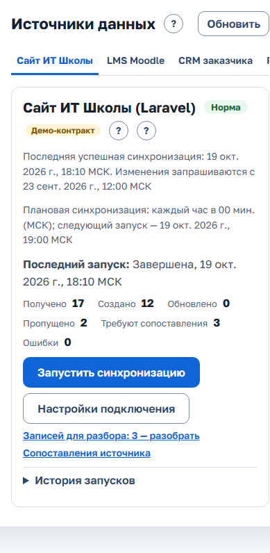

*Рисунок 24 — источники данных*

### 5.12. Почта

«Интеграции» → «Почта». Если модуль выключен на сервере, экран пишет «Модуль выключен: письма не собираются и не отправляются.» — включает его администратор сервера.

**Режим «Без отправки».** Это режим по умолчанию: письма собираются целиком и сохраняются в журнал, но наружу не уходят — так можно проверить, что и кому система пишет. Строка «Режим» сверху: «без отправки: письма собираются и сохраняются в журнал, наружу не уходят». В строке «Очередь» такие письма считаются как «записано в журнал без отправки», а не «отправлено»; в журнале у них статус «в журнале (без отправки)».

**Включить отправку писем**

1. В переключателе «Режим» выберите «SMTP-сервер».
2. Укажите сервер, порт, шифрование («без шифрования», «STARTTLS» или «TLS (SSL)»; порт по умолчанию 25, 587 или 465), логин, пароль, адрес и «Имя отправителя».
3. Нажмите «Сохранить». Появится «Настройки сохранены. Проверьте подключение.».
4. Нажмите «Проверить подключение», затем «Отправить тестовое письмо себе».

Пароль на экран не возвращается: рядом с полем написано «не задан» или «задан»; пустое поле оставляет прежний, флажок «Удалить сохранённый пароль» удаляет его. Адрес отправителя по умолчанию (crm@localhost) не мешает сохранить другие настройки; новый адрес проверяется.

**Журнал отправки.** Колонки «Время, МСК», «Кому» (адрес скрыт частично), «Письмо», «Статус», «Ошибка»; отбор «Статус». Статусы: «в очереди», «отправлено», «в журнале (без отправки)», «ошибка», «не отправлено», «отменено». «Открыть» показывает письмо. Письмо с ошибкой можно «Повторить», ждущее — «Отменить»; «Вернуть ошибки в очередь» — все сразу. Журнал хранится 30 дней по умолчанию (срок — в «Настройках»).

**Приглашения вместо пароля на экране.** В режиме «SMTP-сервер» «Новый сотрудник», «Сбросить пароль» и доступ в кабинет вуза не показывают пароль: человек получает письмо со ссылкой и сам видит временный пароль один раз. В журнале это виды писем «Приглашение: вход в CRM» и «Новый пароль: вход в CRM». Ссылка действует 72 часа; новая ссылка отменяет прежнюю. Ссылку видит только получатель: в журнале и при «Открыть» вместо неё «#/invite/***», «Повторить» отправляет адресату новую ссылку. В режиме «Без отправки» и если почта у учётной записи не указана, пароль показывается на экране. Ссылку на новый пароль администратора CRM не выдаёт.

**Письма администратору:** о сбое источника, о сотруднике, который ждёт активации, и утренняя сводка (ошибки очередей, отказы во входе). Отключить их можно в меню под аватаром → «Уведомления на почту».

### 5.13. Бот MAX

Раздел действует, когда в CRM подключён модуль MAX. Модуль включается при развёртывании сервера и по умолчанию выключен; при выключенном модуле карточки «Бот MAX» нет, а пункт «Подключить MAX» не показывается никому. Администратор уведомлений MAX не получает.

**Настроить бота**

1. Откройте «Интеграции» → «Источники данных»: там карточка «Бот MAX».
2. Вставьте токен, который выдала платформа MAX при регистрации бота, в поле «Новый токен бота» и нажмите «Сохранить токен». Появится «Токен сохранён. Проверьте связь и подпишите вебхук.». Токен шифруется и обратно не показывается. Если на сервере не задан ключ шифрования, карточка пишет, что токен сохранить нельзя.
3. Нажмите «Проверить связь»: CRM запросит у MAX имя бота. Без имени ссылки подключения для сотрудников не строятся.
4. Нажмите «Подписать вебхук»: CRM подпишется на события бота (адрес нужен с HTTPS, иначе MAX его не примет). Сервер сам следит за подпиской и при потере восстанавливает её; результат виден в строке «Подписка».
5. Когда мини-приложение подключено к боту на стороне MAX, отметьте «Мини-приложение подключено к боту на платформе MAX (кнопки сообщений открывают его)». Без отметки кнопки сообщений открывают CRM.

Новый токен сбрасывает имя бота и подписку: проверьте связь и подпишите вебхук заново.

**Состояние.** В карточке — токен, имя бота, адрес вебхука, подписка, время последнего события и очередь сообщений: ждут, ошибки, отправлено и не отправлено за сутки, входящих в разборе. «Вернуть ошибки в очередь» повторно отправляет сообщения, которые не ушли.

**Подключения сотрудников.** Таблица: сотрудник, «Роль», аккаунт MAX, состояние («подключён <дата>» или «бот остановлен <дата>») и кнопка «Отключить». Отключение закрывает сеансы мини-приложения сотрудника. Если подключений нет — «Пока никто не подключил MAX.».

Если подключить или открыть мини-приложение не получается, смотрите коды MAX_* в разделе 8.

### 5.14. Состояние модулей

«Интеграции» → «Состояние модулей» показывает, какие подключаемые модули работают (раздел 1.7). «Обновить» перечитывает данные.

Колонки: «Модуль», «Состояние», «Последняя успешная операция», «Последняя ошибка», «Переменная» (переменная окружения, которой модуль включают на сервере). Модули: «Бот и мини-приложение MAX», «ИИ-агенты (MCP)», «Почта», «Запись в Moodle», «Слушатели», «Кабинет вуза».

Состояния: «Выключен», «Включён, успешных операций ещё не было», «Работает», «Ошибок за 7 дней: N». У слушателей и кабинета вуза счётчика ошибок нет. В режиме почты «Без отправки» последняя операция подписана «письмо записано в журнал без отправки (режим «Без отправки»)»: наружу такие письма не уходят.

Включает и выключает модули администратор сервера.

### 5.15. Журнал

«Безопасность» → «Журнал» — кто, когда и что сделал. Рядом с заголовком — «Записей: N».

1. Нажмите «Фильтры» (если отбор задан — «Фильтры · N»).
2. Задайте «С даты», «По дату», «Раздел», «Автор» (часть имени) и «Объект» (вуз, команда, файл, профиль).
3. Нажмите «Показать». «Сбросить» очищает отбор.
4. «Выгрузить ▾» → «Выгрузить XLSX» или «Выгрузить CSV» сохраняет журнал по текущему отбору.

Разделы: «Профили», «Назначения КАМ», «Вузы: записи и переносы», «Команды», «Синхронизация источников», «Скачивания», «Действия с ПДн», «Сроки хранения», «Учётные записи Keycloak», «Входы и выходы», «Слушатели» (если модуль включён), «ИИ-агенты (MCP)», «Канал MAX», «Настройки и справочники», «Почта».

«Входы и выходы» — вход с ролью, отказ во входе с причиной, выход и неудачные попытки входа (они переносятся раз в несколько минут и только по существующим учётным записям). «Настройки и справочники» — справочники, записи вузов, применение импорта, шаблоны маршрута и их версии, сопоставления источников, изменения «Настроек».

### 5.16. Персональные данные

Когда это нужно: человек (сотрудник вуза, слушатель курса) обращается с запросом о своих данных.

**Найти данные субъекта**

1. Откройте «Безопасность» → «Персональные данные».
2. Заполните известные данные: «ФИО», «Почта», «Телефон». «СНИЛС» и «Другие написания (через запятую)» — в раскрывающемся блоке «Дополнительно».
3. Нажмите «Найти».
4. Результат — контакты организаций, профили сотрудников, упоминания в карточках, файлы с данными в названии, записи источников, записи учёта людей и часов (группа «Учёт людей и часов»: «Запись», «Вуз», «Период») и, по точному совпадению, анкеты слушателей модуля «Слушатели» (без значений — только то, что анкета есть, её состояние и потоки).

**Что можно сделать.** Опасные действия вынесены отдельно, каждое подтверждается отдельным окном и попадает в журнал:

- «Выгрузить ▾» (появляется после поиска) → «Выгрузить сведения PDF» или «Выгрузить сведения JSON» — полная выгрузка по запросу субъекта. В выгрузке только данные субъекта: ФИО и почта других людей из контактов и сотрудников в текстах упоминаний заменены пометкой «[другое лицо]» — и в любом порядке слов («Методистов Борис»), и с инициалами («Методистов Б.»), и без служебной приставки из справочника вроде «(демо)». Отдельное имя без фамилии не закрывается; имя самого субъекта остаётся. На экране поиска администратор видит тексты полностью.
- «Уточнить» — правка контакта (форма с полями ФИО, должность, почта, телефон).
- «Ограничить обработку» / «Снять ограничение» — у контакта и у анкеты слушателя. CRM спрашивает основание: выберите его из списка («Обращение субъекта ПДн», «Отзыв согласия», «Достигнута цель обработки», «Выявлена неправомерная обработка», «Требование Роскомнадзора», «Другое (опишите в комментарии)») и при необходимости добавьте комментарий (номер и дата обращения, без ФИО); для «Другое» комментарий обязателен. Пока ограничение действует, менеджер учебного процесса анкету не раскрывает и не меняет.
- «Обезличить» — у контакта; «Обезличить анкету» — у слушателя (дальше её уточняет менеджер учебного процесса, если нужно); «Обезличить профиль и имя в истории» — у заблокированного сотрудника (у сотрудника с открытым доступом — «Обезличить можно после блокировки в разделе «Сотрудники».»); флажок «Обезличить» есть и у записей учёта людей и часов. Отметьте записи флажками и нажмите «Обезличить…». Окно «Обезличить данные субъекта?» покажет в списке «Будет изменено:», сколько записей каких видов изменится (упоминания, имена файлов, записи источников, записи учёта людей и часов, анкеты, служебные записи, удаляемые файлы и отчёты). Выберите основание и нажмите «Обезличить».

Что меняет обезличивание:

- только записи отмеченных субъектов: у контакта — взаимодействия, вложения, записи источников и журнал его вуза, у сотрудника — вузов, с которыми он работал;
- заменяются ФИО целиком (в именах файлов — и его транслитерация целиком), полная почта и телефон; отдельные слова ФИО и строка поиска не используются, «Другие написания» — только если это ФИО целиком;
- готовые отчёты руководства, команд вузов субъекта (в том числе прежних) и самого сотрудника проверяются по содержимому файла: удаляется только отчёт, где найдено ФИО целиком, почта или телефон субъекта, — владелец видит «сформирован до обезличивания». Если файл проверить нельзя (например, диаграмма по менеджерам), он не удаляется, а помечается «Требует пересоздания». Предпросмотр показывает оба числа;
- в журнал пишется запись на каждого субъекта: объект — контакт, сотрудник или слушатель с обозначением без ПДн, основание, комментарий и счётчики изменений.

В «Других написаниях» одно слово найдётся при поиске, но при обезличивании заменено не будет — форма об этом предупреждает.

Выгрузка сведений делается только по точным данным: ФИО целиком, полной почте, телефону не короче 10 цифр — чтобы в неё не попали чужие записи.

Сами условия поиска в журнал не пишутся.

Если включена почта, в том же меню есть «Отправить сведения на почту субъекта»: в поле «Почта субъекта из его запроса» укажите адрес и нажмите «Отправить PDF» — тот же PDF уйдёт письмом, а в журнале почты вложение не сохранится. В режиме «Без отправки» письмо остаётся в журнале почты и наружу не уходит — CRM так и напишет.

**Посмотреть согласия.** Учёт согласий включается в «Настройках» отдельно для контактов и слушателей (раздел 5.2); по умолчанию выключен, нужен ли он — решает оператор персональных данных. Записывают согласия КАМ и руководитель у контакта (раздел 2.4) и менеджер учебного процесса в анкете (раздел 6.4). Администратор только смотрит:

1. Найдите субъекта.
2. В строке контакта или слушателя нажмите «⋯» → «Согласия».
3. Откроется окно «Согласия: …» со списком: «<дата>: <основание>, документ …; записал …», у отозванных — «Отозвано <дата>». Если записей нет — «Согласий не записано.».

### 5.17. Обращения субъектов ПДн

«Безопасность» → «Обращения субъектов» — журнал обращений людей о своих персональных данных и сроков ответа.

**Зарегистрировать и исполнить обращение**

1. Нажмите «Зарегистрировать обращение».
2. Заполните «Дата поступления *», «Субъект: ФИО или описание *», «Вид *» («Сведения об обработке», «Уточнение», «Удаление», «Отзыв согласия») и «Канал поступления *» (письмо, лично, через вуз).
3. «Срок ответа» можно не заполнять: он посчитается от даты поступления по настройке «Срок ответа на обращение субъекта ПДн» (подсказка под полем называет число календарных или рабочих дней).
4. В поле «Исполнитель» выберите действующего администратора («Я» — вы сами). При необходимости заполните «Примечание».
5. Нажмите «Сохранить». Появится «Обращение зарегистрировано.».
6. Исполните обращение в «Персональных данных» (раздел 5.16): выгрузите сведения, уточните, ограничьте или обезличьте.
7. Нажмите у обращения «Изменить». Выберите «Статус» — «Исполнено» или «Отказано», при необходимости «Дата исполнения» (пусто — сегодня) и запись журнала в поле «Исполнение в журнале». Нажмите «Сохранить».

Статусы: «Новое», «В работе», «Исполнено», «Отказано». Колонки таблицы: «Субъект», «Поступило», «Вид и канал», «Срок ответа» («до <дата>», «Срок <дата>» или «Срок истёк <дата>»), «Исполнитель», «Статус», «Исполнение». «Выгрузить журнал» сохраняет все обращения в CSV.

О близком и истёкшем сроке напоминает колокольчик администратора: «Срок истёк: X, срок в ближайшие N дн.: Y.» (за сколько дней — настройка «Напоминать о сроке ответа за»). В журнал CRM пишутся вид, даты и статус, без имени субъекта.

Срок ответа по умолчанию считается в календарных днях; настройка «Срок ответа считать в рабочих днях (пн–пт, без праздников)» переключает на понедельник–пятницу — праздники не учитываются, при необходимости поправьте срок у обращения.

### 5.18. Сроки хранения

«Безопасность» → «Сроки хранения» — действующие сроки и ручной запуск. Сроки меняются в «Настройках» (ссылка «Изменить сроки: «Настройки» → «Сроки хранения»», раздел 5.2).

На странице: «Файлы заказанных отчётов», «Контакты вузов без взаимодействий», «Профили уволенных сотрудников», «Журнал», «Планы записи ИИ-агента», «Закрытые обращения субъектов ПДн», время последнего запуска. Если включён модуль «Слушатели», ещё «Анкеты слушателей», «Анкет в CRM» (N из предела — условие уровня защищённости), «Потоки без даты окончания» и число анкет, требующих обновления защиты.

Сроки применяет ночная задача. Чтобы применить их сразу, нажмите «Применить сроки сейчас» и подтвердите в окне «Применить сроки хранения сейчас?» кнопкой «Применить».

## 6. Менеджер учебного процесса

Менеджер учебного процесса — специалист по подготовке данных слушателей и передаче в LMS. Его статусы не обещают больше, чем подтверждено: «файл сформирован», «передано» и «принято LMS» — разные факты. По умолчанию все менеджеры учебного процесса работают с общим реестром зачисления: списки потоков, анкеты и очередь не делятся по командам и программам.

Раздел «Зачисление» виден в шапке только сотруднику с флагом «Менеджер учебного процесса» и только пока включён модуль «Слушатели» — иначе раздела нет вовсе. Флаг администратор ставит КАМ или руководителю (раздел 5.3); у сотрудника служебной команды «Открытый набор» есть только «Зачисление» и справка. На телефоне раздел стоит вкладкой нижней панели.

У каждого экрана раздела свой адрес. Кнопка «Назад» браузера и ссылка «← Потоки» сверху возвращают на уровень выше.

### 6.1. Раздел «Зачисление»

Экран идёт сверху вниз: счётчики «Анкет в CRM» (X из предела) и «Потоков без даты окончания», очередь «Что обработать», загрузка оплат (раздел 6.2), таблица «Потоки» и «Поиск слушателя». Предупреждения «Приближается порог 100 000 анкет.» и «Срок хранения анкет не определён: укажите дату окончания потока.» передайте администратору или задайте дату окончания потока (раздел 6.3).

**Очередь «Что обработать»** — исключения по всем потокам. У каждой группы после «·» — подсказка, что делать. Если исключений нет — «Исключений нет: все слушатели переданы и приняты LMS.». Группы:

- «Перенос после передачи — нужна сверка LMS» — оплату перенесли в другой поток, когда слушатель уже был выгружен в LMS. Уберите слушателя с прежнего курса в LMS, проверьте новый и нажмите «Сверка с LMS выполнена». Если включена передача через Moodle, кнопка «Перенести в Moodle» сделает это сама: сначала зачислит на новый курс (или добавит в новую группу того же курса) и проверит, потом снимет с прежнего курса или уберёт из прежней группы. Если Moodle ответил ошибкой, слушатель остаётся в очереди, а рядом написано, что уже сделано (например, «на двух курсах»), — нажмите «Перенести в Moodle» ещё раз (раздел 6.7);
- «Ошибка LMS» — LMS не приняла строку; рядом текст ошибки. Исправьте анкету и выгрузите поток повторно. Если ошибка «Нет курса Moodle», анкета ни при чём: «Нужно сопоставить курс — обратитесь к администратору. Анкету исправлять не нужно.»;
- «Анкета изменена после передачи» — анкету правили после того, как LMS её приняла. Внесите изменения в LMS и нажмите «Сверка с LMS выполнена»;
- «Не хватает обязательных сведений» — нет фамилии, имени, телефона или почты;
- «Неоднозначное совпадение» — та же почта или телефон у другого слушателя потока; проверьте, один ли это человек, дубль объедините по СНИЛС в анкете (раздел 6.4);
- «Ожидается результат LMS» и «Файл сформирован, не передан» — ссылка ведёт в партию;
- «Готово к передаче» — ссылка ведёт в поток.

Группы «Перенос после передачи…» и «Ошибка LMS» раскрыты сразу. В группе видны первые 50 строк; «Показать ещё (показано N из M)» догружает следующие. Строка без имени подписана «Анкета без имени». Над группами — отбор «Поток» («Все потоки») и «Группа» («Все группы») со счётчиками. Анкеты с ограниченной обработкой и обезличенные в очередь передачи не попадают. Ниже — список потоков. Над таблицей — итог по стадиям сразу по всем потокам: «Оплачено», «Анкета заполнена», «Выгружено в LMS», «Принято LMS» (суммы по всем строкам).

Колонки таблицы потоков: «Курс, поток», «Программа» (если курс уже сопоставлен администратором), «Анкеты», «Стадия», «Окончание», «Действие». «Стадия» — полоса из четырёх сегментов: доля от оплаченных, дошедших до каждой стадии. Наведите указатель или используйте экранного диктора, чтобы увидеть точные числа. Стрелка «▸» у потока раскрывает «Оплачено», «Выгружено», «Принято LMS», «Ожидает» и «Хранить до».

Над итогом по стадиям — пояснение: «Выгружено в LMS» — файл для LMS сформирован, «Принято LMS» — строка принята по протоколу LMS или отметке менеджера учебного процесса; отметка «передано» без результата приёмом не считается. Если курс не сопоставлен, в колонке «Программа» — «не сопоставлена», без даты окончания — «не указана».

**Найти слушателя.** Ниже таблицы — «Поиск слушателя»: отдельное поле для email, телефона, СНИЛС и фамилии, у каждого своя кнопка «Найти». Поиск точный: введите значение полностью. Если никого нет — «Никого не нашли.».

### 6.2. Загрузить файл оплат

1. Нажмите «Загрузить файл оплат». Раскроется форма «Загрузка оплат». Пояснение к формату — кнопка «?» «Как загружаются оплаты».
2. В поле «Файл оплат (JSON)» выберите файл оплат сайта и нажмите «Загрузить оплаты».
3. После загрузки CRM покажет «Протокол последней загрузки, <дата время>»: «Получено заявок», «Пустых элементов пропущено», «Новых», «Изменились курс или поток», «Без изменений», «Повторов заявки в файле», «Курс не сопоставлен с программой», «Не приняты», «Новых слушателей», «Найдено существующих», «Зачислений», «Повторных заявок в потоке», «Перенесено в другой поток». Ниже — таблица «Потоки в файле» и «Замечания к заявкам файла» по номеру заявки (например, оплата с нераспознанным телефоном или email либо с цифрами в фамилии, имени или отчестве — поле анкеты останется пустым). Если курс не сопоставлен с программой, его заявки не считаются новыми: протокол называет такие курсы; сопоставляет курс администратор, и заявки попадают в отчёты без повторной загрузки. Если контакты в оплате отличаются от анкеты, анкета не перезаписывается — протокол об этом скажет. Протокол последней загрузки остаётся на экране и после перезагрузки страницы.

Повторная загрузка того же файла не создаёт дублей: уже принятые записи остаются без изменений, а недостающие зачисления достраиваются.

Если заявка переносит уже зачисленного слушателя в поток, которого ещё нет (часто это опечатка в номере потока), перенос не выполняется: в протоколе замечание и кнопка «Создать новые потоки и перенести». ФИО проверяется по тем же правилам, что и анкета (буквы, пробел, дефис, апостроф, точка): неверное поле не сохраняется, заявка принимается с замечанием. Пустой объект {} считается пустым элементом, как null. Сверка с LMS при переносе нужна, только если LMS уже приняла слушателя или партия передана и результат ещё не пришёл.

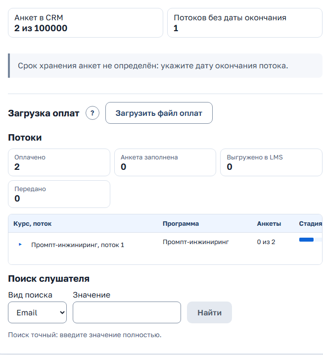

*Рисунок 25 — загрузка оплат*

### 6.3. Поток: курс Moodle и дата окончания

1. В таблице потоков нажмите «Открыть» в колонке «Действие» — откроется поток.
2. Курс Moodle потока по умолчанию берётся из сопоставлений программы: строка «Курс для передачи и переноса: по сопоставлениям программы потока». Если у программы несколько курсов или групп, укажите «Курс Moodle (номер)» и при необходимости «Группа Moodle (номер)» (группа задаётся только вместе с курсом) и нажмите «Сохранить курс». «По программе» снимает уточнение. Передача и перенос через Moodle берут уточнение. То же может сделать администратор.
3. Укажите «Дата окончания потока» и нажмите «Сохранить» — от неё считается срок хранения анкет («Хранить до: …»). Дата — не раньше чем 5 лет назад и не позже чем через 5 лет. Прошедшую дату CRM сохранит только после подтверждения в окне «Дата окончания уже прошла» кнопкой «Сохранить прошедшую дату»: если срок хранения уже истёк, ночью анкеты потока будут обезличены без возможности восстановления.
4. Таблица «Слушатели потока»: «ФИО», «Номер заявки», «Телефон», «Email», «Полнота», «Статус LMS» («Ожидает выгрузки», «Файл сформирован <дата>», «Передано, ждём результат LMS», «Ошибка LMS», «Принято LMS <дата>»), «Пометки», «Действие». «Открыть анкету» открывает анкету слушателя.

### 6.4. Анкета слушателя: просмотр, правка, согласия, объединение

Анкета разбита на группы: «Основное», «Документы», «Личные сведения», «Адрес регистрации», «Дательный падеж», «Образование». В шапке — «Заполнено X из Y» или «Анкета заполнена». Значения по умолчанию замаскированы: телефон показан как `+7 9** ***-**-34`, email — `i***@example.test`, СНИЛС — `***-***-*** 12`, остальные группы — `***`. ФИО и ФИО в дательном падеже видны полностью.

**Посмотреть значения.** Нажмите «Показать» у группы — значения раскроются, действие запишется в журнал. У группы «Дательный падеж» кнопки «Показать» нет: она видна сразу.

**Исправить анкету**

1. Нажмите «Изменить» у нужной группы. Группа раскроется (это тоже пишется в журнал) и станет формой.
2. Исправьте значения. «Пол» — «М» или «Ж», «Образование» — значение из списка.
3. Нажмите «Сохранить». Появится «Анкета сохранена».
4. Если анкету за это время изменил кто-то другой, появится «Анкета изменена другим пользователем: обновите анкету.» с кнопкой «Обновить» — обновите анкету и повторите правку.

**Объединить две анкеты одного человека.** Если при сохранении СНИЛС оказался у другого слушателя, откроется окно «СНИЛС уже есть у другого слушателя. Перенести зачисления к слушателю с этим СНИЛС?» с колонками «Текущая анкета» и «Найденный слушатель».

1. Сравните анкеты.
2. Нажмите «Перенести» — зачисления перейдут к найденному слушателю, пустые поля заполнятся из текущей анкеты, а текущая анкета удалится. Появится «Зачисления перенесены: N; повторных в тех же потоках удалено: M.».
3. Если ФИО в анкетах различаются, CRM откажет и попросит проверить СНИЛС; если это один человек (например, сменилась фамилия), нажмите «Это один человек, перенести».

**Записать согласие слушателя.** Если учёт согласий слушателей включён (раздел 5.2), в анкете есть вкладка «Согласия».

1. Откройте вкладку «Согласия».
2. Заполните «Дата согласия *» (не позже сегодня), «Основание *» и «Документ».
3. Нажмите «Добавить согласие». В списке появится «<дата>: <основание>, документ …; записал <ФИО>». Если записей нет — «Согласий не записано.».
4. Если слушатель отозвал согласие, нажмите «Отметить отзыв»: запись получит метку «Отозвано <дата>».

Записывать согласия можно только у действующей анкеты: у ограниченной и обезличенной — только просмотр.

Если уйти со страницы с несохранённой правкой группы (ссылка «← Потоки», меню, закрытие вкладки), CRM спросит «Изменения в группе «…» не сохранены. Уйти без сохранения?». Черновик анкеты не хранится: в ней персональные данные.

Вкладки «Зачисления» («Курс», «Поток», «Номер заявки», «Окончание потока», «Статус LMS») и «История» под анкетой показывают потоки слушателя и события без значений персональных данных.

Обязательные для файла LMS поля — Фамилия, Имя, Номер телефона, Email; их нельзя очистить правкой, но можно дозаполнить постепенно. Полнота анкеты показывается счётчиком «Заполнено X из Y» или отметкой «Анкета заполнена».

### 6.5. Загрузить заполненный шаблон «Загрузка пользователей»

1. На экране потока нажмите «Загрузить заполненный шаблон». Откроется окно «Загрузка заполненного шаблона».
2. В поле «Файл шаблона (XLSX или XLS)» выберите файл — CRM покажет предпросмотр со счётчиками «Обновить», «Без изменений», «Ошибок», «Конфликтов», статусом каждой строки и замечаниями по ячейкам (например, «Восстановлены ведущие нули» или «Дата должна быть в формате ДД.ММ.ГГГГ»). Столбцы не из шаблона названы отдельно: их значения не читаются.
3. Нажмите «Применить» (кнопка неактивна, если обновлять нечего). Итог: «Применено N, без изменений M, пропущено с ошибками и конфликтами K.». Повторное «Применить» того же предпросмотра не считается конфликтом: CRM ответит «Этот файл уже применён, повторно ничего не изменено.». Если анкеты изменились после предпросмотра, CRM построит его заново. В столбце «Пол» принимаются «М», «Ж», «мужской», «женский», «муж.», «жен.», «M», «F».

«Слушателя нет в потоке» означает, что строку не удалось сопоставить ни с одним слушателем потока по email, телефону или ФИО; «Конфликт» — ФИО совпало у нескольких слушателей или отличается от найденного по контактам.

### 6.6. Партия для LMS: файл, передача и результат по строкам

1. На экране потока нажмите «Выгрузить для LMS».
2. Выберите режим: «Только не переданные» или «Все слушатели потока».
3. Выберите формат: «XLSX по шаблону организатора» или «CSV Moodle «Загрузка пользователей» (логин, имя, фамилия, почта, телефон)» (паспорт, СНИЛС, адрес и диплом в CSV не попадают). XLSX — не типовой CSV Moodle: формат нужно проверить на реальном приёмнике LMS.
4. Если есть анкеты без обязательных полей, выберите «Выгрузить с пустыми ячейками» или «Исключить».
5. Проверьте «Строк в файле: N.» и нажмите «Скачать файл». Появится «Файл сформирован: партия от …, строк N. Это ещё не передача в LMS.». Каждая выгрузка — новая партия: CRM запоминает её состав, номер строки каждого слушателя в файле, версию анкеты и контрольную сумму файла. Повторная выгрузка прежнюю партию не меняет. Сформированный файл — ещё не передача.
6. Загрузите файл в LMS и нажмите «Отметить переданными» у партии в списке «Партии для LMS» (или «Отметить партию переданной» на экране партии). Строки станут «Передано, ждём результат LMS» — не «принято».
7. Откройте партию («Результат по строкам»): экран «Партия для LMS от …» с автором и «Контрольная сумма файла (SHA-256)». Внесите результат приёма:
   - «Загрузить протокол» — поле «Протокол приёма LMS (CSV или XLSX: строка, результат, ошибка)». Номер строки — как в файле партии (первая строка — заголовок). Результат: «принята», «ошибка» (с причиной) или «ожидает». Строки, которых нет в партии, и нераспознанные строки CRM перечислит;
   - или отметьте строки флажками («Выбрать все не принятые») и нажмите «Принята LMS» или «Ошибка LMS» с обязательным полем «Причина ошибки». У строки, анкету которой изменили после выгрузки, пометка «(анкету изменили после выгрузки)».
8. Итог партии: «Строк», «Принято LMS», «Ошибки», «Ожидает результата». Принятую строку изменить нельзя. Строки с ошибкой попадут в очередь «Ошибка LMS»; после исправления выгрузите «Только не переданные» — в новую партию войдут только они.

### 6.7. Передача и перенос через Moodle

Раздел действует, если подключён модуль «Запись в Moodle» и администратор задал токен записи. Тогда CRM сама зачисляет слушателей в Moodle — файл вручную загружать не нужно.

**Передать партию через Moodle**

1. Сформируйте партию (раздел 6.6) и откройте её.
2. Нажмите «Передать через Moodle». CRM найдёт пользователя по почте или создаст его, зачислит на курс потока с ролью студента и в группу, если она одна, и сверит список участников курса.
3. Дождитесь итога: «Отправлено в Moodle строк: N; принято X, ошибок Y.». Строка становится «принята» только после сверки.
4. По строкам с ошибкой прочитайте, что случилось и что делать, исправьте и нажмите «Передать через Moodle» ещё раз. Повторное нажатие отправляет только не принятые строки и второго пользователя не создаёт.

Если Moodle недоступен, передача останавливается: «Передача остановлена: … Принято N; остальные строки ждут, повторите позже.».

Частые ошибки строки:

- код Moodle в скобках, например «нет права назначать роль студента… (wsusercannotassign)», или сбой «codingerror» — к администратору Moodle, затем повторите передачу;
- «Одна почта у нескольких слушателей…» — почта служит логином Moodle, у каждого слушателя она должна быть своей (например, родитель оплатил двоим); исправьте почту в анкете;
- учётная запись Moodle с этой почтой записана на другое имя — CRM её не переименовывает и не зачисляет; проверьте, тот ли это человек;
- «Нет фамилии» («Нет имени») — заполните анкету и повторите;
- «нет курса для потока» — у программы потока нет курса Moodle или их несколько; укажите курс у потока (раздел 6.3) или попросите администратора сопоставить курс.

Имя сверяется по фамилии и имени, а если Moodle сообщает только полное имя — по словам полного имени в любом порядке (регистр и «ё» не важны, отчество допускается). Если Moodle имени не сообщает совсем, строка принимается по почте с пометкой «имя не сверено» — проверьте имя пользователя в Moodle. Логин в Moodle — почта в нижнем регистре.

**Строки из прежнего учёта.** Строки, отмеченные «принято» до учёта партий, помечены «из прежнего учёта, не сверено с LMS». Кнопка «Передать через Moodle» (если других строк нет — «Сверить с Moodle») ищет пользователя по почте и, если он есть на курсе потока, снимает пометку; в Moodle при этом ничего не создаётся и не меняется.

**Перенести слушателя в другой поток или группу**

Если оплату перенесли в другой поток, когда слушатель уже был передан в LMS, он попадает в очередь «Перенос после передачи — нужна сверка LMS» (раздел 6.1) и не попадает в «Готово к передаче».

1. В очереди нажмите «Перенести в Moodle» у слушателя.
2. CRM сначала зачислит его на новый курс (или добавит в новую группу того же курса) и проверит, потом снимет с прежнего курса или уберёт из прежней группы.
3. Если Moodle ответил ошибкой, слушатель остаётся в очереди, рядом написано, что уже сделано (например, «на двух курсах»). Нажмите «Перенести в Moodle» ещё раз.

Если такого слушателя всё же выгрузить в партию нового потока, «Передать через Moodle» его не отправит: строка получит ошибку с подсказкой нажать «Перенести в Moodle». Без модуля записи в Moodle перенесите слушателя в LMS вручную и нажмите «Сверка с LMS выполнена».

### 6.8. Что нельзя и почему это видно в журнале

- Анкету с пометкой «Обработка ограничена» («Обработка анкеты ограничена по обращению субъекта: показ и правка недоступны.») нельзя раскрыть или изменить, пока администратор не снимет ограничение (раздел 5.16).
- Обезличенную анкету («Анкета обезличена.») нельзя ни просмотреть, ни изменить — это ожидаемое состояние после истечения срока хранения или обращения субъекта, а не ошибка.
- Обязательные для LMS поля (Фамилия, Имя, телефон, email) нельзя очистить правкой, только дополнить.
- Принятую LMS строку партии изменить нельзя: ни повторной отметкой, ни протоколом, ни вторым менеджером учебного процесса.
- Снятый флаг «Менеджер учебного процесса» сразу закрывает раздел, партии и очередь.
- Каждое открытие анкеты, раскрытие группы, правка, поиск, выгрузка для LMS, результат партии и сверка пишутся в журнал администратора без значений персональных данных — по коду поля или группы. Если действие кажется недоступным, попросите администратора проверить раздел «Персональные данные»: возможно, на анкету наложено ограничение.

## 7. Координатор вуза: кабинет «Сотрудничество с ИТ Школой РТК»

Координатор вуза — назначенный со стороны вуза, колледжа или школы координатор сотрудничества с ИТ Школой РТК. Кабинет открывается по приглашению ответственного КАМ (раздел 2.17) и показывает данные только своей организации; разделы CRM для сотрудников координатору недоступны.

Координатор видит все взаимодействия и договоры своей организации, а запросы школы — только адресованные ему. Сведения о взаимодействиях, договорах и контактах в кабинете не меняются — это делает ваш менеджер.

### 7.1. Первый вход в кабинет

1. Получите от своего менеджера ИТ Школы РТК адрес входа, логин и временный пароль. Если в CRM включена почта, вместо этого придёт письмо со ссылкой: откройте её, нажмите «Показать пароль» (ссылка одноразовая и действует 72 часа), сохраните пароль и нажмите «Войти в CRM». Если ссылку открыть в браузере, где уже выполнен вход сотрудника, CRM попросит сначала выйти — ссылка при этом не тратится.
2. Нажмите «Войти» и введите логин и временный пароль. Система сразу попросит задать свой пароль.
3. Откроется кабинет «Сотрудничество с ИТ Школой РТК». Вверху — название и тип организации, имя вашего менеджера, его телефон и почта (если они заполнены в его учётной записи), ниже ссылки со счётчиками: «Требуется от вуза (N)», «Взаимодействия (N)», «Документы (N)», «Договоры (N)», «Перечни мероприятий».

Если доступ закрыт, при входе появится «Профиль CRM недоступен», а ответы на запросы больше не принимаются. Если кабинет в CRM не подключён, экран входа называется «Кабинет вуза не подключён».

### 7.2. Ответить на запрос школы

1. Откройте «Требуется от вуза». Здесь запросы школы, адресованные вам: что сделать, ожидаемый результат, срок, материалы школы и уточнения. Статусы запроса: «Ожидает ответа», «Нужны уточнения», «Ответ передан», «Принято», «Возвращено на доработку», «Отменено».
2. Напишите ответ, при необходимости приложите файл. Под полем файла — допустимые форматы и размер (до 20 МБ, имя файла до 255 символов); неподходящий файл CRM отклонит до отправки.
3. Нажмите «Отправить ответ». CRM покажет квитанцию: номер и время. Если связь прервалась, нажмите «Отправить ответ» ещё раз — второй ответ не появится, вы получите ту же квитанцию. Пока файл проверяется антивирусом, у ответа надпись «файл проверяется антивирусом».
4. Если запрос непонятен, напишите вопрос и нажмите «Задать вопрос по запросу». Ответ школы появится в блоке «Уточнение школы». Пока школа не ответила на вопрос, прислать ответ можно и самому.

«Отправлено нами, ожидает проверки» — ответы, которые проверяет менеджер, и вопросы, на которые школа ещё не ответила. Если менеджер вернёт ответ на доработку, запрос снова появится в «Требуется от вуза» с блоком «Причина возврата». «Закрытые запросы» — принятые («Принято школой.») и отменённые. Свой файл ответа можно скачать кнопкой «Скачать свой файл» после проверки антивирусом. Если кабинет пишет о конфликте, нажмите «Обновить кабинет».

Если почта включена, после приёмки ответа придёт короткое письмо «Ответ принят» со ссылкой в кабинет. Отключить его можно в меню под аватаром → «Уведомления на почту».

### 7.3. Взаимодействия, документы и договоры

- «Взаимодействия с ИТ Школой»: программа, продукт, текущий этап, «Этапы до текущего (по отметкам в CRM)» с датами и статус. Это не полная история: при возврате на прежний этап более поздние отметки сюда не попадают. «Ближайший шаг» виден, если менеджер его показал.
- «Документы»: файлы, которые менеджер открыл вузу, с номером версии («версия N (есть новая версия)», если вышла новая). «Скачать» доступна после проверки антивирусом. У материалов запроса есть кнопка «Материалы получены»: она подтверждает получение именно этой версии («Получение этой версии подтверждено …»). Новая версия приходит неподтверждённой; скачивание подтверждением не считается.
- «Договоры»: договоры вуза с ИТ Школой на всех стадиях, кроме проекта, — номер, статус («В этом статусе с <дата> (N дн.)»), предмет (мероприятия плана) и «Срок: с … по …». Если срок договора прошёл, рядом со статусом стоит «срок истёк». Если договор на согласовании, видно, у кого он сейчас: «Сейчас у вуза, круг согласования N», «Сейчас у школы, круг согласования N» или «На подписании, кругов согласования: N». Файлы договоров в кабинете не показываются.

### 7.4. Согласовать перечень мероприятий

1. Откройте «Перечни мероприятий». Здесь перечни, которые школа отправила вузу, с позициями и историей. Статусы: «Проект», «На согласовании», «Согласован», «Согласован без ответа», «Возвращён».
2. У перечня «На согласовании» проверьте позиции и срок «Ответьте до … включительно».
3. Нажмите «Согласовать» — решение записывается сразу, без отдельного подтверждения.
4. Или нажмите «Вернуть на доработку», заполните «Что нужно изменить *» и отправьте. Школа исправит перечень и пришлёт его снова.

Если указан срок ответа и вуз не ответит до его конца, перечень будет считаться согласованным («Согласован без ответа»).

## 8. Если что-то пошло не так

Сообщение об ошибке в CRM всегда сопровождается кодом и, если это ошибка сервера, номером Request ID — сообщайте его администратору вместе с описанием действия.

| Сообщение или ситуация | Что это значит | Что делать |
|---|---|---|
| В запросе есть неверные или отсутствующие поля (VALIDATION_ERROR) | В форме есть неверные или отсутствующие значения | Проверьте поля формы и подсказки под ними, исправьте значения и повторите отправку |
| Прочая ошибка запроса (BAD_REQUEST) | Запрос не выполнен по иной причине | Обновите страницу и повторите действие; если ошибка повторяется, сообщите администратору код и Request ID |
| Сессия отсутствует или истекла (UNAUTHENTICATED) | Вы вышли из системы или сессия истекла | Войдите заново — несохранённый текст останется черновиком и не потеряется |
| Действие недоступно (FORBIDDEN) | Роли не хватает прав на это действие | Действие не предусмотрено для вашей роли или области данных. Если в другой вкладке выполнен вход другим пользователем, CRM откроет главную страницу заново |
| Страница устарела (CSRF_INVALID) | После входа в другой вкладке у формы истёк токен защиты | CRM сама получает новый токен и повторяет действие. Если сообщение всё же появилось, обновите страницу и повторите |
| Слишком много запросов (RATE_LIMITED) | Слишком много запросов за минуту | Подождите столько секунд, сколько указано в сообщении, и повторите действие |
| «Профиль CRM недоступен» (CRM_PROFILE_REQUIRED) | Учётная запись подтверждена, но профиля CRM нет или он заблокирован | Обратитесь к администратору: он восстановит или создаст профиль |
| «Профиль ожидает активации администратором» (CRM_PROFILE_PENDING) | Профиль создан и ждёт, когда администратор назначит роль и команду | На экране ожидания нажмите «Сообщить администратору» и подождите активацию (раздел 1.4) |
| Действие оставит CRM без администратора (LAST_ACTIVE_ADMIN) | Нельзя понизить или заблокировать последнего активного администратора | Сначала назначьте роль администратора другому сотруднику |
| Объект не найден (NOT_FOUND) | Запись не существует или вне вашей области данных | Проверьте ссылку или номер; уточните у руководителя, не передан ли объект другому ответственному |
| Данные уже изменил кто-то другой (VERSION_CONFLICT) | Пока вы редактировали, запись изменил другой пользователь | Нажмите «Обновить карточку», проверьте новые данные и повторите своё изменение — введённый текст не теряется |
| Конфликт состояния данных (CONFLICT) | Данные изменились так, что действие сейчас невыполнимо | Обновите карточку или список и повторите действие |
| Повтор с другим содержимым (IDEMPOTENCY_CONFLICT) | Повтор той же команды пришёл с другим содержимым | Обновите страницу и выполните действие заново |
| Файл больше допустимого размера (PAYLOAD_TOO_LARGE) | Файл больше 20 МБ для вложений | Уменьшите файл или разделите его на части |
| Такой тип файла не поддерживается (UNSUPPORTED_MEDIA_TYPE) | Формат файла не входит в список допустимых | Сохраните файл в одном из допустимых форматов (раздел 2.9) и загрузите снова |
| Непредвиденная ошибка сервера (INTERNAL_ERROR) | Сбой на сервере | Повторите позже. Если ошибка не проходит, откройте «Подробнее для поддержки» и сообщите администратору код и Request ID |
| Сервис недоступен (DEPENDENCY_UNAVAILABLE) | Недоступен внешний или зависимый сервис | Повторите позже; если не проходит, сообщите администратору |
| Файл отчёта ещё формируется (REPORT_NOT_READY) | Отчёт в процессе построения | Подождите: на вкладке «Выгрузки» статус сменится на «Готово», затем скачайте файл |
| Файл отчёта нельзя выдать (REPORT_ACCESS_CHANGED) | После заказа отчёта ваши права на данные изменились | Закажите отчёт заново — прежний файл выдать нельзя |
| Файл отчёта не хранится (REPORT_RESULT_UNAVAILABLE) | Файл отчёта больше не хранится на сервере | Сформируйте отчёт заново |
| Заняты все построения отчётов (REPORT_CAPACITY_EXCEEDED) | Одновременно строится 10 отчётов — предел занят | Повторите заказ примерно через 30 секунд |
| Слишком много строк в отчёте (REPORT_ROW_LIMIT) | Отчёт или выгрузка журнала превышает предел строк (по умолчанию 50 000) |
| Слишком много подтверждений (CONFIRMATION_LIMIT) | В выборке подтверждений мероприятий больше 500 документов или архив слишком велик | Сузьте период, вуз или вид мероприятия и повторите | Сузьте период или фильтры |
| Источник не настроен (SOURCE_NOT_CONFIGURED) | LMS или сайт ещё не настроен администратором | Сообщите администратору: нужна настройка в «Источники данных» |
| CRM заказчика не ответила (CRM_EXCHANGE_FAILED) | CRM заказчика недоступна или ответила не по контракту | Проверьте адрес и токен в «Источники данных» → вкладка «CRM заказчика» → «Настройки подключения» и повторите предпросмотр |
| Синхронизация уже выполняется (SYNC_ALREADY_RUNNING) | Синхронизация этого источника уже идёт | Дождитесь завершения и посмотрите результат в истории |
| Курс LMS не сопоставлен (LMS_NOT_MAPPED) | Курс Moodle не привязан к вузу и программе | Сопоставьте курс в «Источники данных» → вкладка «Записи для разбора» (администратор) |
| Учётная запись уже есть (ACCOUNT_CONFLICT) | При заведении сотрудника или смене почты: в Keycloak уже есть учётная запись с таким логином или почтой | Проверьте логин и почту; возможно, сотрудник уже заведён |
| Данные уже обезличены (PERSONAL_DATA_ANONYMIZED) | Запись обезличена по сроку хранения или по запросу субъекта | Дальнейшие действия с этой записью недоступны — это ожидаемое поведение, не ошибка |
| Обработка данных ограничена (PERSONAL_DATA_RESTRICTED) | На запись наложено ограничение обработки | Просмотр и правка недоступны, пока ограничение не снято администратором в «Персональные данные» |
| Файл не удаётся проверить антивирусом | Технический сбой проверки | Обновите статус кнопкой «Обновить статус»; если не помогает, сообщите администратору |
| Файл недоступен (FILE_UNAVAILABLE) | Запись о документе есть, а файла в хранилище нет | Повтор не поможет: сообщите администратору, файл нужно восстановить из резервной копии или загрузить заново |
| Бот MAX ещё не настроен (MAX_NOT_CONFIGURED) | В карточке «Бот MAX» нет токена или он не проверен | Администратор вводит токен и проверяет связь: «Администрирование» → «Источники данных» → «Бот MAX» (раздел 5.13) |
| MAX не ответил (MAX_UNAVAILABLE) | Сбой на стороне MAX | Повторите позже. Сообщения не теряются: они ждут в очереди |
| MAX отклонил запрос (MAX_REQUEST_FAILED) | Например, MAX не принял подписку вебхука | Проверьте токен и адрес вебхука в карточке «Бот MAX» и повторите |
| Адрес CRM не HTTPS (MAX_WEBHOOK_URL_INVALID) | MAX примет вебхук только по HTTPS | Администратор сервера задаёт публичный адрес CRM с https:// |
| Ссылка подключения истекла (MAX_LINK_EXPIRED) | Ссылка действует 10 минут или по ней ещё никто не открыл бота | Меню под аватаром → «Подключить MAX» → «Новая ссылка» (раздел 2.18) |
| Аккаунт MAX уже занят (MAX_ACCOUNT_TAKEN) | Этот аккаунт MAX подключён к другому профилю | Подключите свой аккаунт. Если аккаунт ваш, попросите администратора отключить прежнее подключение |
| Аккаунт MAX не подключён (MAX_NOT_LINKED) | Аккаунт MAX не связан с профилем CRM | В CRM: меню под аватаром → «Подключить MAX» |
| Мини-приложение открыто не из MAX (MAX_INIT_DATA_INVALID) | Данные запуска неверны или подделаны | Откройте мини-приложение из бота CRM в MAX |
| Запуск мини-приложения устарел (MAX_INIT_DATA_EXPIRED) | Приложение открыто больше часа назад | Закройте мини-приложение и откройте снова |
| Мини-приложение недоступно для роли (MAX_ROLE_NOT_ALLOWED) | Оно доступно только КАМ и руководителю команды | Работайте в основной CRM |
| Сеанс мини-приложения закончился (MAX_SESSION_EXPIRED) | Сеанс закончился или отозван: простой 30 минут, 4 часа от входа, смена роли или отключение MAX | Приложение входит заново само; если не вышло, закройте и откройте его снова |

Полный список кодов ошибок с пояснениями открывается в CRM: меню под аватаром → «Справка» (раздел «Коды ошибок»).

**К кому обращаться:**

- Вопросы доступа, ролей, команд, блокировки — к администратору CRM.
- Вопросы по конкретному вузу, если вы не его ответственный, — к руководителю команды.
- Технический сбой, который повторяется, — администратору с текстом сообщения, кодом ошибки и номером Request ID.
